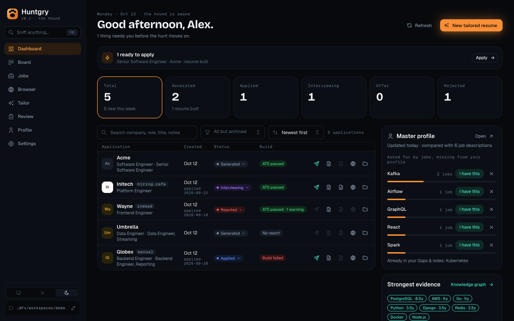
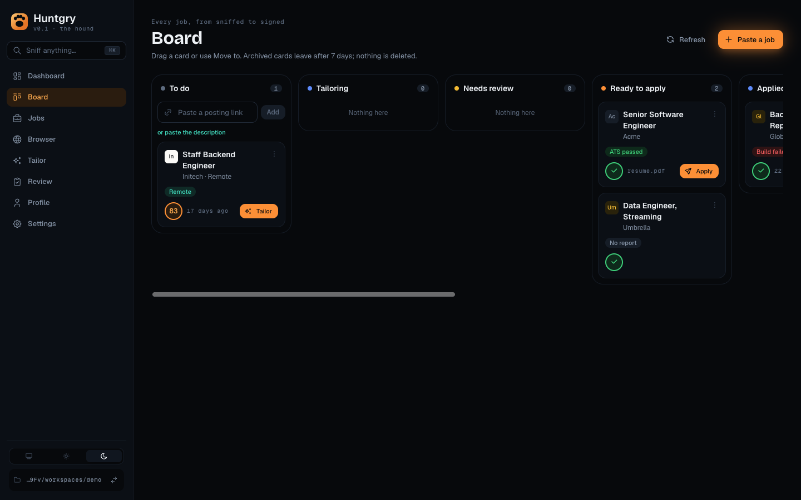
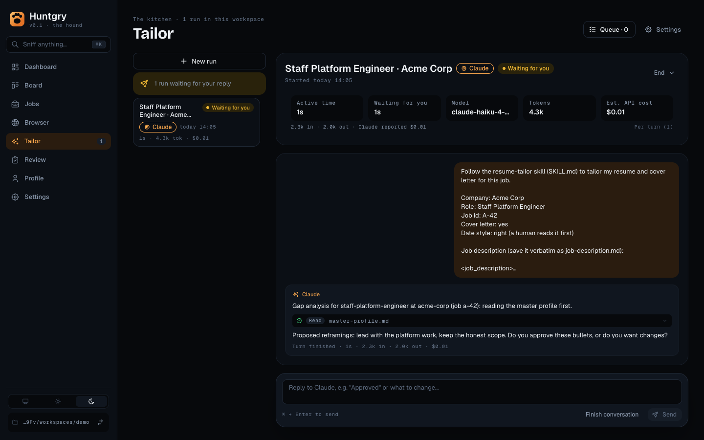
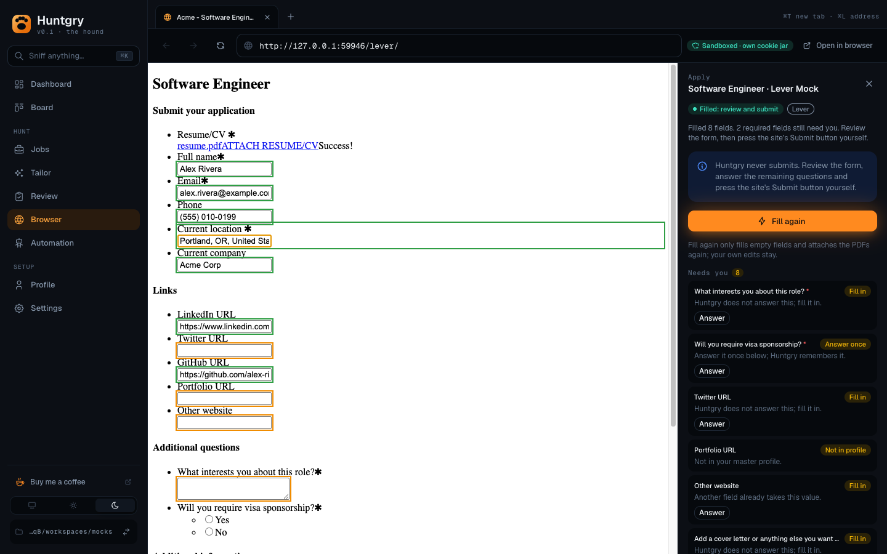
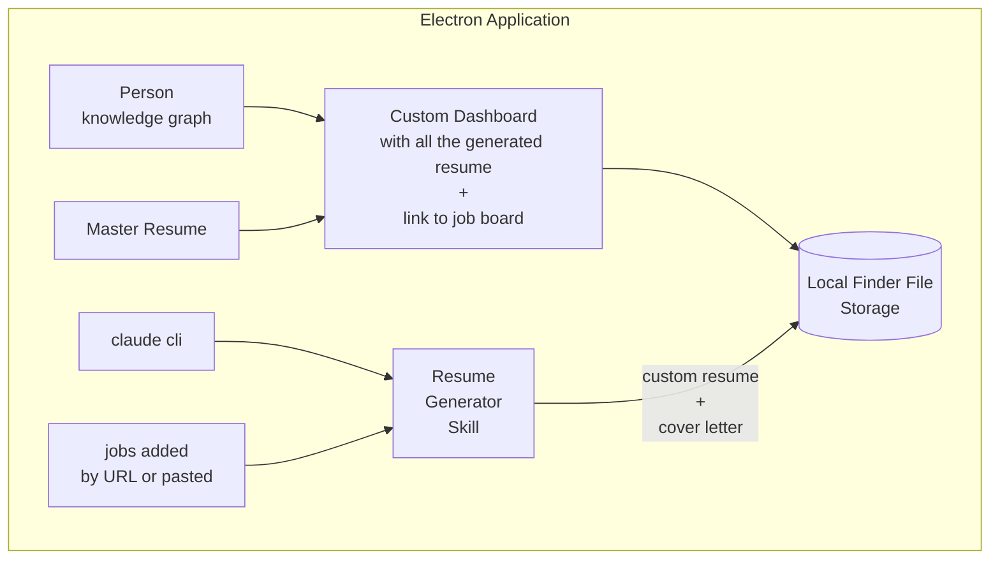

<div align="center">


# Huntgry

**A local-first desktop app (macOS first) that tracks the hunt, tailors a resume to every job with your own AI agent and fills the application form, without ever pressing Submit for you.**

[](https://github.com/silentashish/huntgry/actions/workflows/e2e.yml)
[](https://github.com/silentashish/huntgry/actions/workflows/ci.yml)
[](https://buymeacoffee.com/silentashish)



</div>

## What it does

- **Board and Dashboard**: every saved job and application in one place, from *To do* to *Offer*, with build
  results, PDFs, posting links and status tracking. See [Board](#board) and [Workspace](#workspace).
- **Tailor**: runs the [resume-tailor skill](https://github.com/silentashish/claude-resume-generator-skill)
  through Claude Code, Codex or Antigravity to write a resume and cover letter for one job, or a queue of them.
  Every run goes to the end and you check the result on **Review**. See [Tailoring a resume](#tailoring-a-resume).
- **Browser and Apply**: opens postings in a sandboxed in-app browser, fills Greenhouse, Lever and generic forms
  from your master profile and attaches the tailored PDFs. You review and submit. See [Browser](#browser) and
  [Applying](#applying).
- **Master profile and knowledge graph**: one plain Markdown file is the only store; Huntgry shows your skills
  as a graph and the ones jobs keep asking for that it has no evidence of. See
  [Knowledge graph](#knowledge-graph) and [Keeping the master profile up to date](#keeping-the-master-profile-up-to-date).
- **Remote control**: watch and steer runs from your phone over an end-to-end encrypted relay in your own
  Cloudflare account. See [Remote control (phone)](#remote-control-phone).

There is no Huntgry server and no database: the workspace is a folder on your computer, and the resumes are written by
the agent CLI you already use.

## Screenshots

<table>
  <tr>
    <td width="50%"><br><sub><b>Board</b>: every job as a card, from saved to signed.</sub></td>
    <td width="50%"><br><sub><b>Tailor</b>: a run that went to the end; its result waits on Review.</sub></td>
  </tr>
  <tr>
    <td colspan="2"><br><sub><b>Apply</b>: a form filled from your master profile in the in-app browser; you review it and press Submit.</sub></td>
  </tr>
</table>

Screenshots come from the real app with the fictional e2e demo data; regenerate them with `npm run screenshots`
(see [docs/changes/132-readme-refresh.md](docs/changes/132-readme-refresh.md)).

## Contents

- [What it does](#what-it-does)
- [Screenshots](#screenshots)
- [Initial Idea](#initial-idea)
- [Development](#development)
  - [Project layout](#project-layout)
  - [Adding a feature](#adding-a-feature)
- [Board](#board)
- [Finding jobs](#finding-jobs)
- [Browser](#browser)
- [Applying](#applying)
- [Tailoring a resume](#tailoring-a-resume)
- [Knowledge graph](#knowledge-graph)
- [Keeping the master profile up to date](#keeping-the-master-profile-up-to-date)
- [Workspace](#workspace)
  - [Master profile](#master-profile)
- [Remote control (phone)](#remote-control-phone)
- [Support](#support)

## Initial Idea

Architecture converted from [`initial-idea.excalidraw`](./initial-idea.excalidraw).



## Development

Requirements: Node.js ≥ 22.12 (developed on Node 26) and npm. macOS is the primary target.

```bash
npm install          # the Electron binary is downloaded on first launch
npm run dev          # electron-vite dev server + Electron window (HMR for the renderer)
npm test             # vitest: workspace, profile format and resume parser (no Electron needed)
npm run test:e2e     # build, then the Playwright end-to-end suite against the real Electron app
npm run test:e2e:ui  # the same suite in Playwright's UI mode
npm run typecheck    # tsc for main/preload (node), renderer (web), in-page autofill code (page) and e2e
npm run build        # typecheck + production bundles in out/
npm start            # preview the production build
npm run dist         # packaged app (Huntgry.app / dmg / zip) in release/ via electron-builder
npm run icons        # regenerate resources/icon.png + icon.icns from resources/icon.svg
npm run screenshots  # build, then retake the README screenshots in docs/assets/screenshots/
```

End-to-end tests live in `e2e/` and run the built app in a sandbox (own `userData`, `HOME`
and `PATH`, so they never see your workspace, settings or agent CLIs). How they isolate the
app, how to add a page object or a spec, how to debug a failure and what the GitHub Actions
run (optional check, `.github/workflows/e2e.yml`) leaves behind is in
[docs/testing/e2e.md](docs/testing/e2e.md).

On macOS, `npm run dev` launches the Electron binary from `node_modules`, which would
show up as "Electron". `scripts/brand-dev-electron.cjs` (run on install and before
`dev`) renames that dev copy to **Huntgry** and gives it the app icon. It only touches
`node_modules` and re-signs the bundle ad hoc.

### Project layout

```
src/
├── shared/                     # types, IPC channel names and pure helpers shared by every process
│   ├── api.ts                  # HuntgryApi = one member per feature (window.huntgry)
│   ├── events.ts               # typed main → renderer event channels + allowlist
│   └── <feature>-types.ts      # e.g. workspace-types.ts, master-profile.ts
├── main/                       # Electron main process
│   ├── index.ts                # window (contextIsolation, sandbox, no nodeIntegration)
│   ├── ipc.ts                  # calls register<Feature>Ipc() for every feature
│   ├── current-workspace.ts    # the open workspace, shared by every feature
│   ├── events.ts               # emit(channel, payload) to the renderer
│   ├── workspace/              # all filesystem logic, Electron-free and unit-tested (+ ipc.ts)
│   ├── profile/                # master-profile.md ⇄ MasterProfile (format.ts), read/save (store.ts) (+ ipc.ts)
│   ├── applications/           # scan <role>/<company>/<job-id>/, huntgry.json tracking, huntgry-file:// previews, fs.watch
│   ├── graph/                  # job descriptions for the knowledge graph overlay
│   ├── insights/               # gap insights from job descriptions, dismissals, Claude-drafted evidence
│   ├── jobs/                   # saved jobs: hidden-window posting loader and parser, .huntgry/jobs store
│   ├── browser/                # in-app browser: one WebContentsView per tab, session hardening, address rules
│   ├── apply/                  # auto-apply: session per tab, CDP resume upload, page-reply checks
│   ├── resume/                 # resume file → lines (docx, pdf, txt/md) → draft profile (parse.ts)
│   └── cli/                    # runs the resume-tailor skill via an agent CLI (claude / codex / agy), run history
├── preload/                    # index.ts composes window.huntgry from <feature>.ts + events.ts;
│                               # browser-page.ts is the in-app tabs' autofill preload (exposes nothing)
└── renderer/src/               # React 19 + Mantine UI, no Node access
    ├── navigation.ts           # pages, typed params, navigate(), leave guard
    ├── components/shell/       # AppLayout: navbar + page area
    └── pages/<page>/           # dashboard, jobs, browser, tailor, graph, profile, settings
resources/                      # app icon (svg source, png, icns)
scripts/                        # icon rendering, dev Electron branding, mock-ats.mjs + mock-ats/ (local test forms), doc link check
e2e/                            # Playwright end-to-end tests: fixtures/ (sandbox, workspaces, fake-agent/, servers/), pages/, tests/, screenshots/
```

### Adding a feature

Features only add files, plus one line in each registry:

1. **Types**: `src/shared/<feature>-types.ts` with a `<Feature>Api` interface and its IPC
   channel names; add `<feature>: <Feature>Api` to `HuntgryApi` in `src/shared/api.ts`.
2. **Main**: `src/main/<feature>/` holds the logic (Electron-free where possible, with
   `*.test.ts` next to it) and `ipc.ts` exporting `register<Feature>Ipc()`; call it from
   `src/main/ipc.ts`. Resolve paths from `requireCurrentWorkspace()`; never accept paths
   or command lines from the renderer.
3. **Preload**: `src/preload/<feature>.ts` exports the `ipcRenderer.invoke` wrappers; add
   them to the object in `src/preload/index.ts`.
4. **Streaming**: add `'<feature>:<event>': Payload` to `HuntgryEvents` and the channel to
   `EVENT_CHANNELS` in `src/shared/events.ts`; send with `emit()` from main, listen with
   `window.huntgry.on()` (returns the unsubscribe function) in the renderer.
5. **UI**: `src/renderer/src/pages/<page>/index.tsx`. A new page also needs an entry in
   `PageParams`/`PAGES` (`navigation.ts`), the navbar (`AppLayout.tsx`) and the switch in
   `App.tsx`. Open other pages with `useNavigation().navigate(page, params)`; call
   `setLeaveGuard(message)` while the page has unsaved work.

## Board

**Board** shows every job of the workspace as one card in Kanban columns: **To do** (saved jobs),
**Tailoring** (queued and running), **Needs review** (a run that needs your reply, an
unattended result to approve), **Ready to apply**, **Applied**, **Interviewing**, **Offer**,
**Rejected** and **Archived**. Paste a posting link at the top of To do to save the job, and press
**Tailor** on its card to queue it. The card then moves on by itself as the run goes. Drag a card
to another column, or use its **Move to** menu, to change an application's status or to archive a
job. Clicking a card opens its details. An archived card leaves the board 7 days after it was
archived, but nothing is deleted: **Show older** in Archived brings every archived card back, and
the *Dismissed* jobs on Jobs still list it. See [docs/changes/85-board.md](docs/changes/85-board.md).

Inside a column, cards are grouped by the week they last changed: **This week** is open, older
weeks are folded to a header with a count and open on click, showing one-line cards (hover or
focus one for the full card). The board remembers which weeks you opened or folded. Empty columns
shrink to a narrow rail that still takes drops, and each column scrolls on its own. The search box
and the source filter above the columns narrow every column at once. See
[docs/changes/160-board-week-groups.md](docs/changes/160-board-week-groups.md).

The Board is where applications are browsed: the Dashboard keeps a summary and its stat tiles open
the Board on their column (**Generated** on Ready to apply). An application's drawer, opened from its
card or from ⌘K, has everything the old Dashboard table had per row: **Apply in browser**, the
resume and cover letter PDFs, the posting, **Show in Finder**, the status, the build result and the
review state. See [docs/changes/161-board-replaces-dashboard-list.md](docs/changes/161-board-replaces-dashboard-list.md).

## Finding jobs

**Jobs** holds the postings you add: give a posting URL (the page is opened once in a hidden
browser window and its JSON-LD or text read), or paste the description. Huntgry does not
search job boards (#78). Saved jobs live in `<workspace>/.huntgry/jobs/`; ones found by the
old hiring.cafe / Indeed search are still listed. **Tailor resume** sends a job to the Tailor
page with its saved description, company, role and job id.

Jobs opens on **Relevant**: the saved jobs that fit your master profile (headline and roles,
skills, seniority, location), best first, with the reasons on each card. Filters for visa sponsorship, workplace, seniority, date posted and
minimum salary apply to any list and are kept in `<workspace>/.huntgry/jobs-prefs.json`. If your
Work authorization says you need a sponsor, Relevant leaves out postings that say they won't
sponsor.

The skills part of that score is the job's **match score**: the share of the skills the posting asks
for (Jobright's extracted skills when a job has them, else the ones its description names) that your
master profile has evidence for. Must-haves such as a degree in another field, years you don't have,
a clearance or "no sponsorship" when you need it cap it at 40. Explore, re-scoring and Automation
build on the same engine. See [docs/changes/149-match-score.md](docs/changes/149-match-score.md).

After a run builds a resume, Huntgry scores it again against the same requirements: the Board card,
the application drawer and Review show **Profile fit 82 · Resume 74 (90% surfaced)** and the skills
your profile has that the resume left out. The resume selects from the profile and never adds to
it, so the resume can't beat the fit; the score is kept in the application's `huntgry.json`. See
[docs/changes/151-rescore-after-tailoring.md](docs/changes/151-rescore-after-tailoring.md).

**Explore** lists the daily new-grad software jobs from Jobright's public GitHub list
([jobright-ai/2026-Software-Engineer-New-Grad](https://github.com/jobright-ai/2026-Software-Engineer-New-Grad)),
grouped by the day they were posted, today first. Huntgry fetches that one README from GitHub
when the page first opens and when you click **Refresh**, and keeps a copy in
`<workspace>/.huntgry/explore/jobright.json`. **Add to Jobs** saves a row as a `jobright` job.
See [docs/changes/142-explore.md](docs/changes/142-explore.md).

Jobright shows the employer's own posting link only to signed-in users. Sign in once under
**Settings → Jobright → Connect Jobright** (Explore links there until you do). After that, a job you
add from Explore, or whose full description you fetch, links the employer's posting, with the
Jobright page kept as its board link. You sign in on Jobright's own page, so Huntgry never sees
your password. See [docs/changes/146-jobright-employer-link.md](docs/changes/146-jobright-employer-link.md).

When the employer's link is only an application form, **Fetch full description** uses Jobright's
summary of the job instead (summary, responsibilities, must have, nice to have), and the drawer
says so. See [docs/changes/148-jobright-summary-fallback.md](docs/changes/148-jobright-summary-fallback.md).

## Browser

**Open posting** (Jobs) and **Posting** in an application's drawer (Board) open the job in the
**Browser** page instead of your system browser: tabs, Back/Forward/Reload/Stop, an address
bar (`jobs.example.com` is enough; there is no search engine) and **Open in browser** to
hand the page to your system browser. Tabs stay open while you use the rest of the app and
close when the app quits. Pages run sandboxed in their own cookie jar
(`persist:huntgry-browser`), with permissions (camera, notifications, location…) and
downloads refused, and cannot reach localhost or your private network. `Cmd/Ctrl+L`
focuses the address bar and `Cmd/Ctrl+T` opens a tab while focus is in the app.

Each tab is an Electron `WebContentsView` owned by the main process (see
`docs/changes/23-embedded-browser.md`), so auto-apply (#24) can drive a page:
`BrowserManager.getWebContents(tabId)`, `attachDebugger(tabId)` (Chrome DevTools Protocol,
e.g. `DOM.setFileInputFiles` for the resume upload), and unpacked extensions dropped into
`<userData>/browser-extensions/<name>/`, which load into the browser session at startup.

## Applying

**Apply** (on a Ready to apply card of the Board, **Apply in browser** in the application drawer,
**Apply** on a finished Tailor run) opens the posting's application form in a new Browser
tab, fills it from your master profile and attaches the tailored `resume.pdf` (and
`cover.pdf` when the form has a cover-letter upload). **Huntgry never submits**: you review
the page, answer the rest and press the site's own Submit button. An Apply panel beside the
page lists what was filled, attached, or left to you (custom questions, dropdowns, consent
and demographic questions are always yours). When the site shows its "application
submitted" page, the panel offers **Mark as applied**; nothing changes until you press it.

Greenhouse and Lever forms are recognised (Lever postings open on `/apply`); other sites
get a careful generic match on labels and `autocomplete` that leaves anything ambiguous
empty. Apply needs `resume.pdf` and the posting URL. See `docs/changes/24-auto-apply.md`.

To try it without applying anywhere, run the local mock ATS and allow loopback URLs in a
dev build (ignored by packaged builds):

```bash
node scripts/mock-ats.mjs                      # http://localhost:4173/{greenhouse,lever,generic}/
HUNTGRY_ALLOW_LOCAL_URLS=1 npm run dev         # then set an application's posting URL to one of them
```

The mock's routes live in `scripts/mock-ats/server.mjs`; the e2e suite mounts the same code in
its own server (`e2e/fixtures/servers/`, see `docs/testing/e2e.md`). The e2e harness
additionally sets `HUNTGRY_E2E_LOOPBACK_ONLY=1`, under which a dev build refuses every non-loopback
address outright; packaged builds ignore it too.

## Tailoring a resume

**Tailor** runs the installed resume-tailor skill through an agent CLI — Claude Code
(`claude`), Codex (`codex`) or Antigravity (`agy`) — in the open
workspace: paste a job description, or give an employer or ATS posting URL (job board URLs
such as Indeed cannot be read directly; paste those), pick the agent (the
default one from **Settings** is preselected) and press **Start tailoring**. The job is saved in
**Jobs** and queued like any other; the run goes to the end without asking (it stops only when a
prerequisite is missing), uses the bridges it can make honestly from your master profile, lists each
one in `tailoring-notes.md`, and builds `resume.pdf` / `cover.pdf`. Huntgry saves the job description
for the run, so the model never retypes it. Runs are kept in `<workspace>/.huntgry/runs/` and can be
continued afterwards ("make it shorter"). Huntgry needs resume-tailor v5; Settings offers the update
(older copies still work).

To tailor several jobs at once, tick them on **Jobs** and press **Tailor all**. Huntgry
queues one run per job in `<workspace>/.huntgry/queue.json` and starts them itself, two at a
time by default (up to four), a couple of seconds apart. The queue is shown at the top of
**Tailor**. Jobs with only a board summary (Indeed) are skipped with a note.
**Tailor all** picks one agent for the batch; each queued job can switch to another agent
until it starts, so one job can go to Claude and the next to Codex.
After a restart the queue is paused until you press **Resume**.

**Tailor all** plans the batch first and then runs it as a pipeline of up to 100 jobs. Every result,
from **Tailor all** or the Tailor page, goes through a verify gate and lands as **Unreviewed** on the
**Review** page, which shows the reframings the run used, the gaps it left open and its decisions (it
cannot be applied until you approve it); ticking a reframing saves it as a standing approval, which
later runs get as the preferred wording and which **Settings** lists. See
[docs/changes/158-single-flow.md](docs/changes/158-single-flow.md). Review decisions and standing approvals are kept with the app's data
(`~/Library/Application Support/Huntgry/review/`), outside the workspace, so an agent (which can write
the workspace) can never approve its own result. The pipeline pauses on a usage limit until the
agent's reset time (or switches the jobs that have not started to a fallback agent), retries transient failures and stalls with backoff, keeps the
Mac awake while it has work (closing the lid on battery still sleeps), resumes after a restart, stops
on an optional budget, and leaves a summary card on the Dashboard with a macOS notification and a dock
badge. See [docs/changes/31-unattended-pipeline.md](docs/changes/31-unattended-pipeline.md).

**Settings** shows whether `claude`, the skill and its dependencies are found, which
Claude Code version is installed and whether it is signed in. **Install Claude Code** runs
the official installer, **Update Claude Code** updates an older one (Homebrew installs get
the `brew upgrade claude-code` command instead), and **Install resume-tailor skill**
downloads the skill from its latest GitHub release into `~/.claude/skills`. Signing in
happens once in a terminal (`claude auth login`). The skill needs `pdflatex` (TinyTeX works without admin rights), poppler (`brew install poppler`) and
a few Python modules, which **Install Python dependencies** puts in a venv in the app's
data folder. You do not have to change your shell PATH.

The **Agents** card in **Settings** lists Claude, Codex and Antigravity with their CLI and
version, whether each can see the skill, and which one is the default. Codex and Antigravity
use the skill installed for Claude: **Install skill** links it into their own skills folder
(`~/.agents/skills/resume-tailor`, `~/.gemini/antigravity-cli/skills/resume-tailor`). Install
and sign in to those CLIs yourself (`codex login`, `agy`). See
[docs/changes/22-multi-agent.md](docs/changes/22-multi-agent.md) for how each agent is run and
isolated.

## Knowledge graph

**Knowledge graph** draws the master profile as a graph: roles, companies, projects,
education and skills, each skill backed by evidence (the roles and projects that use it)
and years of use. Job descriptions of the workspace's applications are overlaid: which of
your skills they ask for, and the technologies they ask for that the profile never
mentions (gaps). A **Skills** view lists the same data as a sortable table.

## Keeping the master profile up to date

The Dashboard's **Master profile** card compares the profile with every job description in the
workspace (applications and saved jobs) and lists the skills they keep asking for that the
profile has no evidence of. **I have this** adds evidence to an experience, project or the
skills list, optionally with a bullet Claude words from your own notes (no tools, nothing
invented: numbers not in your notes are flagged); the change is previewed and saved to
`master-profile.md`. **Not me** hides a gap (stored in `.huntgry/profile-insights.json`).

## Workspace

A workspace is the `CV_HOME` directory of the
[resume-tailor skill](https://github.com/silentashish/claude-resume-generator-skill).
On startup the app offers **Create New Workspace** and **Import Existing Workspace**
(or type a folder path; `~` is expanded).

**Create** works on a folder that does not exist yet (it is created) or an empty one
(`.DS_Store`/`.git` are ignored). A folder with other content but no master profile
(unrelated files, or an older workspace with only application folders) is set up after
the user confirms. Create never overwrites anything (existing files are skipped) and writes:

```
<workspace>/
├── master-profile.md   # empty master profile — filled from a resume or the in-app form
├── cover-letter.md     # optional base cover letter
└── CLAUDE.md           # tells Claude Code this folder is CV_HOME (--cv-home <path>)
```

After Create, the app asks how to fill the profile: **Import from a resume**
(`.docx`, `.pdf`, `.txt`, `.md`, parsed locally, reviewed in the form before saving)
or **Fill it in manually**.

**Import** only reads, and requires a master profile at the root: `master-profile.md`
(v3) or the older `master_profile.md`. A folder without one is refused with an offer to
Create a workspace there instead.

### Master profile

`master-profile.md` is the only store: there is no database. The app parses it on every
read and rewrites it on Save, and you can edit it by hand at any time. The format is
plain Markdown: one `## Section` per part of the resume, every entry a `### Heading`
followed by `- Field: value` lines, and list fields (`- Highlights:`) nesting their items.
Sections the app does not know are kept verbatim; lines it cannot place are reported
before you save. Saving is refused if the file changed on disk since it was loaded.
Applications generated by the skill land in the workspace as:

```
<workspace>/<role>/<company>/<job-id>/
├── job-description.md
├── resume_data.json, resume.tex, resume.pdf, build-report.json, resume-page-N.jpg
├── cover_data.json, cover.pdf, cover-page-N.jpg (optional)
└── huntgry.json        # Huntgry's tracking: status, applied date, notes, posting URL, source
```

The **Board** shows them as cards with their build result; an application's drawer links to the
PDFs and the job posting, tracks each one (generated → applied → interviewing → offer / rejected /
archived) and previews the pages. The **Dashboard** counts them by status. Both refresh when
folders change on disk.

| Status | Meaning |
| --- | --- |
| `valid` | `master-profile.md` at the root; ready for the skill |
| `legacy` | `master_profile.md` (importable), or application folders only (Create adds a profile after confirmation) |
| `empty` | existing folder with nothing in it; Create allowed |
| `missing` | folder does not exist, parent is writable; Create allowed |
| `not-a-workspace` | unrelated content, no master profile; Create after confirmation, Import refused |
| `unverified` | too large to check (scan stopped before finding a profile or application folder); pick the workspace folder itself |
| `invalid` | not a directory, not readable/writable, relative path, or parent missing |

See [docs/changes/2-electron-workspace-shell.md](docs/changes/2-electron-workspace-shell.md),
[docs/changes/4-master-profile-flow.md](docs/changes/4-master-profile-flow.md),
[docs/changes/7-app-shell.md](docs/changes/7-app-shell.md),
[docs/changes/8-claude-runner.md](docs/changes/8-claude-runner.md),
[docs/changes/9-applications-dashboard.md](docs/changes/9-applications-dashboard.md),
[docs/changes/10-job-boards.md](docs/changes/10-job-boards.md),
[docs/changes/11-knowledge-graph.md](docs/changes/11-knowledge-graph.md)
and [docs/changes/12-profile-insights.md](docs/changes/12-profile-insights.md) for the design notes.

## Remote control (phone)

Huntgry can be watched and steered from a phone: status, the queue, a run's transcript and
reply, push notifications when a run needs you. The phone talks to the Mac through a small
relay you run in your own Cloudflare account; every message is end-to-end encrypted per
device, the Mac only makes outbound connections, and nothing on the phone can submit an
application. Design and threat model: [ADR-0001](docs/adr/0001-mobile-remote-control-relay.md).

1. **Deploy the relay** (once): `npx -w relay wrangler login`, then `npm run deploy -w relay`.
   It prints the relay URL (`https://huntgry-relay.<you>.workers.dev`) and an admin token,
   once. Details in [relay/README.md](relay/README.md).
2. **Connect the Mac:** Settings → Remote control → paste the **Relay URL** and **Admin
   token**, turn on **Enable remote control**. The Mac stores both encrypted and uses the
   token only to create its room.
3. **Install the app** on the phone: TestFlight or an Android APK, see
   [mobile/RELEASE.md](mobile/RELEASE.md); or a local build, see [mobile/README.md](mobile/README.md).
4. **Pair:** Settings → Remote control → **Pair a phone** shows a QR for 2 minutes; scan it in
   the app and approve "A phone wants to pair" on the Mac. The app then asks whether it may
   send notifications.

**Revoke** a phone in the device list on the Mac: the relay forgets its token and push token
at once and the phone deletes its keys the next time it connects. **Unpair** on the phone
deletes its keys and push token too (revoke it on the Mac as well). **Rotate relay
credentials** removes every phone and gives the Mac a new identity and room; pair again
afterwards. Lost the admin token? Run the deploy script again; existing rooms keep working.

**What leaves the laptop, and who sees it** (ADR-0001, "Security model"):

| Party | Sees | Never sees |
| --- | --- | --- |
| Phone | Decrypted status, transcripts and PDFs it asked for. | `master-profile.md`, paths, credentials. |
| Relay (your Cloudflare account) | Ciphertext, sizes, timing, room and device ids, IPs, push tokens, push categories, the notification text if details are on. | Plaintext of any message. |
| Expo push service, then Apple (APNs) / Google (FCM) | Push token, the fixed generic body ("A run needs your reply") and the category, the notification text if details are on, delivery timing. | The encrypted channel. |

Job and company names reach Expo, Apple and Google only with **Show details in
notifications** on (off by default).

**Costs:** the relay runs on the Cloudflare Workers Free plan (100k requests a day; hibernated
Durable Objects are not billed for duration; Paid is $5/month if ever exceeded). Expo push is
free, and EAS Build's free plan includes 15 iOS and 15 Android builds a month. iPhone push and
TestFlight need the Apple Developer Program ($99/year); without it a local build on a free
Apple ID works without push and expires after 7 days. TestFlight internal builds expire after
**90 days**. Google Play internal testing needs a Play Console account ($25 once); a preview
APK needs none.

## Support

Huntgry is a free, personal project. If it saved you an evening of rewriting resumes, you can buy me a coffee:

<a href="https://buymeacoffee.com/silentashish"></a>

Bug reports and ideas are just as welcome in [Issues](https://github.com/silentashish/huntgry/issues).
