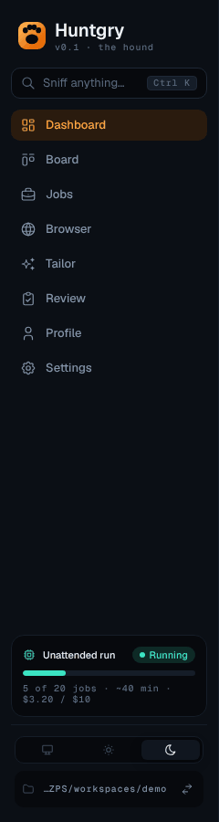
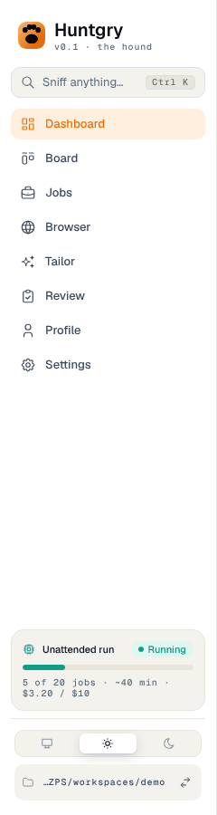
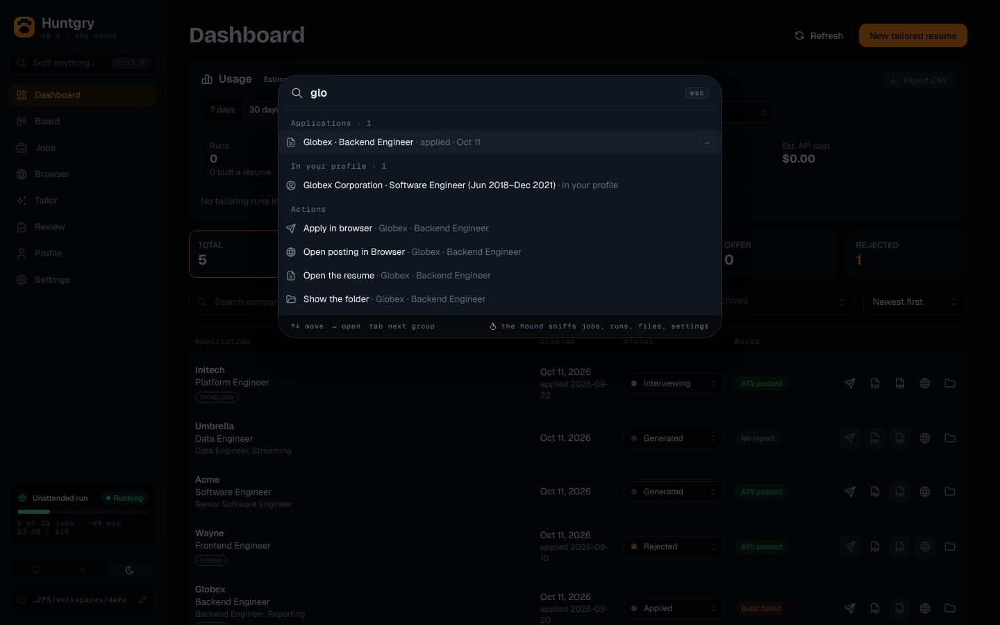
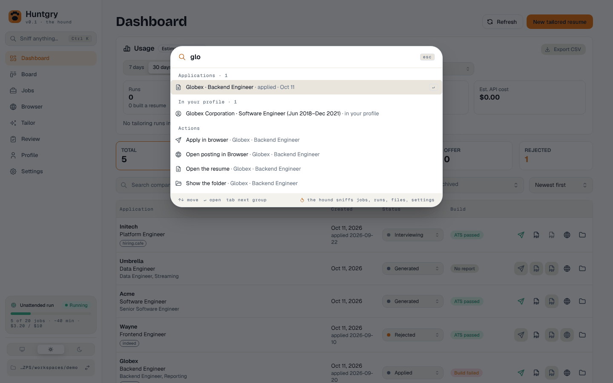
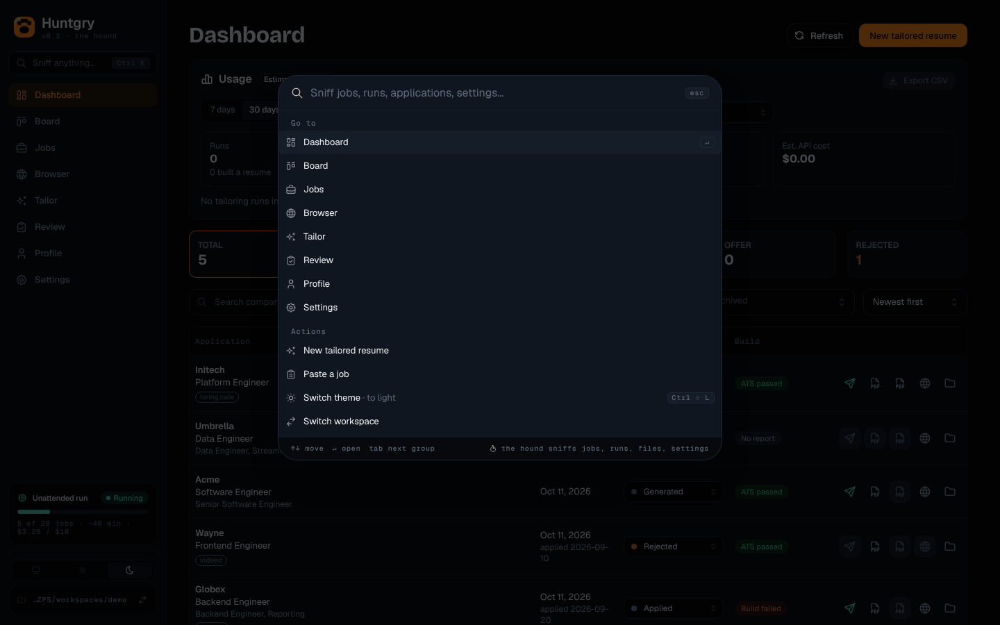

# #108 — App shell: sidebar, theme toggle, pipeline mini-card, ⌘K "Sniff" palette

Issue: [silentashish/huntgry#108](https://github.com/silentashish/huntgry/issues/108) · Epic #95 (redesign 2/11) · Builds on #107 (foundations).
Figma: Dashboard `5:2` (Sidebar `5:3`), Dashboard — Command palette (⌘K) `17:352` (palette `17:968`), and their App · Light twins (`18:531`, `18:2688`).

## What changed

| Area | Files | What |
| --- | --- | --- |
| Sidebar | `components/shell/Sidebar.tsx`, `shell.module.css`, `version.ts` (paw logo from `components/ui`) | Paw logo, "Huntgry", mono version line (`v0.1 · the hound`, from package.json through a Vite `define`, the same version `app.getVersion()` reports). "Sniff anything…" button with the ⌘K / Ctrl K hint opens the palette. 8 nav items with icons and no description lines, Ember active state (`data-active`, `aria-current="page"`). Count badges on Tailor (runs waiting for a reply + runs working) and Review (unattended results waiting). Bottom: unattended pipeline mini-card, System / Light / Dark toggle, workspace path (mono, truncated at the start, full path in a tooltip) with a Switch workspace button. |
| Counts | `components/shell/useNavCounts.ts`, `counts.ts` | Runs from `runner.listRuns()` once, then `runner:run` events; Review from `review.list()`, re-read (debounced) on `applications:changed` / `pipeline:changed`. |
| Pipeline card | `components/shell/pipelineMini.ts` | Shown while a pipeline exists and is not finished (`usePipeline`): status pill (Running / Paused / Waiting / Budget hit / Stopping), trail progress bar, `N of M jobs · ~X min · $spent / $budget` (time only while running, budget only when set). Clicking it opens Tailor → Queue. |
| Leave guard | `components/shell/AppLayout.tsx` | The navigation guard asks with the Profile page's `ConfirmModal` (#115, Figma leave guard 17:1030): warning icon tile, "Discard unsaved changes?", the page's message, Keep editing / Discard and leave. `navigate()` still runs the guard check synchronously. |
| Layout | `components/shell/AppLayout.tsx` | Content column 1136 px (Figma: 1440 − 240 − 2 × 32) with 32 px padding; FULL_BLEED / WIDE pages unchanged. The sidebar stays the only `navigation` landmark. |
| Navigation | `navigation.ts` | `PAGES` is 8 entries (`NavPage = Exclude<Page, 'graph'>`). `redirect()` (applied by `locationOf`, so by every `navigate` and the initial location) turns `graph` (+ `nodeId`) into `profile` with `{ view: 'graph', nodeId }`; no location is ever on `graph`, and callers such as the Dashboard's "Knowledge graph" link need no change. `PAGE_LABEL` ("Master profile" → "Profile", per Figma). `settings` gains `{ section?: SettingsSection }` (the 8 sections of Figma's Settings section nav) and `SETTINGS_SECTION_LABEL`. |
| App | `App.tsx` | No `graph` case any more (the redirect covers it); passes the master profile to the shell for the palette. |
| Palette | `components/palette/` | `search.ts` (entries, scoring, grouping; pure), `CommandPalette.tsx` (Mantine `Modal.Root` + input + listbox), `usePaletteData.ts`, `palette.module.css`. No new dependency. |
| e2e | `e2e/pages/shell.ts`, `e2e/tests/shell.spec.ts`, `e2e/tests/graph.spec.ts` | 8 entries, `Profile` label, palette helpers (`openPalette`, `paletteOption`, `paletteGroup`, `sniff`, `openGraph`), theme buttons; graph spec opens the graph through the palette. |

### The palette ("Sniff")

- Opens with ⌘K on macOS / Ctrl+K elsewhere on every page (ignored with other modifiers; Ctrl+K on macOS is left to text fields, where it deletes to the line end), and from the sidebar button. ⌘K again or Escape closes it. ⌘⇧L / Ctrl+Shift+L switches the theme.
- Searches pages, Profile views (Knowledge graph, Skills), Tailor → Queue, Settings sections, saved jobs, applications, tailor runs, and the master profile (roles, projects, skills). Loads jobs / applications / runs / review list each time it opens.
- Ranking: every query word must match; word start 100, start of a later word 80, inside a word 50, letters in order inside one word 15; the title counts fully, subtitle × 0.6, hidden keywords × 0.5; exact title +40, title prefix +20. Groups are ordered by their best match; up to 5 entries per group (8 for Go to), with counts on entity groups (`Jobs · 2`).
- The best job or application lends its actions to the Actions group, as in the frame: "Tailor a resume for X…" (readies the job like the Jobs page does, then opens the Tailor form), "Open posting in Browser", "Apply in browser" (the existing `useApply`: confirm when already applied, then the Browser page), "Open the resume", "Show the folder". General actions: New tailored resume, Paste a job (the Jobs page's own paste dialog, then Jobs), Switch theme, Switch workspace (behind the unsaved-changes guard).
- Keyboard: ↑ / ↓ move (wrapping), Enter opens, Tab / Shift+Tab jump to the next / previous group, Escape closes; Mantine's focus trap keeps focus in the dialog and returns it on close. ARIA: `dialog` "Sniff", `combobox` with `aria-activedescendant`, `listbox` "Results", `group`s named by their headings, `option`s with `aria-selected`.
- The in-app browser is a native view drawn above the page, so the palette (and its paste / error dialogs) hides it while open on the Browser page and shows it again after. Keys typed inside a browser tab never reach the app window, so the tabs' own shortcuts (and the Browser page's ⌘L / ⌘T) are untouched.
- "Settings → Pricing" etc. navigate to `settings` with `{ section }` and the shell scrolls the card with `data-settings-section="<id>"` (#116) into view once it is drawn. The ids (`SettingsSection` in `navigation.ts`, Figma's section nav order): `agents`, `standing-approvals`, `saved-answers`, `pricing`, `claude`, `skill-dependencies`, `remote-control`, `appearance`. They are the 8 sections of the Settings page (#116), which marks its cards with these ids.
- Commands that leave the page (Tailor a resume, Apply, Switch workspace, and every page jump) run inside the shell's unsaved-changes guard, so nothing happens (no job marked tailored, no Apply session) when the user keeps editing.
- The native browser view is hidden while the palette, its Paste a job dialog, its error dialog or Apply's "Already applied" question (`useApply().confirmOpen`) covers the Browser page. It is shown again only if the Browser page is still the current location: choosing another page closes the palette in the same commit as the Browser page unmounts and hides its view, and it must stay hidden.
- "Paste a job" navigates to `jobs` with a fresh `{ reload }`; `App.tsx` keys the Jobs page on it, so the page is drawn afresh with the new job even when it was already on screen (no change in the Jobs page).
- **Known limitation:** ⌘K does not open the palette while focus is inside a page of the in-app browser, because those keys go to the page's own web contents and never reach the app window.

## Screenshots

| | Dark | Light |
| --- | --- | --- |
| Sidebar (pipeline running) |  |  |
| Palette, query `glo` |  |  |
| Palette, opened |  | |

## Deviations from Figma

- **Theme toggle has three options** (System / Light / Dark) instead of the frame's two; the ticket and `useThemePreference` have System.
- **Version line** shows the real version (`v0.1`), major.minor like the frame; the full version is its tooltip.
- **Workspace path** shows the full absolute path, truncated at the start, not `~/…`: e2e asserts the exact path and the renderer has no home directory.
- **⌘K hint** reads `Ctrl K` off macOS.
- **Kbd hints in the palette**: only `↵` on the selected row and `⌘ ⇧ L` on Switch theme are shown, because only those work. The frame's single-letter hints (T / O / A, `G B`) would steal typing from the search box.
- **No "Board → Ready to apply" deep link**: the Board takes no column parameter. Go to lists the 8 pages, the Profile views, Tailor → Queue and the Settings sections.
- **Applications open** on Review when they wait for review, otherwise their resume (or folder): the Dashboard's drawer has no navigation parameter.
- **Jobs open** their posting in the Browser (or the Tailor form when they have no URL): the Jobs drawer has no navigation parameter.
- **Tailor badge** counts runs waiting for a reply plus runs working (the label says which); neutral tone, like the frame.
- **Footer** says "tab next group" (what Tab does) instead of "tab actions".
- The paw logo is the shared `components/ui/PawLogo.tsx` (deduplicated with #117 after both merged).

## Coordination

- **Profile (#115)** renders the Editor / Knowledge graph / Skills views from `params.view` and `params.nodeId`; with it merged, the `graph` redirect lands on the graph view and `graph.spec.ts` reaches it through Profile's view switch.

## How it was tested

- Component (jsdom): `components/shell/AppLayout.test.tsx`. On Browser, ⌘K then Enter on "Jobs" leaves the native view hidden (the last `setVisible` call is `false`); closing the palette there shows it again; other pages never touch it; Enter runs the selected row and the arrows move; Tab / Shift+Tab move between groups; a palette command behind the leave guard does nothing on Keep editing and runs on Discard and leave. `components/shell/useNavCounts.test.tsx`: the counts, `runner:run` updates, a debounced review re-read, and an event that arrives before the list.
- Unit: `navigation.test.ts` (8 entries, graph → profile redirect with and without `nodeId`, other locations untouched, settings section), `components/palette/search.test.ts` (normalization, word scores, ranking, empty query, grouping with counts, lent actions, commands for jobs / applications / runs / sections / graph, caps, skills deduplicated by case, no match), `components/shell/shell.test.ts` (pipeline card facts, hide when finished, zero total, badges, version line).
- `npm run typecheck:web`, `typecheck:node`, `typecheck:e2e`, `npx vitest run`, `npx electron-vite build`.
- e2e under `xvfb-run` on Linux (DISPLAY / XAUTHORITY passed by a local, uncommitted edit of `e2e/fixtures/app.ts`): `shell.spec.ts` (9 tests: every entry, theme toggle, version line, palette open / close by key and button, arrow keys + Enter, applications / jobs / actions, Tailor from a job, graph → Profile, Settings section, typing in a field) plus `dashboard`, `jobs`, `board`, `tailor`, `profile-editor`, `settings`, `browser`, `review-gate`, `tailor-review-refresh`, `workspace`, `insights`: all pass except `jobs.spec.ts:200` and `profile-editor.spec.ts:174` (the known Linux-only failures). After merging main (with #115, #116, #111…): `shell`, `graph`, `profile-editor`, `settings`, `jobs`, `browser`, `dashboard` pass, except the same two Linux-only failures.
