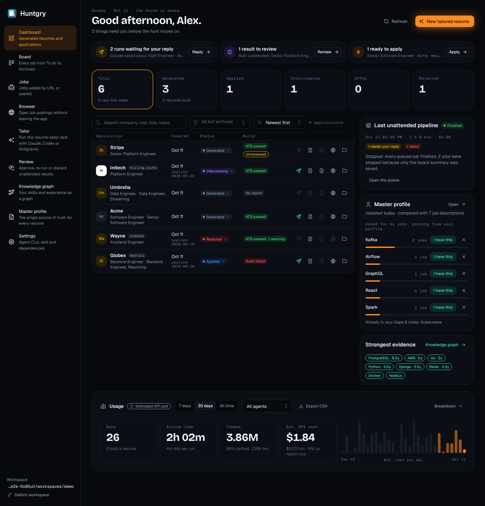
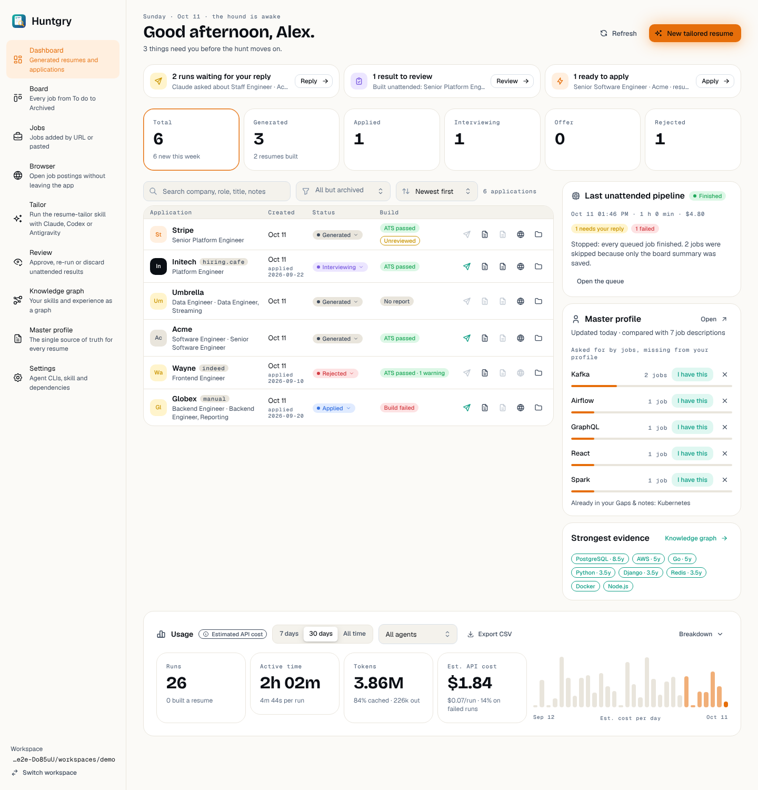
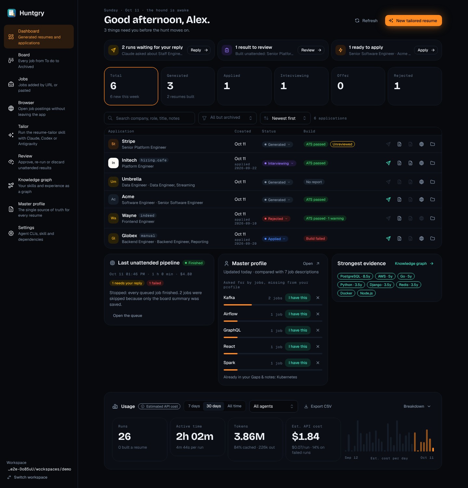
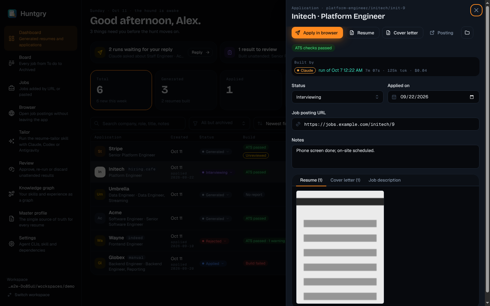
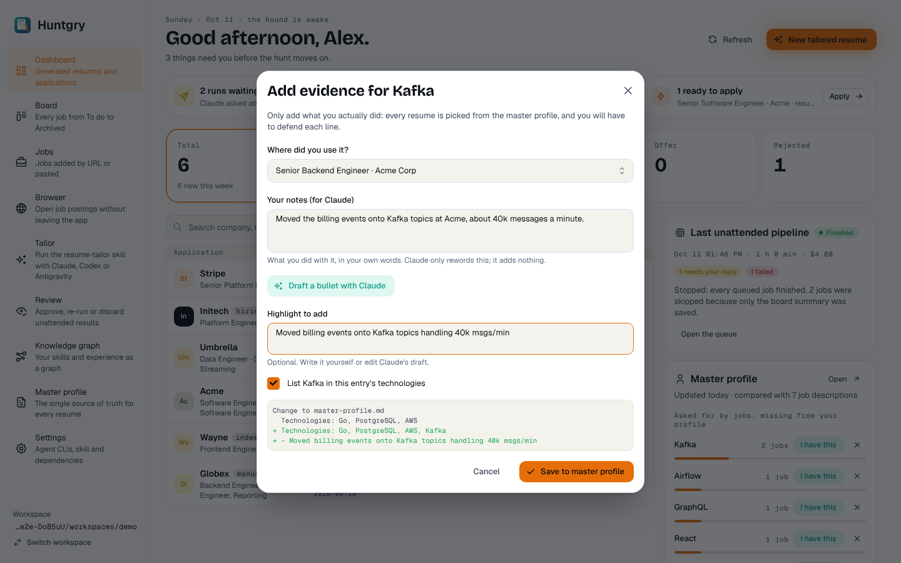
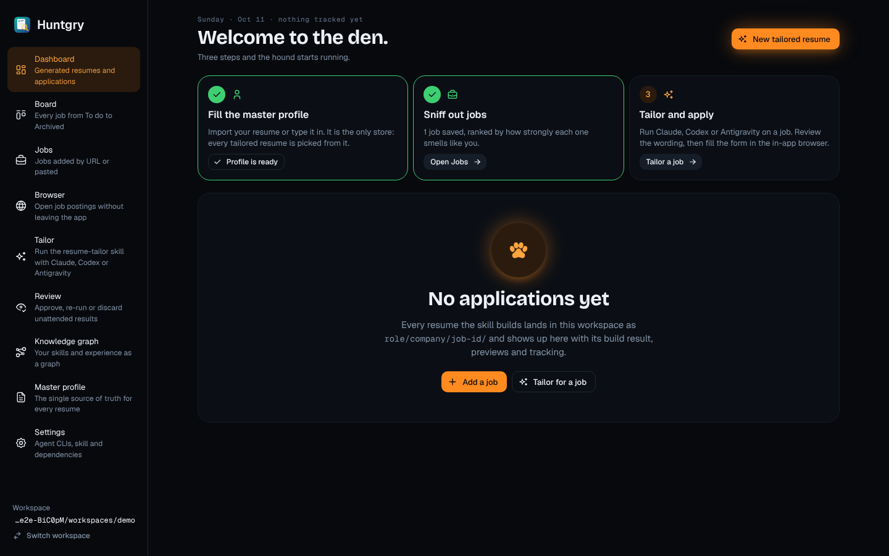
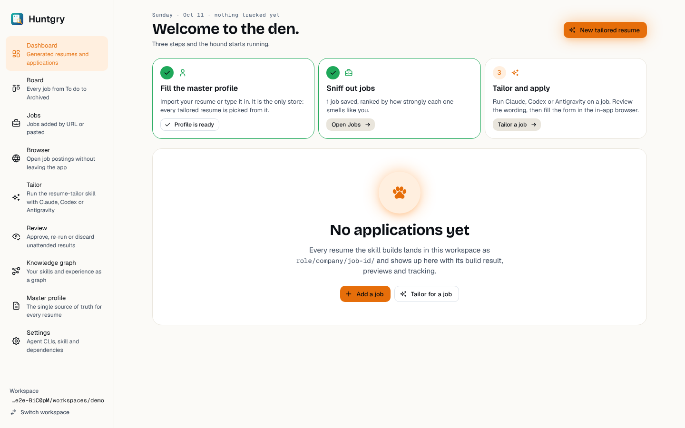

# #109 — Dashboard redesign (Scent Trail)

Issue: [silentashish/huntgry#109](https://github.com/silentashish/huntgry/issues/109) · Epic #95 (redesign 3/11) · Builds on #107
(tokens, theme, shared parts) · Figma `zhNccc831dRnOhj2tmqqkc`: Dashboard `5:2`, Application drawer `16:2`, Evidence modal
`16:735`, Empty (first hunt) `18:2`, and their App · Light twins.

## What changed

| Part | Files | Notes |
| --- | --- | --- |
| Header | `pages/dashboard/index.tsx`, `summary.ts` | `PageHeader`: mono eyebrow (weekday · date · "the hound is awake"), "Good morning / afternoon / evening, <first name>." from the master profile's name (re-read on save and focus, follows the clock), subtitle "N things need you before the hunt moves on." or a calm line, Refresh (subtle) and New tailored resume (primary). The h2's accessible name starts with a visually hidden "Dashboard:", so the shell and page objects still find the page by name. |
| Needs you | `NeedsYou.tsx` | Three cards, each hidden at 0: Tailor runs with status `waiting` (`runner.listRuns`, live on `runner:run`) → Reply opens the first run; unattended results waiting on Review (`review.list` filtered with `isSettledReview`, now in `shared/review-types.ts`, so results whose run still works or re-runs are not counted; live on `applications:changed` / `pipeline:finished`) → Review; Generated applications that pass `applyBlocker` (resume.pdf, posting URL, review) → Apply opens the drawer (one) or clears the search and narrows the table to exactly those results, with a removable "Ready to apply" chip (several). |
| Stat tiles | `index.tsx`, `summary.ts` | `KpiTile` toggles (Ember border = the active filter). Sub lines only from data the records hold: "N new this week", "N resumes built", "N this month" (applied dates), the offer's company. |
| Table | `ApplicationsTable.tsx`, `BuildBadge.tsx`, `ReviewBadge.tsx`, `status.ts` | `CompanyAvatar`, company + mono source tag, role · job title, created date (+ mono applied date), status pill that opens a menu of the statuses, build pill (ATS passed · warnings / Build failed / No report) and the review state as an outline pill, five icon actions (Apply, resume, cover letter, posting, Show in Finder) as before. Search, status multi-select and sort keep their names; a mono count sits beside them. |
| Right column | `LastPipelineCard.tsx`, `ProfileInsightsCard.tsx`, `StrongestEvidenceCard.tsx` | `SectionCard`s. Pipeline: a status pill from the stop reason and failures (Finished, Finished · N failed, Failed, Stopped by you, Paused: spend limit, Stopped: budget, Could not start), mono date · duration · cost, count pills, stop reason, Review N results / Open the queue. Master profile: "asked for by jobs, missing from your profile" rows with mono job counts, a bar (share of the compared job descriptions), "I have this" (trail) and a ✕ "Not me"; empty-section pills, "Show all", the "marked not me" list with restore, the Gaps & notes line. Strongest evidence: the graph's best-evidenced skills as trail chips; a chip opens the Knowledge graph on that node (`navigate('graph', { nodeId })`, which the Shell maps to the Profile graph view). The old Skills card's gap list is dropped: the insights card already lists the gaps. |
| Usage | `UsageCard.tsx` | Header row: title, "Estimated API cost" pill (tooltip), range `SegmentedControl`, agent `Select`, Export CSV. Four `KpiTile` readouts (Runs, Active time, Tokens with % cached, Est. API cost) and one bar per calendar day of the range (last week in soft Ember, today solid; the caption toggles cost / tokens). Model and status filters, several-agent selection, the agent × model table, bulk requests and the latest runs moved behind a "Breakdown" toggle, which counts the filters set there ("Breakdown · 2 filters"). The bars start on the calendar day the totals start (`now − N × 24 h`), so a 30-day range shows 31 days and no day with cost is dropped. |
| Drawer | `ApplicationDrawer.tsx` | Mono eyebrow with the folder, display title `Company · Role`, job title; Apply in browser (primary), Resume, Cover letter, Posting, folder icon; build / review pills and "Open in Review"; "Built by" sunken box with agent pill, run link and mono metrics; Status / Applied on; URL in mono; Notes; a tab card with the page previews side by side. `BuildBadge` stays exported from here for the Board. |
| Evidence modal | `EvidenceModal.tsx`, `evidence.ts` | Display-face title, field descriptions under the inputs, trail "Draft a bullet with Claude", warning alert, and a mono diff of master-profile.md: the line being replaced in red with `-`, the added lines in green with `+`. |
| First hunt | `FirstHunt.tsx` | "Welcome to the den." with three step cards (profile done when the master profile has content, jobs done when jobs are saved, tailor) and the "No applications yet" `EmptyState` (Add a job / Tailor for a job). Refresh, the "Needs you" strip (waiting runs, results to review), the last pipeline and the profile insights stay on this page, and on a failed list too, so a first pipeline where every job failed is still reported. The Usage card shows only if the workspace has runs. |
| Layout | `dashboard.module.css` | Container queries on the page: table and side column side by side from 1100 px of content width (Figma: 776 + 20 + 340); narrower, the side cards share a row under the table. Stat tiles 6 → 3 per row under 760 px. Token colours only. |

## Screenshots

At the Figma content width (1136 px; the current shell caps pages at 1040 px, so these lift that cap for the shot):

At today's shell width (side cards under the table): 

## Deviations from Figma, and why

- **"Needs you" sub lines** name the runs and results ("Claude asked about Staff Engineer · Acme …"), not what the agent
  asked: a run summary has no question text. The review card names the results instead of "pipeline finished 25 min ago".
- **Stat tile subs**: no "2 this week" for Interviewing or "learned 1 gap" for Rejected: no status history is recorded.
  Offer shows the company, not a salary (no salary field).
- **Pipeline meta line** has no "Claude → Codex": the pipeline summary does not record agents.
- **Row actions**: five icons instead of four; the cover letter keeps its own action.
- **Usage**: the model / status filters and the tables (#44) are kept behind "Breakdown" rather than dropped.
- **Gap bars** show the share of compared job descriptions asking for the skill.
- **Tip line** (⌘K) of the empty state is left out until the command palette exists.
- **Layout**: the two-column layout needs the Figma content width; with the current shell (1040 px) the side cards sit
  under the table.

## Shared parts

No shared file was changed. Notes for their owners: `StatusPill` and `KpiTile` do not forward a ref, so a Mantine
Tooltip needs a wrapper element; the theme's disabled `ActionIcon` fill is overridden locally for the plain row icons
(Figma shows them as plain, faded icons).

## Tests

- Unit: `summary.test.ts` (greeting, first name, needs-you line, ready-to-apply rule, KPI subs, day bars, build badge),
  `evidence.test.ts` (diff preview), `filter.test.ts` (ready-to-apply filter); `summary.test.ts` also checks the bars against
  `summarizeUsage` totals, the pipeline pill and the Breakdown filter count.
- e2e (Linux, xvfb): `dashboard.spec.ts` (new: greeting + "Needs you" → drawer → strip clears; no applications + a
  failed pipeline summary still shows the pipeline card, insights and Refresh; row status via the menu; stat values),
  `insights.spec.ts` (Strongest evidence chip → the graph with GraphQL selected), `usage.spec.ts` (Breakdown toggle),
  plus `shell`, `board`, `review-gate`, `tailor-review-refresh`, `profile-setup`. Page objects: `Dashboard.statCard` /
  `statValue` / `rowStatus` / `setRowStatus`, `UsagePage.breakdownToggle`.
- `npm run typecheck:web|node|e2e`, `npx vitest run`, `npx electron-vite build`.
