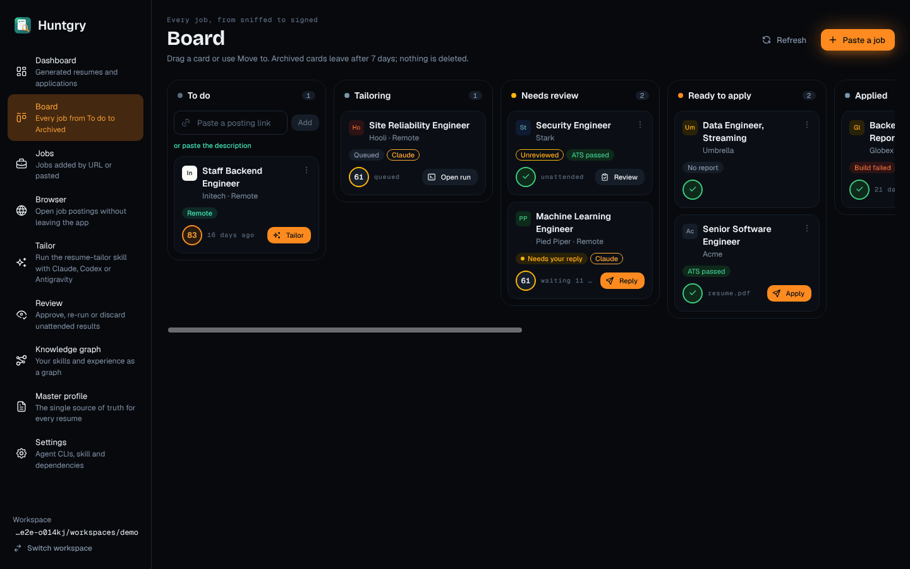
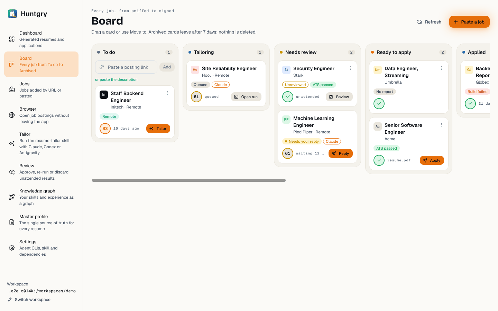
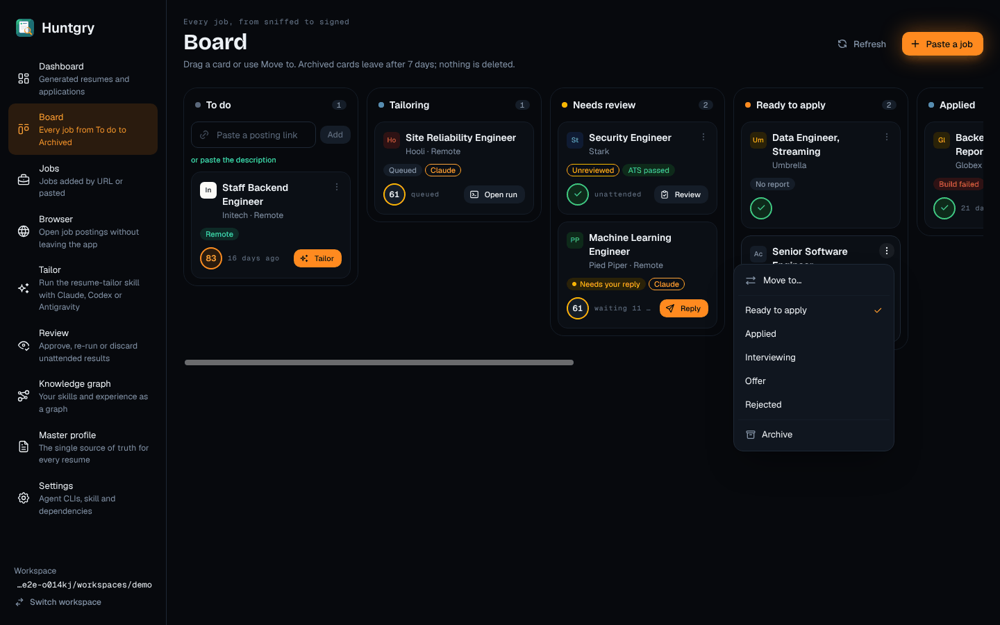
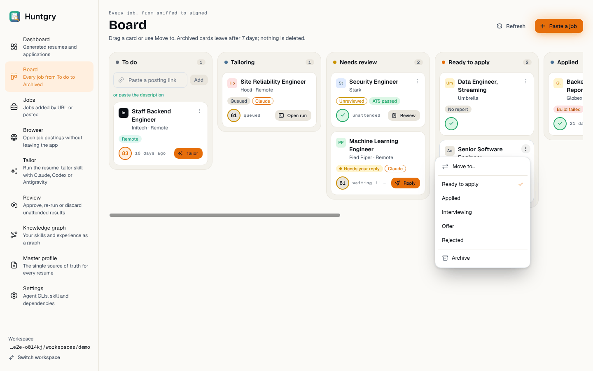

# #110 — Board redesign (Scent Trail)

Issue: [silentashish/huntgry#110](https://github.com/silentashish/huntgry/issues/110) · Epic #95 (redesign 4/11) · Builds on #107.
Figma: Board `6:2` (App · Dark) and its App · Light twin, Components → Kanban card `22:467`, Menu `22:585`.

## What changed

| Area | Files | What |
| --- | --- | --- |
| Page | `src/renderer/src/pages/board/index.tsx`, `board.module.css` | `PageHeader` with the eyebrow "Every job, from sniffed to signed", the title, the archive rule as subtitle, **Refresh** (ghost) and **Paste a job** (the screen's primary; opens the existing paste modal). Full window width. Lanes are 252 px, sunken, radius xl, with a tone dot, the label and a mono count pill. To do keeps the link box (now with a secondary **Add**) and the "or paste the description" link. A lane that takes the dragged card gets an Ember border; the others dim as before. |
| Column name | `src/shared/board.ts`, `README.md` | "Waiting for review" is now **Needs review**. The column id stays `review`. |
| Card | `BoardCardView.tsx`, `card.ts` | `CompanyAvatar`, role (2 lines) and company · location. Below that, the status pills (`StatusPill`): workplace, visa sponsorship and Tailored for a saved job; the queue status (live dot), agent and Unattended for a run; the review state, build and "applied <date>" for an application. The bottom row has the Scent ring, a mono meta line (posting age, "working 14 min", "waiting 3 min", "starts in 2 min", "resume.pdf · cover.pdf", "unattended", days since applied, "archived 2 days ago") and the next step: **Tailor** (solid on the top To do card, secondary on the others), **Open run**, **Reply**, **Review**, or **Apply** on a Ready to apply card that can be applied. Cards can be focused and opened with Enter. |
| Scent ring | `card.ts` (`cardScent`) | `ScoreRing` shows the job's existing relevance score (`scoreJob` against the master profile, already 0–100) when the card has its saved job and the profile has a headline or role to match on. Without a score, a tailored result or tailored job shows the **done** ring and everything else shows the **initial** ring (the company's first letter), as on Jobs. The tooltip gives the reasons, e.g. "Strong scent · Title: Backend Engineer · Skills: Go". |
| Move to menu | `BoardCardView.tsx` | The vertical-dots button (still named "Move <title>"). The menu has a "Move to…" header, then the card's own column ticked in Ember (not an item), then the columns it can go to, a divider and **Archive**. On a saved job's card that last item is **Dismiss job** (danger), which is what archiving a saved job already did. The allowed moves are unchanged (`moveTargets`). |
| Drag and drop | `index.tsx` | Unchanged behaviour: the same `moveFor` rules, the same dimming, and the same 0.5 opacity on the dragged card. |

## Screenshots

| Dark | Light |
| --- | --- |
|  |  |
|  |  |

## Deviations from Figma

- **Avatar and Scent ring on the card.** The Figma Kanban card has no avatar and shows the score as a flame and "92%". The ticket asks for the company avatar and the Scent ring, so the avatar sits before the title and a 32 px ring takes the place of the flame figure.
- **No Board / List switch.** The app has no list view of the board; the Dashboard table already lists applications.
- **No lane "…" menu.** Columns have no actions to offer yet.
- **No "+ N more" footer.** Lanes list every card. Nothing hides cards except the archive rule.
- **The meta line follows the data.** Runs show how long they have worked, waited or will wait, not "1m 12s · 18k tok": the queue item has no token totals and the board does not load run summaries. Agent pills show the queue item's agent.
- **"Dismiss job" only on saved jobs.** For an application, Figma shows both Archive and Dismiss job, but nothing in the app deletes an application ("nothing is deleted"). Applications get Archive; a saved job's card gets Dismiss job, which archives (dismisses) it as before.
- **Apply on Ready to apply cards** appears only when Apply would work: a resume.pdf, a posting URL and an approved or attended result (`applyBlocker`). It is the same action as the application drawer's Apply in browser.
- The sidebar and the page padding belong to the Shell ticket and are not restyled here.

## Tests

- Unit: `pages/board/card.test.ts` (new) covers the Scent ring modes and the 0–100 score, the company, the pills and the meta line. `BoardCardView.test.tsx` gains checks for the avatar, the score, done and initial rings, and Apply. `src/shared/board.test.ts` uses the new column name.
- e2e: `e2e/tests/board.spec.ts` with `e2e/pages/board.ts`. The column map says "Needs review", the Move to items are "Archive" / "Dismiss job", and new checks cover the ticked current column and the Scent ring on cards. On Linux under xvfb: `board.spec.ts` 9/9 and `shell.spec.ts` 2/2 pass.
- `npm run typecheck:web`, `typecheck:node`, `typecheck:e2e`, `npx vitest run` (92 files, 1242 tests) and `npx electron-vite build` pass.
