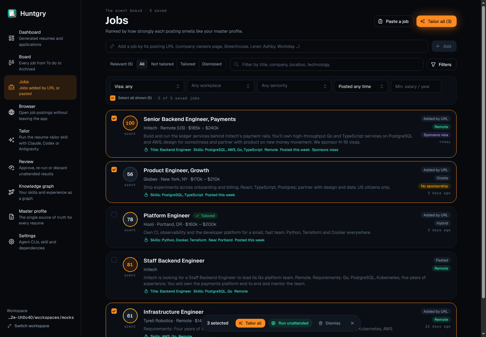
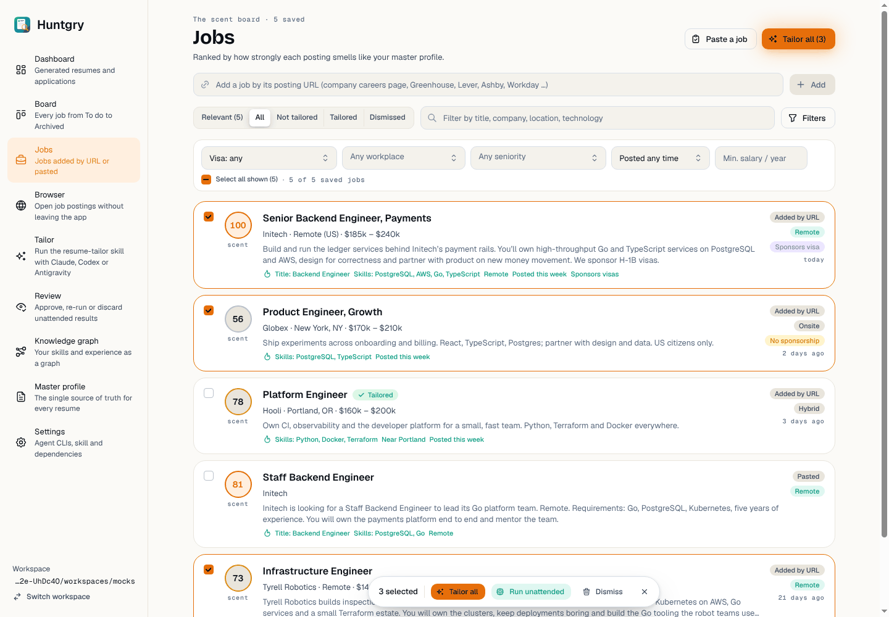
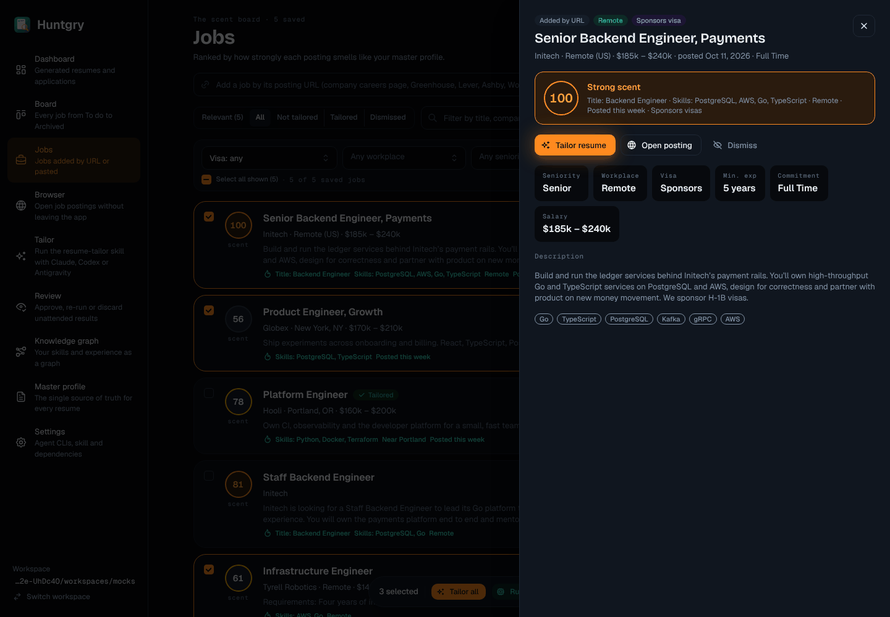
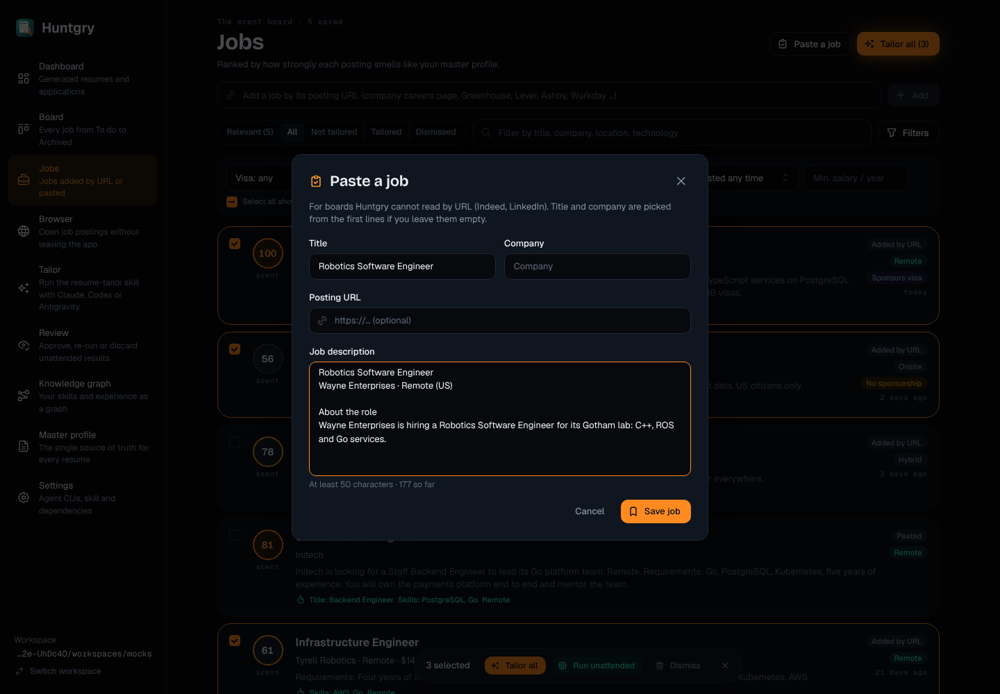
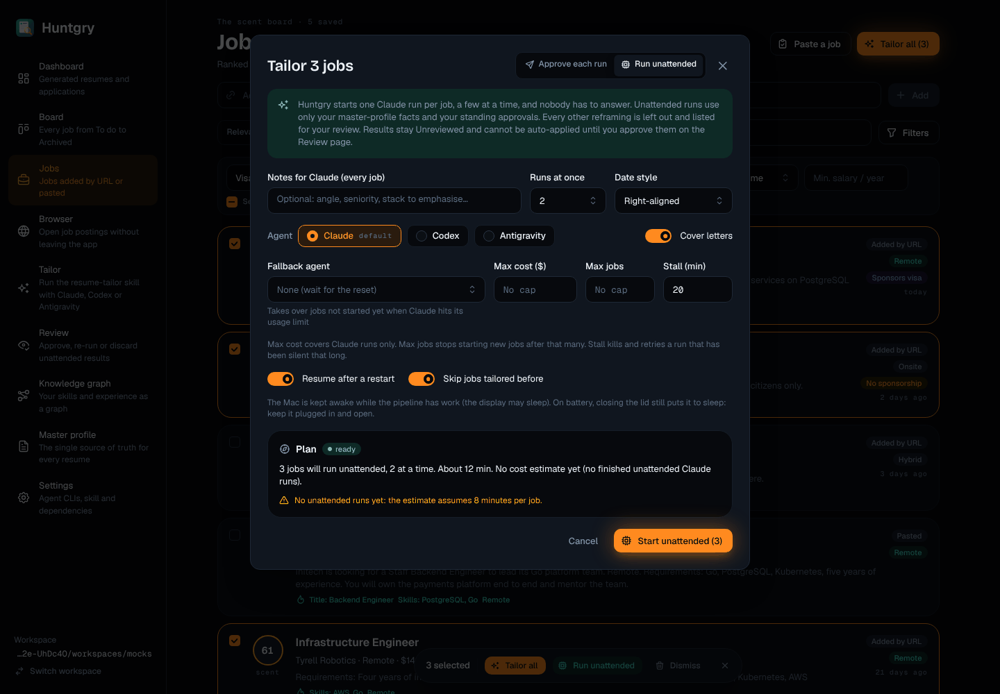

# #111 — Jobs on Scent Trail

Issue: [silentashish/huntgry#111](https://github.com/silentashish/huntgry/issues/111) · Epic #95 (redesign 5/11) · Builds on #107
Figma `zhNccc831dRnOhj2tmqqkc`: Jobs — Relevant `7:2`, Jobs — Job drawer `18:142`, Jobs — Paste a job `17:2`,
Jobs — Tailor all (unattended plan) `16:1404`, and their App · Light twins.

## What changed

| Part | Files | What |
| --- | --- | --- |
| Page | `pages/jobs/index.tsx`, `jobs.module.css` | `PageHeader` with the "The scent board · N saved" eyebrow, **Paste a job** and **Tailor all (n)** (the one Ember button; it opens Tailor all for the ticked jobs). Add-by-URL row with a secondary **Add**. Toolbar: the segments, the text filter with a search icon, and a **Filters · n** button that folds the filter fields away (they stay mounted, `hidden`, so its `aria-controls` always resolves). Empty workspace: `EmptyState`. |
| Filters bar | `JobFiltersBar.tsx` | One bordered box: the selects without visible labels (each keeps its accessible name; the options say what they filter, e.g. "Visa: only sponsors"), Clear filters, then **Select all shown (n) · n of m saved jobs** in mono. |
| Job rows | `JobRow.tsx`, `labels.ts` | `ScoreRing` with the **Scent score** (the #73 relevance score) and a "scent" caption; title (a button, the row's keyboard handle) with the queue state (`StatusPill`, dot while live) and **Tailored**; company · location · pay; two lines of the posting; the reasons it fits under a flame, as a list named "Why it fits"; source / workplace / visa pills and the age in mono. Ticked rows get the Ember border. |
| Scent for every job | `view.ts` (`scentView`), `@shared/job-relevance` (`rankRelevant`), `labels.ts` (`scentDisplay`) | One scoring pass gives every saved job its score and ranks the Relevant list from those same scores (`relevantJobs` is now `rankRelevant` over `scoreJob`, so the ranking is unchanged). All, Not tailored, Tailored and Dismissed show a ring and reasons too. A job Relevant leaves out (dismissed, or "no sponsorship" for a profile that needs it) keeps its number in a neutral ring and says why on the row and in the drawer. Without a headline or role there is no score: the ring shows the company's initials ("No Scent score yet"). |
| Selection bar | `SelectionBar.tsx` | Floating pill (sticky at the bottom of the page) replacing Mantine's ActionBar: "n selected", **Tailor all**, **Run unattended** (opens Tailor all in unattended mode), **Dismiss**, clear. Still a `group` named "Selected jobs". |
| Job drawer | `JobDrawer.tsx` | 600 px drawer: pills, title (Bricolage, h2), meta with posted date and commitment, a bordered close button; the Scent box (`ScoreRing` lg, "Strong / Fair / Faint scent", every reason); Tailor resume (primary) · Open posting · Fetch full description · Dismiss/Restore; the trail "Fetching the full posting…" notice while tailoring; the summary-only notice; fact tiles (`KpiTile size="sm"`: seniority, workplace, visa, min. experience, commitment, salary — only the known ones); description; tags as outline pills. New optional `score` prop: the Board keeps using the drawer without one. |
| Paste a job | `PasteModal.tsx` | Figma layout: icon + title header, the intro line, Title / Company side by side, Posting URL with a link icon, the description with "At least 50 characters · n so far" under it, Cancel + Save job. |
| Tailor all | `BulkTailorModal.tsx` | Header with the mode switch (Approve each run / Run unattended, with icons); trail notice; Notes · Runs at once · Date style in one row (date style is now a select); agents as native radio inputs drawn as chips (one tab stop, arrow keys), with the default marked and an unavailable agent flagged with its reason on hover; Cover letters switch; unattended: Fallback agent · Max cost · Max jobs · Stall (mono inputs), the switches, and the **Plan** card (compass, "ready / blocked / nothing to run" pill, the summary, skipped jobs and warnings in warning tone, blockers in danger with Open Settings). New optional `initialMode` prop. Behaviour, IPC calls and validation are unchanged. |

## Screenshots

| Dark | Light |
| --- | --- |
|  |  |
|  |  |
|  | |

(The sidebar in these shots is still the pre-redesign one; it belongs to the Shell ticket.)

## Deviations from Figma, and why

- **Filter fields have no visible label**, as in Figma; the options carry the meaning instead ("Visa: hide “no sponsorship”", "Posted any time", "Any workplace"). Workplace and Seniority stay multi-selects, so their values show as chips, not "Remote, Hybrid" text.
- **Tag colours in the drawer**: Figma marks some tags in warning outline; the data does not say which tags are gaps for this job, so all tags are neutral outline pills.
- **Facts tiles** are the shared `KpiTile size="sm"` (value in Geist semibold 15) rather than a page-local tile with a 13 px value.
- **"Keep the Mac awake" toggle**: the app has no such setting (it always keeps the Mac awake while a pipeline has work); the modal keeps the explanatory line instead of a toggle. The per-field explanations of Max cost / Max jobs / Stall moved into one muted line under the row.
- **"Each job's agent can still be changed in the queue"** is shown in Approve mode only, where it is true.
- **Tailor all (n) in the header** is disabled until a job is ticked (the design shows it with a selection).
- **Posted date** in the drawer uses the medium date style (with the year) like before, not "6 Oct".
- The drawer's "Fetching the full posting…" notice has no word count: the app does not know it before the fetch returns.

## Shared parts

No shared file changed. Notes for the owners: `ScoreRing` has no "unknown score" mode, so rows without signals use `mode="initial"` with the company initials and their own `aria-label`; `AgentPicker` (shared with Tailor) is a SegmentedControl, so Tailor all renders its own radio chips with the same readiness rules.

## Tests

- Unit: `labels.test.ts` (new: age, meta line, workplace and visa pills, drawer facts, the Scent tone and the left-out state), `view.test.ts` (+ `scentView`: one pass, Relevant identical to `relevantJobs`); `selection`, `merge`, `pipeline-plan` unchanged and green.
- e2e: `e2e/pages/jobs.ts` gains `card`, `scoreRing`, `reasons`; the filter box is found by its accessible name; sponsorship option names follow the new labels. `jobs.spec.ts` checks the ring and the reasons list on Relevant, and three new tests: folding the filters, the drawer's Scent box, and "Run unattended" opening Tailor all in unattended mode (agent radios move with the arrow keys; Cancel keeps the selection).
- Ran on Linux under `xvfb-run` (with `DISPLAY` and `XAUTHORITY` passed to the app by an uncommitted local edit of `e2e/fixtures/app.ts`): `jobs.spec.ts` 12 of 13 pass; the failing one is the known Linux-only "Tailor all … opens the queue view with both" (leftover child processes after the queue finished; everything before that check passes). `board.spec.ts` and `browser.spec.ts`, which use the drawer and modals, pass.
- `npm run typecheck:web`, `typecheck:node`, `typecheck:e2e`, `npx vitest run`, `npx electron-vite build`.
