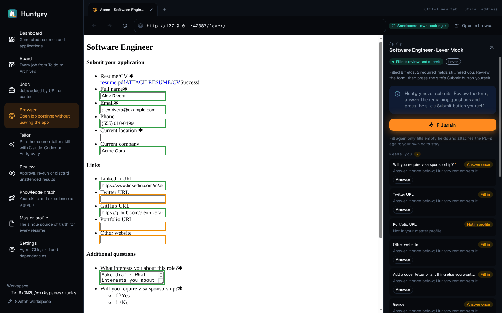
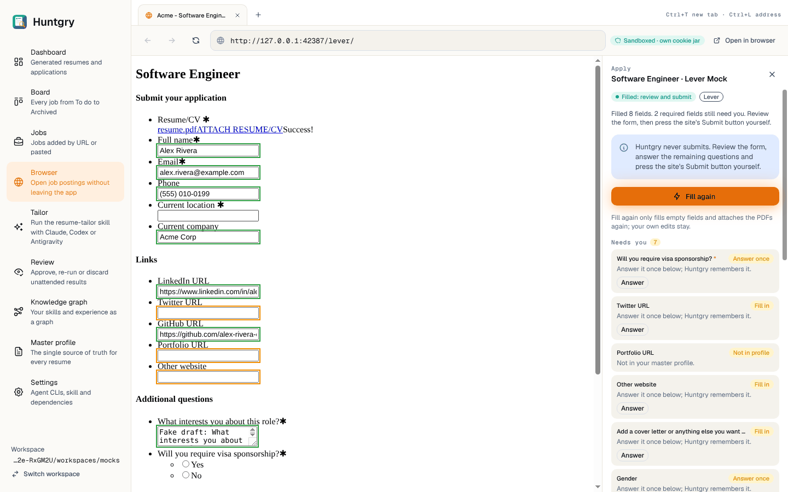
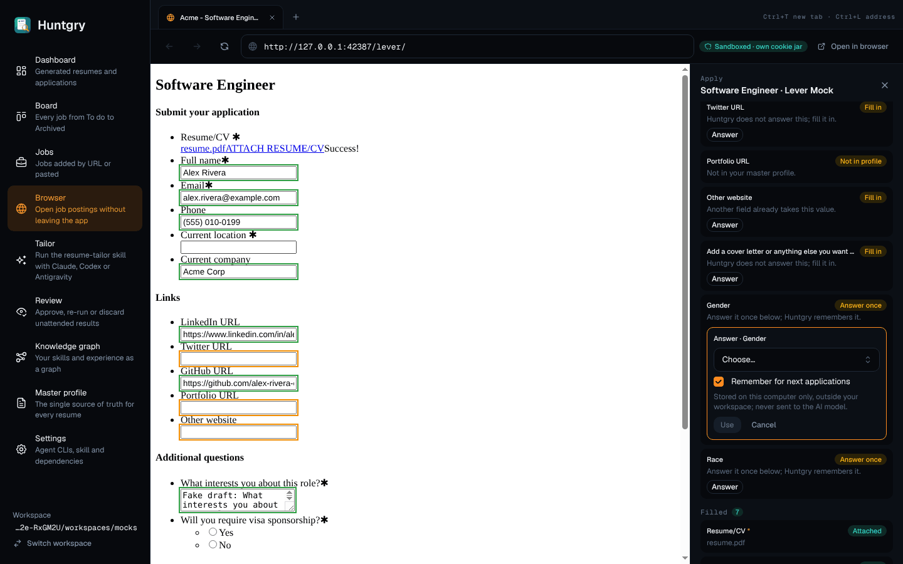
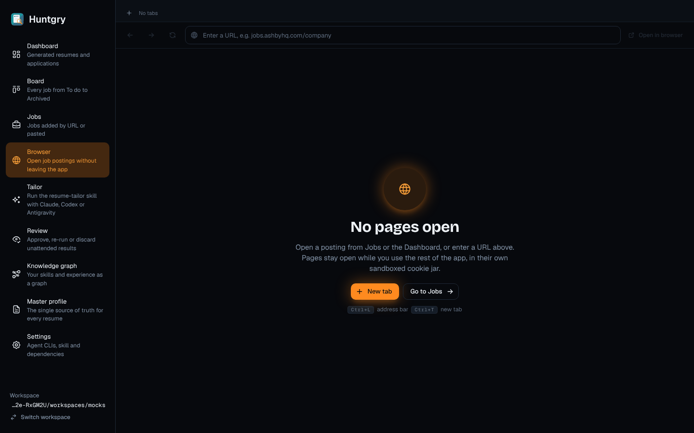
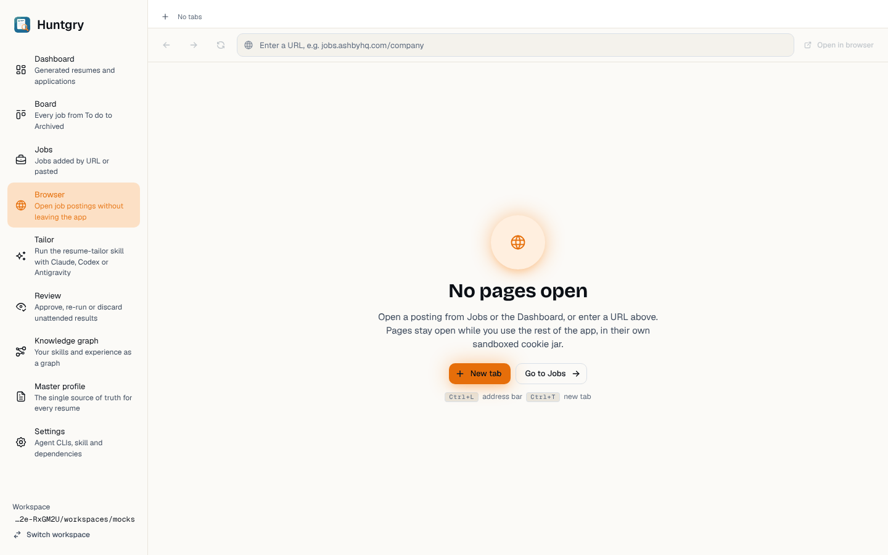

# #112 — Redesign: Browser and the Apply panel

Issue: [silentashish/huntgry#112](https://github.com/silentashish/huntgry/issues/112) · Epic #95 (redesign 6/11) · Builds on #107 (Scent Trail foundations).
Figma: `zhNccc831dRnOhj2tmqqkc`, App · Dark *Browser — Apply session* `8:2` and *Browser — Empty* `8:308`, and their App · Light twins.

## What changed

| Area | Files | Change |
| --- | --- | --- |
| Tab strip | `pages/browser/index.tsx`, `browser.module.css` | 200 px tabs (11 px Geist medium label, world icon or spinner, 12 px close), the active one on the canvas colour with a hairline border so it joins the toolbar; ghost `+`; "No tabs" when empty; the shortcut hint (`⌘T new tab · ⌘L address`, `Ctrl+` off macOS) in Geist Mono on the right. |
| Toolbar | same | 36 px ghost back / forward / reload (stop while loading); the address bar in Geist Mono 13 on the sunken input, with a lock for HTTPS pages and a globe otherwise; the trail "Sandboxed · own cookie jar" pill while a page is open (tabs use their own persistent partition); "Open in browser" as a ghost button. Disabled ghost buttons are dimmed icons rather than the theme's filled disabled chip. |
| Empty state | same | Shared `EmptyState` (ember-glow globe disc, h2 "No pages open", the sandbox sentence), **New tab** (primary) and **Go to Jobs** (outline, navigates to Jobs), and the `⌘L address bar ⌘T new tab` hint in `Kbd`s. |
| Apply panel | `pages/browser/ApplyPanel.tsx` | 340 px surface column: mono "Apply" eyebrow + title + close; status pill (tone per status, dot, spinner while loading/filling), ATS pill (outline) and step pill; the site/status line (`message`); the info box "Huntgry never submits…" (no `role="alert"`, it is not news); **Fill again / Fill form / Open again** as the screen's one primary button (bolt icon) with **Show tab** beside it when the apply tab is not the active one; the "Fill again only fills empty fields…" caption; the confirmation box (success tone) with **Mark as applied** (primary, the Fill button is hidden then) / **Not yet** / **Done**. |
| Field report | `ApplyPanel.tsx` (`ReportRow`), `apply-report.ts` | Groups **Needs you / Filled / Your choice** with a mono heading and a count pill (warning / trail / neutral); each field is a sunken card: label (+ red `*`), outcome pill, value or reason, the suggestion note and the AI-draft note. `STATUS_META`, `OUTCOME_META` and `badgeOf` now return a `UiTone` (`tone`) instead of a Mantine colour, `GROUP_TONE` is new. |
| Answer once | `pages/browser/AnswerControl.tsx` | Closed: a small outline **Answer** / **Confirm answer** button. Open: the Figma box with the ember focus border — "Answer · Gender" / "Confirm answer · …", the native select (or textarea), "Remember for next applications", the sensitive-answer note, **Use** (solid ember, no glow) and **Cancel**. Same IPC and validation as before. |
| Already applied | `components/apply/useApply.tsx` | "Open apply page" is the primary button of the modal. Blocker logic untouched. |
| Helpers | `pages/browser/state.ts` | `modKey(platform)` (⌘ / Ctrl+ in hints) and `isSecure(tab)` (lock icon), unit-tested. |

## Screenshots

| | Dark | Light |
| --- | --- | --- |
| Apply session |  |  |
| Answer once |  | |
| Empty |  |  |

(The page area is the mock Lever form of the e2e server, captured from its tab and placed where the native view is drawn.)

## Deviations from Figma

- **The answer box sits inside its field card**, not as a separate card under the "Needs you" list: it stays next to the question it answers when several are open, and the e2e page object finds it within the field row.
- **Tab labels are one line** (ellipsis) instead of wrapping to two in the active tab, so every tab keeps the same height.
- **The loading tab shows a spinner**, not the refresh glyph of the mock.
- **"Show tab" appears only when the apply tab is not the active tab** (as before); in the mock the apply tab is active and the button is still shown, which would do nothing.
- **The Sandboxed pill is shown only while a page is loaded**; on an empty tab there is nothing sandboxed to point at.
- **Shortcut hints follow the platform**: `⌘` on macOS, `Ctrl+` on Linux/Windows (the handlers already accepted both).
- **The address bar is not auto-focused** on the empty page (the mock shows its focus ring); focus stays where the user left it, `⌘L` focuses it.
- **No "Huntgry never presses this button" caption under the site's Submit button**: that is inside the third-party page (a native view), which Huntgry does not draw into.
- **Field rows use the shared 18 px `StatusPill`**, slightly taller than the 14 px pills of the mock, instead of forking a smaller pill.
- The sidebar in the screenshots is still the pre-redesign shell (Shell ticket).

## Tests

- Unit: `apply-report.test.ts` (tones instead of colours), `state.test.ts` (`modKey`, `isSecure`); `npx vitest run` all green.
- e2e page object: `ApplyPanel.group()` matches the new heading (`Filled 7` instead of `Filled (7)`); every other locator (field rows, status pills, buttons, the notice) is unchanged.
- e2e on Linux under `xvfb-run` (with `DISPLAY`/`XAUTHORITY` passed to the app by a local, uncommitted fixture change): `browser.spec`, `apply.spec`, `apply-answers`, `apply-ashby`, `apply-generated`, `apply-workday`, `review-gate`.
- `npm run typecheck:web`, `typecheck:node`, `typecheck:e2e`, `npx electron-vite build`.
