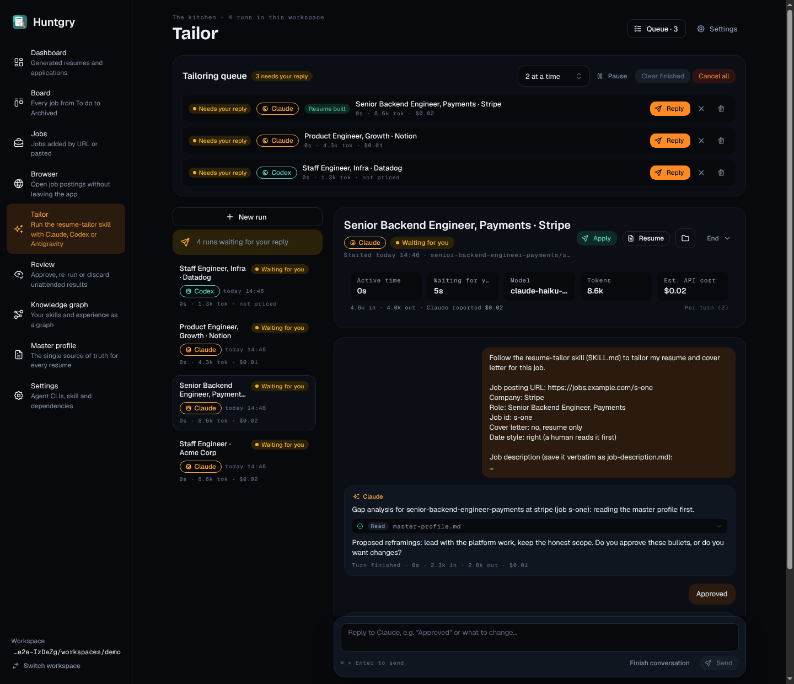
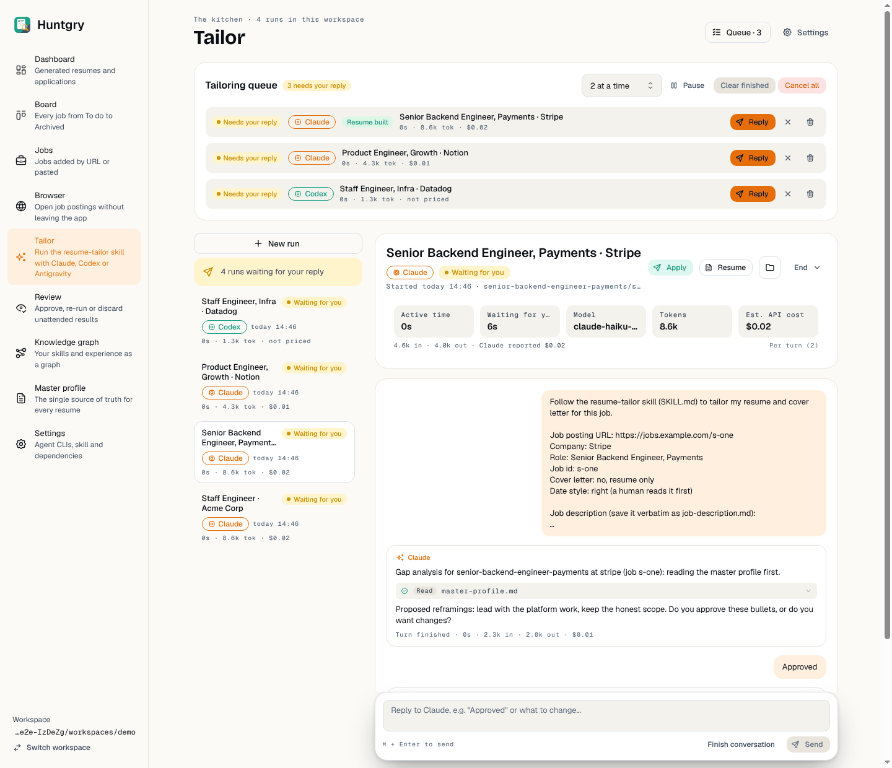
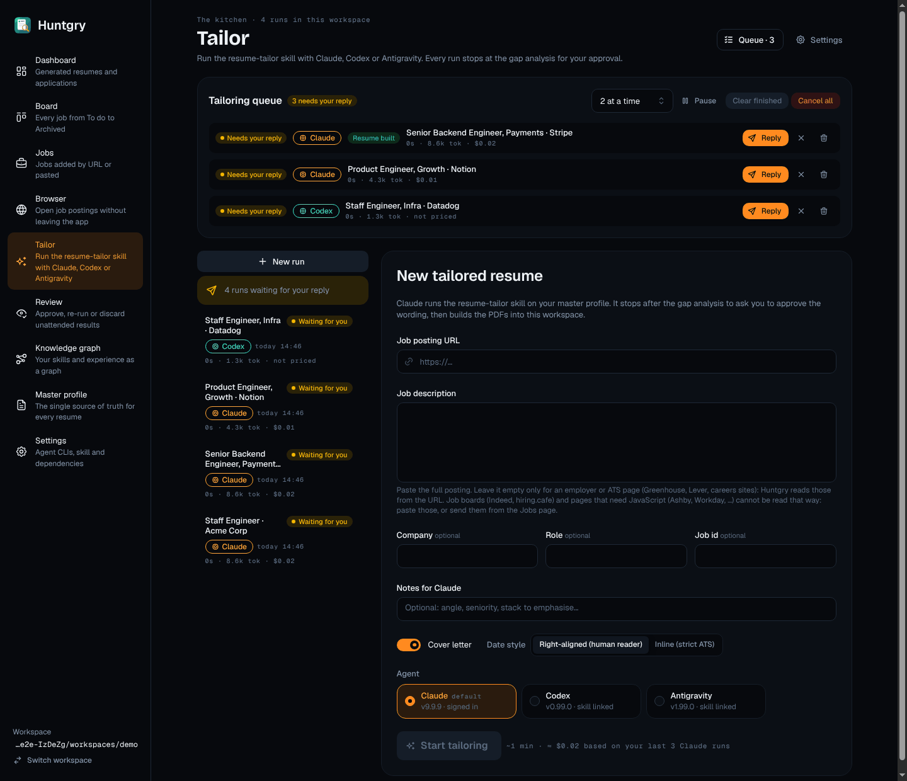
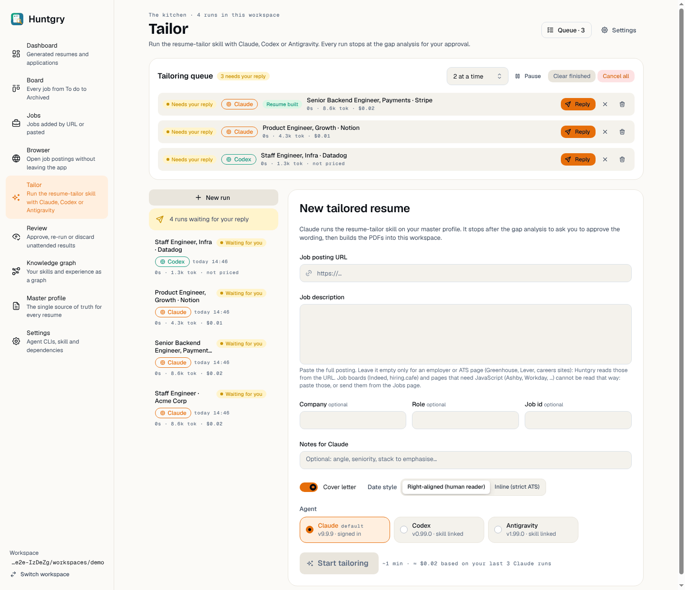

# #113 — Tailor page redesign (new run form, run view)

Issue: [silentashish/huntgry#113](https://github.com/silentashish/huntgry/issues/113) · Epic #95 (redesign 7/11) · Builds on #107 (Scent Trail foundations)
Figma `zhNccc831dRnOhj2tmqqkc`: Tailor — New run `9:2`, Tailor — Run view `9:279` (App · Dark) and their App · Light twins `18:5800`, `18:6077`; Queue row `22:560`.

## What changed

| Part | Files | Change |
| --- | --- | --- |
| Page | `pages/tailor/index.tsx`, `tailor.module.css` | `PageHeader` with the mono eyebrow (`The kitchen · N runs in this workspace`), the subtitle on the new-run view, and `Queue · N` (shows and scrolls to the queue panel) and `Settings` actions. Run list and main column as a 272 px + fluid grid (one column under 900 px). |
| Run list | `RunList.tsx` | Each run is a plain `<button>` card: title (two lines), status pill with dot, agent pill (Claude Ember / Codex Trail / Antigravity Review, CPU icon), mono `today 10:42` / `yesterday` / `2 Oct`, and the mono `time · tokens · cost` readout. The open run gets the raised surface. "N runs waiting for your reply" is the warning note with the send icon. |
| New run form | `StartForm.tsx` | Card title 24 px, intro, "Prefilled from your saved job" trail alert (role, company, word count of the description field, Open posting) when the Jobs page or the Board sent a full posting, until the description or URL is changed; the summary/no-description alerts are kept. URL field with a link icon, the description hint under the field, `optional` captions on Company / Role / Job id, one-line (auto-growing) Notes, Cover letter + Date style on one row, agent cards, `Start tailoring` as the screen's one `primary` button with the mono estimate next to it (`~4 min · ≈ $0.40 based on your last 5 Claude runs`, the median of this workspace's finished runs of the picked agent). |
| Agent picker | `components/AgentPicker.tsx` (+ `.module.css`) | Radio cards instead of a SegmentedControl: name, mono `default` tag, and with `detailed` (the Tailor form) a second line `v2.1.4 · signed in` / `v0.48 · skill linked` / `not installed` / `skill missing`. An unavailable agent is dimmed, keeps its reason in a tooltip, and stays pickable. Native radios (arrow keys work) named `Claude (default)`, `Codex`, `<name>: not available` as before. The Jobs "Tailor all" modal uses the compact cards (as in the Jobs — Tailor all frame); its props are unchanged. |
| Run view | `RunView.tsx` | Header card: 20 px title, agent pill, status pill (dot, or a spinner while working), mono `Started today 10:42 · <folder>/ · <files>` (cut with an ellipsis, full text in the title), Apply (`light` trail), Resume, Cover letter, Show in Finder (folder icon button), End menu; the run metrics sit in the card as the five sunken tiles. Transcript card, then the reply dock: raised card with the float shadow, mono `⌘ + Enter to send`, `Finish conversation` (ghost) and `Send` (primary). |
| Transcript | `Transcript.tsx` | The agent's replies, tool calls and the turn's result are grouped into one raised block per turn (sparkles + agent name, Markdown, sunken tool rows with a status icon, mono tool chip, mono summary and an expand chevron, mono `Turn finished · …` footer, "Blocked tool calls" warning). User messages are Ember-soft bubbles on the right; notices stay alerts. |
| Queue / pipeline | `QueuePanel.tsx`, `PipelinePanel.tsx` | `SectionCard`s (h4 titles). Queue rows are the Figma Queue row: sunken, status pill (dot while live), agent pill, outcome / Resume built pill, title, mono usage, `starts in …` and mono chips (`attempt 2`, `retry 1/2` in warning, failure reasons), the held-reply note in warning; actions `Reply` (send icon, Ember), `Open run` / `Review` (outline), and ghost Cancel / Retry / Remove icons; the per-job agent select stays for jobs that have not started. Pipeline: trail border while running, status and `Claude → Codex · 3 at a time` pills, kept-awake / on-battery pills and the controls in the header, mono status line (`Running · about 40 min left · $3.20 of $10.00 · 5 of 20 jobs · …`), 8 px trail progress bar, count pills. |
| Status maps | `status.ts` | Every status map keeps its `label` and Mantine `color` (other pages read them) and gains a Scent Trail `tone`; `AGENT_TONE`, `PIPELINE_TONE`, `shortWhen()`, `runEstimate()`. |

Behaviour is unchanged: same IPC calls, states, live updates, queue/pipeline actions, apply blocker, reply rules. `components/queue/*` and `components/usage/RunMetrics.tsx` are not edited.

## Screenshots

| | Dark | Light |
| --- | --- | --- |
| Run view (queue + run + transcript + dock) |  |  |
| New run |  |  |

Taken under xvfb with the scripted e2e agents (their runs report 0 s active time and small token counts). The sidebar is still the old one: the Shell ticket (#108) restyles it.

## Deviations from Figma

- **No "New run" in the page header of the run view.** The run list already has it; two buttons named "New run" would be ambiguous (and the e2e page object finds it by name). The header shows `Queue · N` on both views instead.
- **Queue panel lists every item.** Figma folds the rest into `+ 9 more queued · 2 done · 0 failed`; the app keeps all rows visible (each has its own actions, and the queue specs address them).
- **Pipeline status tones.** "Running" is Trail as in Figma; the other states keep their meaning (Paused warning, waiting for the limit Ember, budget stop danger, finished success).
- **Run metrics.** `RunMetrics` is shared with the Dashboard and was not edited; the page styles it as the Figma tiles from its own stylesheet (sunken tiles, mono labels). Its token tile reads `8.6k`, not `61k · 71% cached` (the cache share is in the line under the tiles). A `variant="tiles"` on `RunMetrics` would remove the descendant selectors (for the Dashboard owner).
- **Agent card second line.** The environment has the CLI version, the skill link and Claude's sign-in state; "signed in" is shown for Claude only (the other CLIs report no sign-in state), the others read "skill linked".
- **Prefilled alert text.** Titled "Prefilled from your saved job" (jobs arrive from the Jobs page and the Board) and "The full posting is filled in below (N words)" instead of "fetched from the employer's page", since the form cannot tell where the text came from.
- **Start estimate** is shown only once the workspace has a measured run of the picked agent.
- **Content width.** The screenshots were taken with the shell's old 1040 px cap (Figma: 1136), so the metric labels truncate there; the Shell ticket raises the cap to 1136 px for every page.

## Tests

- Unit: `tailor.test.tsx` (new: `shortWhen`, `runEstimate` (finished runs only), transcript grouping, agent card lines and radio names, the dock's Finish conversation button, the prefill note), `RunList.test.tsx`, `QueuePanel.test.tsx`, `usage.test.tsx` unchanged and green. `npx vitest run`: 92 files, 1235 tests pass.
- e2e page object `e2e/pages/tailor.ts`: `expectStatus` reads the status pill (`data-testid="run-status"`; the metrics tile also says "Waiting for you"), `pickAgent` clicks the radio card.
- e2e on Linux (xvfb, `DISPLAY`/`XAUTHORITY` passed by an uncommitted fixture edit): `tailor.spec.ts`, `tailor-queue.spec.ts`, `tailor-review-refresh.spec.ts`, `usage.spec.ts`, `review-gate.spec.ts`, `apply-generated.spec.ts`, `apply-ashby.spec.ts`, `apply-workday.spec.ts`, `jobs.spec.ts`, `shell.spec.ts`, `dashboard.spec.ts`, `board.spec.ts` pass, except `jobs.spec.ts:200` (known Linux failure, also on main). One `apply-generated` Lever case failed once and passed on its own re-run.
- `npm run typecheck:web`, `typecheck:node`, `typecheck:e2e`, `npx electron-vite build`.
