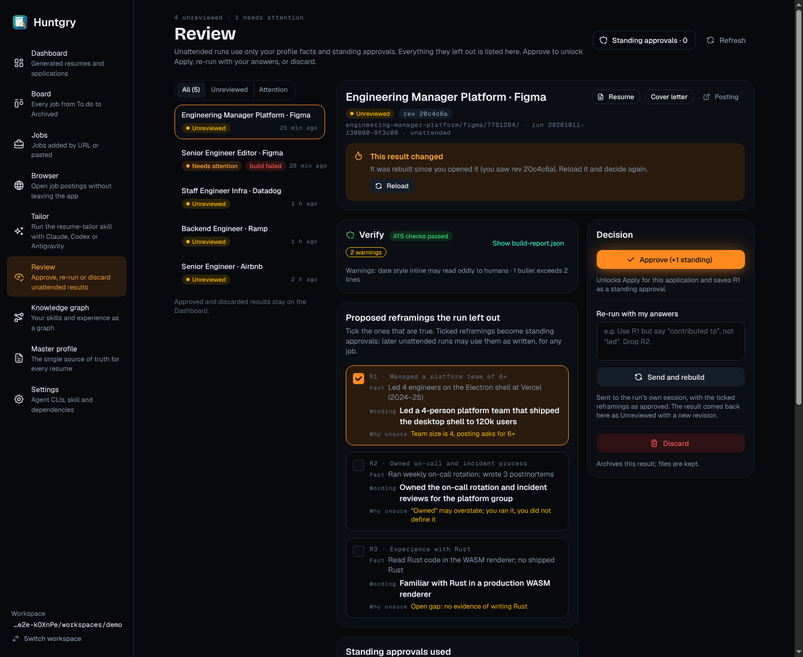
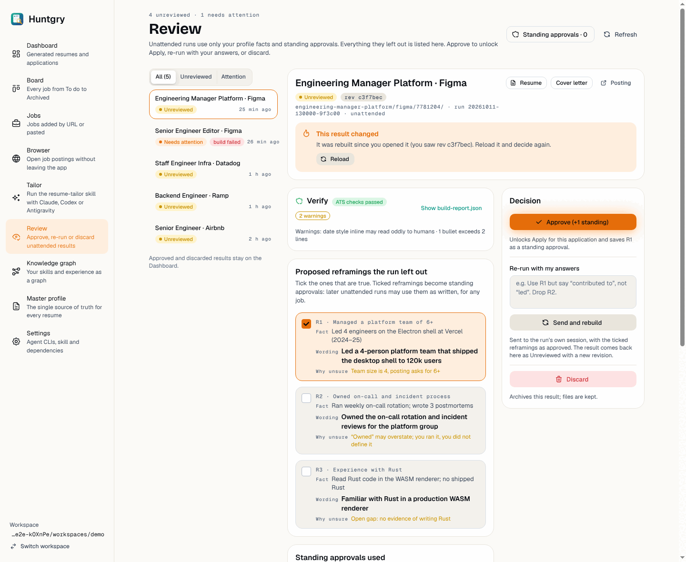
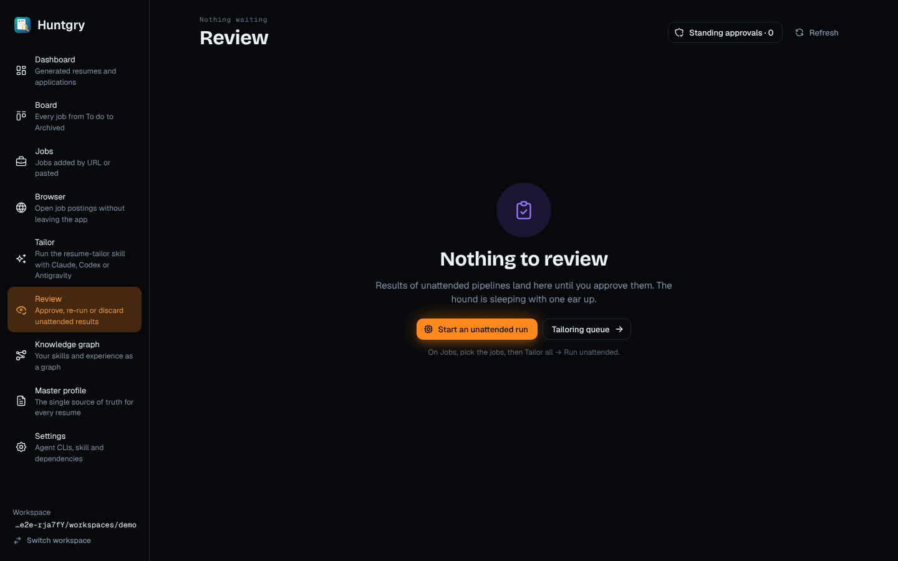
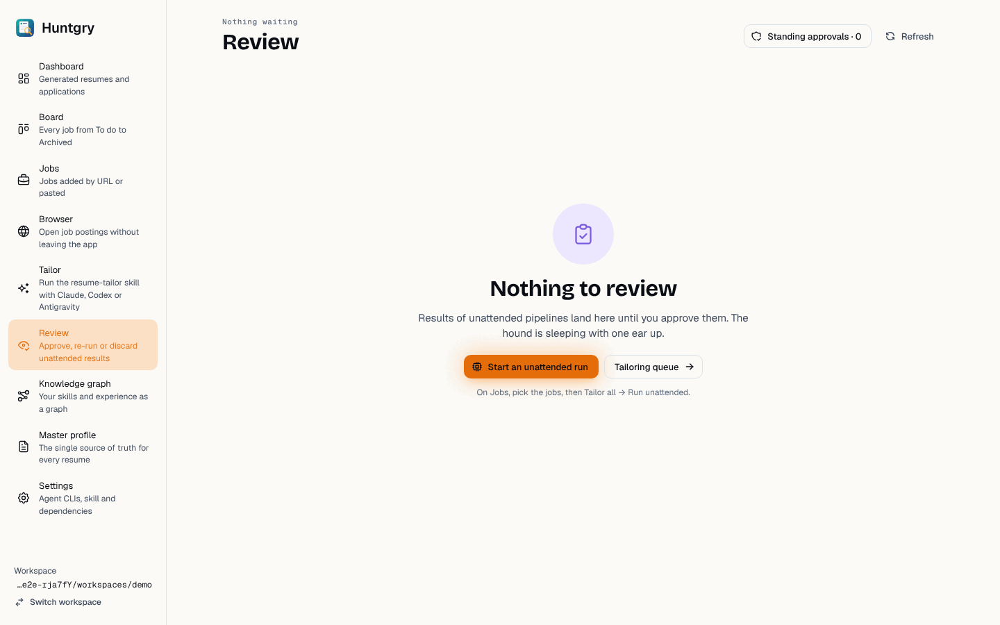

# #114 — Redesign: Review (result detail and empty state)

Issue: [silentashish/huntgry#114](https://github.com/silentashish/huntgry/issues/114) · Epic #95 (redesign 8/11) · Builds on #107 (foundations)
Figma `zhNccc831dRnOhj2tmqqkc`: Review — Detail `10:2`, Review — Empty `10:326` (App · Dark) and `18:6503`, `18:6827` (App · Light).

## What changed

All in `src/renderer/src/pages/review/`; no main-process, IPC or shared change.

| Part | What it looks like now |
| --- | --- |
| Header | `PageHeader`: mono eyebrow with the counts ("4 unreviewed · 1 needs attention", or "Nothing waiting"), the title, the explanation, **Standing approvals · N** (outline, opens Settings; N comes from `review.approvals()`) and **Refresh** (ghost). |
| List | All (n) · Unreviewed · Attention filter (`SegmentedControl`), one row per result: title, state pill with a dot (Unreviewed = warning, Needs attention = ember), "build failed" pill, mono age ("25 min ago", full date in the tooltip). The open result has the ember border. The page opens on the first result when no result is asked for. |
| Header card | Title, state pill, the revision in mono (`rev 9f3c1a2`, full hash in the tooltip), the mono path line (`<folder>/ · run <id> · unattended`), the reason when it needs attention, Resume / Cover letter (outline) and Posting (ghost). A stale decision shows the ember "This result changed" block with **Reload** in this card. |
| Verify | Shield icon, ATS pill (passed / build failed / no build report), "N warnings" outline pill, "Show build-report.json" toggle, the failed checks, and the warnings themselves ("Warnings: … · …", read from the report's soft checks and `style_warnings`). |
| Reframings | One box per proposed reframing, the whole box toggles it: mono `R1 · <requirement>`, `Fact`, `Wording` (bold), `Why unsure` (warning). Ticked boxes turn ember. The explanation of standing approvals is always shown. |
| Approvals used + gaps | Check rows with "← source fact" on the right, a divider, and the open gaps as warning outline pills. |
| Previews | Review notes · Resume (n) · Cover letter (n) tabs; pages side by side (scrolls sideways); opens on Resume when there are pages. Notes get card-sized headings and the parser's `<!-- huntgry-review … -->` marker is hidden. |
| Decision card | Right column, sticky: **Approve (+n standing)** (the one primary), a line saying what it saves ("… saves R1 as a standing approval"), **Re-run with my answers** (textarea, always visible) + **Send and rebuild**, **Discard** (danger light) with the same inline confirmation ("Archive this result (files are kept)?" → Discard / Keep). Approved or discarded results show their state here instead. |
| Empty | `EmptyState` (review tone): "Nothing to review", the sleeping-hound line, **Start an unattended run** (primary, opens Jobs) and **Tailoring queue**, plus a hint how to start one. |

Behaviour is unchanged: the same IPC calls, each decision still carries the revision on screen,
`stale` still asks for a reload, and a decision reloads the list and moves on to the next result.
One tightening: only ticked reframings that belong to the revision on screen are sent
(`shownTicked`), so a reload that brings other reframings never sends ids the user did not see.
Opening a result is guarded against out-of-order responses (only the latest `review.get` is shown),
and after Approve / Discard the next result is the first one the current filter shows. The stale
block is neutral ("You saw rev …" plus main's message), since the change may come from the phone.

## Screenshots

| | Dark | Light |
| --- | --- | --- |
| Detail (R1 ticked, after a stale Approve) |  |  |
| Empty |  |  |

The sidebar in the screenshots is the current shell (#108 restyles it).

## Deviations from Figma

- **Revision**: Figma shows "revision 2" and "revision 2 → 3"; the app identifies revisions by a hash,
  so the header shows `rev <7 hex>` and the stale block says which revision you saw.
- **No "Job description" preview tab**: `ReviewDetail` carries no job description; adding it to IPC
  was not needed for review. Resume and cover pages, and the notes, are there.
- **No agent name in the path line** ("· Claude ·"): `ReviewDetail` has no agent field.
- **Empty state secondary button** is "Tailoring queue" instead of "Find jobs": unattended runs start
  on Jobs, so the primary already goes there; two buttons to the same page would be redundant.
- **Width**: the screenshots were taken with the shell's old 1040 px page cap (Figma: 1136, which
  the Shell ticket #108 adopts), so the list is about 270 px and the main column about 430 px there
  and the Verify pills wrap; at 1136 px the columns come out at Figma's 300 / 500 / 300. Below a 680 px
  detail width the Decision card moves under the content; below a 1100 px window the list moves
  above the detail.

## Tests

- New `review-ui.test.ts`: filter, eyebrow counts, relative age, revision, the ticked-and-shown
  reframing ids, the Approve hint, and the build warnings parser.
- New `ReviewPage.test.tsx` (jsdom): auto-open only without an asked-for result, a late response
  for an earlier result is ignored, and the next result after a decision respects the filter.
- `npm run typecheck:web / :node / :e2e`, `npx vitest run`, `npx electron-vite build`.
- e2e on Linux (xvfb): `review-gate.spec.ts`, `tailor-review-refresh.spec.ts` (no label changed:
  `/^Approve/`, the two-step `Discard` and "Archive this result (files are kept)?" are kept) and
  `shell.spec.ts` (the list is a labelled `section`, not a second `navigation` landmark).
