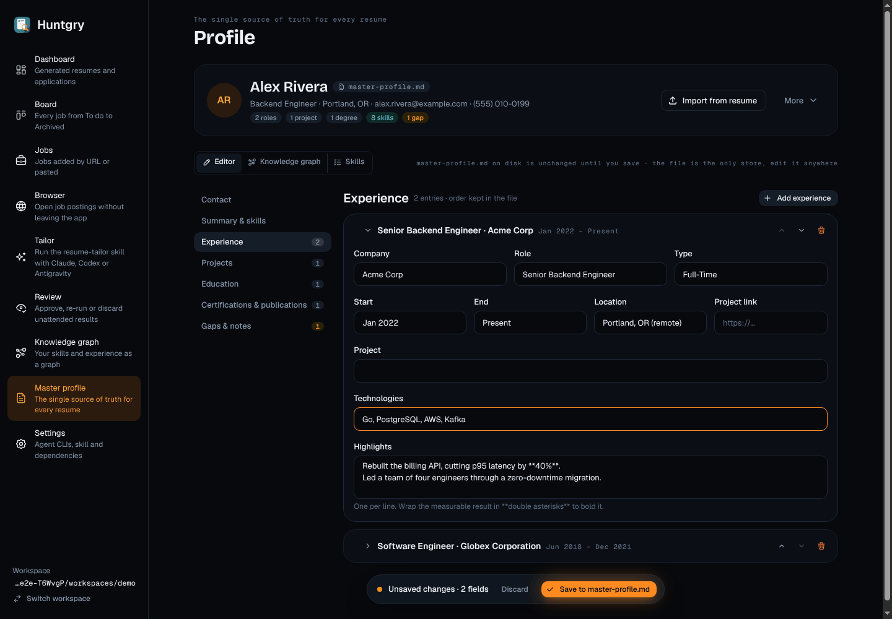
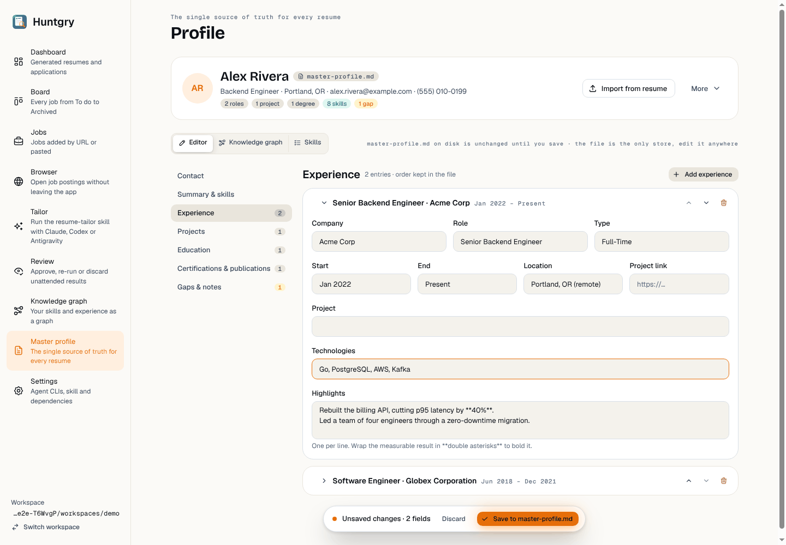
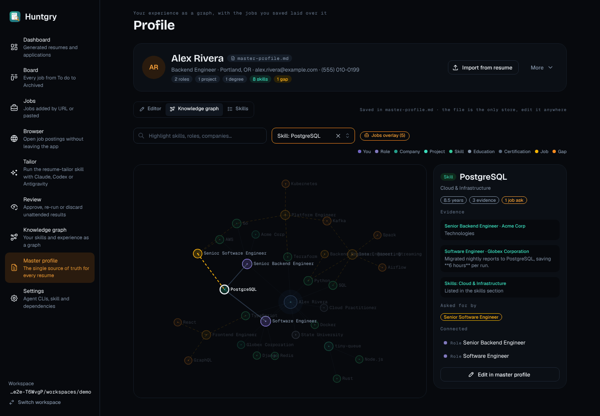
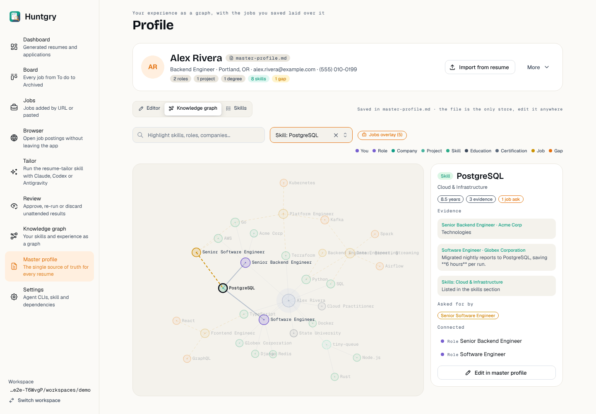
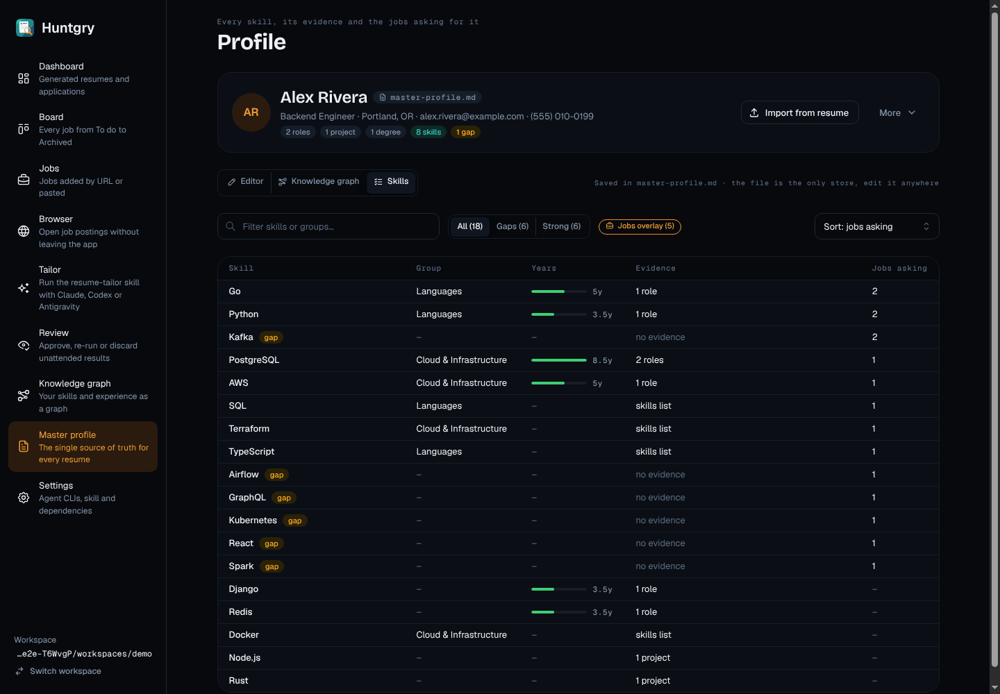
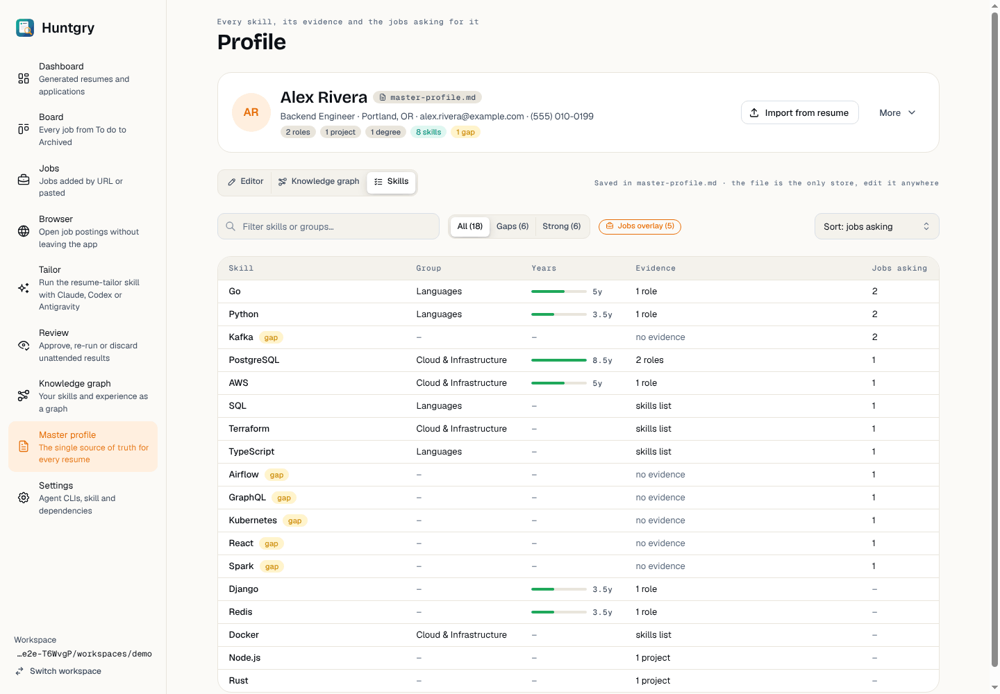
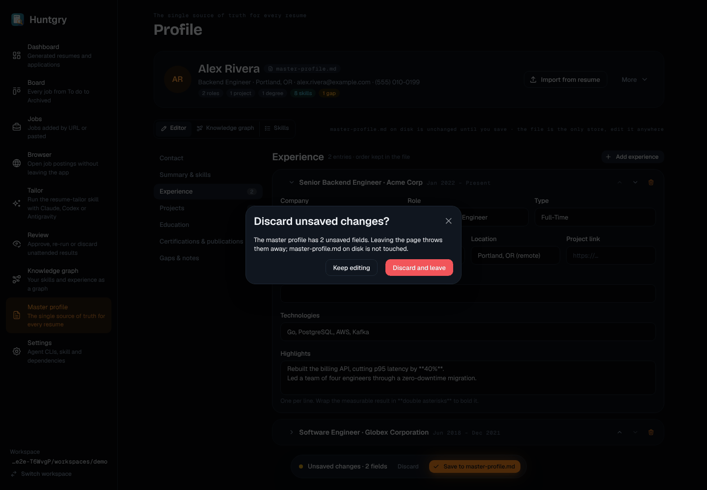
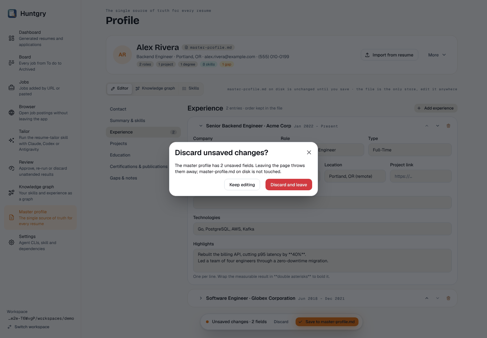

# #115 — Redesign 9/11: Profile (Editor · Knowledge graph · Skills), save bar, leave guard

Issue: [silentashish/huntgry#115](https://github.com/silentashish/huntgry/issues/115) · Epic #95 · Builds on #107 (tokens, theme, shared parts)
Figma `zhNccc831dRnOhj2tmqqkc`: Profile — Editor `13:2`, Profile — Knowledge graph `12:2`, Profile — Skills `12:279`,
Profile — Leave guard modal `17:1030` (App · Dark) and their App · Light twins.

## What changed

**One Profile page with three views.** `pages/profile` renders the page title (`PageHeader`, "Profile", eyebrow per view),
the header card (avatar, name, `master-profile.md` badge, contact line, roles / projects / degrees / skills / gaps pills,
Import from resume, More), and a view switcher **Editor · Knowledge graph · Skills** (`SegmentedControl` named "Profile
view"). The switcher is driven by `params.view` (Editor when absent) and switches with `navigate('profile', { view })`,
so every view is deep-linkable; `nodeId` selects a graph node and `section` opens an Editor section, re-applied on every
navigation. The draft lives in `ProfileEditor`, which stays mounted across the views, so moving to the graph or the
skills and back keeps unsaved edits. Moving *inside* the page (the switcher, the graph's "Edit in master profile")
passes the leave guard: the page wraps the navigation context so a `profile → profile` navigate clears the guard for
that one call and restores it; leaving the page still asks.

**Editor** (Figma 13:2). Sections are a vertical list on the left (`Tabs` `orientation="vertical"`, mono count
badges, a warning badge on Gaps & notes with the number of gaps); each section has a head (Geist 20 title, a muted line,
"+ Add …" in the secondary small style). Entries (experience, projects, education, certifications, publications) are
cards that fold open: chevron, title, mono dates, move up / move down / remove icon buttons. Fields sit on a 12-column
grid (rows of 3 and 4 like the Figma Experience card), descriptions under the input.
**Save bar**: a floating pill at the bottom, only while the form differs from the file — warning dot, "Unsaved changes ·
N fields", Discard, and the screen's one primary button "Save to master-profile.md". The number of fields comes from
`components/profile/changes.ts` (`profileChanges`: a text field is one, a list of lines is one, an added or removed
entry is one; blank lines and trailing spaces the file cannot hold are ignored, as before).
While nothing is unsaved the line beside the switcher says "Saved in master-profile.md · the file is the only store,
edit it anywhere" (the full path is its tooltip).

**Leave guard** (Figma 17:1030). The guard message is now the Figma text with the real count: "The master profile has N
unsaved fields. Leaving the page throws them away; master-profile.md on disk is not touched." The shell (AppLayout)
shows it in its modal with Keep editing / Discard and leave. The editor's own questions (More → Switch workspace…,
Import over a filled form) use `components/profile/ConfirmModal`, which is the Figma modal: icon tile, Geist 20 title,
28 px radius, outline + solid danger buttons.

**Knowledge graph** (Figma 12:2). Toolbar: search ("Highlight skills, roles, companies…"), "Jump to…", the Jobs overlay
chip (ember outline pill with a briefcase), and the legend. The canvas card (sunken surface) sits beside a 320 px node
panel: kind pill + title, years / evidence / "N jobs ask" pills, Evidence cards (source in the link colour, quote),
"Asked for by" job pills, connected nodes, and "Edit in master profile". Nodes are drawn as Figma rings: a soft fill,
a 1.5 px ring and a centre dot in the kind colour, a halo around "You", mono labels to the right, dashed amber lines
for what jobs ask for; a collision force keeps rings apart.
**Graph colours are tokens** (`components/graph/colors.ts`): `KIND_COLOR` maps each kind to a `var(--hg-…)`; the
canvas cannot read CSS variables, so `useTokenValues` reads their current values from `<html>` and reads them again
when the colour scheme attribute changes (a `MutationObserver`; no branching on the scheme). Alpha for faded nodes and
links comes from `withAlpha` (parses the hex / `rgb()` forms the tokens use).

**Skills** (Figma 12:279). Toolbar: filter, All / Gaps / Strong segmented filter with counts, the Jobs overlay chip,
"Sort: jobs asking / evidence / years / name". Table (mono header on the sunken surface): skill + "gap" pill, group,
years bar (relative to the longest) with a mono "8.5y", evidence by source ("2 roles · 1 project", "skills list", "no
evidence"), jobs asking. A row opens the node panel beside the table. Logic in `components/graph/skills.ts`.

**GraphPage** stays exported for a `graph` location until the shell sends it to the Profile page: it is a thin page
(title "Knowledge graph", "Open in Profile") around the same `GraphView`. `SkillsSummaryCard` (Dashboard) is restyled
with `SectionCard` / `StatusPill` and its "Knowledge graph" link now opens `profile` with `view: 'graph'`.

## Screenshots

| | Dark | Light |
| --- | --- | --- |
| Editor + save bar |  |  |
| Knowledge graph |  |  |
| Skills |  |  |
| Leave guard |  |  |

The sidebar in the screenshots is the pre-redesign shell (#108 restyles it in parallel).

## Deviations from Figma

- **Leave guard modal from the shell.** The navigation guard's modal belongs to `AppLayout` (Shell, #108); this page
  sets its message only, so the shell's modal shows the Figma text but not the icon tile / 28 px radius. The Figma look
  is in `components/profile/ConfirmModal`, used for the editor's own questions and ready for the shell to reuse.
- **"Updated 3 days ago"**: the app has no modification time for the file; the line says "Saved in master-profile.md"
  (or that the file is unchanged until you save) instead.
- **No drag handle on entry cards**: there is no drag-and-drop; order changes with the up / down buttons.
- **"N gaps" pill** counts the profile's own "Gaps and constraints" lines, the data the app has for it.
- **Legend colours**: Figma uses primitives (blue/violet/trail-500/trail-300/green/violet-100/amber/ember 500) in both
  modes; here they are tokens that switch with the scheme (`status-info`, `status-review`, `trail-600`, `trail-400`,
  `status-success`, `text-secondary`, `status-warning`, `accent-primary`), because `violet-100` (Education) and
  `trail-300` disappear on the bone background. Certification and Publication (not in the Figma legend) use
  `text-muted` / `ink-300`.
- **Jobs overlay in the Skills view**: Figma's Skills toolbar has no overlay chip; it stays because the gaps and the
  "jobs asking" column depend on it.
- **Node panel in the Skills view**: Figma's Skills frame has none; selecting a row still opens it (existing
  behaviour), next to the table.
- **"Asked for by"** lists the job titles of the saved postings (Figma shows company names; the graph's job nodes are
  titled by the posting).
- **Legend placement**: it wraps to its own right-aligned line when the toolbar does not fit the 1040 px content width
  of the current shell.

## Tests

- Unit: `components/profile/changes.test.ts` (field counting, normalisation, the guard text),
  `components/graph/graph.test.ts` (token-only colours, colour parsing and alpha, evidence summary, filters, sorting).
- e2e page objects: `e2e/pages/graph.ts` now reaches the graph through **Profile → Knowledge graph** with the view
  switcher (`GraphPage.open()`), whether or not the sidebar still lists the graph; `e2e/pages/profile-editor.ts` gains
  the view switcher and follows the new save bar ("Save to master-profile.md", "Unsaved changes · N fields").
- e2e specs: `graph.spec.ts` (legend "Gap", years as "5y", evidence by source, the All / Gaps filter, the selection
  following from Skills to Knowledge graph, "Edit in master profile" opening the Editor view), `profile-editor.spec.ts`
  (new: switching to the graph and skills views keeps the draft without asking, the save bar follows, leaving still
  asks with the field count; the leave text), `profile-setup.spec.ts` (no Save button until something changed).
- Run on Linux under `xvfb-run`: `graph`, `profile-editor`, `profile-setup`, `insights`, `shell`, `dashboard` specs pass,
  except `profile-editor.spec.ts` "closing the window with unsaved edits…", which fails the same way on `main` under
  Linux (closing the last window quits the app).
