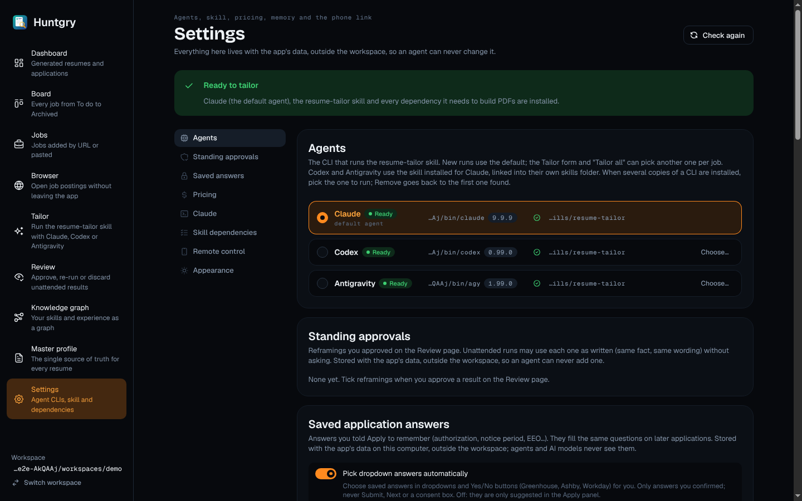
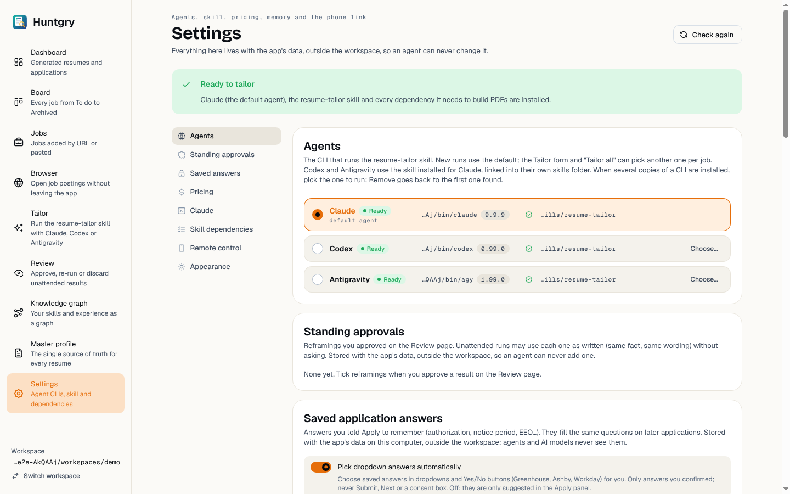
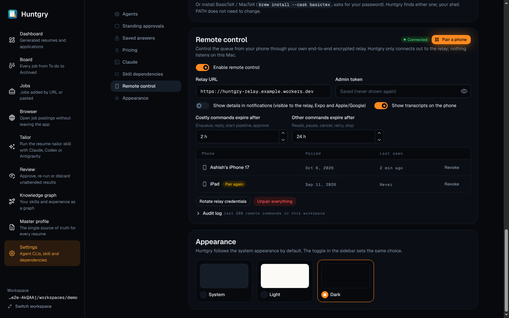
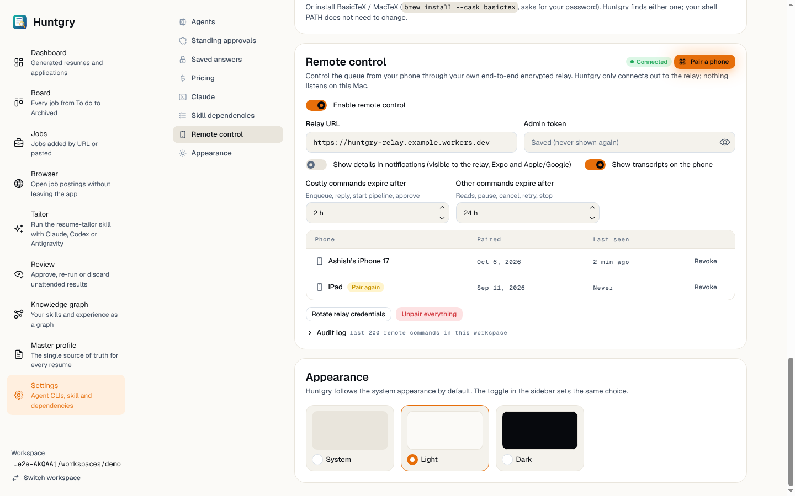
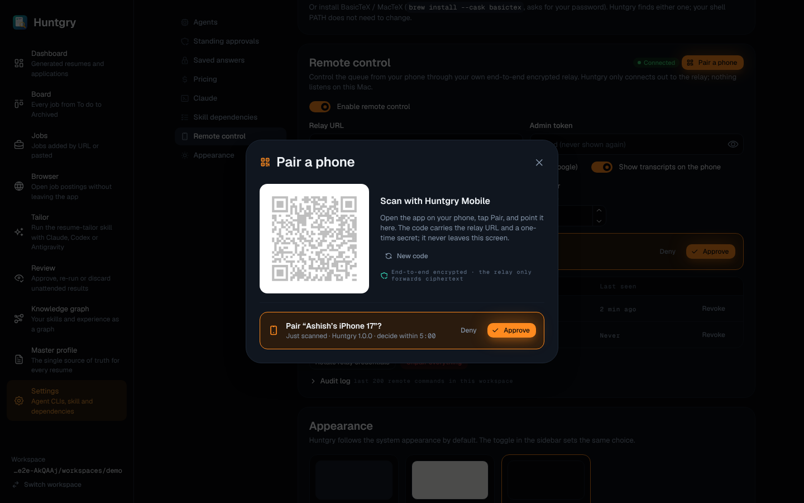
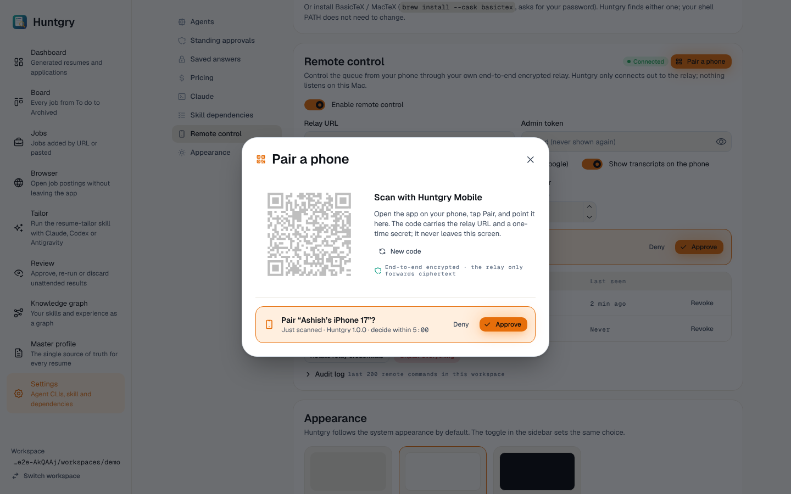
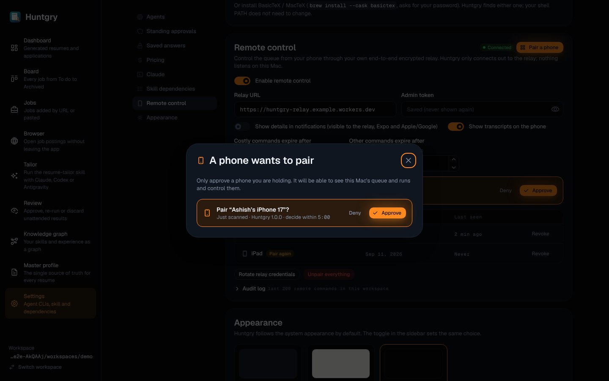
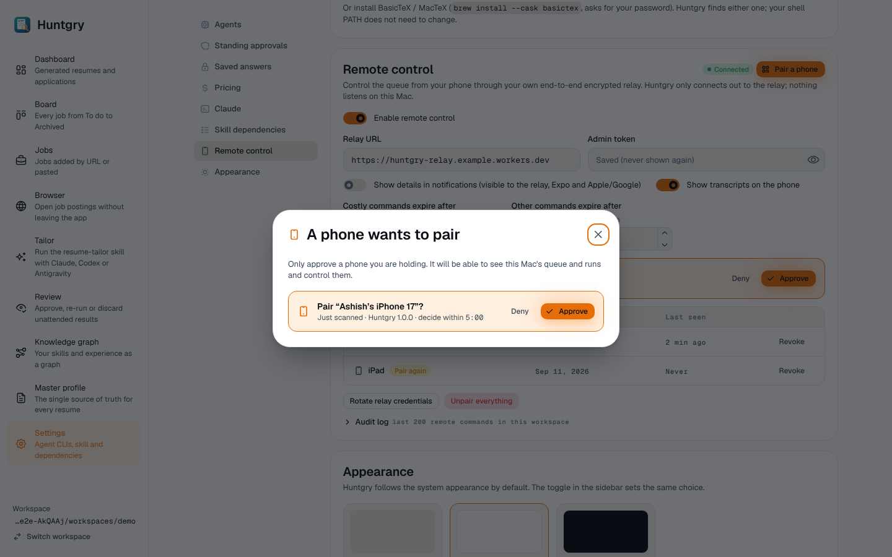

# #116: Settings redesign

Issue: [silentashish/huntgry#116](https://github.com/silentashish/huntgry/issues/116) · Epic #95 (redesign 10/11) · Builds on #107 (foundations).
Figma `zhNccc831dRnOhj2tmqqkc`: Settings `14:2`, Settings — Pair a phone (QR + approve) `17:1342`, and their App · Light twins.

## What changed

| Area | Files | What |
| --- | --- | --- |
| Page | `pages/settings/index.tsx` | `PageHeader` with the mono eyebrow, subtitle and **Check again**. The banners stay where they were. Below them sit a sticky section nav on the left and the cards on the right. Claude and Skill dependencies sit side by side when the column is at least 2 × 440 px wide; on narrower columns they stack. |
| Section nav | `SectionNav.tsx` | Agents, Standing approvals, Saved answers, Pricing, Claude, Skill dependencies, Remote control, Appearance. A click smooth-scrolls to the card. While the page scrolls, the entry for the card being read is highlighted (`aria-current="true"`). The highlight works whichever element scrolls (the window or the shell's main). At the bottom of the page the last card is highlighted, and a clicked entry stays highlighted until its scroll stops. Scrolls inside the cards (install log, tables, audit log, dropdowns) are ignored, and the bottom is measured on the element that scrolls the cards. When two cards sit side by side, the first of them wins, so Claude can be highlighted. Section wrappers carry `data-settings-section` with the shell's `SettingsSection` ids (`agents`, `standing-approvals`, `saved-answers`, `pricing`, `claude`, `skill-dependencies`, `remote-control`, `appearance`), which the ⌘K palette scrolls to. The pure `activeSection()` holds the logic and has unit tests. Before the agent check returns, only Remote control and Appearance are listed. |
| Appearance | `AppearanceCard.tsx` | System / Light / Dark as `Radio.Card` tiles with a preview swatch, in a `radiogroup` named "Appearance". It uses `useThemePreference()` from `theme/`, the same preference as the sidebar toggle. |
| Cards | `SettingsCard.tsx` and every card | Each card is the shared `SectionCard` with the Settings title size (20 px) and 20 px padding. Tables sit in a rounded frame with the sunken mono header. Pills are `StatusPill`. Paths, versions, dates, prices and counts use Geist Mono. |
| Agents | `index.tsx` | Each agent is a framed row (the default one in Ember soft), with the radio, name, Ready/Not ready pill and "default agent" caption. The CLI path and version pill come next, then the skill path with a check icon (or Not installed + **Install skill**), and **Choose…** / **Remove** on the right. The agent's name is a label for its radio, so clicking the name makes that agent the default. It is still a table, and the column headers are visually hidden. |
| Claude / Skill dependencies | `index.tsx` | Key/value rows with Geist labels and mono values. Badges sit under the value and actions on the right. Preflight rows show a mono status pill, the mono name and a muted detail. "Installing LaTeX and poppler" stays as its own card. |
| Standing approvals, Saved answers, Pricing, Remote control | their files | Ghost **Remove all** / **Forget all** with a trash icon (their confirm step is unchanged). The warning alert has an icon. The pick-dropdowns switch sits in a sunken strip. Pricing: **Sync prices** is secondary, **Add model** and **Reset to defaults** are ghost, amounts are mono, and the source pills are trail `synced`, Ember `changed` and review `added`. Remote: a status pill with a dot, and **Pair a phone** as the screen's one primary button. The phone table has mono dates, a warning **Pair again** pill and ghost **Revoke**. |
| Pair a phone | `PairPhoneModal.tsx` | 560 px modal, radius 2xl, with a Bricolage title and a QR icon. The 196 px white QR tile holds the 168 px code. The countdown is warning-coloured mono, **New code** is ghost, and the encrypted line is mono with a trail shield. |
| Approve prompt | `PairingPrompt.tsx` | `ApprovePanel` is an Ember-soft box with the phone icon, "Pair “…”?", the caption with a mono countdown, ghost **Deny** and primary **Approve**. The app-wide `PairingPrompt` modal (still rendered from `App.tsx`) uses the same modal styling. |

No behaviour changed: every IPC call, state, confirm step, label that tests use, and data-testid is kept.

## Screenshots

| | Dark | Light |
| --- | --- | --- |
| Top |  |  |
| Remote control + Appearance |  |  |
| Pair a phone (QR + approve) |  |  |
| App-wide "A phone wants to pair" |  |  |

The screenshots come from the running app (e2e sandbox, fake agents, and a faked connected relay with two phones), 1440 × 900.

## Deviations from Figma, and why

- **Real data, not the mock's.** The Claude card shows the CLI path with its version and install-kind pills rather than "2.1.4 Homebrew". The Agents skill column shows the skill path rather than "linked → ~/.agents/skills". Standing approvals show the application id under the date rather than "via desktop". Prices show what the table holds (no forced two decimals).
- **Longer copy kept.** Card descriptions keep the existing, more precise text (Agents, Standing approvals, Saved answers, Pricing). Labels that e2e tests use stay as they are: **Install/Reinstall Python dependencies** instead of "Reinstall Python deps", **Reset to defaults** instead of "Reset", and **Update Claude Code** instead of "Update".
- **Extra content the app has.** These cards and controls are not in the frame but stay on the page: the "Installing LaTeX and poppler" card, the command-expiry fields, Rotate relay credentials / Unpair everything, the audit log, the Paired column in the phones table, the sync status line, and the "not modelled" note under Pricing.
- **Claude + Skill dependencies stack** while the shell caps the page at 1040 px: two 450 px columns do not fit the real paths. They sit side by side once the content column is wide enough (as in the 1136 px Figma layout).
- **The QR dims while the approve step is shown** (existing behaviour, so a second phone cannot scan the same code); the Figma frame shows it at full strength.
- **The section nav hides below 1000 px** of window width.
- **Appearance description** reads "follows the system appearance by default. The toggle in the sidebar sets the same choice." instead of "follows macOS by default" (the app also runs on Linux).

## Shared parts

- `SectionCard` accepts no `data-*` props, so the Pricing card's `data-testid="pricing-card"` sits on a wrapper `div`. `MonoLabel` does not take one either, so the sync status line is a mono `Text`. If those props are added later, the wrappers can go.

## Tests

- Unit: `RemoteCard.test.tsx` and `SavedAnswersCard.test.tsx` are unchanged and green. New `SectionNav.test.tsx` covers `activeSection()` (first, last passed, bottom, missing sections) and the Appearance card switching the Mantine colour scheme.
- e2e: `e2e/pages/settings.ts` gains `sectionNav`, `sectionLink()`, `cardHeading()` and `appearanceOption()`. `settings.spec.ts` gains "the nav scrolls to a card and highlights it; Appearance sets the colour scheme and keeps it", which also covers a relaunch.
- Ran under `xvfb-run` on Linux, with `DISPLAY`/`XAUTHORITY` passed to the app by a local, uncommitted fixture edit: `settings`, `usage`, `isolation`, `shell`, `workspace`, `apply-answers` and `tailor` all pass (32 tests).
- `npm run typecheck:web && typecheck:node && typecheck:e2e`, `npx vitest run` and `npx electron-vite build` all pass. Under heavy machine load, two timing-sensitive main-process tests (`runner.test.ts`, `pipeline.test.ts`) failed once in the full run; both pass when re-run, and this change does not touch either.
