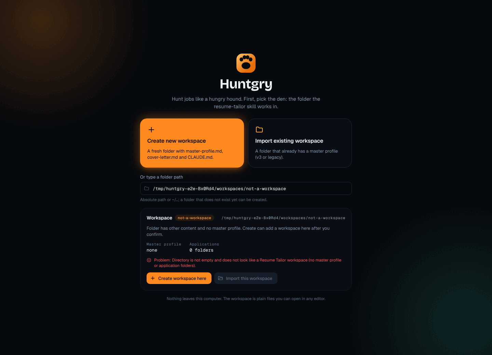
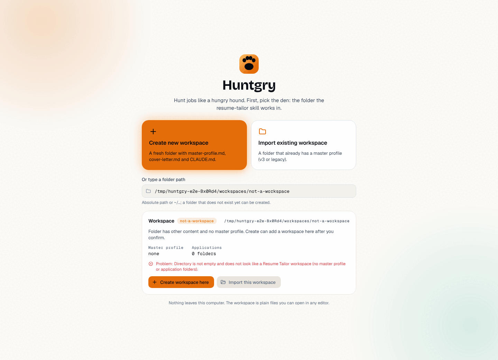
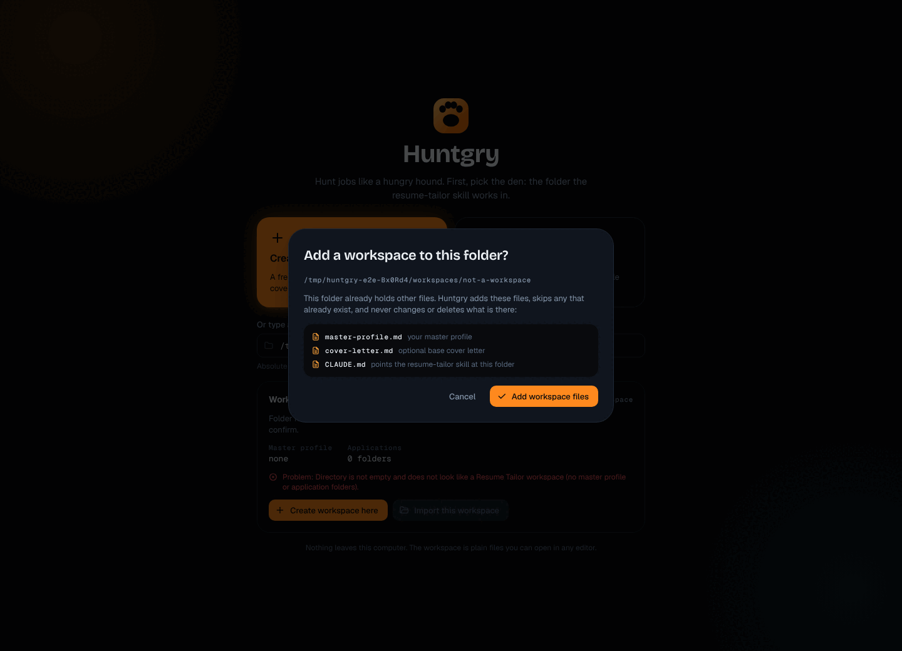
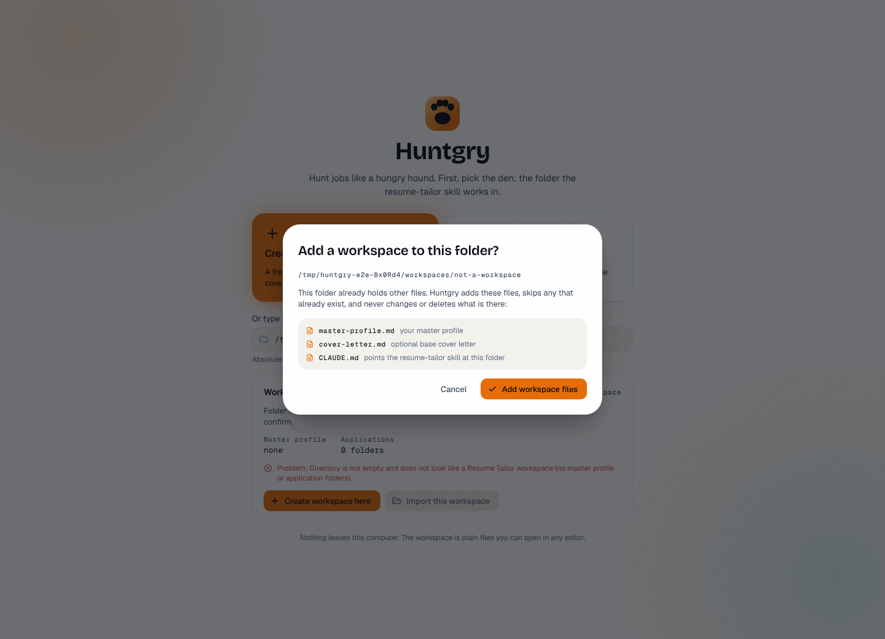
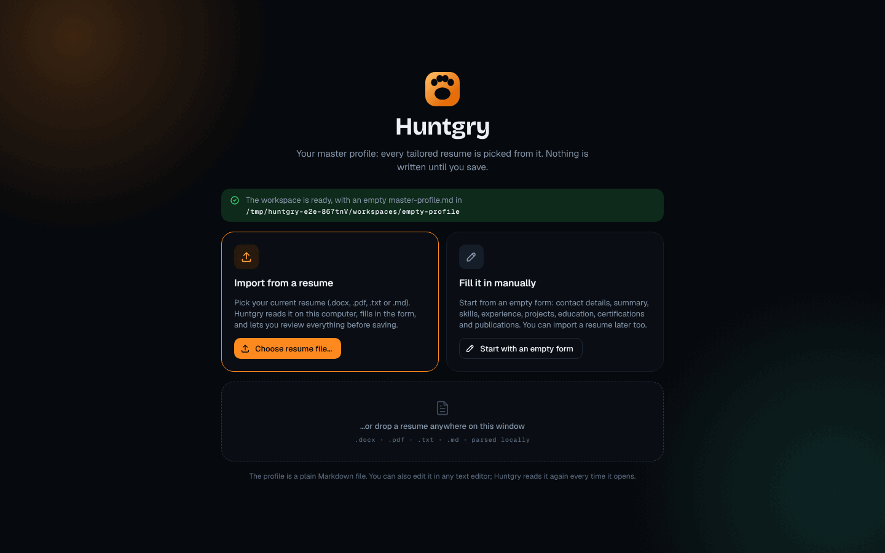
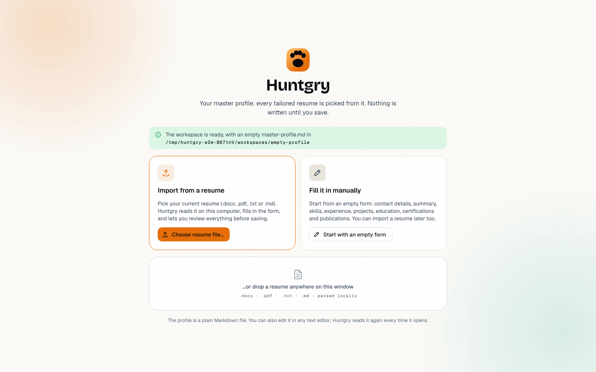

# #117 — First run in the Scent Trail design

Issue: [silentashish/huntgry#117](https://github.com/silentashish/huntgry/issues/117) · Epic #95 (redesign 11/11) ·
Figma `zhNccc831dRnOhj2tmqqkc`: First run — Workspace picker `15:2` (with its confirm modal `15:65`),
First run — Profile setup `15:92`, and the App · Light twins (`18:9587`, `18:9677`). Builds on the foundations of #107.

## What changed

| Area | Files | What |
| --- | --- | --- |
| Layout | `components/first-run/FirstRunLayout.tsx`, `first-run.module.css`, `App.tsx` (the non-shell part only) | Centred column on the canvas with the two scent glows (Ember top left, Trail bottom right), the paw, "Huntgry" (Bricolage 40, still the level-2 heading) and the step's subtitle. The loading state uses the same page: paw, wordmark and a small loader instead of the old bare spinner. |
| Paw logo | `components/first-run/PawLogo.tsx` | The Figma "Logo / Paw" mark as inline SVG, same geometry as `mobile/src/ui/Logo.tsx`, colours from the `--hg-ember-*` / `--hg-ink-950` tokens. |
| Workspace picker | `components/WorkspacePicker.tsx` | Create / Import are now two cards (Create is the screen's Ember card with the glow). Mono path input with a folder icon. Notices are soft tone banners (`role="status"`, unchanged texts and the "Create workspace here" offer). The confirm modal follows `15:65`: display title, mono path, the three files in a sunken list, ghost Cancel and "Add workspace files". New: a "Last opened" row offers the remembered workspace again (after "Switch workspace"), only when it can still be opened. |
| Status card | `components/WorkspaceStatus.tsx` | Figma `15:34`: "Workspace" + mono status pill + path on one line, the hint, mono facts (master profile, applications), warnings and problems as tone lines, and the Create here / Import this buttons inside the card. Both buttons show whenever one applies; the other is disabled (as in Figma). |
| Profile setup | `components/ProfileSetup.tsx` | Success banner with the workspace path, the two option cards (Import is the Ember-bordered one), the dashed drop zone and the footnote. |
| Drop a resume | `main/profile/resume-import.ts` (+ test), `main/profile/ipc.ts`, `preload/workspace.ts`, `shared/workspace-types.ts` | The design says "…or drop a resume anywhere on this window", so that now works: `profile.importResumeFile(file)` takes the dropped `File`, the preload resolves its path with `webUtils.getPathForFile` and main parses it exactly like a picked resume (shared `importResumeFrom`). Main accepts only an absolute path with a resume extension. A `File` built by page script has no path, so the renderer still cannot make main read an arbitrary file. The picked-file handler is unchanged apart from sharing the parse code. |

All behaviour of the picker and setup step is kept: the generation guard against stale inspections, Create's
confirmation for non-empty folders, the Import refusal with its Create offer, the remembered-workspace notice,
cancelled dialogs changing nothing, and nothing written before Save.

## Screenshots

| | Dark | Light |
| --- | --- | --- |
| Workspace picker |  |  |
| Confirm modal |  |  |
| Profile setup |  |  |

## Deviations from Figma

- **No "Size" fact** on the status card: the inspection has no file count, so only master profile and
  applications are shown.
- **Full paths, not `~/…`**: the renderer does not know the home folder, so paths are shown as main returns
  them (absolute, real path). Long paths wrap in the setup banner.
- **"Nothing leaves this computer"** instead of "this Mac": the app runs on Windows and Linux too.
- **Problems are listed** under the hint (Figma only shows a warning line): the inspection's errors were shown
  before as well and stay visible.
- **Button glows**: Figma's buttons in these frames have no glow, so "Create workspace here", "Choose resume
  file…" and "Add workspace files" use the solid Ember button without glow; the Create card is the one glow.
- **"Last opened" row** is not in Figma: the brief asked for the recent workspace, and after "Switch workspace"
  it is the only way back to the open workspace without the folder dialog. It only appears when the remembered
  workspace can still be imported.
- The setup step has no visible "Set up your master profile" heading any more (Figma has none); the step is a
  region with that name, and the option cards are `h3` headings.

## Tests

- Unit: `src/main/profile/resume-import.test.ts` (path checks for dropped files, parse result and errors).
- e2e page objects: `workspace-picker.ts` (sentence-case card names, new subtitle, `recent` region),
  `profile-setup.ts` (region, `dropFile` with a real file-backed `File`, `dropScriptFile` for a pathless one).
- e2e specs: `workspace.spec.ts` (no recent row on first launch or for a broken workspace; Switch workspace →
  Open brings the workspace back), `profile-setup.spec.ts` (a dropped `.docx` is imported like a picked one;
  a dropped `.png` and a pathless script `File` are refused), `isolation.spec.ts` (uses the page object).
- Run on Linux under `xvfb-run`: `workspace`, `profile-setup`, `isolation`, `shell` specs, 21/21 passed;
  `npm run typecheck:web/node/e2e`, `npx vitest run` (92 files), `npx electron-vite build`.
