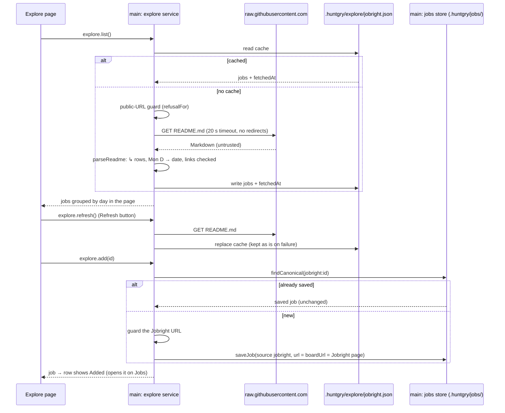

# #142 — Explore: daily new-grad jobs from Jobright's GitHub list, addable to Jobs

Issue: [silentashish/huntgry#142](https://github.com/silentashish/huntgry/issues/142) · Builds on #10 (jobs store), #78 (no board search), #108 (shell), #111 (Jobs redesign)

> **Since #169** Explore lists from the newgrad-jobs API, one category at a time, cached per category in
> `.huntgry/explore/<category>.json`; the README described here is its fallback when the API fails. See
> [169-explore-newgrad-api.md](169-explore-newgrad-api.md).

## Context & problem

Huntgry stopped searching job boards in #78: jobs come in by URL or pasted text. New grads
still need somewhere to find postings, and Jobright publishes a curated list of new-grad software
jobs as a public GitHub repo,
[jobright-ai/2026-Software-Engineer-New-Grad](https://github.com/jobright-ai/2026-Software-Engineer-New-Grad).
Its `README.md` (branch `master`) holds one Markdown table under `## Daily Job List`:

```
| Company | Job Title | Location | Work Model | Date Posted |
| **[Rocket](https://www.rocketcompanies.com)** | **[Software Engineer I](https://jobright.ai/jobs/info/<id>?utm_…)** | Detroit, MI, United States | On Site | Oct 21 |
| ↳ | **[Formal Verification Engineer](https://jobright.ai/jobs/info/<id>…)** | Mountain View | Remote | Oct 21 |
```

On 2026-10-21 it held 736 rows across Oct 14–21 (514 On Site, 163 Hybrid, 59 Remote, 142 `↳`
rows), about 180 KB. `↳` means "same company as the previous row", dates are `Mon D` with no
year, and every job link is a `jobright.ai/jobs/info/<24 hex>` page whose id is stable.

Explore reads that README (one raw GitHub URL, plain HTTPS from the main process; jobright.ai is
not scraped), groups the jobs by posted day and lets the user add any of them to Jobs in one
click.

## What changed and why

| Area | Files | Why |
| --- | --- | --- |
| Model | `src/shared/explore-types.ts`, `src/shared/jobs-types.ts`, `src/shared/runner-types.ts` | `ExploreJob` (Jobright id, company and its link, title, Jobright URL, location, work model, posted day), `ExploreList`, `ExploreApi`, `EXPLORE_CHANNELS`. A new `JobSourceId` / `JOB_SOURCE_TAGS` entry `jobright`, and `JOB_ID_PATTERN` accepts `jobright:<id>`, so a Jobright job is an ordinary saved job everywhere (queue, pipeline, Tailor, the application's recorded source). |
| Parser | `src/main/explore/parse.ts` | Pure: `↳` rows take the previous company, `Mon D` → `YYYY-MM-DD` (this year, or last year when the date would be more than a day after today), `On Site` / `Onsite` / `Remote` / `Hybrid` → the work model, `\|` inside a cell kept. **The Markdown is untrusted**: a row is kept only when its job link is `https://jobright.ai/jobs/info/<id>` (or `www.`), tracking parameters are dropped from the stored URL, a company link is kept only when it is a public-looking http(s) URL, and malformed rows (bad date, other host, short row, repeated id) are skipped. The source URL is the constant `JOBRIGHT_NEW_GRAD_README`, so another Jobright list is a small change. |
| Service | `src/main/explore/service.ts` | `listExplore` serves `<workspace>/.huntgry/explore/jobright.json` when present, else fetches; `refreshExplore` fetches, parses and replaces the cache (a failed fetch leaves it as it was). The fetch is Node's `fetch` with a 20 s timeout, no redirects, no credentials, a 5 MB cap, and goes through the same public-URL guard as the browser (`refusalFor`). Cached rows are validated again on read. `addExplore` saves a row through the jobs store (`saveJob`, so `canonicalize` and aliases apply) as `source: 'jobright'`, `url` and `boardUrl` the Jobright page, `postedAt` the posted day at noon UTC, `remote` / `workplaceType` from the work model, `descriptionComplete: false`. It is idempotent: a job already saved (as itself or as an alias of another board's copy) is returned untouched. |
| IPC / preload | `src/main/explore/ipc.ts`, `src/main/ipc.ts`, `src/preload/explore.ts`, `src/preload/index.ts`, `src/shared/api.ts` | `window.huntgry.explore.{list, refresh, add}`. The renderer sends only a Jobright id (checked against `JOBRIGHT_ID_PATTERN`); main takes everything else from its own cache. |
| Test source | `src/main/explore/source.ts`, `scripts/mock-ats/jobright.mjs`, `e2e/fixtures/servers/*` | `HUNTGRY_EXPLORE_SOURCE_URL` points an **unpackaged** build with `HUNTGRY_ALLOW_LOCAL_URLS=1` at a **loopback** README (and accepts job links on that host). A packaged build always reads GitHub. The e2e mock server serves a README dated relative to today and Jobright-like posting pages (one behind a bot wall). |
| Fetch full description | `src/main/jobs/service.ts`, `pages/jobs/JobDrawer.tsx` | A `jobright` job is fetched like one added by URL: the hidden posting loader opens the Jobright page and reads its JSON-LD or text. When Jobright shows the hidden window a human check, the drawer says so the way it does for Indeed: "Jobright shows full job descriptions only after a human check. Open the posting and paste the description." |
| Page | `src/renderer/src/pages/explore/*` | Day buttons newest first with counts, today selected (the newest day when today has none), a text filter (company / title / location), a work-model segment (Any / Remote / Hybrid / On Site), **Refresh** with "Updated … ago", errors inline over the cached list, and per row **Add to Jobs** or **Added** (opens the job's drawer on the Jobs page). Titles open the Jobright page in the in-app browser, which applies its own public-URL guard. |
| Navigation | `navigation.ts`, `App.tsx`, `Sidebar.tsx`, `CommandPalette.tsx`, `palette/search.ts`, `pages/jobs/index.tsx` | `explore` page between Jobs and Browser (compass icon), in the ⌘K palette's Go to list; `navigate('jobs', { openId })` opens a saved job's drawer. |
| Labels | `pages/jobs/labels.ts` | Source label "Jobright". |



## Decisions and alternatives rejected

- **The README, not jobright.ai.** The repo is a public, documented list; the README is one
  request on demand. Scraping jobright.ai's site or API was out of the question.
- **Fetch on demand, cache in the workspace.** No background polling: the list is fetched the
  first time the page opens in a workspace and when the user clicks Refresh. Reopening is
  instant and works offline. The cache is per workspace like the rest of `.huntgry/`.
- **The renderer sends ids only.** `add` takes a Jobright id and builds the job from main's
  cache, so a compromised renderer cannot save arbitrary URLs as Jobright jobs.
- **Strict links.** Job links must be Jobright posting pages; anything else drops the row. Links
  are opened in the in-app browser and loaded by the posting loader, both of which keep their
  public-URL guards; `add` runs the guard on the Jobright URL too. A DNS check of every company
  link at parse time (700 lookups) was rejected; company links are only syntax-checked and not
  opened by the page.
- **Year inference with a day of slack.** A date up to a day ahead of the local date is this
  year (the list is maintained in US time); anything later is last year's.
- **Today, else the newest day.** The README is updated during the US day; before the first
  update the page opens on the newest day rather than an empty "today".
- **Idempotent add returns the saved job untouched**, rather than merging the row again, so a
  full description fetched since is never overwritten.
- **No sidebar badge** for new jobs: the count is on the day buttons.

## How to test

```bash
npm run typecheck
npx vitest run
npm run test:e2e -- e2e/tests/explore.spec.ts e2e/tests/jobs.spec.ts e2e/tests/shell.spec.ts
```

Unit tests: `src/main/explore/explore.test.ts` (parser: `↳` rows, year inference, work model
mapping, malformed rows and unsafe links skipped, id pattern; source override only unpackaged
and loopback; service: fetch once then cache, offline cache, failed refresh keeps the cache,
empty list refused, foreign or invalid cache ignored, add with every field, idempotent add keeps
a fetched description, merge with the same job from another board, unknown id, refused link,
Fetch full description from the Jobright page and its human-check message) and
`src/renderer/src/pages/explore/view.test.ts` (day groups and labels, default day, filters,
saved rows incl. aliases, "Updated … ago").

e2e: `e2e/tests/explore.spec.ts` against the mock list: today first with counts, the malformed
row dropped, the cache written, another day, text and work-model filters, **Add to Jobs** writes
`jobright-<id>.json`, **Added** opens the drawer on Jobs, Fetch full description reads the mock
Jobright page, reopening is served from the cache, Refresh and an inline error over the cached
list, the human-check message, the sidebar order and the ⌘K entry, and the error state with no
cache. `shell.spec.ts` now expects 9 pages and visits Explore with no override: the harness's
loopback-only rule refuses GitHub before any lookup.

## Follow-ups

- Other Jobright lists (data, PM, interns): a list picker over more source constants.
- Follow the Jobright page's "Apply" link to the employer's posting when the page exposes it,
  so Fetch full description and Apply reach the employer's ATS directly.
- A "new since last visit" marker on the day buttons.
