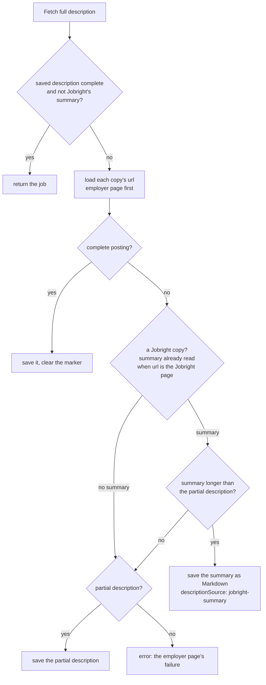
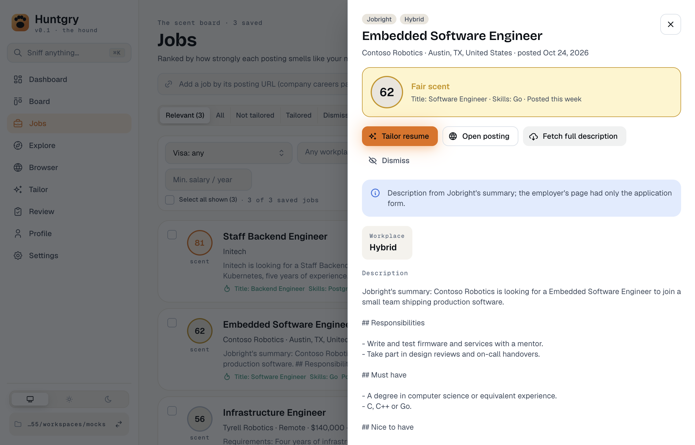

# #148 — Jobright's summary when the employer's page is only an application form

Issue: [silentashish/huntgry#148](https://github.com/silentashish/huntgry/issues/148)

## Context & problem

Since #146 a Jobright job's link (`url`) is the employer's posting, and the Jobright page stays its
board link (`boardUrl`). Some employer links go straight to an application form: a Workday apply
step, an Ashby or Pinpoint "Application" tab, a careers page with only the form. They carry no
description, so **Fetch full description** failed with "The employer's page did not have a
readable description". Worse, a form with enough labels (over 200 characters of text and no
JSON-LD) passed the page-text fallback and its labels were saved as the description.

The Jobright page knows the job. It has no JSON-LD `JobPosting`, but its `__NEXT_DATA__` →
`props.pageProps.dataSource.jobResult` has `jobSummary`, `coreResponsibilities[]` and
`qualifications.mustHave[]` / `niceToHave[]`, signed in or not. `fetchDetails` never tried it: it
only loaded each copy's `url`.

## What changed and why

| Area | Files | Why |
| --- | --- | --- |
| Form pages | `src/main/jobs/sources/posting.ts` | `POSTING_EXTRACT` also counts the characters of the main text inside `<form>` elements (`formText`). Without JSON-LD the page text counts as a posting only when it has 200 characters outside forms. A posting with an application form below it still reads; an apply step alone does not. |
| Jobright's summary | `src/main/jobs/sources/jobright.ts` | `JOBRIGHT_POSTING_EXTRACT` reads everything `POSTING_EXTRACT` reads plus the summary fields, so one load of a Jobright page gives both. `jobrightSummaryOf` shape-checks them and builds Markdown: the summary, then `## Responsibilities`, `## Must have` and `## Nice to have` lists. |
| Fallback | `src/main/jobs/service.ts` | `fetchDetails` tries every copy's link as before; a complete employer description wins and the Jobright page is never loaded. Otherwise the board page of the first Jobright copy is loaded and its summary used when it is longer than the employer's partial description (and than another board's saved summary). The job is saved with `descriptionSource: 'jobright-summary'`. A job whose link is still the Jobright page (#142, not connected) reads the page and the summary in one load, and a Jobright human check there still gets #142's message without a second load. |
| Marker | `src/shared/jobs-types.ts`, `src/main/jobs/store.ts` | `Job.descriptionSource`. It follows the description it describes: a re-saved board copy without a description keeps it, a fetched posting clears it, and merging copies from several boards prefers a posting over Jobright's summary. `jobDescriptionFor` adds the note to the text the tailor gets. |
| Drawer | `src/renderer/src/pages/jobs/JobDrawer.tsx` | "Description from Jobright's summary; the employer's page had only the application form." **Fetch full description** stays offered for such a job (`canRefetchDetails`). |
| Tests | `src/main/jobs/jobright-summary.test.ts`, `e2e/tests/explore-jobright.spec.ts`, `scripts/mock-ats/jobright.mjs`, `e2e/fixtures/servers/pages.ts` | Unit: the extract on a fake signed-out page, Markdown building, form-only pages, the fallback, no fallback with an employer description, the partial-vs-summary length rule, the one-load path, human checks, clearing the marker, merging. The mock Jobright pages carry the summary fields; Contoso's employer link is `/postings/apply-only`, a form with no description. |

## Decisions and alternatives

- **The summary counts as complete.** It is the most Huntgry can read without the user, and
  tailoring, the queue and the unattended pipeline only take complete descriptions; marking it
  incomplete would have made them fail with "Only part of the posting could be read". The marker
  tells the user and the tailor what it is, and Fetch full description stays offered (and
  `fetchDetails` does not return early for it), so a later fetch that finds the employer's posting
  replaces it. `canFetchDetails` is unchanged, so Tailor resume does not refetch it every time.
- **Only the summary fields from the Jobright page in the fallback**, not its page text: on
  jobright.ai that text is Jobright's rendering of the same summary with navigation and sign-up
  prompts around it. For the same reason, a Jobright page without JSON-LD gives the summary when
  it has one rather than its page text.
- **Skills (`skillSummaries`, `jdCoreSkills`) are left out.** They repeat the qualifications; the
  ticket's four sections are enough for tailoring.
- **Form detection by `<form>` text, not by counting inputs.** A posting page often embeds its
  application form; counting inputs would reject it. Excluding the form's own text keeps it.

## How to test

- `npx vitest run src/main/jobs src/main/explore`
- `npm run build && npx playwright test -c e2e/playwright.config.ts e2e/tests/explore-jobright.spec.ts e2e/tests/explore.spec.ts e2e/tests/jobs.spec.ts`
- By hand: connect Jobright (Settings → Jobright), add a job from Explore whose employer link is
  an apply form, and click **Fetch full description**: the drawer shows Jobright's summary with
  the note.

## Follow-ups

- Apply steps that do not use `<form>` elements (some Workday steps render plain inputs) still pass
  the page-text check when their labels are long; a role-based check could catch them.
- The drawer shows the Markdown as plain text, like every description; rendering it is separate.
