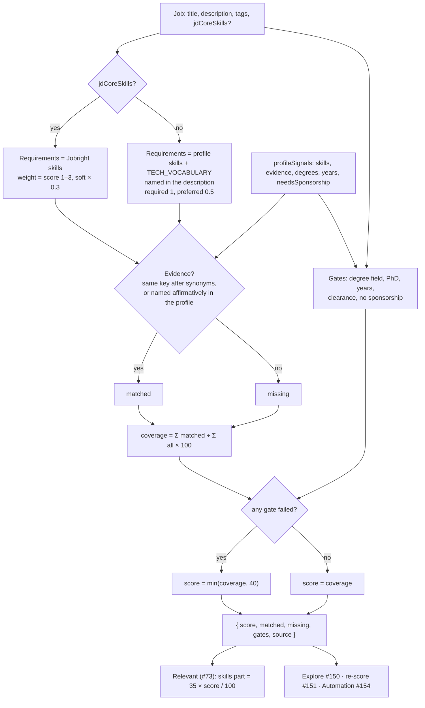

# #149 — Match score: skill coverage from the master profile (shared engine)

Issue: [silentashish/huntgry#149](https://github.com/silentashish/huntgry/issues/149)

## Context & problem

The Jobs page's **Relevant** score (#73, `src/shared/job-relevance.ts`) answers "is this worth a
look?": title 35, skills 35, seniority 10, location 10, recency 10. Its skills part was full as
soon as a posting named **3** of the profile's skills, so a job asking for twelve technologies of
which the profile has three looked as good as one asking for exactly those three.

Explore (#150), the re-score after tailoring (#151) and Automation (#154) need a different number:
**how much of what the job asks for the profile has evidence for**, with the reasons, from one
shared engine. A second unrelated 0–100 number on other pages would confuse, so this change also
defines how the two relate: Relevant's skills part *is* the match score.

## What changed and why

| Area | Files | Why |
| --- | --- | --- |
| Engine | `src/shared/match-score.ts` | `matchScore(job, profile)` returns `{ score, matched, missing, gates, source }`. Requirements come from Jobright's `jdCoreSkills` when the job has them (`source: 'jobright-skills'`), else from the description, title and tags (`source: 'description'`), looked up with the profile's skills plus `TECH_VOCABULARY`, so technologies the profile lacks count against it. Score = Σ weight matched ÷ Σ weight of all × 100. Must-haves are gates: a failed one caps the score at `GATE_CAP` (40) and says why. Pure, deterministic, no model call. |
| Weights | `src/shared/match-score.ts` | Jobright: weight = its `score` (clamped 1–3); soft skills × `SOFT_SKILL_WEIGHT` (0.3). Description: 1 for a skill named as required anywhere, `PREFERRED_WEIGHT` (0.5) when only named under a "Nice to have" / "Preferred" heading or in a sentence that says "a plus", "preferred", "bonus". |
| Evidence | `src/shared/match-score.ts`, `src/shared/job-relevance.ts` | A requirement is matched when a profile skill (knowledge graph, gaps excluded) has the same key after synonyms (`JS` = `JavaScript`, `Postgres` = `PostgreSQL`, `k8s` = `Kubernetes`, via `skills.ts`), also after dropping filler words and parentheses ("Python Programming", "Amazon Web Services (AWS)"). Otherwise the profile's own words count when they name it affirmatively (`ProfileSignals.evidence`: skills lines with their annotations, technologies, highlights, summary, education, certifications, never "Gaps & notes"), so "S3" inside "AWS (EC2, S3)" is evidence and "No production Rust" is not. |
| Gates | `src/shared/match-score.ts`, `src/shared/job-filters.ts` | **Degree field**: a required degree whose field is in an area (computing/EE/math, chemistry/life sciences, business, health care, mechanical/civil/industrial) none of the profile's degrees is in. "Or equivalent experience" and preferred degrees are not gates. **PhD**: only when the sentence requires it. **Years**: the board's `minYearsExperience`, else the largest "N+ years … experience" in a required sentence, with one year of slack. **Clearance** (`requiresClearance`, now exported): fails for someone who needs sponsorship, or when an *active* clearance is required and the profile does not say it holds one. **Sponsorship**: the profile needs a sponsor and the posting says it won't (`sponsorshipOf`). |
| Profile signals | `src/shared/job-relevance.ts` | `ProfileSignals` extends `MatchProfile` and gains `degrees` (Education) and `evidence`. `profileSignals(profile)` fills them, so every caller already has what `matchScore` needs. |
| Relevant | `src/shared/job-relevance.ts` | The skills part is now `35 × match score / 100` instead of "full at 3 shared skills". `JobScore.match` carries the whole `MatchResult`; the "Skills: …" reason lists the matched requirements. The other parts, the threshold (40) and the exclusions are unchanged. |
| Calibration | `scripts/match-calibration.mjs` | Scores a workspace's saved jobs and Explore list (read only) and prints the spread, a histogram, how many jobs each threshold would pick, and examples (titles, companies, skill names only). `node scripts/match-calibration.mjs <workspace> [--json]`, Node 23+ (it imports the TypeScript sources through a resolve hook). |
| Tests | `src/shared/match-score.test.ts`, `src/renderer/src/pages/jobs/view.test.ts`, `src/renderer/src/pages/jobs/labels.test.ts` | Synonyms both ways, Jobright names with filler and parentheses, weights (Jobright and preferred), a description-only job, the live `jdCoreSkills` shape and malformed entries, every gate and its exceptions, the chemistry-lab Application Engineer case, `profileSignals` → `matchScore`, and Relevant's skills part. The view test's ranking fixture now differs by coverage instead of by count. |

## How it works

## Calibration (the owner's workspace, read only)

54 of the 64 saved, not dismissed jobs name at least one requirement (the other 10 name no known
technology); none has `jdCoreSkills` yet, since Explore's rows carry only a title until #150 loads
the posting. The 799 Explore rows have no description, so they can't be scored yet; the 7 rows
already added to Jobs score 33–60.

| | min | p25 | median | p75 | p90 | max |
| --- | --- | --- | --- | --- | --- | --- |
| Match, saved jobs (n = 54) | 33 | 57 | 79 | 99 | 100 | 100 |
| Relevant, same jobs | 33 | 56 | 63 | 73 | 84 | 95 |
| Requirements per job | 1 | 5 | 9 | 13 | 19 | 37 |

Suggested Automation threshold: **Match ≥ 80 with at least 4 requirements**, which picks 19 of the
54 (about the top third). At 90 only 8 qualify; at 70, 23. Jobs that name one or two skills land on
0 or 100 from a thin signal, hence the minimum. #154 should re-run the script on a fuller
workspace before fixing the number.

## Decisions and alternatives

- **Coverage, not a count.** The ticket's definition: 100 means every requirement is matched.
  A job that names nothing scores 0 with `matched` and `missing` empty, which callers read as
  "unknown", not "no match".
- **Gates cap, they don't zero.** A failed gate caps at 40, so a gated job sorts below any
  ungated good match but still shows what matched.
- **Areas, not exact fields, for degrees.** "Computer Science, Electrical Engineering or Math" is
  met by an Electronics and Communications degree. A field outside every known area never gates,
  so an odd sentence can't hide a job.
- **"JS" alone in a description is not JavaScript.** `skills.ts` ignores two-letter aliases in
  free text on purpose ("ts", "ml", "go"). They still match as names: a Jobright skill "JS" or a
  profile skill "JS" is JavaScript.
- **UI unchanged.** The Jobs card still shows the Relevant ring; showing Match on the card with
  Relevant as its filter is left as a follow-up (it changes the ring, its tones and the e2e
  screenshots). `JobScore.match` already carries what it needs.

## How to test

- `npx vitest run src/shared/match-score.test.ts src/shared/job-relevance.test.ts src/renderer/src/pages/jobs src/renderer/src/pages/board`
- `node scripts/match-calibration.mjs <workspace>`, e.g. on a workspace with saved jobs.
