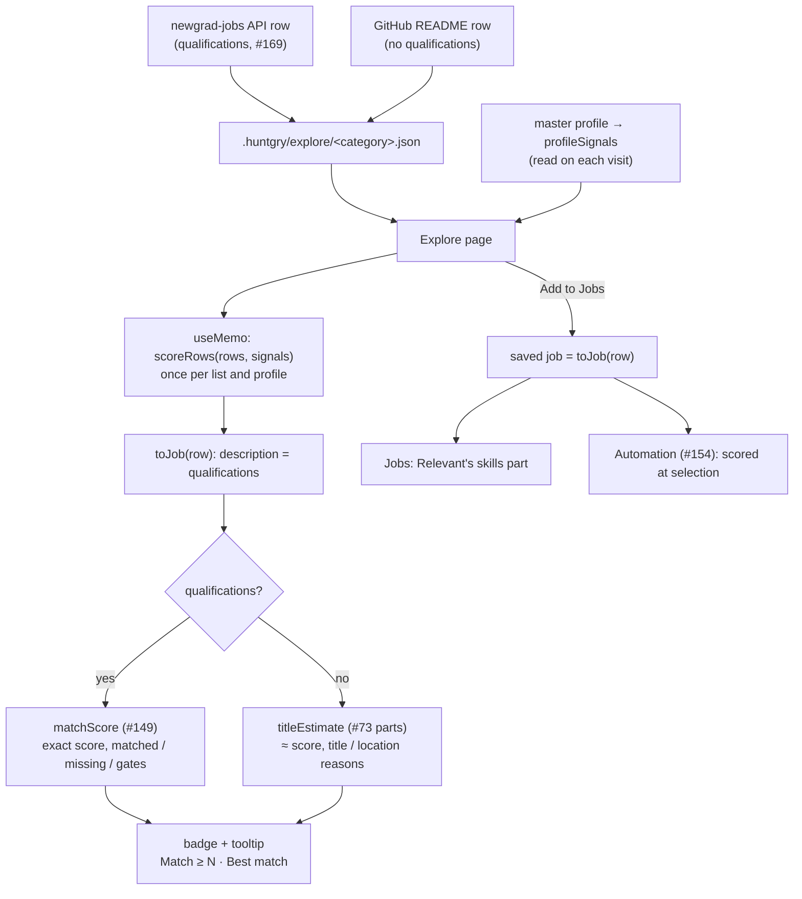
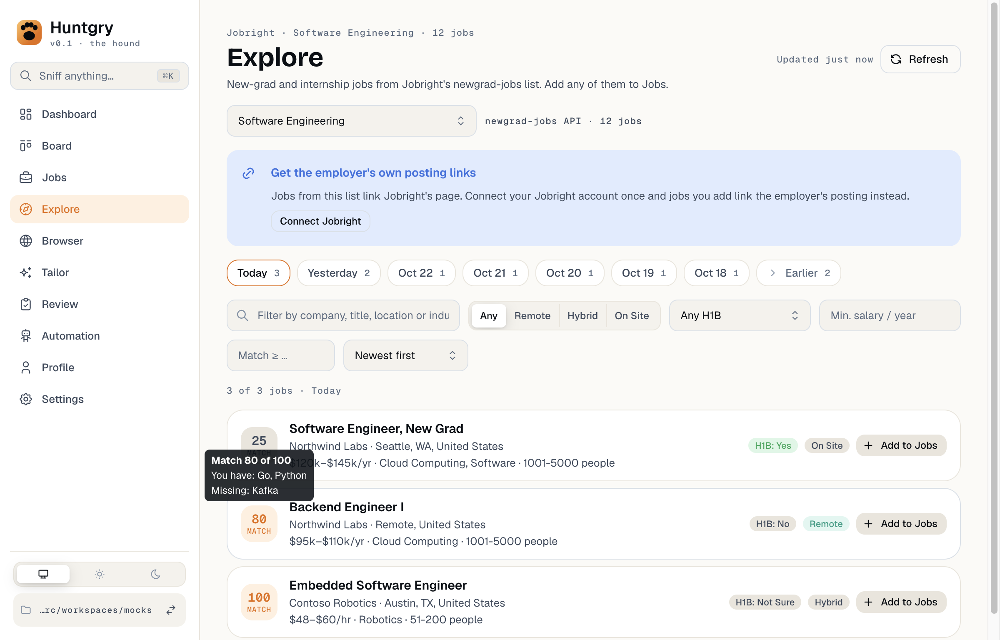
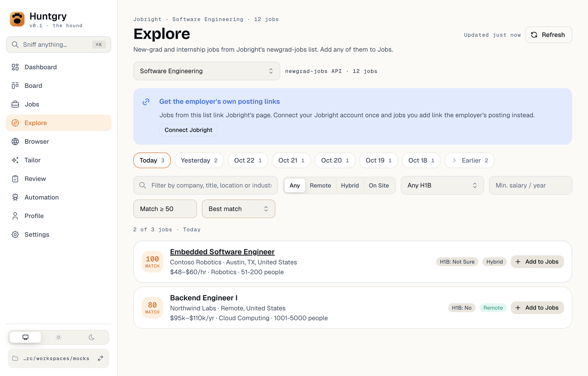
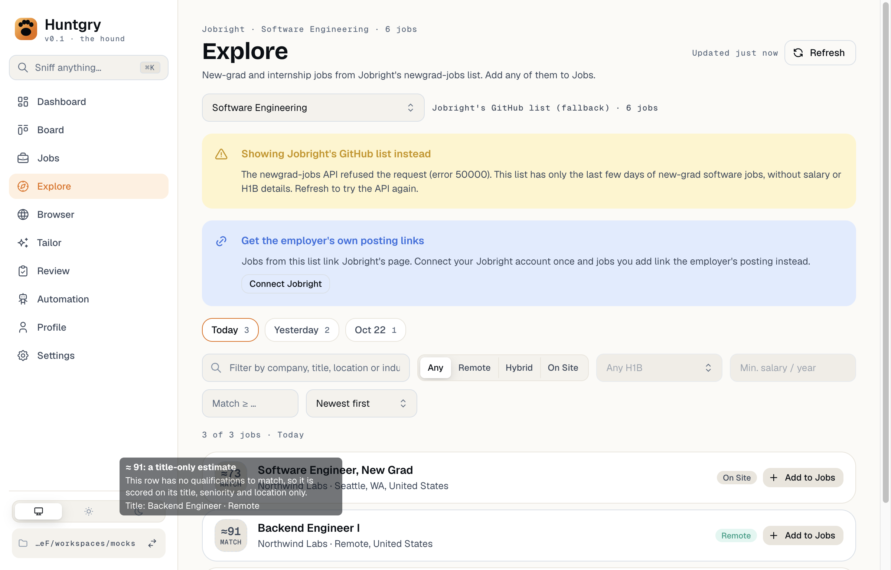

# #150 — Explore: the match score on every row

Issue: [silentashish/huntgry#150](https://github.com/silentashish/huntgry/issues/150)

## Context & problem

Explore (#142) listed Jobright's new-grad jobs with a title, a company and, since #169, pay, H1B and
industry, but nothing told you which of a day's hundreds of rows fit your profile. #149 built the
shared match score (`src/shared/match-score.ts`) for exactly this. The issue first planned to load
each row's Jobright posting page to read its `jdCoreSkills`, with a "Score this day" button, a
per-day cap and a page cache.

**[Owner's decision (2026-10-24, on #150)](https://github.com/silentashish/huntgry/issues/150#issuecomment-6391537791):** use the newgrad-jobs API. Since #169 every API row
carries Jobright's `qualifications` (a numbered list of what the posting asks for), so rows are
scored from that text and no posting page is loaded. Rows from the GitHub README fallback have no
qualifications and get a title-only estimate shown with "≈".

## What changed and why

| Area | Files | Why |
| --- | --- | --- |
| Row scoring | `src/shared/explore-score.ts` | `scoreRow(row, signals)` → `{ kind: 'exact', score, matched, missing, gates }` from the qualifications with `matchScore` (#149), or `{ kind: 'estimate', score, reasons }` when the row has none. `scoreRows` keys a whole list by id. A row with qualifications is never estimated, even when they name no skill Huntgry reads (exact 0, "names no skill" in the tooltip). |
| Saved job | `src/shared/explore-score.ts` (`toJob`, moved from `src/main/explore/service.ts`, which re-exports it) | The job a row is saved as now has the qualifications as its `description` (`descriptionComplete: false`: a summary, not the posting). `scoreRow` scores that same job, so a row's score and its saved job's score are equal by construction, and Jobs (Relevant's skills part) and Automation (#154) score it without loading the posting. Fetch full description still replaces it with the posting. |
| Title-only estimate | `src/shared/job-relevance.ts` | `titleEstimate(job, signals)`: Relevant's (#73) title (35), seniority (10) and location (10) parts, rescaled to 0–100, with their reasons. `scoreJob` now calls the same three helpers (`bestTitle`, `seniorityFit`, `locationFit`); its results are unchanged. |
| Page | `src/renderer/src/pages/explore/index.tsx`, `MatchBadge.tsx`, `explore.module.css` | A badge in place of the company avatar: the score with a tone (Ember ≥ 80, yellow ≥ 60, else neutral), or a dashed neutral "≈ N". Hover or keyboard focus opens a tooltip: matched skills, missing skills and failed gates, or "a title-only estimate" with the title and location reasons. A **Match ≥ N** box and a **Newest first / Best match** sort sit with the other filters. |
| Sort & filter | `src/renderer/src/pages/explore/view.ts` (`matchRows`) | Applied after the day, text, work-model, H1B and salary filters. Best match is a stable sort, so equal scores keep the listed (newest-first) order. |
| Speed | `src/shared/skills.ts` | `mentionPatterns` is memoized per skill name. Building the patterns scanned every alias, and `matchScore` asks for the same few hundred names for each job: scoring 1,000 rows took about 6 s, and now takes about 70 ms. The patterns and the results are the same. |
| Automation | `src/main/automation/sources.ts`, `src/shared/automation-select.ts` (comments only) | No logic change: the Explore source already marked a job `scoreable` when it had a description, so rows with qualifications are now scored at selection (threshold, requirements, gates) instead of after reading their postings. README rows behave as before. |
| Mock | `scripts/mock-ats/jobright.mjs` | Today's three API rows carry qualifications that score 25, 80 and 100 against the e2e `mocks` profile. Contoso's (100, six requirements) keeps it Automation's pick in `automation.spec.ts`. |

## How it works

## Decisions and alternatives

- **Score in the renderer, memoized.** Scoring is pure and, with the memoized patterns, takes
  under 0.1 ms a row. The page computes it once per (list, profile) with `useMemo`, so filtering,
  sorting and picking a day reuse it. Nothing is stored: a cached score would need invalidating
  whenever the profile changes. The page reads the profile on every visit, and since pages unmount
  on navigation, editing the profile and coming back re-scores. Reopening Explore reads the cached
  list and the profile, as Jobs does, and fetches nothing.
- **The estimate sorts and filters by its number.** A README list has only estimates, and leaving
  them out of "Match ≥ N" would empty it, so an estimate counts like a score. The "≈" and the
  dashed badge tell you it is a guess. A row not scored yet (the profile still loading) counts as 0.
- **No recency in the estimate.** How new a posting is says nothing about fit, so the estimate
  uses only title, seniority and location.
- **Qualifications as the saved job's description**, not a new field: Jobs, Automation and
  tailoring already read `description`, and `descriptionComplete: false` already means "a summary,
  fetch the posting for the full text".
- **Dropped from the issue body ([owner's decision on #150](https://github.com/silentashish/huntgry/issues/150#issuecomment-6391537791);
  [adapted acceptance criteria](https://github.com/silentashish/huntgry/issues/150#issuecomment-6393737027)):** the **Score this day** button, the
  **per-day cap N** and the **page cache** in `.huntgry/explore/jobright.json`. They existed to
  keep posting-page loads down; scoring from the API's qualifications loads no page, so there is
  nothing to cap or cache. Jobright's `jdCoreSkills` still wins for jobs whose posting page gets
  loaded anyway (added jobs, #146 / #148).

## Out of scope

- #149's scoring rules, #151's re-score after tailoring and #152's tailoring benchmark are untouched.
- Jobs added from Explore before this change keep an empty description until their posting is
  fetched. Adding is idempotent, so adding them again doesn't backfill.

## How to test

- Unit: `npx vitest run src/shared/explore-score.test.ts src/shared/job-relevance.test.ts src/renderer/src/pages/explore src/main/explore src/main/automation/sources.test.ts`
  - `explore-score.test.ts`: an API row scores exactly as `matchScore` of its qualifications
    (matched / missing / weights); a failed gate is reported and capped; a row whose
    qualifications name nothing is exact 0, never "≈"; README and blank-qualification rows get
    `titleEstimate`; deterministic across days; equal to `scoreJob(toJob(row))`; 1,000 rows under
    a second.
  - `job-relevance.test.ts`: `titleEstimate` values and reasons; skills and recency don't move it.
  - `view.test.ts`: `matchRows`: newest order kept, best match with stable ties, estimates sort
    and filter by their number, the threshold, composed with the day filter, unscored rows as 0.
  - `ExplorePage.dom.test.tsx`: exact badges and no "≈" for API rows; focus shows "You have" /
    "Missing"; a README row's "≈" badge and its title-only tooltip; Match ≥ N then Best match;
    after the profile gains skills, reopening over the same cached rows shows the new badges,
    tooltip, Best match order and Match ≥ N result.
  - `api.test.ts`: an added API row keeps the qualifications as its description, and its
    `scoreJob` match score equals the row's.
  - `sources.test.ts`: a row with qualifications is a `scoreable` Automation candidate.
- e2e: `npm run build && npx playwright test -c e2e/playwright.config.ts e2e/tests/explore.spec.ts e2e/tests/explore-jobright.spec.ts e2e/tests/automation.spec.ts`
  - Today's rows show Match 25 / 80 / 100; hovering shows the skills; Tab focus opens the tooltip;
    Best match and Match ≥ 50, combined with the Remote filter; yesterday's rows are scored too; no
    posting page and no second API request; the added job's description is the row's
    qualifications; reopening Explore scores from the cache; after Kafka is added to
    `master-profile.md`, reopening shows Backend Engineer I at 100 (was 80) with no new request.
  - The README fallback rows show "≈ N", say "a title-only estimate", and filter by the estimate.
  - Automation picks Contoso from its qualifications and skips the thin rows.
  - `HUNTGRY_DOC_SHOTS=1` saves the screenshots below.

## Screenshots

Exact scores, with the tooltip of Backend Engineer I:

Best match, Match ≥ 50:

The README fallback's title-only estimates:

## Follow-ups

- Backfill the description of Explore jobs saved before this change (a one-off, or when the row is
  seen in a fresh list).
- If many rows' qualifications name no skill Huntgry reads, widen `TECH_VOCABULARY` (a #149 change).
