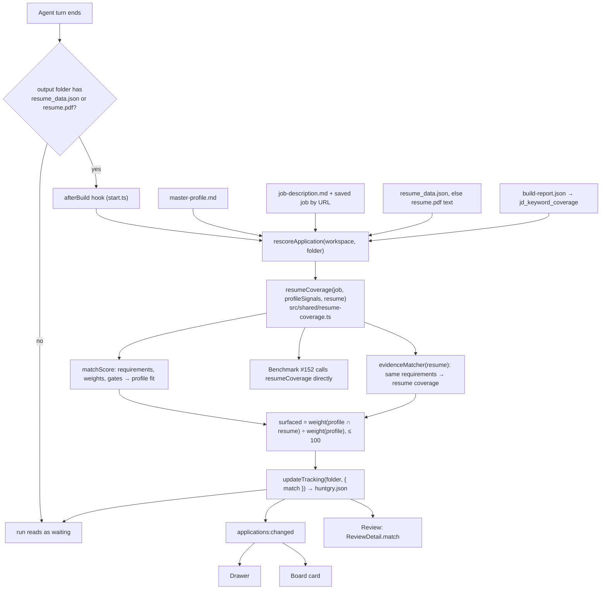
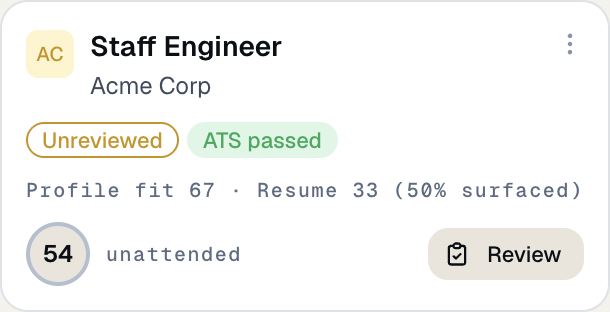
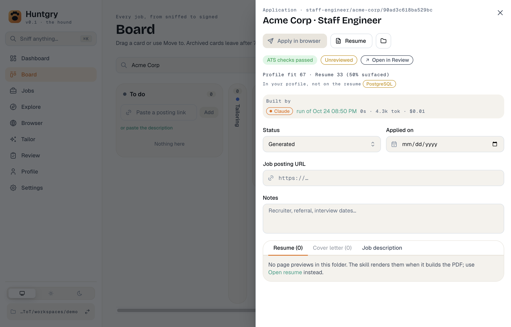
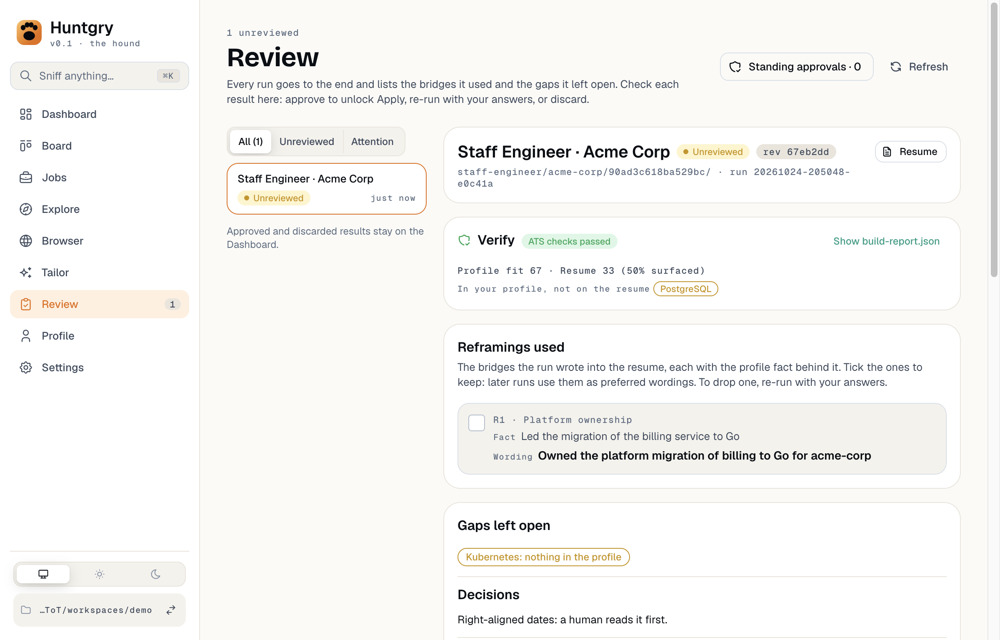

# #151 — Re-score after tailoring: profile fit vs resume coverage

Issue: [silentashish/huntgry#151](https://github.com/silentashish/huntgry/issues/151) · Builds on [#149](149-match-score.md) · Feeds #152 (benchmark)

## Context & problem

The match score ([#149](149-match-score.md)) says how much of a job the **master profile** has
evidence for. After a run tailors a resume, the question is how much of the job the **resume**
shows. The skill's honesty rule decides how the two relate: a resume selects from the profile and
never adds to it, so resume coverage can't beat profile fit. A higher resume score can only mean
the resume surfaced more of what the profile already has. So the re-score reports three numbers:

- **Profile fit**: the match score, the ceiling;
- **Resume coverage**: the same requirements, matched against the resume's words;
- **Surfaced**: how much of what the profile has the resume shows.

The skill already reports `jd_keyword_coverage` in `build-report.json` ("31/40 substantive JD
terms appear in the resume. Absent: […]"). That list comes from word frequency in the description,
so it's noisier ("event streaming", "team") and not comparable with the match score. The number
Huntgry shows comes from the #149 engine; the skill's list is shown only as the "Absent" hint.

## What changed and why

| Area | Files | Why |
| --- | --- | --- |
| Engine | `src/shared/resume-coverage.ts`, `src/shared/match-score.ts` | `resumeCoverage(job, profile, resume)` is the one function the app and the benchmark (#152) call. It runs `matchScore(job, profile)` and matches the **same** requirements, weights and gates against the resume through `evidenceMatcher`, which is the matcher `matchScore` itself uses, newly exported. There is no second matcher. `resumeEvidenceFromData` reads the skill's `resume_data.json` (skills rows, summary, roles and bullets, projects, education, certifications, publications; no contact details); `resumeEvidenceFromText` reads a PDF's text. |
| Run finish | `src/main/cli/runner.ts`, `src/main/cli/start.ts` | `RunnerHooks.afterBuild` runs when a turn ends with `resume_data.json` or `resume.pdf` in the run's output folder, right after the job source is recorded and before the run reads as waiting. That covers a Tailor run, a pipeline run, a follow-up reply and a Review re-run, so every rebuild is re-scored. A failure is logged and never fails the run. |
| Re-score | `src/main/applications/rescore.ts` | `rescoreApplication(workspace, id)` reads the master profile (`master-profile.md`, else `master_profile.md`), the folder's `job-description.md` (what the skill tailored against), the saved job with the same posting URL when there is one (its tags, minimum years and sponsorship, as the Board links them), the resume (`resume_data.json`, else the text of `resume.pdf`) and the `jd_keyword_coverage` row of `build-report.json`. Files are read only when they are regular files (never through a symlink) and within a size limit. |
| Storage | `src/shared/applications-types.ts`, `src/main/applications/tracking.ts` | The result is `huntgry.json` → `match` (main-owned tracking data, see below), written through `updateTracking`, so it's serialized with other tracking writes and leaves the status and notes alone. `normalizeMatch` drops anything malformed, including a surfaced share over 100. The renderer's tracking patches can't write it: the `applications:update-tracking` allowlist is unchanged. The skill's files aren't touched. |
| UI | `src/renderer/src/components/match/` | One `ResumeMatch` component (and a pure `matchText`) used in three places. **Drawer** (Board → application): "Profile fit 82 · Resume 74 (90% surfaced)", the profile's skills the resume left out as chips, any failed must-have, and the skill's "Absent" terms. **Board card** (applications): the same line in mono, with the left-out skills in its hover text; hidden on a folded compact card like the pills. **Review** → Verify: the drawer's block. Nothing shows for an application that was never scored. |
| Review | `src/shared/review-types.ts`, `src/main/review/service.ts` | `ReviewDetail.match` carries it. It's outside `revision`: a re-score never makes a decision on screen stale, and the files an approval vouches for don't change. The phone's projection doesn't include it. |

## How it works



## Storage shape

`<role>/<company>/<job-id>/huntgry.json`, next to `status`, `notes` and the other tracking fields
(`ApplicationMatch`):

```json
{
  "status": "generated",
  "notes": "",
  "match": {
    "profileFit": 87,
    "resumeCoverage": 67,
    "surfaced": 77,
    "requirements": 8,
    "leftOut": ["Kubernetes", "Terraform"],
    "absent": ["Kafka", "event streaming"],
    "gates": ["Asks for 8+ years of experience (you have 4.8)"],
    "resumeFrom": "resume_data.json",
    "source": "description",
    "runId": "20261024-120000-abc123",
    "at": "2026-10-24T12:00:00.000Z"
  }
}
```

| Field | Meaning |
| --- | --- |
| `profileFit` | 0–100 integer: `matchScore(job, profile).score`, gates applied. |
| `resumeCoverage` | 0–100 integer: weight of the requirements the resume shows ÷ weight of all, capped at `GATE_CAP` (40) when a gate fails, like the fit. |
| `surfaced` | 0–100 integer: weight of the requirements both have ÷ weight of those the profile has. Absent when the profile has none of them. |
| `requirements` | How many requirements the job names (≥ 1; a job naming none is not stored). |
| `leftOut` | Requirements the profile has and the resume doesn't show, heaviest first, at most 20. |
| `absent` | Optional. The skill's `jd_keyword_coverage` "Absent" terms, at most 20. A hint only. |
| `gates` | Optional. Failed must-haves as reasons; they cap both numbers. |
| `resumeFrom` | `resume_data.json` or `resume.pdf`: where the resume's words were read from. |
| `source` | `jobright-skills` or `description`, as in `MatchResult.source`. |
| `runId`, `at` | The run whose turn wrote it, and when. |

`match` is replaced by every re-score, and removed when the job no longer names a requirement or
the resume can't be read. When there is no master profile or no `job-description.md`, nothing is
written.

## Screenshots

From `e2e/tests/rescore.spec.ts` (demo profile: Go and PostgreSQL, not Kubernetes; the fake resume names Go only).
The card's ring is still Relevant (#73), which has title, seniority, location and recency parts on top of the match score.

| Board card | Drawer | Review → Verify |
| --- | --- | --- |
|  |  |  |

## Decisions and alternatives

- **Surfaced compares weights, not the two scores.** A failed gate caps both scores at 40, which
  would make a resume that left half the profile out read as 100% surfaced. Weights don't have
  that problem; without a gate, the result equals resume coverage ÷ profile fit.
- **Why surfaced can't pass 100.** The numerator is the requirements **both** the profile and the
  resume have, so it's a part of the denominator. Resume coverage can still pass profile fit when
  the resume names a requirement the profile's words don't (a synonym the profile missed, or a
  claim to check). `ResumeCoverage.unbacked` lists those for the benchmark, and the value is clamped
  to 100 anyway, here and when `huntgry.json` is read.
- **Same requirements, not re-extracted.** For a description-only job the vocabulary is the
  profile's skills plus `TECH_VOCABULARY`. Extracting again with the resume's skills would compare
  two different requirement lists.
- **`resume_data.json` first.** It's what the skill rendered, with skills rows already split. The
  PDF text is the fallback for a build without it. Both are read-only.
- **In `huntgry.json`, not the review authority store.** It's derived, low-stakes display data
  that main recomputes after every turn, while the authority store holds decisions an agent must
  not forge. An agent that edits `huntgry.json` can change what the drawer shows until the next
  turn, but nothing it gates.
- **Run finish = the turn that built the resume.** The hook sits where the runner already finds
  the output folder and records the job source, so attended and unattended runs, replies and
  re-runs all go through it, and the score is on disk before the queue sees the run waiting.
- **The skill's keyword list is only the "Absent" hint.** It's frequency-based and capped at 40
  terms, so it isn't the number shown.

## How to test

- `npx vitest run src/shared/resume-coverage.test.ts src/main/applications/rescore.test.ts src/main/cli/runner.test.ts src/main/review/service.test.ts src/renderer/src/components/match src/renderer/src/pages/dashboard/ApplicationDrawer.dom.test.tsx src/renderer/src/pages/board src/renderer/src/pages/review`
- The fixture job and resume are `src/shared/fixtures/tailored-job.md` and `tailored-resume_data.json`.
- In the app: tailor a job, open its card on the Board. The card and the drawer show
  "Profile fit … · Resume …", and so does the result on Review.

## Follow-ups

- **#152 (benchmark)**: call `resumeCoverage(job, profileSignals(profile), resumeEvidenceFromData(data))`
  per result and compare `surfaced` and `leftOut` across agents and skill versions. `unbacked`
  is worth tracking there as an honesty signal.
- Results built before this change have no `match` until their next turn. A one-off backfill
  could call `rescoreApplication` for every application.
- `leftOut` could feed a Review re-run message ("surface Kubernetes and Terraform").
