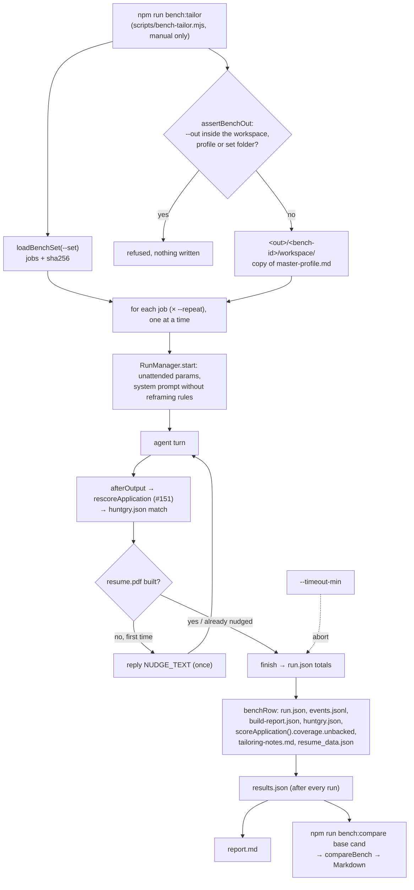

# #152 — Tailoring benchmark: time, cost and quality per run

Issue: [silentashish/huntgry#152](https://github.com/silentashish/huntgry/issues/152) · Builds on [#151](151-rescore-after-tailoring.md) · Yardstick for #153 (faster resume generation)

## Context & problem

#153 wants resume generation to be faster. "Faster" only counts if quality holds, and nothing
measured either side in a way two versions could be compared. Run logs already record time, tokens
and cost per turn (#44), and the re-score after tailoring (#151) records profile fit, resume
coverage and surfaced. But they come from whatever jobs the user happened to tailor, with whatever
profile, rules and skill they had at the time.

Today's numbers, from 63 runs on Claude Opus 5.5 (the issue's sample, before this change):

| Metric | Median | Spread |
| --- | ---: | --- |
| Time (active) | **195 s** | p25 175 s, p75 225 s, max 340 s |
| Share of it waiting on the API | **97 %** | |
| Output tokens | **~21K** | about 4.4K of them reasoning |
| Cache-read input | 1.25M | |
| Cost | **$1.30** | |

Almost all of the time is the model writing output, so speed has to come from writing less or
writing it faster. The benchmark has to show whether that cost any quality.

## What changed and why

| Area | Files | Why |
| --- | --- | --- |
| Runner | `src/main/bench/run.ts` | `runBench(options)` runs each job of a bench set unattended, one after the other, with a given agent binary, model, skill folder and venv. Each run gets what an unattended Tailor run gets: `buildSystemPrompt` (with **no** reframing rules), the #151 re-score after every turn (the same `afterOutput` hook as `start.ts`), and the pipeline's one `NUDGE_TEXT` reply when a turn ends without a resume. Then the run is finished. A run over `--timeout-min` is aborted and recorded as `failed`. A failed run is recorded and the bench moves on. Ctrl-C stops the current run and keeps the results so far. |
| Isolation | `src/main/bench/run.ts` (`assertBenchOut`) | Runs go to `<out>/<bench-id>/workspace/`, a fresh workspace holding a **copy** of the master profile (and `cover-letter.md` if there is one) and nothing else. An `--out` equal to, or inside, the real workspace, the profile's folder (as given and, for a symlinked profile, its real folder) or the set's folder is refused. The check compares real paths segment by segment, so neither a symlink nor a child named `..bench` gets around it. The bench folder is created exclusively: a taken name, whether a planted symlink or an earlier bench of the same label and second, gets `-2`, `-3`, …. The workspace is checked again by real path before the profile is copied in, and copies refuse an existing destination. The real workspace is only read, and only for the profile. |
| Metrics | `src/main/bench/measure.ts` | `benchRow` reads one row from what the run left on disk: `run.json` totals and metrics, `events.jsonl` (`build.py` calls), `build-report.json` (through `summarizeBuild`, plus `render.fill` / `target_pages`) and `huntgry.json` → `match`. |
| Honesty | `src/main/bench/honesty.ts` | `untraceableClaims` counts claims the master profile doesn't back (see below). |
| Re-score | `src/main/applications/rescore.ts` | `scoreApplication` is split out of `rescoreApplication`. It is the read-only half and returns `{ match, coverage }`, so the bench gets `coverage.unbacked` without scoring anything a second way. `rescoreApplication` keeps its signature, storage and tests. |
| Report | `src/main/bench/report.ts` | `benchReport` writes the single-run `report.md`. `compareBench(base, candidate)` writes the comparison: medians, per job, jobs in only one run, warnings, and a verdict. |
| Bench set | `src/main/bench/set.ts` | `loadBenchSet(dir)` reads the job files and hashes them, so two runs on different sets are flagged. |
| CLI | `scripts/bench-tailor.mjs`, `package.json` | `npm run bench:tailor` and `npm run bench:compare` run on plain Node (no tsx). They import the TypeScript sources through `registerHooks`, as `scripts/match-calibration.mjs` does, and use the app's own Settings choices for the claude binary, account, skill and venv. |
| Plain-Node loading | `src/main/cli/runner.ts`, `src/main/cli/command.ts`, `src/main/pipeline/pipeline.ts` | Node's type stripping rejects parameter properties. `RunManager`'s constructor now assigns a plain field, and `NUDGE_TEXT` moved to `cli/command.ts`, re-exported from `pipeline.ts`. No behaviour change. |
| Fake agent | `src/main/cli/fixtures/fake-claude.mjs` | `BENCH_OUTPUT` writes what a real build leaves behind: `resume_data.json`, a full `build-report.json`, `tailoring-notes.md` v2 with one sourced and one unsourced reframing, two `build.py` tool calls and `duration_api_ms`. `BENCH_LATE` builds only after the nudge. |

## How it works



## Metrics

One row per run in `results.json` → `rows[]` (`BenchRow`, `src/main/bench/types.ts`):

| Field | Definition |
| --- | --- |
| `activeMs` | `run.totals.activeMs`: time the agent worked, summed over its turns (from the message being sent to the turn ending; time waiting for a reply isn't included). |
| `apiMs` | Σ `run.metrics[].apiMs`, Claude's `duration_api_ms`: time spent waiting on the model API. `apiMsComplete` is `false` when a turn didn't report it. |
| `apiShare` | `apiMs / activeMs`. |
| `outputTokens`, `reasoningTokens`, `cacheReadTokens` | `run.totals.usage`. Reasoning tokens are already counted in output tokens. |
| `costUsd` | `run.totals.estimatedCostUsd`: tokens × the **bundled** price table (`MODEL_PRICES`), so a Settings price override doesn't skew a comparison. `reportedCostUsd` is what the CLI reported. `unpricedTurns` > 0 means `costUsd` is a lower bound. |
| `turns`, `nudged` | Turns the run took, and whether it needed the nudge. |
| `hardFailures` | `summarizeBuild(build-report.json).failed`: hard verify checks that failed. `buildOk` is the report's `ok`. |
| `builds`, `rebuilds` | `build.py` calls in `events.jsonl` (Bash `tool_use` whose command runs `…/scripts/build.py`). Rebuilds = builds − 1, at least 0. |
| `pages`, `targetPages`, `fill` | `build-report.json` → `render.pages`, `render.target_pages`, `render.fill` (0–1). |
| `profileFit`, `resumeCoverage`, `surfaced` | `huntgry.json` → `match`, exactly as the #151 re-score stored it after the run's last turn. The bench doesn't compute them. |
| `untraceable` | `{ count, byKind, items }`: claims the profile doesn't back (below). `items` keeps the first 20 for spot checks; it is in `results.json`, not in the report. |
| `outputChars` | Characters of `resume_data.json`, `tailoring-notes.md` and `cover_data.json`, the agent's biggest writes. |

The report adds a **pass rate**: the share of runs that **finished**, built a resume, and whose `build-report.json` says `ok` with no failed hard check. A missing or unreadable report doesn't count as a pass, and neither does a run that timed out after writing a PDF.

### Honesty: untraceable claims

`untraceableClaims` is deterministic and cheap. It sums four kinds:

1. **unbacked**: requirements the resume shows and the profile has no evidence for
   (`resumeCoverage().unbacked`, from `scoreApplication`);
2. **reframing**: a reframing in `tailoring-notes.md` whose source fact isn't in the profile, either
   word for word (ignoring case and punctuation) or as ≥ 90 % of one profile line's words;
3. **number**: a number in the resume's summary or bullets that the profile never states. `4M`,
   `4 million` and `4,000,000` read the same and `40%` reads as `40`; years are skipped;
4. **identity**: an employer, title, school, degree or certification in `resume_data.json` that the
   profile doesn't name word for word.

It is a **regression signal**, so compare it between bench runs; it is not an absolute truth. A
resume that rephrases a number ("doubled" for "2x") or shortens a title gets flagged although it is
honest. That noise is the same on both sides of a comparison.

## Bench set format

A folder of job files, one JSON object per job (or a `jobs/` subfolder of them). The real set
holds the user's own jobs, which are personal data, so it lives in the workspace at
`.huntgry/bench/` (the default `--set`) or anywhere else, and never in the repository. Aim for
8–10 jobs covering a spread of seniorities and stacks.

```json
{
  "id": "senior-backend",
  "role": "senior-backend-engineer",
  "company": "acme",
  "jobId": "senior-backend",
  "descriptionFile": "senior-backend.md",
  "url": "https://boards.greenhouse.io/acme/jobs/1",
  "coverLetter": true,
  "dateStyle": "right",
  "seniority": "senior",
  "stack": ["go", "aws"]
}
```

Only `description` (inline) or `descriptionFile` (relative to the set folder, and inside it) is
required. `id` defaults to the file name, `role` / `company` / `jobId` are lowercase slugs (the
application folder, and must differ between jobs, because all runs share one workspace; a set where two jobs would build into the same folder is refused), `coverLetter` defaults to `true` and `dateStyle` to `right`. `url` becomes the
application's `jobUrl`. `seniority` and `stack` are labels for reading the report and are never
sent to the agent. `src/main/bench/fixtures/` holds the synthetic set CI uses.

## Running it

> **Cost warning.** A real bench spends money: about **$1.30 and 195 s per job** on Opus 5.5 at
> today's median, so roughly $10–13 for a set of 8–10 jobs, and as much again per `--repeat`. The
> command prints its estimate before it starts. `--dry-run` stops there. It is manual only: it is not
> part of `npm test`, CI or the e2e suite, which run the bench against the fake agent.

The baseline (this has not been run in this change; run it before #153's first experiment):

```sh
npm run bench:tailor -- --model claude-opus-5-5 --label baseline-$(git rev-parse --short HEAD) \
  --set ~/<workspace>/.huntgry/bench --profile ~/<workspace>/master-profile.md --out ~/huntgry-bench
```

A candidate, then the comparison:

```sh
npm run bench:tailor -- --model claude-opus-5-5 --label candidate-$(git rev-parse --short HEAD) \
  --set ~/<workspace>/.huntgry/bench --profile ~/<workspace>/master-profile.md --out ~/huntgry-bench
npm run bench:compare -- ~/huntgry-bench/<baseline-id> ~/huntgry-bench/<candidate-id> --out report.md
```

Without `--set`, `--profile` or `--workspace`, the open workspace from Huntgry's settings is used
(`<workspace>/.huntgry/bench`, `<workspace>/master-profile.md`). Other options:

- `--claude <path>`, `--skill-dir <dir>`, `--venv <dir>` and `--claude-config-dir <dir>`. The
  defaults are the app's: Settings → Agents, `<userData>/skill-venv`, and the chosen account.
- `--repeat N`: each job N times, each into its own `<job-id>-rN` folder.
- `--jobs a,b`: only those jobs.
- `--timeout-min 15`: the per-run limit.
- `--tolerance 2` (compare): how many points of coverage or surfaced the candidate may lose.

Each bench run writes `<out>/<bench-id>/results.json` (after every run), `report.md`, and the
`workspace/` it ran in, with the run logs and applications kept for inspection.

## Decisions and alternatives

- **Reuse the re-score instead of recomputing it.** The bench uses the same `afterOutput` hook as
  `start.ts` and reads `huntgry.json` → `match` back, so a bench number is the number the app shows.
  Calling `resumeCoverage` from bench code was the alternative, but it could drift from the app (the
  saved-job lookup, the PDF fallback).
- **`scoreApplication` split out.** The honesty count needs `unbacked`, which the re-score computed
  and then threw away. Adding it to `ApplicationMatch` would have stored a list nothing in the app shows.
- **No caller rules.** The user's standing reframing rules (#159) change what a run may write.
  A bench with empty rules gives the same input on both sides, whatever the user decided in between.
- **One workspace per bench run, not per job.** The runs then share a profile copy and one place to
  inspect, so every job must build its own application folder, which the set loader checks. A 1.5 s gap between runs keeps the runner's output-folder scan (folders changed since a
  second before the turn started) from picking up the previous run's folder. A Ctrl-C during that
  pause ends the bench before the next run starts.
- **Medians, and only over shared jobs.** Model output varies, so the report compares medians and
  `--repeat` adds samples. A candidate run on part of the set (`--jobs`) is compared on the jobs both
  ran. Medians over different job mixes would compare the jobs, not the versions. Two runs with no
  job in common (or an empty run) get **Not comparable**, with no medians, deltas or verdict.
- **The verdict is quality-first.** "Faster" is only reported when median coverage and surfaced
  dropped by at most the tolerance (2 points), the mean untraceable count per run didn't rise, and
  the pass rate didn't drop. Otherwise the verdict reports a quality regression, whatever the time.
- **The bundled price table.** User overrides in Settings → Pricing would make two machines disagree
  about the same tokens.
- **A plain Node script instead of an Electron entry point or tsx.** It follows the
  `match-calibration.mjs` pattern and needs no new dependency. The price was two small refactors
  for type stripping.
- **Default `--out` is `~/huntgry-bench`**, outside every workspace. Results inside the workspace's
  `.huntgry/` would mix throwaway runs with real ones and show up in the app's run history.

## How to test

- `npx vitest run src/main/bench src/main/applications/rescore.test.ts src/main/cli src/main/pipeline`.
  `bench.test.ts` runs the bench end to end with the fake agent: isolation (the source workspace is
  byte-for-byte unchanged; `--out` inside it is refused, including through a symlink, a `..bench` child
  and a symlinked profile; a planted bench-folder symlink is never followed), every row
  metric, the nudge, the timeout, Ctrl-C (also during the pause between runs), `--repeat` / `--jobs`,
  duplicate application folders, and a comparison of two runs. `report.test.ts` covers the pass rule
  and the "Not comparable" verdict.
- The CLI without spending anything. Put a wrapper around the fake agent in a scratch folder; it
  answers `--version` and `auth status` itself:

  ```sh
  cat > /tmp/fake-claude <<EOF
  #!/bin/sh
  case "\$1" in
    --version) echo "2.3.0 (Claude Code)"; exit 0;;
    auth) echo '{"loggedIn": true}'; exit 0;;
  esac
  exec node $PWD/src/main/cli/fixtures/fake-claude.mjs "\$@"
  EOF
  chmod +x /tmp/fake-claude
  mkdir -p /tmp/skill /tmp/venv/bin && touch /tmp/skill/SKILL.md && ln -sf "$(command -v python3)" /tmp/venv/bin/python3
  npm run bench:tailor -- --model claude-haiku-4-5 --set src/main/bench/fixtures/set \
    --profile src/main/bench/fixtures/master-profile.md --claude /tmp/fake-claude \
    --skill-dir /tmp/skill --venv /tmp/venv --out /tmp/bench --label a
  ```

  Run it again with `--label b`, then `npm run bench:compare -- /tmp/bench/<a-id> /tmp/bench/<b-id>`.
  An `--out` inside `src/main/bench/fixtures` is refused.

## Follow-ups

- **Record the real baseline** with the command above (about $10–13), and quote it in #153.
- **Saved-job requirements**: a bench job could carry a saved job (Jobright `jdCoreSkills`) for the
  re-score to use, as the Board does. Today a bench run scores description-only, which is the same on
  both sides of a comparison.
- **Other agents**: the runner takes any `AgentId`, but the CLI wires Claude only (Codex and
  Antigravity don't report API time).
- **Per-file time**: the issue's "time per output" (`resume_data.json` vs `tailoring-notes.md`) would
  need timestamps per tool call. `outputChars` is the proxy for now.
