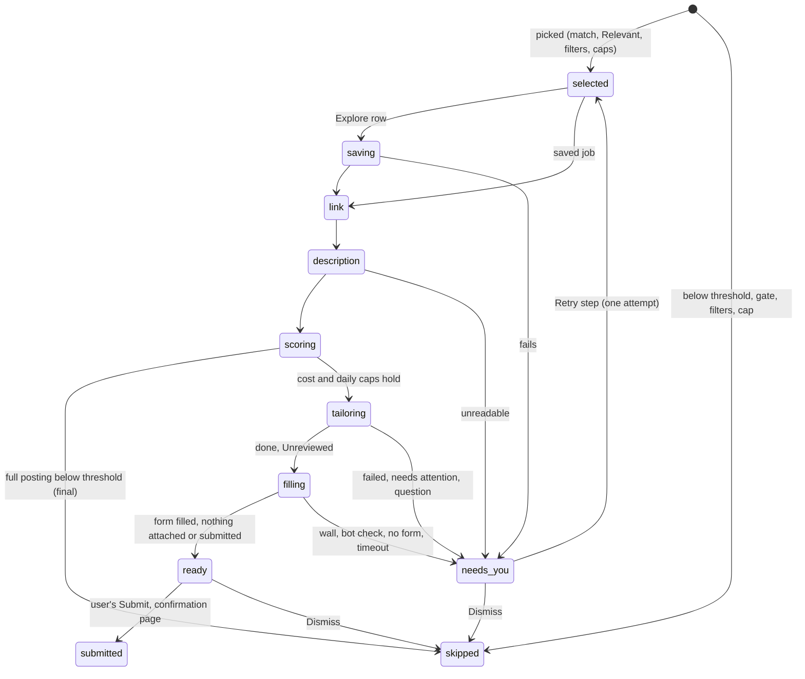
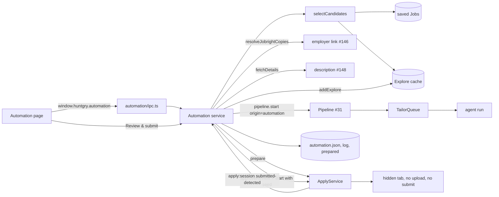
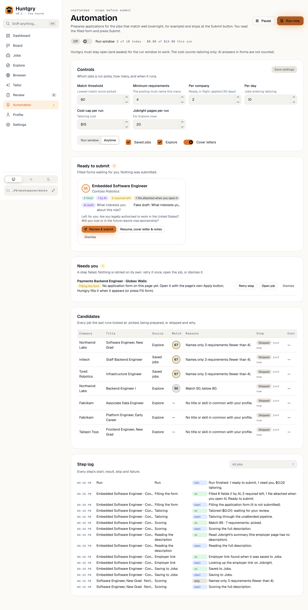
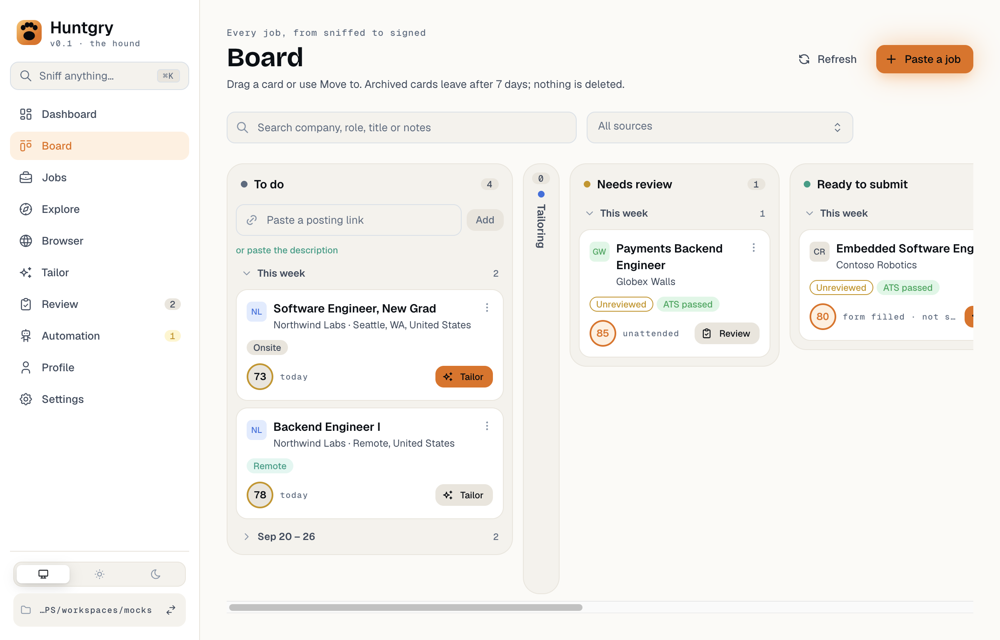
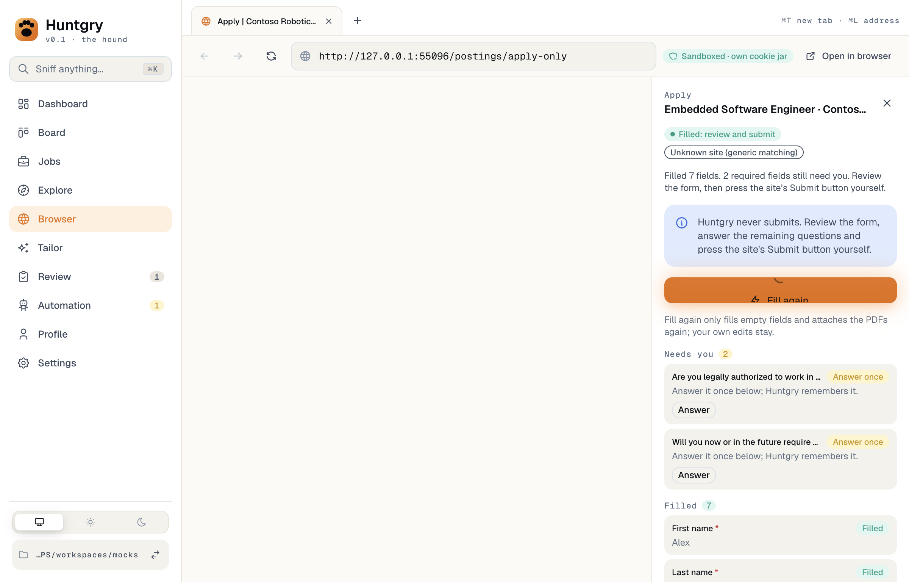

# #154: Automation prepares high-match applications unattended and stops at Submit

Issue: [silentashish/huntgry#154](https://github.com/silentashish/huntgry/issues/154) · Epic #156 · Needs [#148](148-jobright-summary-fallback.md), [#149](149-match-score.md) · Builds on [#31](31-unattended-pipeline.md), #24, [#146](146-jobright-employer-link.md), [#158](158-single-flow.md) · Followed by #155 (automatic Submit, out of scope)

## Context & problem

Huntgry already had every piece of the chain from a good job to a sent application, but a person had
to drive each step: Explore → Add to Jobs → Fetch full description (which resolves the employer link) →
Tailor (the unattended pipeline) → Review → Apply in the in-app browser (autofill) → Submit.

#154 adds an **Automation** page that drives that chain on its own for the jobs that match well, for
example overnight. It stops before the site's Submit button. The job then waits in **Ready to submit**
with its resume, cover letter, review notes and the filled form (AI-drafted answers marked). One click
opens the filled form, and the user reads it and presses Submit.

The owner's rules for this ticket:

- build on the existing pieces only: tailoring through the pipeline and queue, the link through #146's
  `resolveJobrightCopies`, the description through `fetchDetails` (with #148's fallback), the fill
  through `ApplyService`;
- `ApplyService` never submits; automatic Submit is #155;
- default threshold from #149's calibration: Match ≥ 80 with ≥ 4 requirements;
- caps per company, per day and per run (cost), pause and resume, a run window, a step log;
- a failed step leaves a visible "needs you" state and is never retried silently in a loop.

## What changed and why

| Where | What |
| --- | --- |
| `src/shared/automation-types.ts` | Types, IPC channels, events, defaults, bounds, settings validators. |
| `src/shared/automation-select.ts` | Pure candidate selection and caps (`selectCandidates`). |
| `src/main/automation/sources.ts` | The pluggable `CandidateSource`: saved Jobs and the Explore cache. |
| `src/main/automation/service.ts` | The `Automation` class (Electron-free): runs, steps, holds, caps, Retry, the one-click open. |
| `src/main/automation/tailor.ts` | Tailoring through the unattended pipeline, one job per pipeline (`origin: 'automation'`). |
| `src/main/automation/schedule.ts` | The run window in local time, crossing midnight. |
| `src/main/automation/store.ts` | `.huntgry/automation.json`, `.huntgry/automation-log.jsonl`, `.huntgry/automation/prepared/`. |
| `src/main/automation/settings.ts` | Settings and caps in `userData/settings.json` (`automation`). |
| `src/main/automation/ipc.ts` | The app's instance over the real services; `window.huntgry.automation`. |
| `src/main/apply/service.ts` | `prepare` (main only) and `start(applicationId, seed)`. |
| `src/main/pipeline/pipeline.ts` | An optional `origin` on the record (main only); no per-job notification for Automation's. |
| `src/renderer/src/pages/automation/` | The page: status, controls, Ready to submit, Needs you, Candidates, Step log. |
| `src/shared/board.ts` | A **Ready to submit** column between Needs review and Ready to apply. |
| Sidebar, ⌘K palette | **Automation** after Review; "Go to Automation", "Pause / Resume / Run automation now". |

**Selection** (`selectCandidates`, pure, unit-tested at every boundary). A candidate is picked when:

- Relevant does not exclude it (dismissed, or "does not sponsor visas" for a profile that needs a
  sponsor), and it shares a title or a skill with the profile;
- it passes the user's saved Jobs filters (sponsorship, workplace, seniority, date posted, salary);
- it is not applied to or tailored already (joined to applications like the Board: posting URL, else
  job id with the same company), and Automation has not settled it (Ready to submit, Submitted, Needs
  you) or skipped it for good after reading its full posting;
- when it can be scored now (a saved job with a description), its match is at least the threshold (80),
  it names at least the minimum number of requirements (4), and no must-have gate failed. A posting that
  names no requirement is skipped as "Match unknown", not failed.

Explore rows have no description, so they pass on the title and Relevant rules and are scored once their
posting is read. Order: scored jobs by match, then newest; then Explore rows by Relevant score.

**Caps.**

- *Per company* (default 2): Automation's ready and in-flight jobs, its submissions of the last 30 days, and
  applications created in the last 30 days, per normalized company name, each counted once
  (`companyHeld`). Checked at selection and again right before each tailoring launch (a Retry too; a
  capped Retry stays in Needs you until a place frees up).
- *Per day* (default 10): jobs entering tailoring on the local day, across runs. Selection counts the
  jobs it can score now; an Explore row is checked again when it reaches tailoring, and the run then
  ends as `stopped-cap`, leaving the rest skipped with "Cap: 10 a day." (not final; tomorrow they count
  again).
- *Per run cost* (default $15): before each tailoring launch, *spent + the median cost of recent
  unattended runs* must stay under the cap, otherwise the run ends `stopped-cost` and the jobs not
  started stay **Selected**. Costs are estimated from tokens for every agent
  (`RunSummary.totals.estimatedCostUsd`), so Codex and Antigravity runs count too.
- *Jobright pages per run* (default 20): enforced at the loader. Every Jobright page the link lookup and
  the description load (aliases and #148's summary fallback included) takes one, and the loader refuses
  the page once the allowance is spent. That job then waits, Selected, for the next run, from the step it
  was at.
- *Day and enable switch in userData*: today's count and the run window switch are kept per workspace
  under `<userData>/automation/<sha256(workspace)>.json`. `automation.json` in the workspace only mirrors
  them, so an agent writing there can neither turn the window on nor give back the day's allowance.

**Per job, one at a time, every step once** (`Automation.process`):

1. *Saving*: an Explore row goes through Explore's **Add to Jobs** (`addExplore`), without its link
   lookup (the next step does it, counted, with its failure reported). The record moves to the saved
   job's id.
2. *Link*: `resolveJobrightCopies` for a `jobright` job whose link is still the Jobright page, only
   while connected. Signed out or "no link" is logged and the job goes on; a lookup that **failed**
   (the page did not load) is Needs you.
3. *Description*: `fetchDetails` when the posting is not complete (#148's summary fallback inside).
4. *Scoring*: the match on the full description. Below the threshold, too few requirements or a gate:
   **Skipped** for good, with the reason.
5. *Tailoring* (Pause, the window, the other pipeline, the company, cost and daily caps are all checked
   together right before the launch, and the day is the launch's local day): one pipeline per job (`pipeline.start` with `origin: 'automation'`,
   `resumeAfterRestart: false`, the queue's own concurrency). The pipeline's verify gate, bounded
   retries, usage-limit waits and stall watchdog apply as to any pipeline. Only `done` + Unreviewed goes
   on; needs attention, a question, a failure or a cancel is **Needs you**.
6. *Filling*: `ApplyService.prepare`, see below. Filled: **Ready to submit**; any other end (a step that
   is the user's, a bot wall, no form, an error, the 3-minute timeout) is **Needs you** with the page's
   reason.

While a job is tailoring, Pause and the window closing pause Automation's own pipeline, so a retry or a
usage-limit reset that falls outside the window does not start (the turn already running ends as it
would); the pipeline resumes at the next opening or on Resume. A job's cost adds up every attempt of its
queue item (all runs of its batch). Any error inside a step (an unreadable profile while scoring, a
prepared file that cannot be written) leaves the job in Needs you at that step.

**No retry anywhere in Automation.** A failed step sets `needs-you`, `failedStep` and `error`, logs one
`fail` line and the run goes on with the next job. Later ticks and runs leave the job alone (unit test:
three more ticks and runs, zero calls). **Retry step** makes exactly one more attempt from the failed
step, after the job being worked on when a run is going; a tailoring Retry of a result that needs
attention passes the pipeline's "tailored before" guard (one attempt, the same verify gate).
**Dismiss** is Jobs' Dismiss. The pipeline's own bounded retries (#31) are the only retries.
Waiting is not retrying: a run holds, with the reason on the page, while the window is closed, while
paused, while another pipeline runs, while the queue is paused with jobs of its own (starting a pipeline
would unpause them), and while the user has an apply session open.

**`ApplyService.prepare`** (main only, never over IPC). It is the same open and fill as `start`, with
these differences:

- the review gate lets an **Unreviewed** result through (needs attention, discarded and an approval that
  drifted are still refused);
- the tab opens with `activate: false` and background throttling off, so it never takes the active tab
  and its timers keep running while hidden;
- **no file is attached** (`deferUploads`): Greenhouse's S3 widget, Lever's parser and Workday's autosave
  send the file to the employer before Submit, and the user has not reviewed the resume yet;
- it waits until the fill **and its model calls** (`learn`: mapping, drafts, their refills) are done, under
  **one deadline** (3 minutes) for the whole prepare, then snapshots the report, the drafts and this
  application's AI answers, ends the session and closes the tab;
- a page that opens a new tab is not followed: that tab is closed and the job is left to the user;
- the session never reaches the renderer (`current()` is `null` while it runs), and Automation never
  starts one while the user has a session. The user's own Apply ends a prepare, never the reverse.

**Ready to submit and the one click.** The prepared fill is saved in
`.huntgry/automation/prepared/<application>.json`, so the card survives a restart. **Review & submit**
approves the result through the review service (`approveReview`, the user's decision, with no standing
approvals), then calls `ApplyService.start(applicationId, seed)`. The seed restores the drafts, the AI
answers and the "already asked" steps, so the same answers are written again with **no model call**, and
the resume is attached now. The renderer opens Browser; the user reads the form and presses Submit. When
the site's confirmation page shows in *that* session, Automation records the application as applied and
the job becomes **Submitted**.

**Run window and controls.** A 60 s tick (unref'd) starts a run when Automation is on, not paused, and
the window is open, **once per opening**. A window run holds when the window closes and continues at the
next opening. **Run now** ignores the window, not the caps. **Pause** holds before the next step and
pauses Automation's own pipeline (`pipeline.pause` only when its origin is Automation). **Stop** ends the
run; a job being tailored is stopped and goes back to Selected. Only one run starts at a time (the start is claimed before
its first await). A run the app's quit interrupted ends on the next start, and a job that was mid-step
goes to Needs you ("Interrupted"); a job interrupted while tailoring keeps its queue item, and Retry
follows that item instead of tailoring again. A workspace switch aborts the run's waits and stops its
pipeline.

**Step log.** Every step's start, ok, skip and fail is appended to `.huntgry/automation-log.jsonl` with
the time, the job and a message. A torn last line (a crash mid-append) is skipped on read and never glued
to the next entry. The page shows the latest 200, filterable by job.

**Trust.** Settings and caps live in `userData/settings.json`, and the run window switch and today's count
in `<userData>/automation/`, like the review decisions (#31's authority): an agent writing into the
workspace can neither raise a cap nor reset its use. The state and the log are in the workspace, where
the user can read them.

**Never submits.** Automation only calls `ApplyService`; the build guard
(`src/shared/autofill/guard.test.ts`) now scans every module under `src/main/automation` too.

## Diagrams

### A job's steps



### Components



## Design decisions and alternatives

The product decisions from the context research (§8), with the default taken:

| # | Decision | Taken | Alternative not taken |
| --- | --- | --- | --- |
| Q1 | Apply gate vs unattended prefill | A main-only `prepare` may fill an **Unreviewed** result (not needs attention, not drifted) in a hidden tab, never submitting, **uploads deferred** to the user's click. The user-visible open still needs approval: **Review & submit** is that approval. | Also attach the resume during prepare (closer to "filled form", but sends an unreviewed resume to the employer). |
| Q2 | Record "applied" on the confirmation page | **Only** for a session opened from a Ready to submit card (the user pressed Submit, the confirmation proves it). Manual applies keep "Mark as applied". | Keep it manual everywhere. |
| Q3 | Threshold | **Match ≥ 80 with ≥ 4 requirements**, editable on the page. Re-run on the owner's workspace: 19 of the 54 saved jobs with requirements reach it (same as #149); none of the 799 Explore rows can be scored without loading its page. | — |
| Q4 | Unattended Jobright page loads | Only rows that pass the title/Relevant pre-filter, at most **20 pages per run** counted at the loader (aliases and fallbacks included), through the existing loader (its per-host gap), and the Explore list is **never refreshed on a timer** (Automation reads the cache as it is). | Explore candidates only after the user adds them to Jobs (switch the Explore source off on the page). |
| Q5 | Sidebar position | **After Review** (…, Tailor, Review, Automation, Profile, Settings). The explore → browser → tailor adjacency tests stay. | Right after Explore. |
| Q6 | "Relevant's exclusions" | Relevant's exclusions + title/skill `matched` + the saved Jobs filters + the match gates. | Also require Relevant score ≥ 40. |
| Q7 | Per-company window | Ready + in flight + applications created in the **last 30 days**. | Only within one run. |
| Q8 | Cost cap scope | **Per run, $15**, tailoring cost estimated from tokens, with the median-based pre-launch check. Apply's AI calls (mapping, drafts) are not tracked today and are not counted; the page says so. | A fixed per-fill estimate. |
| Q9 | Agent and options | The default agent (Settings → Agents), cover letters on (a page switch), dates right-aligned, **one job at a time**, no fallback agent. | The Tailor page's remembered form (renderer-only state main cannot read). |
| Q10 | Explore category after #169 | Today there is one list (Jobright's). After #169 the Explore source reads the category the user last opened; only `exploreCandidates` changes. | Several categories (deferred). |

Other decisions:

- **A retry inside one job can pass the cost cap by that job's own retries.** The cap is checked before
  each launch with the median cost; the pipeline's bounded retries (at most 2 automatic retries per job,
  #31) run inside one launch and are counted once they end. The pipeline's own budget counts Claude's
  figure only, so it is not used for this.
- **One pipeline per job**, not one batch. Automation decides before each launch (cost cap, daily cap,
  pause, window), which a batch's queue would have started already. The pipeline record stays the single
  owner of the queue's unattended hooks; Automation observes `queue:changed`. Cost: a "pipeline finished"
  notification per job, so Automation's pipelines skip it and Automation notifies once per run.
- **Automation waits for the user, never the reverse.** Only one pipeline and one apply session exist at a
  time; starting either over the user's would cancel their work.
- **Nothing added to `huntgry.json` or `Job`** (#150 and #151 change those): Automation keeps its state in
  its own files, and the Board takes the ready application ids as an optional input.
- **Pluggable sources.** `CandidateSource.list()` and `materialize()`; #169 (newgrad API) and #150 (match on
  Explore rows) plug in by changing `exploreCandidates` (set `job.description` from the row's
  qualifications or skills and `scoreable: true`). Selection does not change.
- **The step pill shows Selected between steps.** A run that ends between two steps never leaves a job in
  a working step, so a restart only marks the job that was really mid-step.

Rejected: a second tailoring path (`enqueue` directly: it unpauses the whole queue and skips the
pipeline's policy); `manager.abort` for the cost cap (an unknown reason is classified transient and
retried); keeping the prepared tab open until the user comes back (20-tab cap, the window can close, the
page goes stale).

## Screenshots

The Automation page after a run (mock ATS): Contoso's row prepared up to Submit with its AI draft, a walled
job that needs you, and the thin matches skipped with their reasons.



The Board's new column:



After **Review & submit**: the Apply panel on the filled form (the page itself is a native view the e2e screenshot does not capture; the spec checks its fields, the attached resume and the draft directly).



## How to test

Unit (vitest):

```sh
npx vitest run src/shared/automation-select.test.ts src/main/automation src/main/apply/apply.test.ts src/shared/autofill/guard.test.ts src/shared/board.test.ts src/renderer/src/pages/automation
```

End to end (mock ATS, mock Jobright, fake agents):

```sh
npm run build
npx playwright test -c e2e/playwright.config.ts e2e/tests/automation.spec.ts --repeat-each 3
npx playwright test -c e2e/playwright.config.ts e2e/tests/shell.spec.ts e2e/tests/board.spec.ts e2e/tests/apply*.spec.ts e2e/tests/explore*.spec.ts e2e/tests/single-flow.spec.ts e2e/tests/pipeline-unattended.spec.ts
```

By hand:

1. Open **Settings → Jobright → Connect Jobright** and sign in, then open **Explore** once (Automation reads
   its cached list).
2. Open **Automation**. Check the controls (threshold 80, 4 requirements, 2 per company, 10 a day, $15 a
   run, 22:00–07:00, both sources) and press **Run now** (or turn on **Run window** and wait for it).
3. Watch the Candidates table move through the steps and the Step log fill. Skipped rows say why.
4. A job in **Ready to submit** shows its fill summary and AI answers; **Review & submit** opens the filled
   form in Browser with the resume attached. Read it, press the site's Submit: the job turns Submitted and
   the application Applied.
5. A job in **Needs you** says which step failed and why. **Retry step** tries once more.

## Follow-ups

- A phone mirror of Automation (protocol, gateway, mobile).
- Automatic Submit (#155), out of scope.
- A Settings card for Automation's defaults (the page holds the controls today).
- Count apply's AI calls (mapping, drafts) in the cost cap once they record a cost.
- Explore scoring from `qualifications` / `jdCoreSkills` (#169, #150 plug into `exploreCandidates`).
- Re-score after tailoring (#151) on the Ready to submit cards.
- Keep-awake for the fill phase and battery rules (the pipeline holds keep-awake while tailoring).
- Several Explore categories as sources.
- Running with the app window closed (there is no background daemon; the page says Huntgry must stay open).
