# #158: The automatic run is the only flow

Issue: [silentashish/huntgry#158](https://github.com/silentashish/huntgry/issues/158) · Epic #156 · Needs #157 (resume-tailor v5) · Builds on [#31](31-unattended-pipeline.md), #42 · Followed by #159

## Context & problem

Huntgry had two tailoring flows and two prompts:

- the **attended** run (Tailor page, "Approve each run" in **Tailor all**) stopped after the gap
  analysis and waited for the user to type "Approved";
- the **unattended** run (#31) never stopped, but left every bridgeable reframing *out* of the
  resume, wrote them to `review-notes.md` (v1) and needed a re-run to use any of them.

Both made the model retype the job description (`job-description.md`, a median 6.4 KB) and the
unattended one wrote a second notes file (median 6.2 KB). resume-tailor v5 (#157) now carries the
single flow itself: run to the end without asking, bridge boldly but never fabricate, list every
bridge in `tailoring-notes.md` (v2, machine-readable), follow the caller's rules (wordings to avoid,
preferred wordings), and read a job description the caller saved instead of retyping it.

#158 makes Huntgry use that flow and nothing else. The user's decisions (final):

1. the automatic run is the only flow; the attended approval stop goes;
2. a job pasted on the Tailor page becomes a saved job (Jobs) and runs through the queue like any other;
3. follow-up replies on a finished run stay ("make it shorter");
4. results are read from `tailoring-notes.md` v2; older `review-notes.md` v1 results still parse;
5. bridges are used confidently; nothing is fabricated (no invented employer, title, degree, date, number or skill).

## What changed and why

**One prompt** (`src/main/cli/command.ts`). `ATTENDED_APPROVAL_LINE`, `unattendedBlock` and the
"APPROVAL RULE" are gone; `buildSystemPrompt` has one variant:

- run the skill to the end without asking, never end a turn with a question; stop only when a
  prerequisite is missing (no master profile, no job description), in one message;
- the skill's honesty rule, spelled out: use the bridges you can make from master-profile facts,
  list each with its source fact, never fabricate an employer, title, degree, date, number or skill;
- the v2 notes format, verbatim (marker + Direct hits / Reframings used / Gaps left open /
  Decisions), written to the drafts folder and passed with `build.py --notes`. It duplicates v5's
  SKILL.md on purpose: a v4 skill writes the same file;
- **caller rules**: standing approvals as *preferred wordings* (JSON, newest first, capped as
  before) and *wordings to avoid* (an empty list until #159 stores Review rejections);
- `--jd <saved path>` and one cost cap kept from #31: "if a hard check still fails after two
  rebuilds, stop and say which".

**Huntgry saves the job description** (`src/main/cli/runner.ts`, `runs.ts`). `RunManager.start`
writes `params.jobDescription` to `.huntgry/runs/<run id>/job-description.md` before the agent
starts; `buildFirstPrompt(params, path)` names that file ("read it there and pass this path to
build.py --jd; do not write it out again") instead of embedding the text in `<job_description>`.
`build.py --jd` copies it into the application folder, so the folder still has
`job-description.md`. The file is under `.huntgry/`, which the application scan skips.

**Notes v2** (`src/main/review/notes.ts`, `notes-file.ts`). `parseTailoringNotes` reads v2
(marker-gated: free-form `tailoring-notes.md` of an older attended run yields nothing tickable).
`parseReviewNotes` (v1) is unchanged, ids included. `notes-file.ts` is the one place that decides
which notes a folder carries (v2 with the marker, else v1, else a free-form file shown raw with a
warning); the verify gate, the Review service, the scan and the phone mapping all use it.

**Every result goes through Review.**

- *Verify gate* (`pipeline.ts`): v2 notes (or v1, for an older run settled again) pass; missing
  notes or free-form `tailoring-notes.md` (a v4 skill that ignored the format) → Needs attention.
  The nudge drops the approval rule.
- *Queue* (`queue/ipc.ts`, `remote/gateway.ts`): the renderer's and the phone's `queue.enqueue`
  create unattended items (no `pipelineId`); the pipeline's hooks already settle those.
- *Tailor page* (`queue/tailor-job.ts`, `pages/tailor/*`): Start calls `queue:tailor`, which saves
  the job (a job sent from Jobs / Board is used as it is through `savedJobId`; pasted text goes
  through `addPasted`; a bare URL through `addByUrl`), queues it unattended and returns the item;
  the page opens the run when the queue starts it. `runner:start` is gone, so nothing bypasses the
  queue. The form loses its Job id field.
- *Bulk modal* (`pages/jobs/*`): "Approve each run" is gone; **Tailor all** is the plan + pipeline.
- *Review* (`review/service.ts`, `pages/review/*`): a v2 result shows **Reframings used** (ticking
  one keeps it as a preferred wording, same ids as v1), **Gaps left open**, **Decisions** and the
  direct hits (folded). v1 results render as before. The re-run message speaks of preferred
  wordings and `tailoring-notes.md`.

**States.** "Waiting for your approval" copy is gone (Tailor form and page, bulk modal, Review page,
Standing approvals). `needs-reply` stays as a value (old `queue.json` items, phone DTOs) and now
means a missing prerequisite after the one nudge. Follow-up replies on a finished run still go
through the queue and bring the result back to Unreviewed.

**Phone (#42)** (`src/main/remote/notes-file.ts`). No change in `src/shared/remote/*`. The phone
asks for `review-notes.md`; when a folder has no v1 notes but v2 `tailoring-notes.md`, the desktop
serves that file under the old name. The inline notes, gaps and reframings come from the Review
service. ADR-0001 has a note.

**Settings** (`cli/skill-version.ts`, `environment.ts`, `pages/settings`). The skill row shows
"Huntgry needs v5" for an older copy and the Sync button reads "Update to v5 or later"; the
environment check adds a warning, never a problem. SKILL.md has no version field and a hand-installed
copy has no tag, so the copy's text decides (v5 carries the notes v2 marker); a known tag below v5
counts too.

**Data compatibility.** `unattended` stays on run and queue records (every new one has it); old runs
without it, old attended queue items (`needs-reply`), folders with only `review-notes.md` v1, standing
approval ids and v1 revisions all keep working (unit fixtures unchanged, e2e "an attended item saved
before #158").

**Also fixed.** `TailorQueue.launch`: a launch cancelled *and retried* while its agent was still
starting adopted its stale run and then stopped the newer one. Saving the job description widened
that window enough for `queue.test` to hit it; the launch now checks it is still the current attempt.

## Diagrams

The single flow:

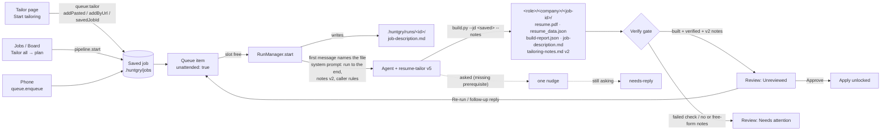

Which notes file Review reads, and what the phone sees:

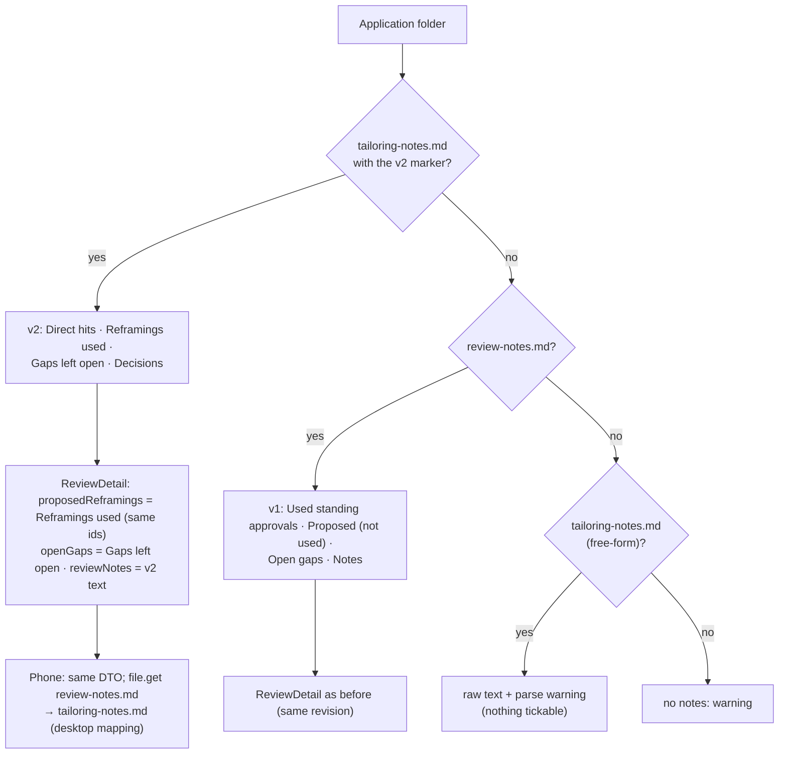

## Design decisions

- **Keep `unattended: true`** on every new record instead of a new `flow` field: every reader
  (beforeReply, releaseIdle, the verify gate, the phone's run.reply guard) keeps working; the flag no
  longer selects a prompt. The flag is set where items are created (the queue), not forced in
  `RunManager`, so an old attended item's run still frees its slot as before.
- **Ticking a used reframing = preferred wording.** v2 "Reframings used" go into
  `proposedReframings` with the v1 ids, so approve / re-run / standing approvals and the phone work
  unchanged. #159 adds Reject (→ wordings to avoid).
- **Marker-gated v2.** `tailoring-notes.md` by name alone is not v2: 7 of 63 real older runs wrote
  free-form ones and were never meant for Review. The scan, the gate and the phone check the marker
  (first KiB only).
- **Pasted jobs are saved jobs.** The Tailor page reuses `addPasted` / `addByUrl` (dedup by
  URL or text, the ≥ 50-character rule of "Paste a job") instead of a parallel path. The folder's
  job id comes from the saved job (`pasted:<sha256[0..16]>`): the form's Job id override is dropped.
- **Settings warns, never blocks.** v4 keeps working: the prompt spells out "run to the end" and the
  v2 format. A v4 run that still writes free-form notes lands in Needs attention, which is safe.
- **Prompt injection.** The job description moved from the first message to a file the agent reads.
  The trust level is the same (the agent reads untrusted text either way); tools stay allow-listed
  and network-less, and the file is inside the workspace the sandbox already allows.

### Alternatives considered

- *A `flow: 'auto'` field on records*: cleaner name, but touches every reader and the phone DTOs for
  no behaviour gain.
- *Keep `runner:start` for the Tailor page*: simpler UI, but the run would skip the verify gate and
  Review, and two code paths would keep diverging.
- *Change the phone protocol to `tailoring-notes.md`*: needs a mobile release and a protocol bump for
  a rename the desktop can absorb in one function.
- *Drop the rebuild cap*: v5's step 7 already loops on the build, but the one-line cap bounds cost
  on a check that cannot pass.

## Screenshots

| Before | After |
| --- | --- |
| 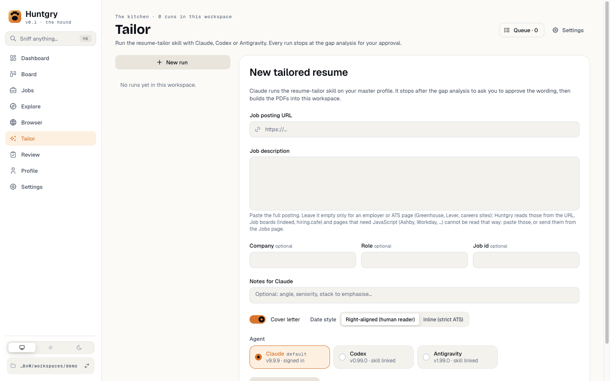 | 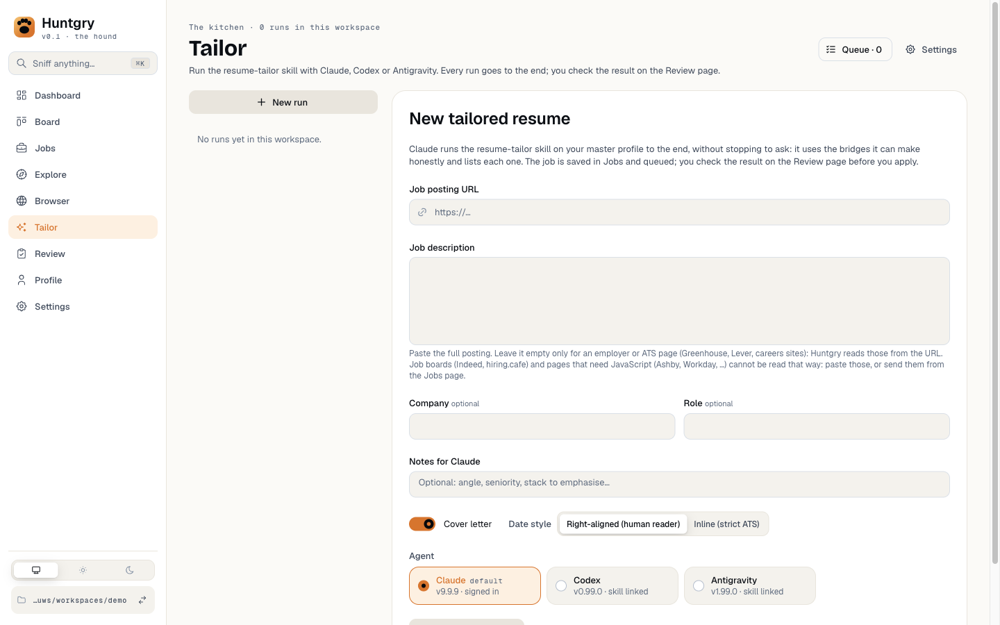 |
| 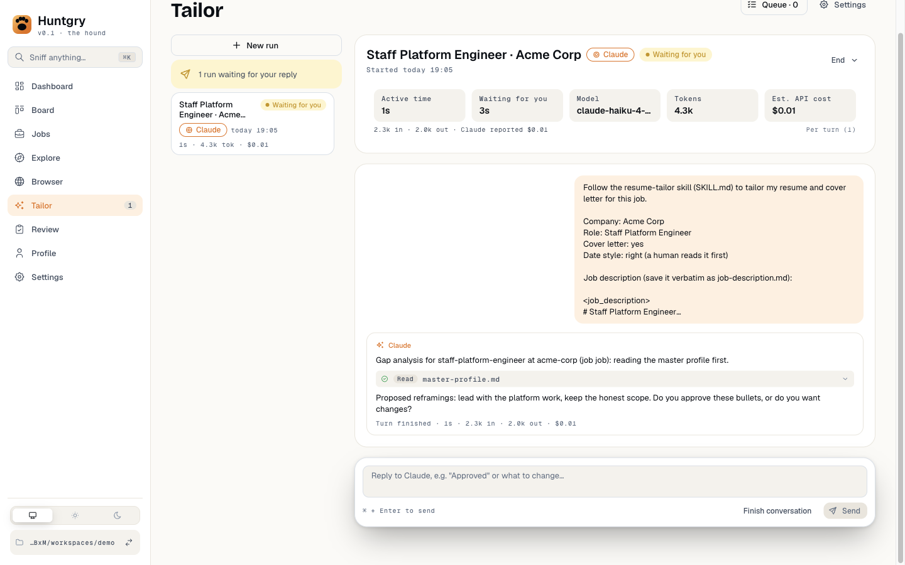 | 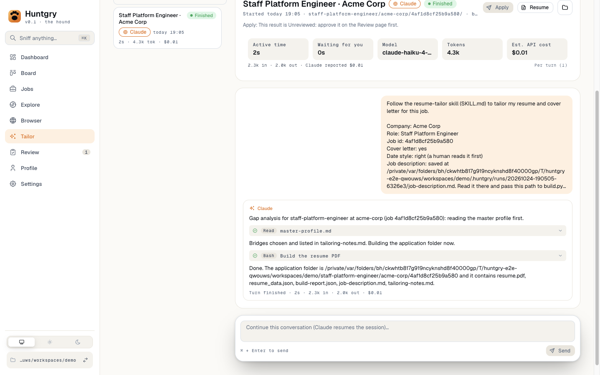 |
| 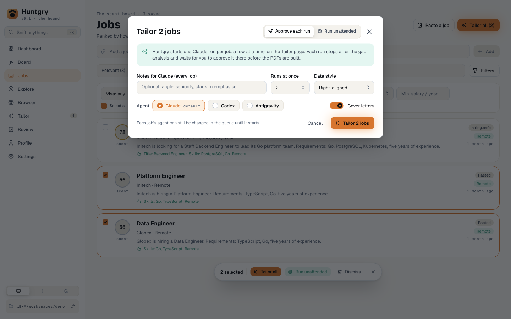 | 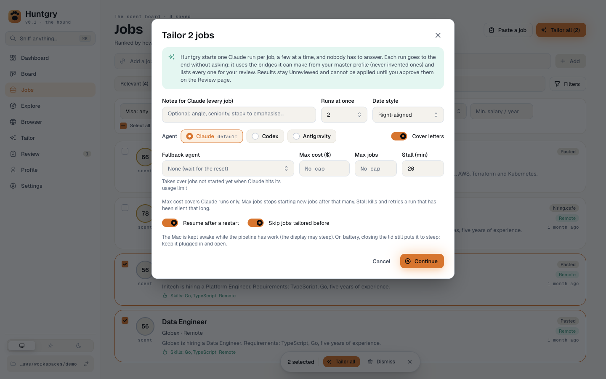 |
| 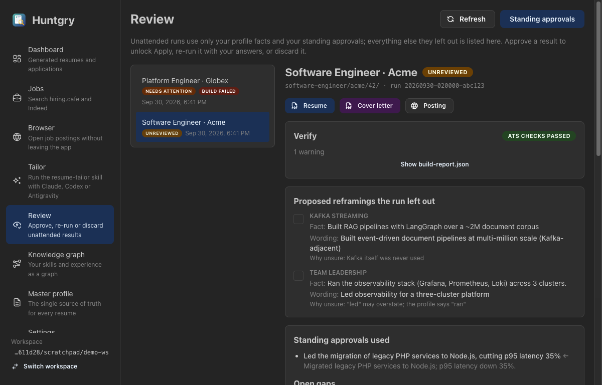 | 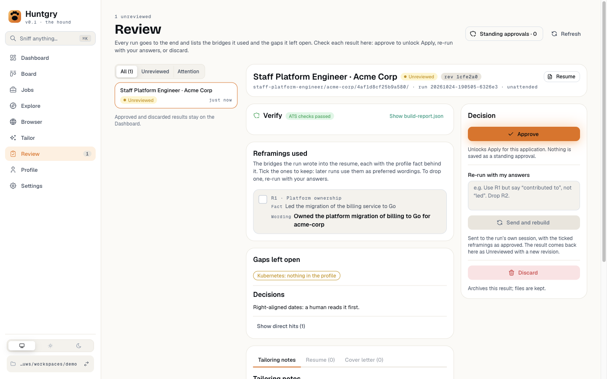 |
| | 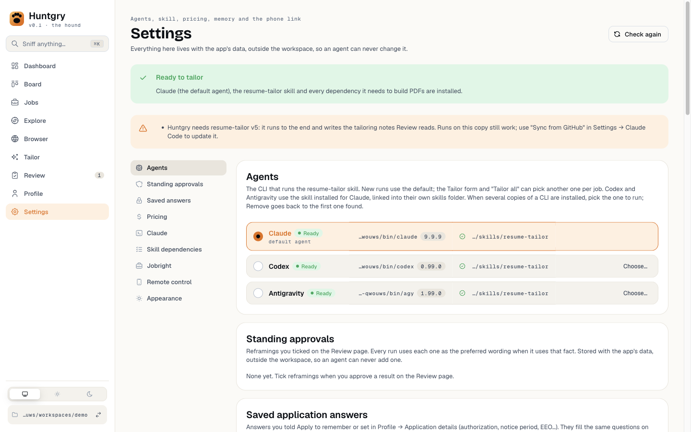 |

## Numbers

Baseline from the real workspace (61 finished unattended runs, Claude Opus 5.5, before #158): median
active time **195 s**, output **21.1K tokens**, cost **$1.31**; median files the model wrote:
`job-description.md` 6.4 KB, `review-notes.md` 6.2 KB, `resume_data.json` 11.6 KB.

Prompt size (characters, 6,400-character job description, measured with the old and new
`command.ts`):

| | System prompt | First message | Total |
| --- | ---: | ---: | ---: |
| Attended, before | 1,628 | 6,746 | 8,374 |
| Unattended, before | 3,652 | 6,746 | 10,398 |
| Single flow, after | 3,000 | 427 | 3,427 |

The model no longer writes the job description (≈ 6.4 KB) or a second notes file. Real-run "after"
numbers (time, output tokens, cost on 3–5 runs) need the signed-in account and are added to the PR by
the owner; the #152 benchmark does not exist yet.

## How to test

```bash
npm run typecheck
npx vitest run
npm run build && npx playwright test -c e2e/playwright.config.ts
npm run check:docs
```

- Unit: `cli.test` (one prompt, AC-1; first message names the saved file, AC-3), `runner.test`
  (JD saved before the agent, copied by the build), `notes.test` / `notes-file.test` (v2, v1
  unchanged, free-form), `service.test` (v2 detail, v1 revision unchanged), `pipeline.test` (gate
  takes v2 / v1, free-form → Needs attention, pipeline-less items settle), `tailor-job.test`,
  `remote/files.test` + `review.test` (phone mapping), `skill-version.test`, `ReviewPage.test`.
- e2e: `single-flow.spec` (a Tailor-page run and a pipeline run leave the same files and both wait
  in Review), `tailor.spec`, `tailor-queue.spec` (incl. an attended item from before #158),
  `review-gate.spec`, `apply-*.spec` (approve on Review, then Apply).
- By hand: paste a job on **Tailor** → it appears in **Jobs**, runs, ends **Finished**; **Review**
  shows Reframings used / Gaps left open / Decisions; Apply opens after Approve. With resume-tailor
  v4 installed, **Settings** shows "Huntgry needs v5" and runs still complete.

## Follow-ups

- #159: Reject a reframing on Review → stored rejections fill *wordings to avoid*; rename Standing
  approvals → Reframing rules; phone protocol addition.
- Board: the "Unattended" pill on queue cards is noise now that every run is unattended (left for
  #160 / a follow-up, to stay out of `pages/board/*`).
- Mobile copy: the phone's Review screen still says "Reframings the run left out"; v2 results are
  the reframings used.
- Real-run before/after numbers on 3–5 runs (owner, signed-in account), or the #152 benchmark.
