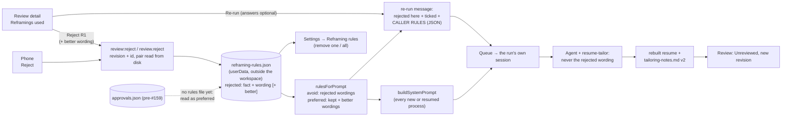
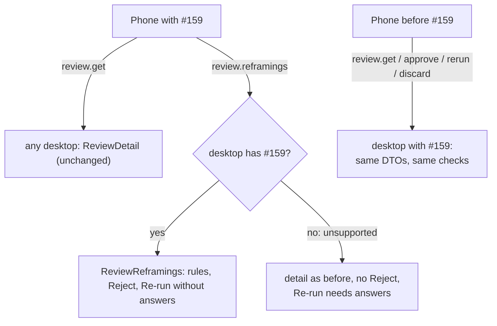
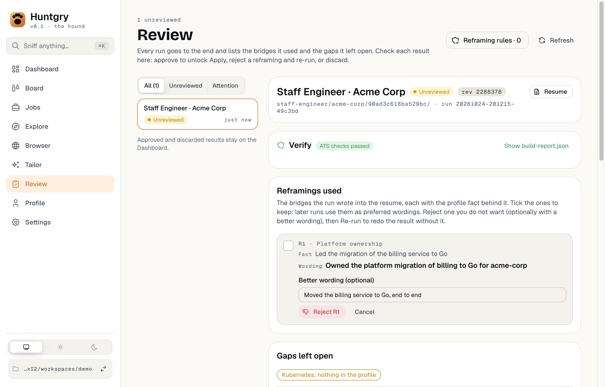
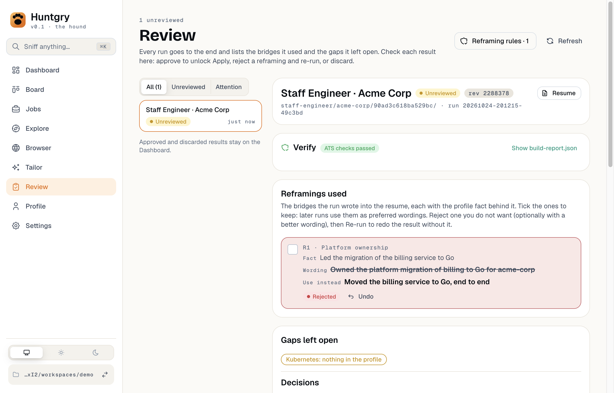
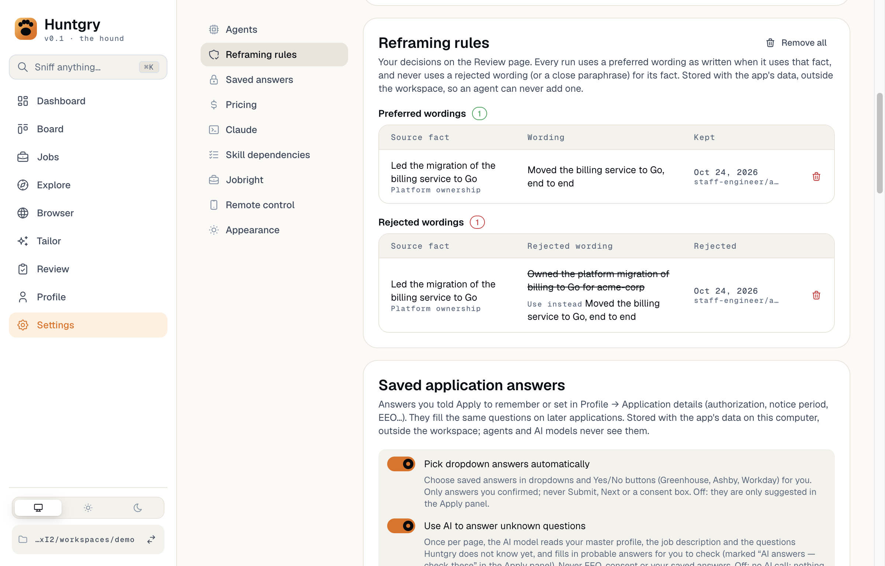

# #159: Reject reframings instead of approving them; standing approvals become reframing rules

Issue: [silentashish/huntgry#159](https://github.com/silentashish/huntgry/issues/159) · Epic #156 · Follows [#158](158-single-flow.md) · Builds on [#31](31-unattended-pipeline.md), [#42](42-phone-review.md)

## Context & problem

Since #158 every run goes to the end and *uses* the bridges it can make honestly, listing each one
in `tailoring-notes.md` v2 ("Reframings used", with its source fact and wording). Review could
still only do what it did when runs held reframings back: tick a reframing to keep it (a standing
approval, sent to later runs as a *preferred wording*), or type free-text answers for a re-run. To
get rid of one wording the user had to describe it in prose, and nothing stopped the next run from
writing it again. `buildSystemPrompt` already had an empty *wordings to avoid* slot for this.

So Review's job flips: the user rejects the wordings they do not want, and the run is redone
without them.

## What changed and why

**Reframing rules** (`src/main/review/approvals.ts`, `src/shared/review-types.ts`). The review
authority store (under userData, never in the workspace) now keeps one rule per source fact →
wording pair:

- `preferred`: use this wording as written when the fact is used (a reframing ticked on Review,
  the old standing approval);
- `rejected`: never use this wording, or a close paraphrase, for this fact; optional
  `betterWording`, which runs get as the preferred wording for the fact.

The latest decision about a pair replaces the earlier one (rejecting a kept wording, or keeping a
rejected one again). Rules live in `reframing-rules.json` (`{ version: 1, rules }`).

**Migration** (criterion 4). When there is no rules file yet, `loadRules` reads the pre-#159
`approvals.json` and returns every standing approval as a preferred rule (same id, fact, wording,
requirement, application, run, via; `approvedAt` → `at`). The first write saves them into the rules
file. `approvals.json` itself is never modified, so an older Huntgry after a rollback still finds
its approvals. Once the rules file exists, the old file is not read again (removing a migrated
rule sticks).

**Caller rules** (`src/main/cli/start.ts`, `command.ts`). `rulesForPrompt` turns the rules into the
skill's caller rules: kept wordings and better wordings → `preferred`, rejected wordings →
`avoid`. Newest first, capped together at `RULES_PROMPT_CAP` (150 wordings, 32 KB, the old
approvals cap). A rejection with a better wording is sent whole or not at all.

**Review service** (`src/main/review/service.ts`, `ipc.ts`).

- `rejectReframing` (IPC `review:reject`): bound to the revision on screen; the pair is read from
  disk (only the better wording is user text, ≤ 2,000 characters, whitespace-normalised, refused
  when equal to the rejected wording). It writes a rule and an audit line, and leaves the result's
  state and revision alone. Allowed while the run works, like Discard (it writes no result file).
- `ReviewDetail.proposedReframings[].rule` shows the rule standing for each pair. It is not part of
  the revision: a rule is a decision, not the result.
- **Re-run** needs no typed answers any more. Its message spells out this result's rejected
  reframings (with "Use instead") and the ticked ones, then repeats the full caller rules. They are
  repeated because a continued session keeps the system prompt it started with; a resumed process
  also gets the new system prompt.
- `review:rules`, `review:remove-rule`, `review:remove-all-rules` replace the `approvals` channels.

**Review page** (`src/renderer/src/pages/review/*`). Each reframing the run used has **Reject**,
which opens an optional "Better wording" field. A rejected reframing shows its wording struck
through, "Use instead", a Rejected pill and **Undo** (removes the rule). The Decision card's
**Re-run** is always available; its hint says what it will do ("…with your reframing rules
(without R1; keeping R2 as written)"). The header button is **Reframing rules · N** and opens that
Settings section. v1 results ("left out") have no Reject: there is nothing in the resume to remove.

**Settings → Reframing rules** (`ReframingRulesCard.tsx`, was `StandingApprovalsCard.tsx`): two
tables, *Preferred wordings* and *Rejected wordings* (with the better wording), each row removable,
plus Remove all and the prompt-cap warning. The section id is `reframing-rules`.

**Phone** (`src/shared/remote/*`, `src/main/remote/*`, `mobile/src/*`). Protocol 1 gains two
commands, additively:

- `review.reframings { applicationId }` (a read) → `ReviewReframings { applicationId, revision,
  format, reframings: { id, sourceFact, wording, requirement?, rule?, betterWording? }[], truncated? }`,
  for the same revision as `review.get`. The ids it lists join what the device was served.
- `review.reject { applicationId, revision, reframingId, betterWording? }` → the updated
  `ReviewReframings`. Only an id the phone was served under that revision (`denied` / `invalid`
  otherwise); the service answers `stale` like any decision. Audited with the revision and id.
- `review.rerun` accepts empty answers.

`ReviewDetail` is unchanged, field for field. The phone asks for the reframings after each detail;
an older desktop answers `unsupported`, and the phone then shows the detail as before, without
Reject, and still asks for typed answers to re-run. The mobile Review screen shows "Reframings
used" with each rule, a Reject row with a better-wording field, and **Re-run** without answers on a
desktop that knows the rules. The demo Mac answers both commands.

**Fake agent** (`e2e/fixtures/fake-agent/agent.mjs`). The one reframing it writes follows the
caller rules of the system prompt and of any later message: a preferred wording for its fact is
used as written, an avoided one never (then the fact itself). The wording now lands in
`resume_data.json` and `resume.pdf` too, so a spec can check the resume.

## Diagrams

Reject → rule → re-run:



What an older or newer phone and desktop do:



## Design decisions

- **One rule per pair, latest decision wins.** A pair is either preferred or rejected, never both,
  so the prompt cannot carry the same wording in both lists. Keeping a rejected reframing again
  (tick + Approve / Re-run) turns it back into a preferred one.
- **A better wording is part of the rejection,** not a separate preferred rule: removing the
  rejection removes both, and Settings shows them together. It goes to runs as a preferred wording
  for the fact.
- **A new file, the old one untouched.** Rewriting `approvals.json` in a v2 shape would make an
  older build read it as empty (its loader refuses other versions); an older build writing v1 would
  drop the rejections. Reading the old file as preferred rules until the first write keeps both
  directions safe. The cost: approvals made by an older build after the rules file exists are not
  picked up (only after a rollback and a roll-forward).
- **Re-run repeats the rules in its message.** A run whose process is still alive keeps the system
  prompt it started with; the message makes the rules reach it either way. A process resumed for
  the re-run also gets them in its system prompt (the e2e checks both).
- **Rejecting does not change the result's state.** Reject several reframings, then Re-run once;
  Approve stays possible (rejected rules then apply to later runs only). No new review state.
- **The rules are not part of the revision.** They are decisions about wordings, not the files an
  approval vouches for; adding one does not make the phone's or the desktop's view stale.
- **Phone: new commands, not new fields.** Every DTO guard refuses unknown fields, so a new field in
  `ReviewDetail` would break older phones. Two new commands are a minor change in the protocol's own
  rules (`src/shared/remote/README.md`); the "version" a phone needs is told by the desktop's
  `unsupported` answer, the existing signal. `PROTOCOL` stays `{ min: 1, max: 1 }`.
- **Reject is for v2 results only.** v1 reframings were left out of the resume; there is nothing to
  remove. They can still be ticked.

### Alternatives considered

- *A `rejected` flag on `StandingApproval` in `approvals.json`*: smallest diff, but an older build
  would read rejections as approvals after a rollback.
- *A per-result "rejected" state that blocks Approve until re-run*: stricter, but it makes the user
  re-run for wordings they only want avoided next time.
- *Bump `PROTOCOL.max` to 2 for the phone*: the README reserves majors for breaking changes; nothing
  existing changed.
- *Re-run from scratch (a new run) instead of the run's own session*: loses the session's context
  and costs a full run; the rules reach the continued session through its message.

## Screenshots

| | |
| --- | --- |
|  |  |
|  | |

Taken by `e2e/tests/reject-reframings.spec.ts` with `HUNTGRY_SHOTS=docs/changes/159-images`. The
phone screen was not captured: a worktree's `mobile/node_modules` links to the main checkout, whose
protocol package does not have the new commands yet (see How to test).

## How to test

```bash
npm run typecheck
npx vitest run
npm run build && npx playwright test -c e2e/playwright.config.ts e2e/tests/reject-reframings.spec.ts e2e/tests/single-flow.spec.ts e2e/tests/review-gate.spec.ts e2e/tests/tailor-review-refresh.spec.ts e2e/tests/settings.spec.ts
npm run check:docs
npm run test --workspace mobile
```

- Unit: `approvals.test` (rules store, one rule per pair, migration from `approvals.json` with no
  loss and the old file untouched, prompt lists and cap), `service.test` (reject: pair from disk,
  better wording, stale / invalid write nothing; Re-run without answers carries the rules; a kept
  rejection is preferred again), `review-ui.test`, `ReviewPage.test` (Reject with a better wording,
  Re-run with no answers, no Reject on v1), `dto.test` / `guards.test` / `frame-size.test` (new DTO
  and commands at their bounds, `ReviewDetail` unchanged), `remote/review.test` (reframings and
  reject through the gateway, denied / invalid / stale, an older desktop answers `unsupported`,
  Re-run without answers from the phone), mobile `model-screens.test` / `review.test` (asks after
  each detail, rejects, re-runs without answers; older desktop: no list, no Reject, asked once),
  `agent.test` (the fake follows the rules).
- e2e: `reject-reframings.spec` (criterion 3): Tailor → Review → Reject R1 with a better wording →
  Re-run → the rebuilt `resume_data.json`, `resume.pdf` and notes have the better wording and not
  the rejected one; the re-run message and the resumed process's system prompt carry the rule; keep
  the new wording, approve; Settings lists both rules and removes one.
- By hand: on Review, Reject a reframing used (with or without a better wording), Re-run, reopen
  the result when the run settles. Settings → Reframing rules lists it.
- In a worktree whose `mobile/node_modules` links to another checkout, the mobile typecheck and
  tests resolve `@huntgry/remote-protocol` there; point it at this checkout's `src/shared/remote`
  (a `paths` / `alias` entry) to check this branch.

## Follow-ups

- The open Review detail does not refresh by itself when a re-run lands (as before #159); the list
  does, and a decision on the old revision gets "This result changed, reload". An auto-reload of the
  open detail on `applications:changed` would make Reject → Re-run → check one step shorter.
- Phone: Undo a rejection (today in Settings on the Mac, or by keeping the reframing again).
- A rejected wording is matched by the model ("or a close paraphrase"); Huntgry does not check the
  rebuilt resume against the avoid list. A verify-gate warning when a rejected wording reappears
  verbatim would catch a model that ignores the rule.
