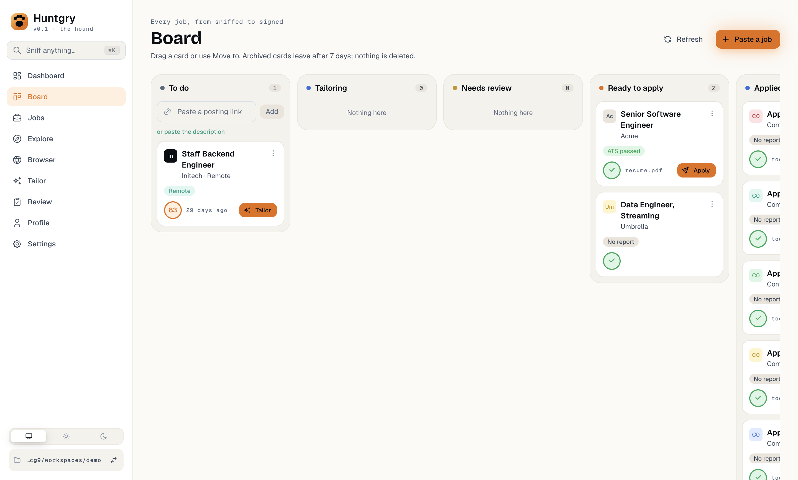
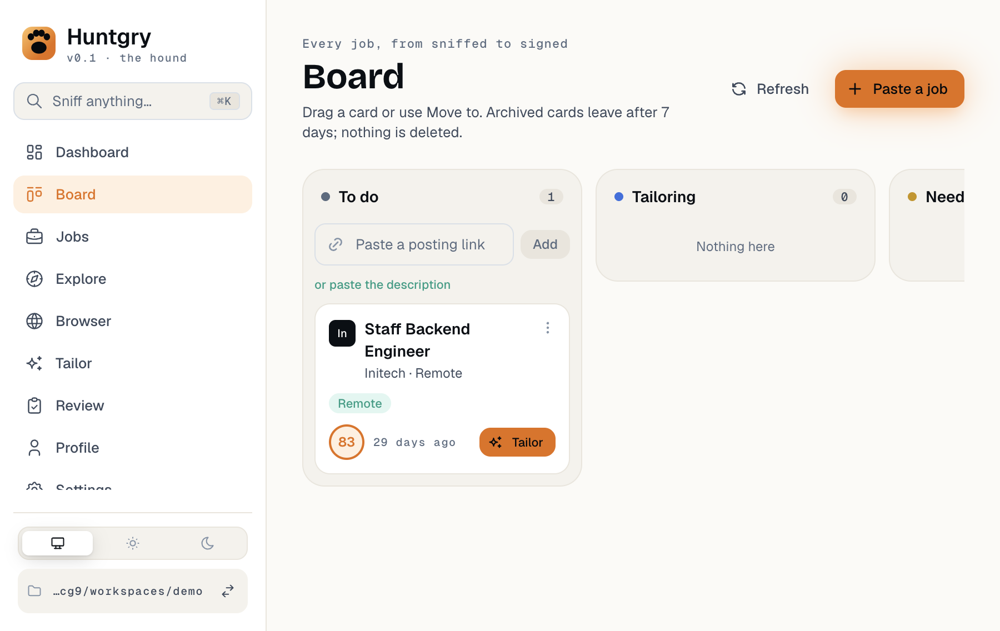
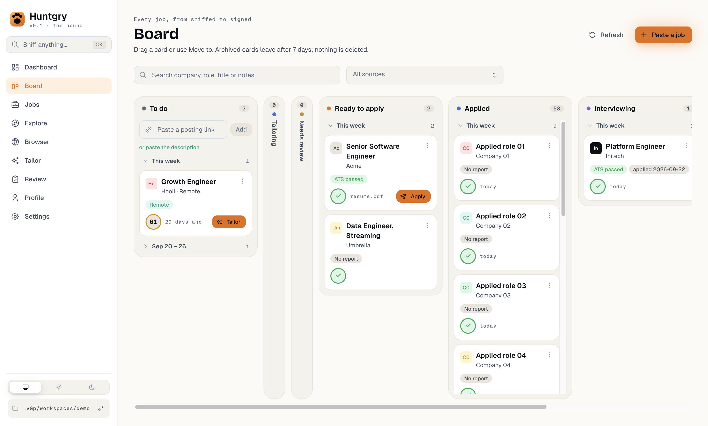
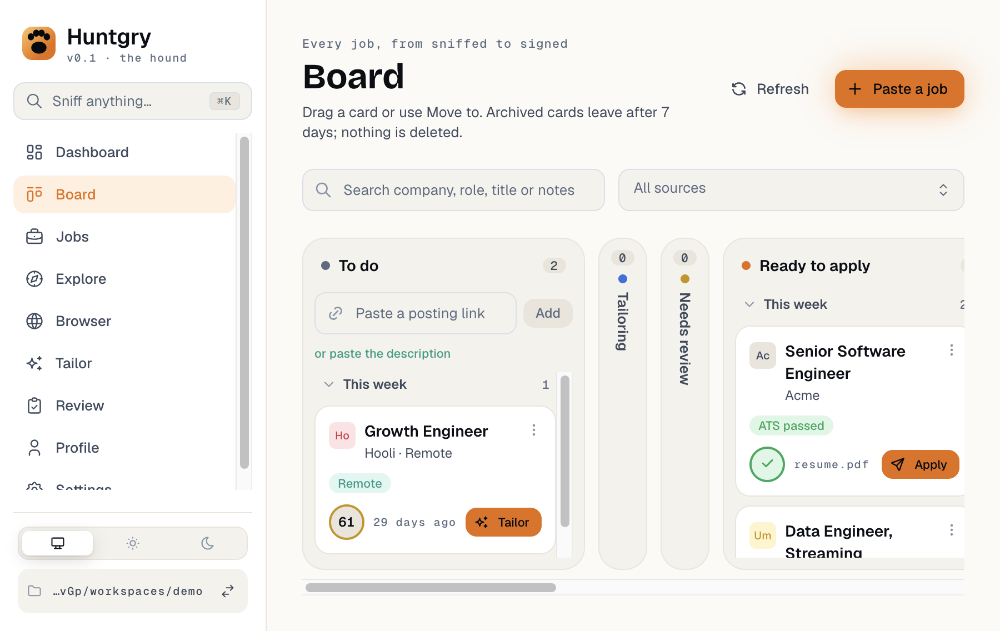
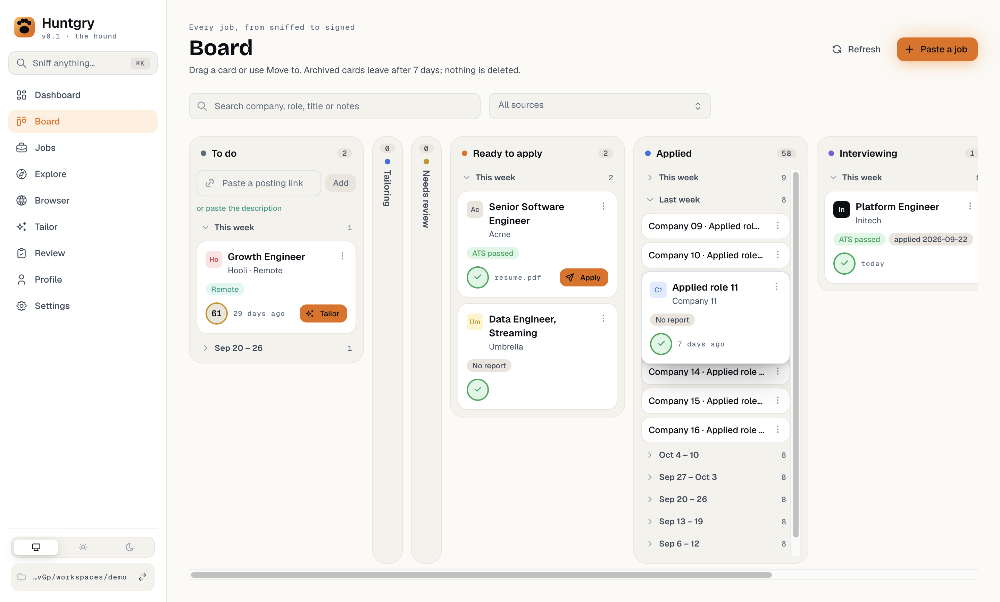
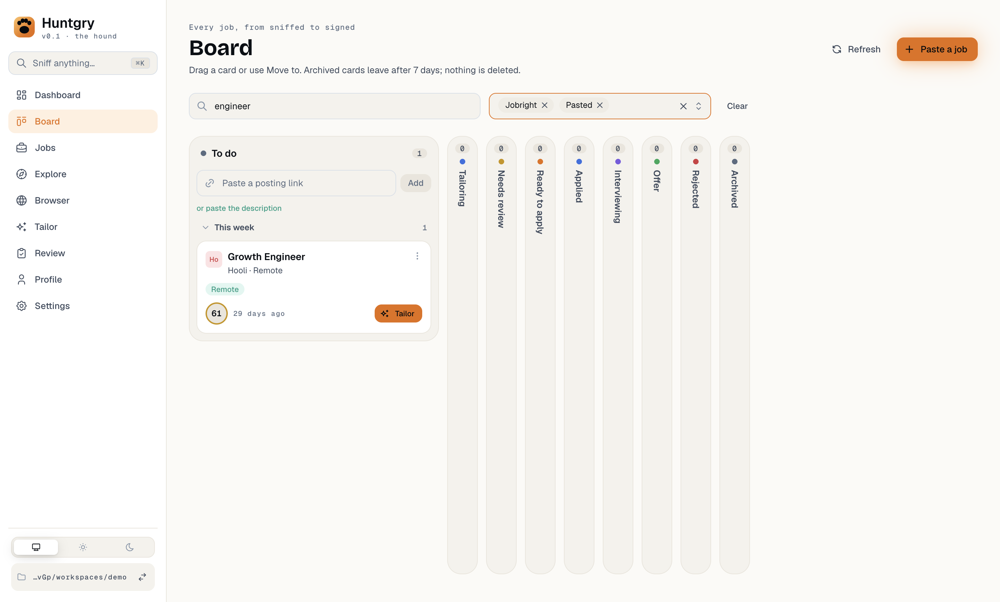
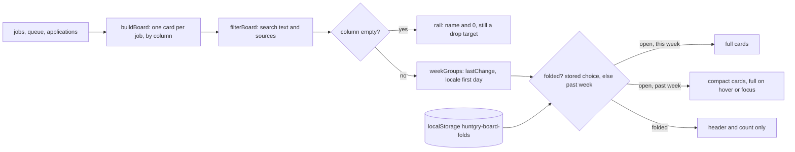

# #160 — Board: week groups, folded past weeks, empty-column rails, search

Issue: [silentashish/huntgry#160](https://github.com/silentashish/huntgry/issues/160) · Epic #156 · Followed by #161.

## Context & problem

The Board's columns grew without limit. **Applied** held 57 cards in one column that ran far below
the fold (the page was 8,600 px tall with 57 seeded applications), while five empty columns still
took 252 px each. There was no way to find a card except by scrolling, and the Dashboard table,
which had a search, is about to be removed (#161).

| Before (1440 × 900) | Before (900 × 600, the window's minimum) |
| --- | --- |
|  |  |

## What changed and why

| Area | Files | What |
| --- | --- | --- |
| Week groups | `src/renderer/src/pages/board/weeks.ts` | `weekGroups(cards, { now, locale, firstDay })` groups a column's cards by the week of their last change, newest week first and newest card first. Labels are **This week**, **Last week**, then ranges such as "Oct 4 – 10", "Sep 27 – Oct 3", and with the year when it differs ("Dec 28, 2026 – Jan 3, 2027"), formatted with `Intl.DateTimeFormat` in the locale. Weeks start on the locale's first day (`Intl.Locale#getWeekInfo()`, or the older `weekInfo` property; Monday, as in ISO 8601, when neither is there) and are computed in local time with calendar arithmetic (`setDate`), so a 23- or 25-hour DST day does not move a boundary. A card dated in the future counts as this week; one without a readable time goes last, under **Undated**. |
| Last change | `weeks.ts` (`lastChange`), `src/main/applications/tracking.ts`, `src/main/jobs/service.ts` | The board's own `card.at` (the application's file mtime, the job's fetch time, the run's update time, when it was archived), or a later change of where the card stands, which the scan does not count: an application's `statusChangedAt` (new: stamped in `huntgry.json` by `updateTracking` whenever the status changes), the day it was applied, the time it was archived, its review's `reviewedAt`; a saved job's `restoredAt` (new: stamped when a dismissed job is restored) or `tailoredAt`. Without this, a card moved to Offer today would land in a folded week from a month ago, out of sight. The application's `updatedAt`, which the Dashboard sorts by, is unchanged. |
| Folding | `index.tsx` (`Week`), `folds.ts` | Each group has a header button (`aria-expanded`, named "Last week, 8 cards") with a chevron, the label and the count. This week is open, past weeks are folded; a folded group renders no cards. The user's choices are kept per column and week (`applied:2026-10-11`) in localStorage under `huntgry-board-folds`, the same place the colour scheme lives, so they survive a restart. Only choices are stored, each with the time it was made. A choice not made again for about a year is pruned when saving, however old its week (old applications stay on the board, so their weeks can be opened). |
| Compact cards | `BoardCardView.tsx` (`compact`), `board.module.css` | Cards in past weeks are one line: company · title, the Scent score when there is one, and the Move to button. On hover or keyboard focus the full card is drawn **over** the slot instead of growing in place. Growing in place moved the cards under the pointer, and near an edge a card could expand and collapse in a loop. The face opens downward, or upward when the column has no room for it below but has room above (the last card of a column), so it is not cut off by the column's scrolling list. Keyboard focus also scrolls it into view; hover does not, so nothing moves under the pointer. Drag, Move to, click to open and Enter work on compact cards as on full ones. |
| Empty columns | `index.tsx` (`Column`), `board.module.css` | A column with no cards (after the filter) is a 44 px rail: the count, the tone dot and the name written sideways. It is still the same `<section aria-label>` with the same drag-over / drop handlers, so it takes drops and Move to as before. To do never becomes a rail, because it holds the link box. An empty Archived rail carries the archive note as hover text. |
| Layout | `board.module.css` | The page is as tall as the window (`100dvh` minus the shell's padding). Each column has a fixed head (name, count, To do's link box) and a body that scrolls on its own, so the head stays in view. Busy columns share the width the rails leave (252 to 360 px each). When they do not fit (the window's 900 px minimum), the board scrolls sideways inside its own box; the page does not. |
| Search and source | `src/shared/board-filter.ts`, `index.tsx` | A search box (company, role, title, notes, and an application's job id as the Dashboard table did) and a source multi-select (Jobright, Link, Pasted, hiring.cafe, Indeed) above the columns, with **Clear**. `filterBoard` narrows every column before the counts, rails and week groups are worked out, so all of them follow the filter. |

| After (1440 × 900) | After (900 × 600) |
| --- | --- |
|  |  |
|  |  |

## How it fits together

## Decisions and alternatives

- **The filter lives in `src/shared`, as data.** `BoardFilter` is `{ text, sources }`, and
  `matchesBoardFilter(card, filter)` is the one place a card is matched. #161 removes the Dashboard
  table and adds its Archived filter here as another field. `applicationSearchText` holds the
  table's searched fields (company, role, job title, job id, notes) for that move. The Dashboard's own
  `filter.ts` is left untouched: it also sorts and filters by status, and #161 retires it.
- **Source of a card.** The saved job's source when the card has one, otherwise the application's
  recorded `source` when it is one of the Board's sources. Applications made outside the app
  (`manual`, or none) and runs whose job was removed have no source and are hidden while a source is
  picked.
- **localStorage for the folds, not the app settings file.** Fold state is a per-device view
  preference like the colour scheme, written on every click. The settings IPC is for settings that
  main uses or that must reach other devices.
- **Rejected: virtualizing or capping columns ("+ N more").** Folding does the same job and keeps
  every card one click away, without a second way to page through a column.
- **A status-change time in `huntgry.json`, not a new `updatedAt`.** The scan leaves tracking edits
  out of `updatedAt` on purpose ("tracking edits are not the application changed"), and the
  Dashboard relies on that. The Board needs when a card moved, so main records it next to the
  status it already writes. Applications moved before this change have no such time; they date
  from their files as before.
- **Rejected: a hover popover in a portal for compact cards.** It would escape the column's scroll
  box, but it would also take the card's Move to button and drag handle away from the card. The
  overlay stays inside the card's own element.
- **Rejected: `Intl.DateTimeFormat#formatRange` for the labels.** Its separator and spacing vary
  between ICU versions (thin spaces, "–" vs "-"), which makes labels and tests unstable; the label
  is built from two formatted dates.

## How to test

- Unit: `npx vitest run src/renderer/src/pages/board src/shared/board-filter.test.ts`.
  `weeks.test.ts` pins the time zone to America/New_York and covers Sunday- vs Monday-first
  locales, the fallback, DST on both changes, the year boundary, the labels and the grouping
  order, and status moves, reviews, restores and tailoring as the last change.
  `applications.test.ts` and `jobs.test.ts` cover `statusChangedAt` and `restoredAt`.
  `board-filter.test.ts` covers sources, text fields (job id included) and per-column counts.
  `folds.test.ts` covers storage, the first version's format and pruning by when a choice was made. `BoardCardView.test.tsx` covers the compact line.
- e2e: `npm run build && npx playwright test -c e2e/playwright.config.ts e2e/tests/board.spec.ts`.
  The new describe block seeds 57 Applied applications, 8 a week over 8 weeks
  (`e2e/fixtures/board.ts` sets the files' mtimes the scan reads), and checks folding and counts,
  compact cards and hover, fold state across a relaunch (a week from 500 days ago included), a card
  moved from last week to Offer and back landing in This week before any week is opened, Move to
  and drag onto an empty column's rail, the last card's full face staying inside its column at
  900×600 on hover and keyboard focus, and search plus source filter counts. The page object opens folded weeks
  before it looks for a card and hovers a card before it opens its Move to menu.
- By hand: open the Board in a workspace with many applications. Past weeks are folded. Open one,
  hover a card, fold this week, restart the app: the choices hold. Shrink the window to its
  minimum: the board scrolls sideways inside itself and the page does not.

## Follow-ups

- #161: the Dashboard table goes; the Board takes over its search (done here), its Archived filter
  and its per-row actions on the card or its drawer. Done in
  [161-board-replaces-dashboard-list.md](161-board-replaces-dashboard-list.md); the Archived filter
  became `buildBoard`'s `keepArchived`, not a `BoardFilter` field.
