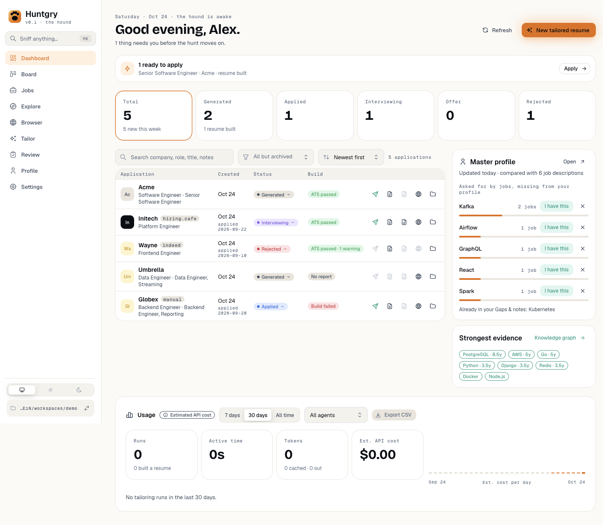
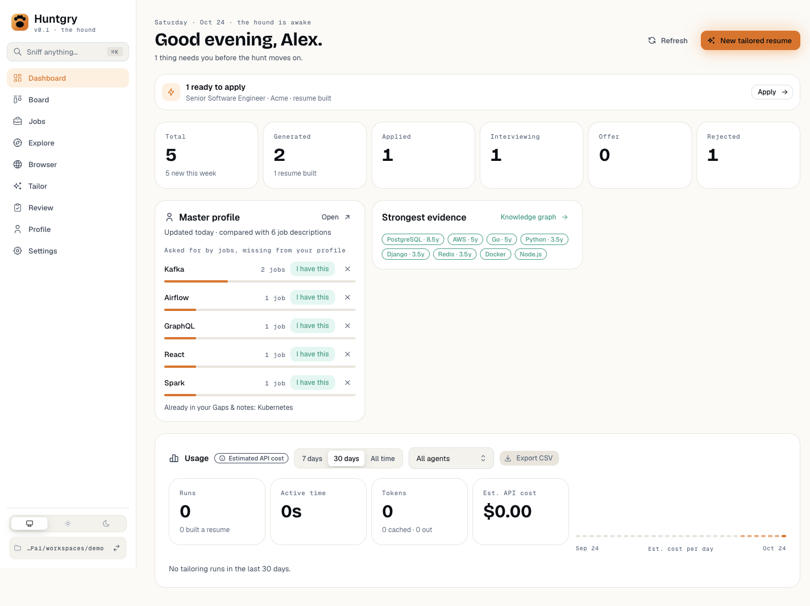
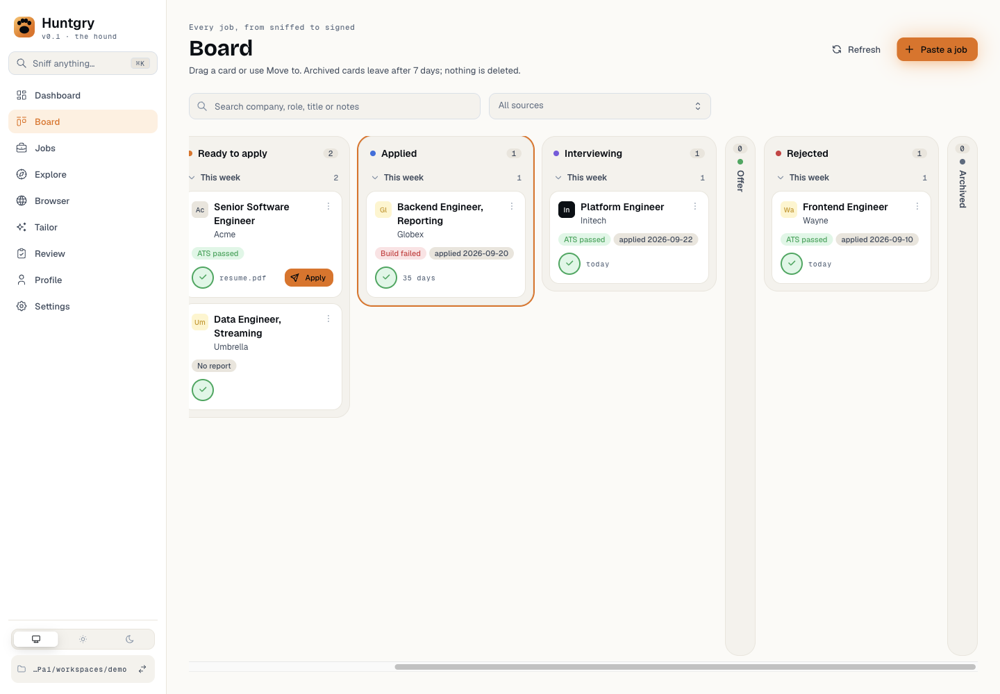
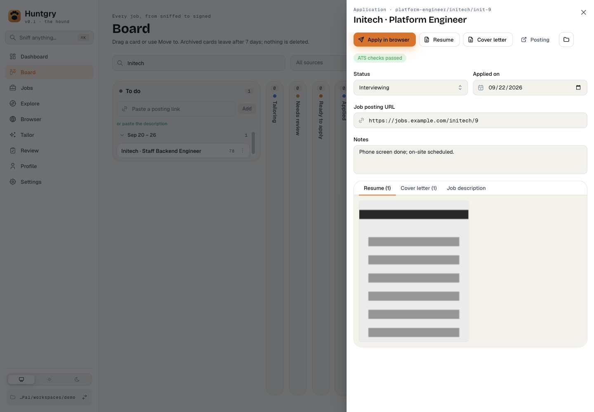
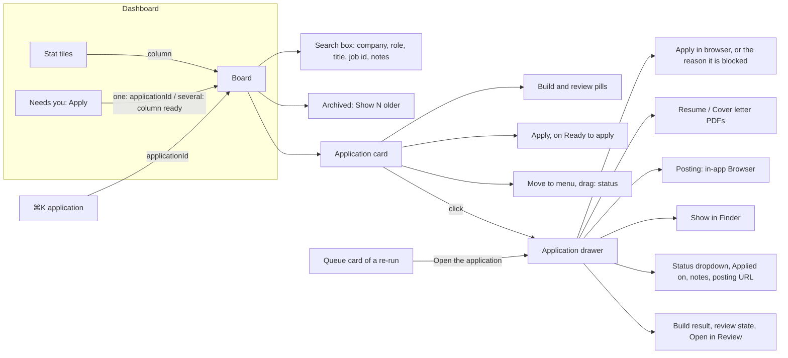

# #161 — The Board takes over from the Dashboard's applications table

Issue: [silentashish/huntgry#161](https://github.com/silentashish/huntgry/issues/161) · Epic #156 · Follows #160.

## Context & problem

The Dashboard (home page) listed every application in a table ("5 applications", or "68 of 78"
in a busy workspace) with a search, a status filter, a sort and five icon actions per row. The
Board (#85, #160) shows the same applications as cards, by stage, with its own search. That meant
two places to browse applications, and the home page grew with every application. The Dashboard
should be a summary: what needs the user, the counts, the last pipeline, usage and profile
insights. The Board is where applications are browsed.

Nothing the table did could be lost on the way, so the first step was an inventory.

| Table feature | Where it lives now |
| --- | --- |
| Apply (send icon) | **Apply** on a Ready to apply card; **Apply in browser** in the application drawer |
| Open resume.pdf / cover.pdf | **Resume** / **Cover letter** in the drawer (shown when the file exists) |
| Open the posting | **Posting** in the drawer, which opens the in-app Browser |
| Show in Finder | The folder button in the drawer |
| Status dropdown | **Status** in the drawer; the card's **Move to** menu; dragging the card |
| Build badge → build report, review state | Build and review pills on the card (detail on hover); the full build result, review state and **Open in Review** in the drawer |
| Apply blocked, with the reason | No Apply on the card; the drawer's disabled **Apply in browser** gives the reason on hover |
| Search (company, role, title, job id, notes) | The Board's search box (#160 already searched the same fields) |
| Status filter | The Board's columns; a stat tile scrolls to its column |
| Archived filter (every archived application) | **Show N older** in the Archived column (new) |
| Sort (newest, oldest, company) | Not carried over: cards are ordered by their last change, in week groups (#160) |
| Click a row → drawer | Click a card → the same `ApplicationDrawer` |
| A row while its job is re-tailored | The queue card that stands for the job carries the application (`card.app`): its **Open the application** button opens the drawer, and search matches the application's fields |

Every action already existed in the drawer the Board opens (the Board has reused the Dashboard's
drawer since #85). Three things were missing: archived applications older than a week (the Board drops
them after 7 days, the table's Archived filter listed them all), a way for other pages to link
into the Board, and somewhere for the stat tiles to go.

| Before | After |
| --- | --- |
|  |  |

| A stat tile opens the Board on its column | The application drawer from a card |
| --- | --- |
|  |  |

## What changed and why

- **Dashboard** (`src/renderer/src/pages/dashboard/index.tsx`): the table, its toolbar (search,
  status multi-select, sort, count) and the drawer are gone. The stat tiles stay and open the Board:
  Applied, Interviewing, Offer and Rejected on their column, Generated on Ready to apply (what is
  left to do with a generated result), Total on the whole Board. **Apply** in "Needs you" opens the
  one ready result's drawer on the Board, or the Board's Ready to apply when there are several. The
  last pipeline, profile insights and strongest evidence cards share one row under the tiles. The
  "scan stopped early" warning stays on the Dashboard.
- **Board links** (`navigation.ts`, `pages/board/index.tsx`): the `board` page takes
  `{ column?, applicationId? }`. `applicationId` opens that application's drawer; `column` scrolls
  the column into view and marks it with an Ember ring that fades (a steady ring with reduced
  motion). The column's `<section>` carries `data-column` and `data-focus`.
- **Archived** (`src/shared/board.ts`): `buildBoard` takes `keepArchived`. The Archived column's
  note gets **Show N older** (and **Only the last 7 days** to go back), and Archived stays a full
  column, not a rail, while it has older cards to offer.
- **⌘K** (`components/palette/search.ts`): an application found in the palette opens in its drawer
  on the Board (one waiting for review still opens on Review). It used to open the resume, or the
  folder. The "applications" keyword finds the Board, no longer the Dashboard.
- **KpiTile**: a clickable tile without `selected` is a plain button, not a toggle with
  `aria-pressed`. The tiles are links now, not filters.
- **Removed**: `ApplicationsTable.tsx` (and its `StatusMenu`), `filter.ts` and `filter.test.ts`,
  and the table's CSS. `isReadyToApply` and `countByStatus` moved to `summary.ts`, which is all that
  still used them; `readyToApply` keeps the newest-first order the table's filter gave it.
- **Re-runs** (review of this PR): while a saved job has a working queue item, its card is the
  queue card and the `generated` application it supersedes had no card at all, so its files,
  status and build were out of reach for as long as the item ran or waited for a reply. The queue
  card now carries that application (`app` in `src/shared/board.ts`); its **Open the application**
  button opens the drawer, and `cardSearchText` adds the application's fields.
- **Board cards** carry `data-kind` (`job`, `queue`, `application`) so tests can tell an
  application from a saved job of the same company.

## How it fits together

Where each former table action lives now:

## Decisions and alternatives

- **Scroll to the column, do not filter the others away.** "Open the Board filtered" could have
  meant hiding every other column. The Board's columns already are the status filter; hiding the
  rest would turn them into rails reading 0, which looks like data loss, and would need a filter
  chip to undo. Scrolling to the column and marking it shows the same cards and keeps the context.
  Total opens the whole Board, where this week's group is already open; "5 new this week" is
  exactly what that shows.
- **Show older archived cards in the column, not as a filter field.** `filterBoard` narrows the
  cards a built board has, but cards older than a week are not on the board at all, so the switch
  goes to `buildBoard` (`keepArchived`) and is page state next to the filter. It is not cleared by
  the filter's **Clear**, as it is not a narrowing.
- **No sort control.** The Board orders cards by their last change inside week groups (#160);
  sorting by company would fight the grouping. Search covers finding a company.
- **The drawer stays in `pages/dashboard/`.** Only the Board uses it now, but moving it with its
  badges and its CSS would add a large rename to this change. Left as a follow-up.
- **⌘K opens the drawer, not the resume.** An application's place is now its card; the resume is
  one click away in the drawer, and the palette still offers "Open the resume" as an action.

## How to test

- Unit: `npx vitest run src/shared/board.test.ts src/renderer/src/pages/dashboard src/renderer/src/components/palette src/renderer/src/components/ui`.
  `ApplicationDrawer.dom.test.tsx` covers each former row action in the drawer: Apply, resume and
  cover letter, the posting, Show in Finder, the status dropdown, the build result, the review state
  and Open in Review, and the missing-file case. `summary.test.ts` covers the tile → column map, the
  Needs you link and the counts; `board.test.ts` covers `keepArchived`; `search.test.ts` the
  palette's Board entries; `ui.test.tsx` the non-toggle tile.
- e2e: `npm run build && npx playwright test -c e2e/playwright.config.ts e2e/tests/dashboard.spec.ts e2e/tests/board.spec.ts e2e/tests/shell.spec.ts e2e/tests/review-gate.spec.ts e2e/tests/apply.spec.ts e2e/tests/apply-answers.spec.ts e2e/tests/apply-ashby.spec.ts e2e/tests/apply-generated.spec.ts e2e/tests/apply-workday.spec.ts e2e/tests/insights.spec.ts`.
  `dashboard.spec.ts` checks that no table, search, filter or sort is left, each tile's column and
  Ready to apply → drawer. `board.spec.ts` has a new `applications on the board (#161)` block:
  search by company, role, title and notes; resume, cover letter and folder (with `shell.openPath`
  stubbed) and the posting; the status dropdown and its `appliedAt` stamp; build and review pills,
  the Apply reason and Open in Review; the posting URL edit; and Show older in Archived. The apply
  specs and review-gate start Apply from the Board's drawer; shell.spec opens an application from ⌘K.
- By hand: on the Dashboard click **Applied**: the Board opens on Applied with a ring. Click
  **Apply** in "Needs you": the drawer opens. In Archived, press **Show N older**.

## Follow-ups

- Move `ApplicationDrawer`, `BuildBadge`, `ReviewBadge` and their CSS from `pages/dashboard/` to
  `pages/board/`.
- The stat tiles could filter the Board by when cards changed ("5 new this week") if the column
  scroll proves not enough.
