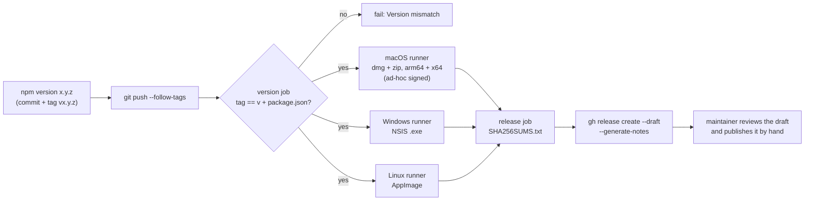
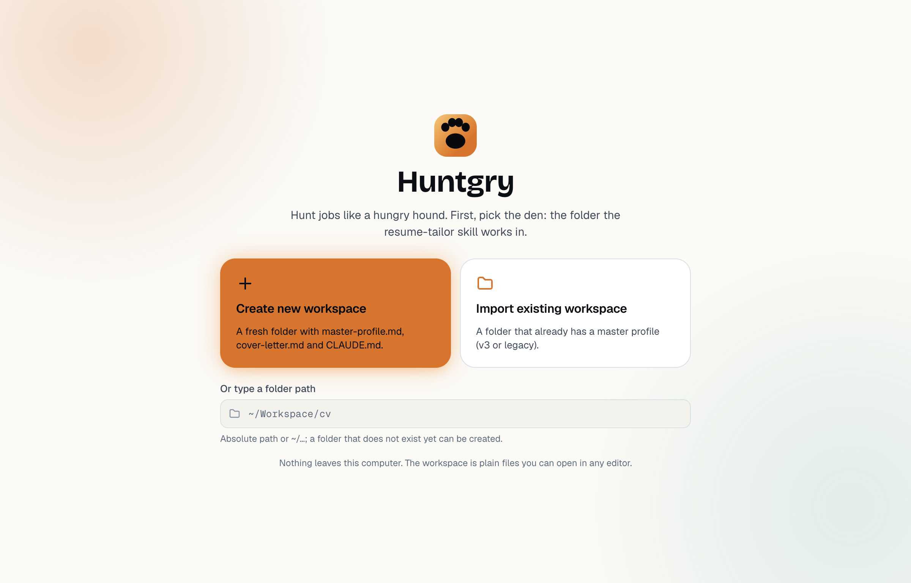
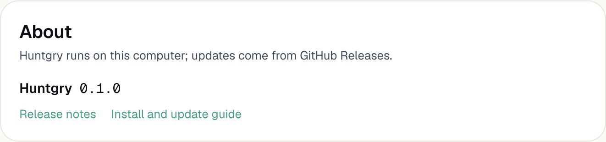

# #167: Installable desktop builds on GitHub Releases (no Apple account needed)

Issue: [silentashish/huntgry#167](https://github.com/silentashish/huntgry/issues/167)

## Context & problem

The only way to run Huntgry was to clone the repository and run `npm run dev` or `npm run dist`.
`electron-builder.yml` already described a macOS dmg and zip and a Linux AppImage, but nothing built
them for anyone else: there was no release workflow, `package.json` stayed at `0.1.0`, and the app
never showed its full version.

There is no Apple Developer account, so this phase cannot sign with a Developer ID or notarize. The
build has to be usable anyway, through macOS's "Open Anyway" path. Signing, notarization and
auto-update are [#168](https://github.com/silentashish/huntgry/issues/168).

Packaging the app locally showed one blocker: with no signing identity, electron-builder **skipped
signing**. The arm64 bundle kept Electron's linker signature, which no longer matches the bundle once
electron-builder rewrites `Info.plist` (`codesign --verify`: "code has no resources but signature
indicates they must be present"). A downloaded, quarantined copy of such a bundle gets the "is damaged
and can't be opened" message, which has no "Open Anyway" button.

## What changed and why

- **`electron-builder.yml`**
  - `mac.identity: '-'` signs the app ad hoc (electron-builder 26 needs the explicit opt-in;
    without it there is no ad-hoc fallback). `codesign --verify --deep --strict` now passes, and
    Gatekeeper treats the app as an unnotarized app, which it lets the user allow.
  - `mac.hardenedRuntime: false`: hardened runtime only matters for notarization, and with an ad-hoc
    signature its library validation rejects Electron's own frameworks. It comes back with #168.
  - `artifactName: ${productName}-${version}-${os}-${arch}.${ext}`: one name per OS and arch
    (`Huntgry-0.2.0-mac-arm64.dmg`, `…-mac-x64.zip`, `…-win-x64.exe`, `…-linux-x86_64.AppImage`) so
    every file of a release sits in one folder and one checksums file.
  - `win.target: nsis` is explicit (it was the implicit default).
- **`.github/workflows/release.yml`** (new), on a `v*` tag:
  1. `version`: fails unless the tag is `v` + `package.json`'s version, with an error naming both
     and the fix (`npm version`). A version with a `-suffix` is flagged as a pre-release.
  2. `build`, a matrix of three runners: macOS (`--mac --arm64 --x64`, dmg + zip each), Windows
     (`--win --x64`, NSIS) and Linux (`--linux --x64`, AppImage). Each runs `npm ci`,
     `npm run build` (which type-checks every workspace, like `npm run dist`) and
     `electron-builder --publish never`, then uploads its files as a workflow artifact.
  3. `release`: downloads them all, writes `SHA256SUMS.txt` (`sha256sum` format, which
     `shasum -a 256 -c` reads) and runs `gh release create --draft --verify-tag --generate-notes`.
     GitHub writes the notes from the PRs merged since the previous tag. Only this job has
     `contents: write`. On a rerun (or after a first run that created the draft and then failed
     mid-upload), a draft that already exists for the tag gets this run's complete set of files
     (`gh release upload --clobber`) and keeps its notes; a published release is refused.
- **Settings → About** (new card, last in the section nav, ⌘K "Settings → About"): the full version
  and links to that version's release and to the install guide. The version comes from
  `package.json` at build time (the same `__APP_VERSION__` the sidebar uses), which is what
  `app.getVersion()` reads in a packaged app; the release workflow makes the tag and `package.json`
  agree, so the card names the release the app came from.
- **`docs/install.md`** (new), linked from a new README "Install" section: which file to download, the
  macOS "Open Anyway" flow, the Windows SmartScreen "More info → Run anyway", the Linux AppImage,
  checking `SHA256SUMS.txt` (`shasum`, `sha256sum`, PowerShell `Get-FileHash`), what Settings installs
  on first launch, and how to cut a release. `npm run check:docs` now checks its links too.

No app behaviour changed for packaged builds beyond the About card: the packaged-build audit below
found nothing else that broke.

## The release pipeline

## Packaged-build audit

`npm run dist` builds `release/mac-arm64/Huntgry.app`. It was launched for real (Playwright's
`_electron.launch` on the packaged binary) with a fresh `--user-data-dir`, the launchd `PATH` a
Finder-launched app gets (`/usr/bin:/bin:/usr/sbin:/sbin`) and every e2e override set
(`HUNTGRY_E2E=1`, `HUNTGRY_ALLOW_LOCAL_URLS=1`, `HUNTGRY_E2E_LOOPBACK_ONLY=1`,
`HUNTGRY_EXPLORE_SOURCE_URL=http://127.0.0.1:9/…`), to check that a packaged build ignores them:

| Check | Result |
| --- | --- |
| `app.isPackaged`, `app.getVersion()` | `true`, `0.1.0` (the app path is `Contents/Resources/app.asar`) |
| First run | the workspace picker ("Create new workspace" / "Import existing workspace" / a typed path); creating one writes `master-profile.md`, `cover-letter.md`, `CLAUDE.md` |
| Claude / Codex / Antigravity discovery with the minimal PATH | all three found (`~/.local/bin/claude` 2.1.310, codex 0.163.0, agy 1.4.7) through the well-known folders and the login-shell PATH; `claude auth status` read |
| Skill | found in `~/.claude/skills/resume-tailor`; with an empty `HOME`, **Install resume-tailor** downloaded v5 from GitHub and wrote `skill-install.json` in userData |
| Python venv in userData | missing on a fresh userData, as expected; **Install Python dependencies** created `<userData>/skill-venv`, after which the environment was `ready` |
| TeX discovery | `~/Library/TinyTeX/bin/universal-darwin`; the preflight's pdflatex, pdftoppm, pdftotext and LaTeX packages OK |
| Explore | the real Jobright list fetched from GitHub; the loopback `HUNTGRY_EXPLORE_SOURCE_URL` was ignored |
| Hidden browser | `https://example.com/` opened in a tab; `http://127.0.0.1:9/` refused ("a local or private-network address"), so `HUNTGRY_ALLOW_LOCAL_URLS` was ignored |
| Repo-only files | `app.asar` holds only `out/**`, `resources/icon.png`, `package.json` and the runtime dependencies; nothing reads a path outside it or userData |

The e2e escape hatches were already gated on `app.isPackaged` (`cli/env.ts`, `cli/dev-urls.ts`,
`explore/source.ts`); the audit confirms they hold in a real packaged build.

One dev-only quirk, not changed here: the e2e suite and `npm start` launch `out/main/index.js`, where
Electron finds no `package.json` beside the entry and `app.getVersion()` (and so the macOS About panel)
reports Electron's own version. The renderer's version comes from the build, so the sidebar and
Settings → About are right in every mode.

## Gatekeeper

The built dmg was quarantined as a Safari download
(`xattr -w com.apple.quarantine "0081;$(printf %x $(date +%s));Safari;" <dmg>`), mounted, and the app
copied out and opened, on macOS 26.6.2:

- `spctl -a -vv -t exec` on the copy: `rejected`.
- syspolicyd logged the first-launch assessment (`GK evaluateScanResult: 0 … id: com.silentashish.huntgry`)
  and `Prompt shown (6, 0), waiting for response`, the unnotarized-app prompt that leads to
  "Open Anyway" (not the "damaged" one).
- The dialog itself could not be captured: the Mac's screen was locked during the run
  (`CGSSessionScreenIsLocked`), so neither `screencapture` nor the accessibility API could see it.
  The app process still started (translocated) after each attempt, through `open` and through Finder
  driven by AppleScript; why the prompt did not hold it could not be checked on a locked session. The wording in
  `docs/install.md` is Apple's documented text for macOS 15 and later ("“Huntgry” Not Opened" /
  "Apple could not verify…" / Done, Move to Trash; Privacy & Security "“Huntgry” was blocked to
  protect your Mac." / Open Anyway). It should be confirmed, with screenshots, by double-clicking the
  downloaded app in Finder on an unlocked Mac.

## The workflow, run for real

- **Dry run** ([run 40155678059](https://github.com/silentashish/huntgry/actions/runs/40155678059)):
  the tag `v0.0.0-test.1` on a throwaway commit with `package.json` at `0.0.0-test.1`. Version check
  6 s, Linux 2 min, Windows 5 min, macOS 9 min, release 26 s. It created a **draft pre-release**
  "Huntgry 0.0.0-test.1" with `Huntgry-0.0.0-test.1-mac-arm64.dmg`, `…-mac-arm64.zip`,
  `…-mac-x64.dmg`, `…-mac-x64.zip`, `…-win-x64.exe`, `…-linux-x86_64.AppImage` and
  `SHA256SUMS.txt`, with notes listing the merged PRs. The downloaded arm64 dmg passed
  `shasum -a 256 -c SHA256SUMS.txt --ignore-missing`; the app inside passed
  `codesign --verify --deep --strict` (`Signature=adhoc`), and launched it reported
  `app.isPackaged: true`, `app.getVersion(): 0.0.0-test.1` and "Huntgry 0.0.0-test.1" in the sidebar.
  The release and the tag were then deleted.
- **Rerun** ([run 40156981665](https://github.com/silentashish/huntgry/actions/runs/40156981665),
  after the review): the tag `v0.0.0-test.3` created a draft with all 7 files. Re-running only the
  release job then logged "A draft for v0.0.0-test.3 exists: replacing its files." and re-uploaded
  all 7 to the same draft (one release, new upload times; the dmg still matched `SHA256SUMS.txt`).
  The published-release refusal was not exercised, since nothing may be published.
- **Mismatch** ([run 40155693782](https://github.com/silentashish/huntgry/actions/runs/40155693782)):
  the tag `v0.0.0-test.2` on a commit at `0.1.0` failed in the version job with "Tag v0.0.0-test.2
  does not match package.json version 0.1.0 (expected tag v0.1.0)…", and nothing was built.

## Screenshots

The packaged app's first run (fresh userData) and Settings → About in a packaged build:

## Decisions and alternatives

- **The tag must match `package.json`; the workflow never rewrites the version.** Deriving the
  version from the tag inside the build (`npm version --no-git-tag-version` in CI) would ship an app
  whose `package.json` on `main` says something else. With `npm version` the commit that is tagged
  already carries the version, so a checkout of the tag rebuilds the same app.
- **Ad-hoc signing rather than no signing.** Unsigned arm64 Electron apps are "damaged" once
  downloaded; ad hoc is the only thing that gives users the "Open Anyway" path without an Apple
  account.
- **One macOS runner builds both architectures** rather than an arm64 and an Intel runner, or a
  universal build. The app has no native modules, so cross-packing x64 on Apple silicon is safe, and
  two smaller dmgs download faster than one universal one.
- **Only installable files are uploaded.** The `.blockmap` files and `latest*.yml` that
  electron-builder writes are for its auto-updater (#168); they are left out until then.
- **Draft, not published.** `gh release create --draft`: a human looks at the notes and opens the
  macOS build before anything is public.
- **`gh release create` rather than electron-builder's GitHub publisher.** One job owns the release,
  the checksums cover every OS's files, and the build jobs need no write token.
- **The size of the app** (≈400 MB unpacked, 138 MB dmg) is mostly Electron plus renderer-only
  dependencies (`@tabler/icons-react`, Mantine…) that electron-builder copies into `app.asar` although
  Vite already bundles them. Excluding them is a follow-up, not needed to ship.

## How to test

- Unit: `npx vitest run src/renderer/src/pages/settings/AboutCard.test.tsx` (the card shows the
  version it is given and links to `releases/tag/v<version>`).
- e2e: `npm run build && npx playwright test -c e2e/playwright.config.ts e2e/tests/settings.spec.ts`
  ("About shows package.json's version…").
- Packaging: `npm run dist`, then `codesign --verify --deep --strict release/mac-arm64/Huntgry.app`
  (passes) and open the app; Settings → About shows the version.
- Workflow: the dry run in [docs/install.md](../install.md#cutting-a-release) (a throwaway commit at
  `0.0.0-test.1`, tag pushed alone, draft checked, then deleted). A tag that does not match
  `package.json` fails in the `version` job.

## Windows: a known limitation

The review of PR #174 found that the Windows build cannot finish the Python setup: environment
discovery looks for `python3` in `:`-joined folders and uses `<venv>/bin/python3`, while Windows has
`python.exe` and `Scripts\python.exe`. The gap is wider than Python, though. CLI discovery
(`findInDirs`) never applies `PATHEXT`, so `claude.exe` and `codex.cmd` are not found either, and the
child PATH, the well-known folders and the TeX candidates are all Unix paths. A Python-only patch would
not make tailoring work, so the Windows installer still ships (the issue asks for it) but is marked
**experimental** in `docs/install.md` and the README. The fix is
[#175](https://github.com/silentashish/huntgry/issues/175).

## Follow-ups

- [#168](https://github.com/silentashish/huntgry/issues/168): Developer ID signing, notarization
  (hardened runtime back on) and auto-update (publish the blockmaps and `latest*.yml`).
- Screenshots of the Gatekeeper dialog and the Privacy & Security "Open Anyway" row from an unlocked
  Mac, to confirm the wording in `docs/install.md`.
- Keep renderer-only dependencies out of `app.asar` to shrink the download.
- [#175](https://github.com/silentashish/huntgry/issues/175): Windows discovery of the agent CLIs, Python
  and TeX, so the Windows build can tailor.
