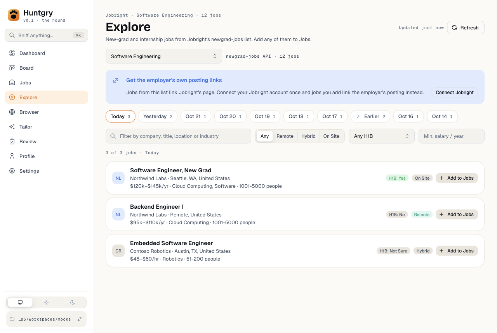
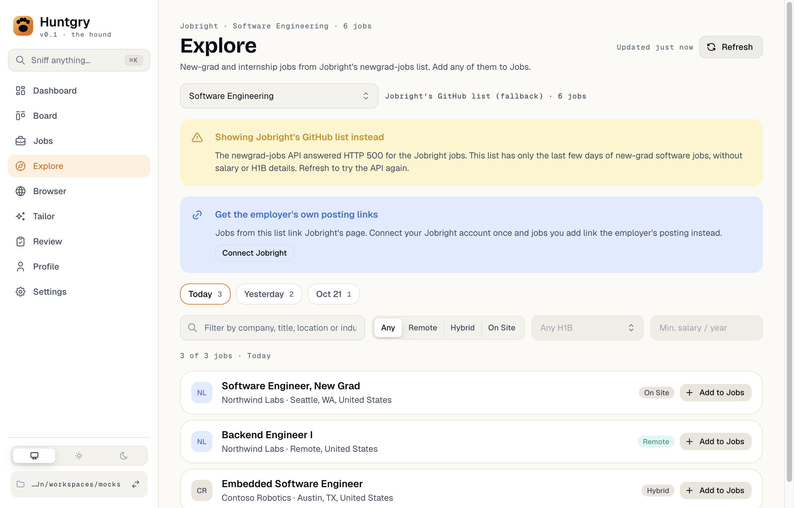
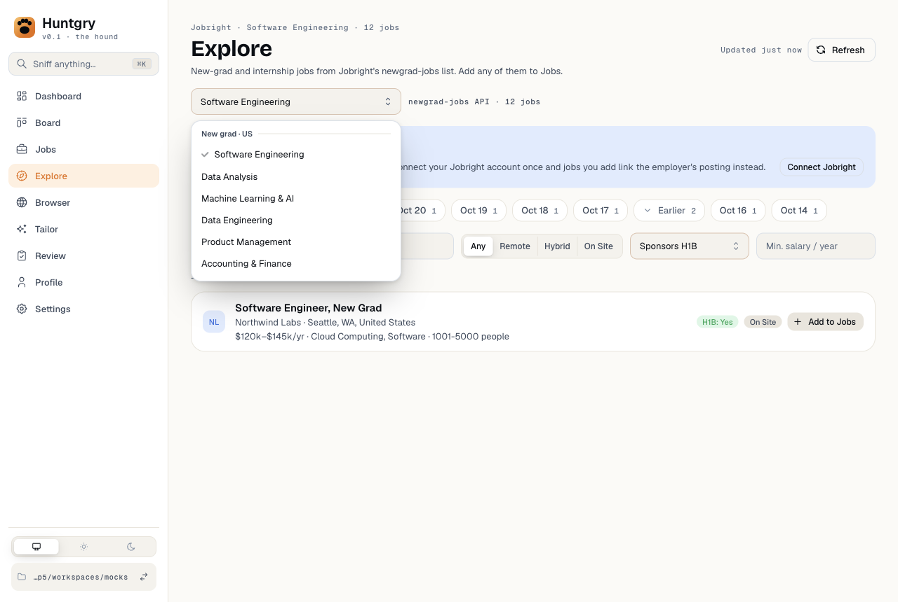
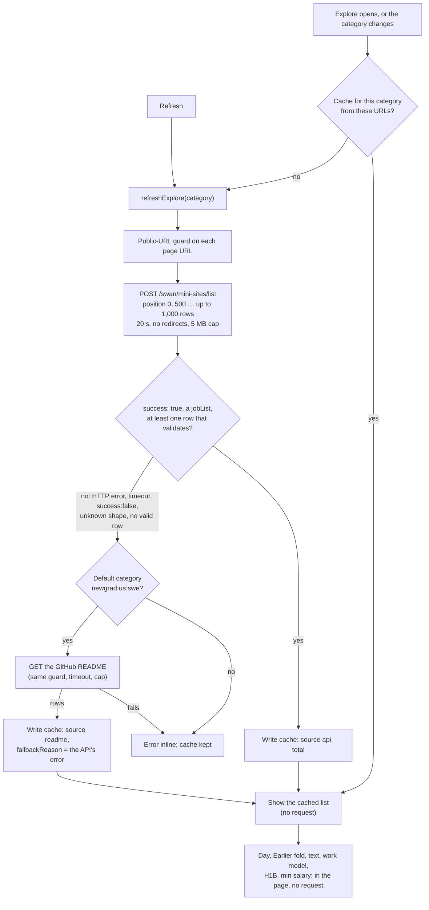

# #169 — Explore: jobs from the newgrad-jobs API, with categories and filters; the README as fallback

Issue: [silentashish/huntgry#169](https://github.com/silentashish/huntgry/issues/169) · Epic #156 · Builds on #142 (Explore), #146 (employer links), #148 (summary fallback), #160 (folded weeks) · Feeds #150 (match score per row)

## Context & problem

Explore (#142) read Jobright's GitHub README: the last ~7 days of US new-grad software jobs
(about 700 rows) with company, title, location, work model and day, and nothing else. The site
behind it, newgrad-jobs.com, lists the same jobs from an API on jobright.ai with the full list
(about 2,100 US software jobs), 67 categories and per-job fields the README lacks: salary,
qualifications, H1B sponsorship, industry, company size. Qualifications are what the match score on
every row (#150) needs.

The owner decided on 2026-10-24 to use that API although it is undocumented and internal:
robots.txt disallows `/swan/` and Jobright's terms forbid automated access. The issue sets the
limits that come with it (one category, a few pages, only on open and Refresh, cached, README
fallback, every field validated). This change keeps every one of them.

| The API list (today, H1B, pay, Earlier) | The README fallback, and why |
| --- | --- |
|  |  |



## The API

`POST https://jobright.ai/swan/mini-sites/list?position=<offset>&count=<n>`, `Content-Type:
application/json`, body `{"category":"newgrad:us:swe"}`. No auth. Checked on 2026-10-24 with two
plain curl calls (the shape below, `total` 2,116) and by reading newgrad-jobs.com's own page script
for the body it sends and its category list:

```json
{"success":true,"errorCode":10000,"errorMsg":null,"result":{"total":2116,"jobList":[{"jobId":"6abeb1c08ff3fb9b3bc751eb",
 "tabCategory":["newgrad:us:swe"],"postedAt":1792859280000,"properties":{"title":"Software Engineer, Mobile Core (Android)",
 "company":"Notion","location":"San Francisco, CA; New York, NY","salary":"$150000-$168000/yr","workModel":"Hybrid",
 "industry":["SaaS","Software"],"companySize":"501-1000","qualifications":"1. …\n2. …\n...","expLevel":null,
 "jobFunction":null,"h1bSponsored":"Not Sure","isNewGrad":false,"roleType":null}}]}}
```

Rows come newest first. Its CORS allows only `https://www.jobright.ai`, so main makes the call, as
it does for the README.

## What changed and why

| Area | Files | Why |
| --- | --- | --- |
| Model | `src/shared/explore-types.ts` | `ExploreJob` gains optional `salary`, `qualifications`, `h1b`, `industry[]`, `companySize`, `expLevel`; `id` (the Jobright id) and `url` (`https://jobright.ai/jobs/info/<id>`) are unchanged. `ExploreList` gains `category`, `source` (`api` / `readme`), `total` and `fallbackReason`. `EXPLORE_CATEGORIES` (4 groups, 67 categories, from newgrad-jobs.com's script), `DEFAULT_EXPLORE_CATEGORY` and `EXPLORE_MAX_ROWS` (1,000). `list`, `refresh` and `add` take the category. |
| API source | `src/main/explore/api.ts` | `parseApiPage` / `apiRow`: an answer is used only when `success` is `true` and `result.jobList` is an array. Each row is kept only when its `jobId` matches `JOBRIGHT_ID_PATTERN`, its title and company are non-empty strings, `postedAt` is a number of milliseconds between 2020 and two days from now, and its job URL passes `jobrightId` on an allowed host. Text is stripped of tags and control characters and capped (300 for title, company and location, 120 for salary, 4,000 for qualifications with its line breaks kept, 60 for each industry with at most 10). `h1bSponsored` must be `Yes`, `No` or `Not Sure`, and the work model goes through `workModelOf`; anything else is dropped from the row. `fetchApiList` pages 500 at a time and stops at 1,000 rows, a short page or the total. It drops repeated ids and checks every page URL with the public-URL guard. A failed first page throws; a failed later page keeps the rows already read. |
| HTTP | `src/main/explore/fetch.ts` | The README GET and the API POST share one request: 20 s timeout, `redirect: 'error'`, `credentials: 'omit'`, and a 5 MB cap that counts bytes as they stream in. A non-JSON answer is an error. `fetchReadme`'s messages are unchanged. |
| Service | `src/main/explore/service.ts` | One cache per category, `.huntgry/explore/<category>.json` (`newgrad.us.swe.json`), with the source and the URL it came from. A cache read with another source URL (the e2e mock's, say) is ignored. Every cached row is checked again, the API fields included. `refreshExplore` tries the API. When that fails and the category is the default one, it reads the README and records the API's error as `fallbackReason`. When both fail, it throws both messages and the cache is left as it was. `addExplore(id, category)` looks the row up in that category's cache; the saved job now carries the API's `salary`. |
| Test source | `src/main/explore/source.ts` | `HUNTGRY_EXPLORE_API_URL` joins `HUNTGRY_EXPLORE_SOURCE_URL`, under the same rule: unpackaged, `HUNTGRY_ALLOW_LOCAL_URLS=1`, and a loopback URL. Each is checked on its own, and a packaged build always uses the real URLs. |
| IPC | `src/main/explore/ipc.ts`, `src/preload/explore.ts`, `account.ts` | The renderer's category is accepted only when it is in `EXPLORE_CATEGORIES`; anything else is the default. The Jobright sign-in check (#146) uses the default category's list. |
| Page | `src/renderer/src/pages/explore/*` | **Category picker**, grouped and searchable; the default is New grad · US · Software Engineering, and the choice is remembered in localStorage. **Source line**: "newgrad-jobs API · 12 jobs", "… newest 1,000 of 2,116 jobs", or "Jobright's GitHub list (fallback) · 736 jobs", plus a warning with the API's error. **Filters**: text (now industry too), work model, H1B (Any / Sponsors / Not ruled out) and a yearly minimum salary read by the Jobs page's `salaryRange` (hourly pay × 2,080). H1B and salary are disabled on a README list. **Days**: the newest seven, then **Earlier** (a fold like the Board's past weeks, remembered); a picked older day stays shown. Rows show pay, industry, company size and an H1B pill. |
| Mock and e2e | `scripts/mock-ats/jobright.mjs`, `e2e/fixtures/servers/*`, `e2e/pages/explore.ts`, `e2e/tests/explore*.spec.ts` | `POST /jobright/swan/mini-sites/list` in the API's shape: paged, dated relative to today, with two malformed entries, six older rows (nine days in all) and a second category. `mock.jobright.api` makes it answer an HTTP status, `success: false` or only malformed rows. The README route stays. |

## How it fits together



## Decisions and alternatives

- **Filters run in the page, over the cached rows.** The API filters (`workModel[]`,
  `h1bSponsored[]`, `salary`, `title[]`) were not used, for three reasons. Each filter change would
  be another API call, against "only on open and Refresh". The API's `salary` means "the value falls
  within the range", not a minimum (from newgrad-jobs.com's own filter hint). And a combined filter
  call returned `total: 0`, so its behaviour was not clear enough to trust blindly. The cost: filters
  see only the newest 1,000 rows of a category (about ten days of US software jobs), not all 2,100.
- **The category is a request parameter, and it has its own cache.** Picking a category the
  workspace has never listed fetches it once. That is the same as opening the page for it, and
  switching back is served from its cache.
- **The README fallback covers only `newgrad:us:swe`.** It is the only category the README lists.
  Falling back to software jobs while "Data Analysis" is picked would show the wrong list, so other
  categories show the API's error instead, with their cache kept.
- **Two pages of 500, not one of 1,000.** Both work (the issue tested `count` up to 1,000). Smaller
  answers keep each body well under the 5 MB cap (500 rows are about 0.4 MB), and the issue asks for
  a few pages at most. A later page that fails keeps what the first one gave rather than losing it.
- **`postedAt` becomes a local day in main.** Day grouping and `toJob` (noon UTC of that day) work as
  before, so a saved job's `postedAt` looks the same whichever source it came from.
- **No company link.** The API has none, so `companyUrl` is `null` for API rows.
- **"of N" only above the cap.** The API's total also counts rows Huntgry drops, so "12 of 14" would
  read as missing jobs.
- **A new cache file name.** The old `.huntgry/explore/jobright.json` (README rows) is no longer read.
  The first open after the update fetches the API once, which is the point of the change. The old
  file is left in place; it is small.
- **Rejected: scraping newgrad-jobs.com's page.** The page is an iframe of
  `jobright.ai/minisites-jobs/…`. Its server-rendered data covers only the first 50 rows and would
  need HTML parsing that breaks more easily than JSON.
- **Rejected: match scoring here.** #149 builds the engine in `src/shared` in parallel. This change
  only carries `qualifications` through for #150.

## Caveats (accepted by the owner)

- The endpoint is undocumented and internal: robots.txt disallows `/swan/` and Jobright's terms
  forbid automated access. Huntgry calls it only when a category has no cache and on **Refresh**,
  never on a timer. It asks for one category, at most two requests (1,000 rows) per refresh, from the
  user's own machine, with no cookies.
- Jobright can change or close it at any time. The default category then falls back to the README
  (and the page says so); other categories show the error over their last cached list.
- Every field is untrusted: rows and fields are validated when they arrive and again when they are
  read from the cache.

## How to test

- Unit: `npx vitest run src/main/explore src/renderer/src/pages/explore`.
  - `api.test.ts`: row mapping, malformed entries, field cleaning and caps, the mock origin, and
    answers that are not a successful list. Paging: 500 a time, the 1,000 cap, stopping at the total
    or a short page, repeated ids, a later page failing, the guard. The service: cached per category,
    one request, then the cache. The README fallback on HTTP 500, `success: false`, malformed rows and
    an unknown shape. Edited cache rows, and Add to Jobs from an API row.
  - `explore.test.ts`: the README path as the fallback, the overrides (loopback only, each on its
    own), and `postJson` (body, HTTP errors, non-JSON, the 5 MB cap, offline).
  - `employer-link.test.ts`: the #146 cases, now on an API row.
  - `ExplorePage.dom.test.tsx`: list and Refresh requests that overlap (Refresh during the first load, that
    load failing, a category picked while a Refresh runs, Refresh during an uncached category switch). The newest
    request wins, and when it settles it clears both the loader and the Refresh spinner.
  - `view.test.ts`: the Earlier split, H1B, minimum salary (hourly too) and industry text, filters
    disabled on README lists, the remembered category, labels and the source line.
- e2e: `npm run build && npx playwright test -c e2e/playwright.config.ts e2e/tests/explore.spec.ts e2e/tests/explore-jobright.spec.ts`.
  - The API path: one request, malformed entries dropped, the row fields, `qualifications` in the
    cache, every filter with no new request, Add to Jobs / Added / Fetch full description.
  - The Earlier fold and that it is remembered; the category picker (its own cache, remembered,
    adding from it).
  - Refresh; the README fallback on HTTP 500 (warning, source line, disabled filters, adding a README
    row), on `success: false` and on malformed rows; both sources down, with no cache and with one.
  - The #146 / #148 specs, unchanged except that the sign-in check now fetches the list from the API.
- By hand: open Explore (it lists from jobright.ai). Pick another category, filter by H1B and salary,
  open Earlier, then Refresh. Each list open or Refresh makes at most two requests to
  `jobright.ai/swan/mini-sites/list`.

## Follow-ups

- #150: score each row from `qualifications` with the #149 engine.
- If the API's own filters become well understood, a Refresh could send the active filters, so the
  1,000-row cap is spent on matching jobs. That would need a cache per filter set.
- Other Jobright README repos (data, PM, interns) could become fallbacks for their categories.
