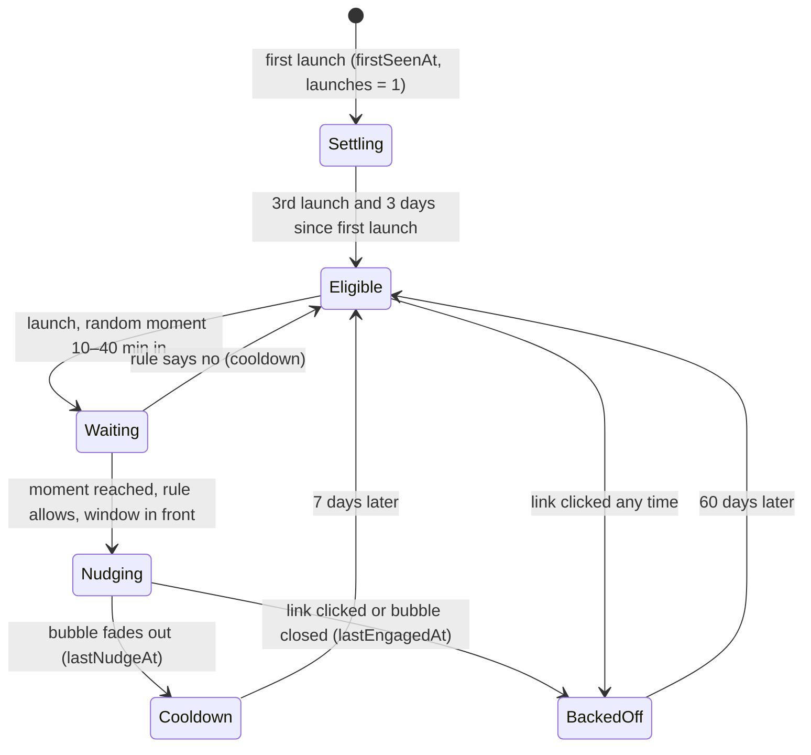
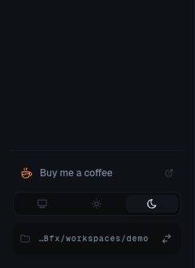
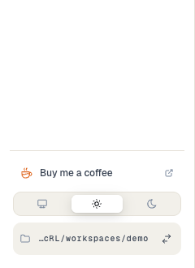
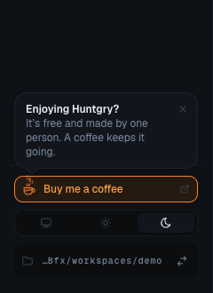
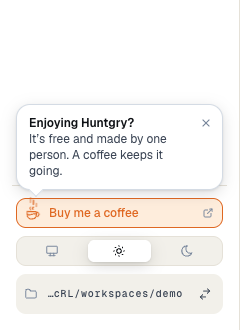

# #185 — Sidebar: Buy me a coffee, with an occasional nudge

Issue: [silentashish/huntgry#185](https://github.com/silentashish/huntgry/issues/185) · Follows the README badge (#132).

## Context & problem

Huntgry is free. The only place that offers a way to support it is the Buy Me a Coffee badge in the README, and people who use the desktop app never read the README again. The app needed a small, polite way in: always there, catching the eye now and then, never on every launch and never on a loop.

## What changed and why

| Area | Files | What |
| --- | --- | --- |
| Schedule | `components/shell/coffee.ts` | `COFFEE_URL`, `NUDGE_RULES` and the pure functions `shouldNudge(state, now, sessionStartedAt)`, `nudgeDelay(random)`, `recordLaunch`, `recordNudge`, `recordEngaged`, `parseNudgeState`. |
| Hook | `components/shell/useCoffeeNudge.ts` | Counts one launch per renderer load, picks a random moment into the session, asks `shouldNudge` then, waits for the window to be in front, plays the nudge, fades the bubble after 9 s (later while the pointer or focus is on it; hover and focus are tracked separately, and either one arriving during the 400 ms fade cancels it). Keeps the schedule state in memory for the session and saves it to `localStorage["huntgry-coffee-nudge"]`, like the colour scheme (`huntgry-color-scheme`) and the Board's folds; a failed save never undoes a nudge or a click within the session. |
| Link | `components/shell/CoffeeLink.tsx`, `Sidebar.tsx`, `shell.module.css` | A compact row above the theme toggle: ember coffee cup, "Buy me a coffee", an external-link glyph. It is a plain `<a href target="_blank" rel="noreferrer">`. While nudging: ember-soft highlight, the cup wiggles twice, three steam wisps rise, and an "Enjoying Huntgry?" bubble pops up above it with a close button. |
| Tests | `coffee.test.ts`, `CoffeeLink.test.tsx`, `e2e/tests/shell.spec.ts`, `e2e/pages/shell.ts` | The schedule's rules and edges; the link's attributes and accessible name; no nudge on a first launch; the nudge at the scheduled moment without focus moving; fade-out; dismissal and click recorded; the force flag; back-off kept when storage throws; hover and focus holding the bubble independently; a fade cancelled by focus; focus returned to the link on keyboard close; in the app, the click going to `shell.openExternal` with the app window left alone. |

### Opening the page

`src/main/index.ts` already denies every window the renderer asks for and hands `https://` URLs to `shell.openExternal`; `will-navigate` is cancelled too. A `target="_blank"` link goes through that handler, so no main-process or preload change was needed. The e2e test stubs `shell.openExternal`, presses Enter on the link and checks the URL it received, that the window URL did not change and that no second window exists.

### The nudge schedule

| Rule | Value | Why |
| --- | --- | --- |
| `minLaunches` | 3 | The first sessions are for setting up a workspace and a profile. |
| `minAgeMs` | 3 days since first launch | Someone who launches three times on day one is still trying it out. |
| `minSessionMs` … `maxSessionMs` | a random moment 10 to 40 min into the session | Never at startup; only once the user has been working for a while. |
| `cooldownMs` | 7 days | At most once a week. A nudge that fades out on its own counts as shown. |
| `engagedCooldownMs` | 60 days | After a click on the link or a close of the bubble the user has made their choice; ask again only much later. |
| `bubbleMs` | 9 s | Long enough to read two lines; held open while hovered or focused. |

The moment is drawn once per launch; if the rule says no at that moment, nothing else is tried in that session. If the window is in the background then, the nudge waits until it is in front again.

### Accessibility

- The link is named "Buy me a coffee (opens in your browser)", is in the tab order and shows the ember focus ring.
- The bubble is inside a `role="status"` (polite) live region that is always rendered, so screen readers hear it without focus moving. Its close button ("Dismiss coffee reminder") is reachable with Tab; Escape inside the item closes it too. It never takes focus.
- The bubble stays while the pointer is over the item or focus is in it (either one), and comes back if either arrives while it is fading, so a focused close button is never removed under the user.
- Closing it while focus is inside the bubble (its button or Escape) moves focus to the link; closing it with the pointer while focus is elsewhere leaves focus alone.
- `prefers-reduced-motion: reduce`: no wiggle, no steam, no pop or fade; the bubble and the static ember highlight only.

## Screenshots

| | Dark | Light |
| --- | --- | --- |
| Sidebar bottom |  |  |
| Nudge (mid-wiggle, steam rising) |  |  |
| Nudge, reduced motion |  | |

## Decisions and alternatives

- **localStorage, not `settings.json`.** The schedule is a per-machine UI detail like the theme and the Board's folds; it needs no IPC, no schema and no migration, and losing it only means the user is treated as new (no nudge for three launches).
- **A link, not a button calling a new IPC.** The window-open handler already exists for exactly this; a new channel would duplicate it.
- **Not a Mantine `Popover` or toast.** A popover moves focus or needs managing, and a toast in the corner would be far from the item it is about. The bubble is drawn in the sidebar, anchored to the cup.
- **No nag on a loop or on launch.** Rejected by the issue; a random moment 10–40 minutes in also keeps it away from the busy first minutes of a session.
- **Fixed numbers, no setting to turn it off.** Closing the bubble already backs off for two months; a settings toggle can follow if anyone asks.

## How to test

- `npx vitest run src/renderer/src/components/shell/` (schedule and component tests).
- `npm run test:e2e -- tests/shell.spec.ts` (the link and the forced nudge in the built app).
- By hand: in the app's devtools console run `localStorage.setItem('huntgry-coffee-nudge-force', '1')`, reload (⌘R): the nudge plays 1.5 s after launch. `localStorage.removeItem('huntgry-coffee-nudge-force')` to go back to the schedule; `localStorage.removeItem('huntgry-coffee-nudge')` to start over as a fresh install. To check the real schedule, seed `{"firstSeenAt": 0, "launches": 9, "lastNudgeAt": null, "lastEngagedAt": null}` and wait 10–40 minutes.
- Reduced motion: turn on macOS System Settings → Accessibility → Display → Reduce motion and force the nudge.

## Follow-ups

- A link in Settings → About next to Release notes, for people who look there.
- If people find the nudge too often or too rare, tune `NUDGE_RULES` (one place).
