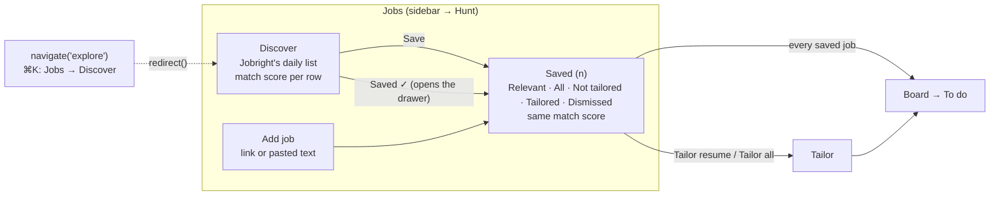
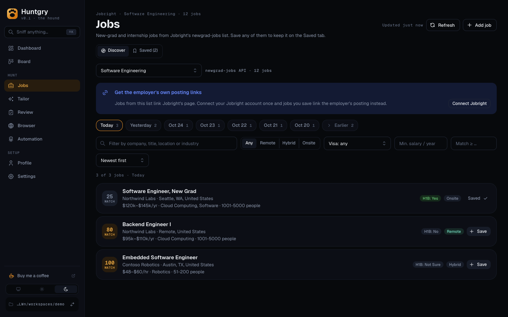
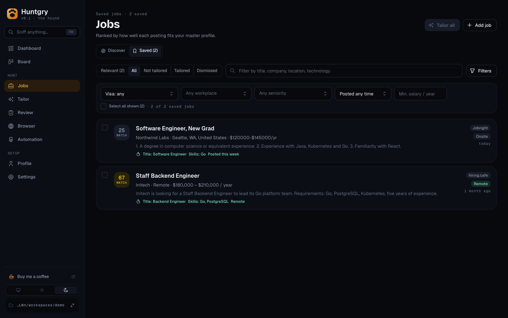
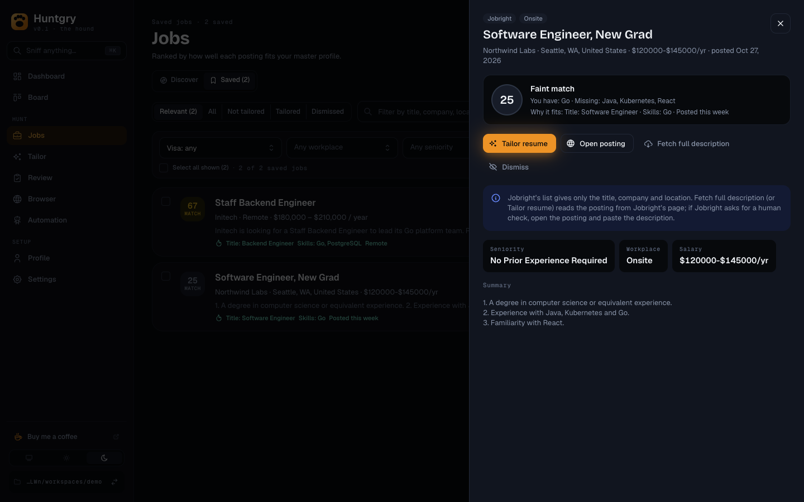
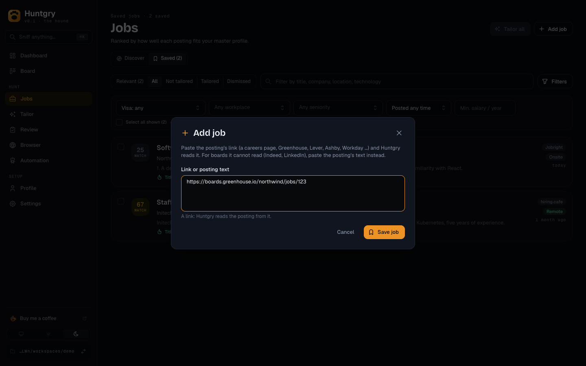
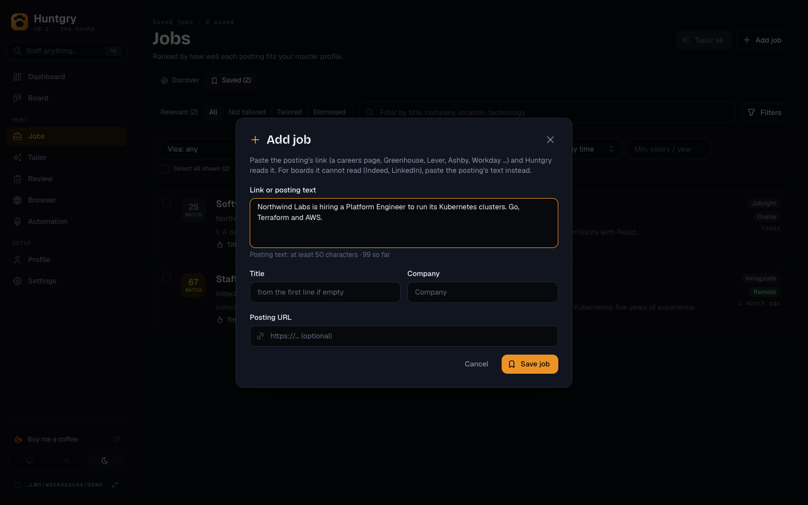
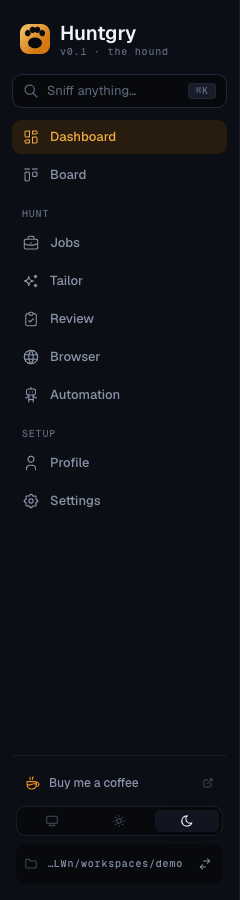

# #189 — Jobs: Discover and Saved tabs, one match score, sidebar in hunt order

Issue: [silentashish/huntgry#189](https://github.com/silentashish/huntgry/issues/189) · Merges Explore (#142, #169) into Jobs (#78, #111); one score from the match score (#149, #150).

## Context & problem

Explore and Jobs listed the same kind of job row on two pages. A job saved from Explore then showed in three places: Explore as "Added", Jobs, and Board → To do. The two pages scored the same job with two numbers: *Software Engineer, New Grad · Northwind Labs* read **25 match** on Explore and **59 scent** on Jobs, the match score of #149 next to the relevance score of #73. Their filter bars named the same things differently (H1B vs. Visa, On Site vs. Onsite), there were two ways to add a job on Jobs (a URL box and "Paste a job"), and the sidebar listed Explore and Browser between Jobs and Tailor, not in the order a hunt goes.

## What changed and why

| Area | Files | What |
| --- | --- | --- |
| Jobs page | `pages/jobs/index.tsx`, `pages/jobs/tabs.ts` | One page with a `Discover` · `Saved (n)` switch under the header, the Profile page's view-switch pattern (a `SegmentedControl` named "Jobs view", picked by `params.tab`, so each tab is deep-linkable). The page owns the saved list both tabs read, the open drawer and the Add job dialog. `jobsTab(params, savedCount)` is the pure rule for the tab it opens on: `openId` → Saved, else `tab`, else Saved when there is a saved job in play and Discover when there is none. Once chosen the tab stays, so saving the first job on Discover does not jump to Saved. |
| Discover | `pages/jobs/discover/*` (moved from `pages/explore/*`) | The old Explore page as a tab, its logic unchanged: category, Jobright banner, day buttons, filters, rows, Refresh and "Updated … ago". "Add to Jobs" is **Save**; a saved row reads **Saved ✓** and clicking it switches to Saved with the job's drawer open. A saved row shows its saved job's match score, so the two tabs agree even after the full posting was fetched. |
| Saved | `pages/jobs/SavedTab.tsx`, `view.ts` | The old Jobs page body, behaviour unchanged: Relevant / All / Not tailored / Tailored / Dismissed, filters, Tailor all, Dismiss, the drawer. `relevanceView` (was `scentView`) scores every job once and returns the relevance (ranks Relevant, gives "why it fits"), the Relevant list and the match score of every job. |
| One score | `JobRow.tsx`, `JobDrawer.tsx`, `MatchBadge.tsx`, `labels.ts`, `shared/explore-score.ts`, `pages/board/card.ts`, `BoardCardView.tsx` | Rows show the `MatchBadge` Discover shows; the drawer and Board cards show the match score in their ring, with what it is made of (you have / missing / failed must-haves). `jobMatch(job, signals)` gives a saved job's match score the way its Discover row was scored: exact from the description, a title-only "≈" estimate without one. Relevance is still computed and still ranks Relevant, but it is no longer shown as a number. "Strong / Fair / Faint scent" reads "… match"; the ring's name is "Match N of 100". |
| Add job | `pages/jobs/AddJobModal.tsx`, `addJob.ts` (replaces `PasteModal.tsx`) | One "Add job" button in the header, on both tabs, opens one dialog with one box. `addJobInput` decides: a lone http(s) URL is a link (Huntgry reads the posting), 50+ characters of anything else are a posting's text (title, company and link fields appear, optional). The Board's header button and the ⌘K action ("Add job") open the same dialog; the Board's To do link box stays. Main's "paste the description" hint now names "Add job". |
| Filter labels | `discover/DiscoverTab.tsx` | Discover's H1B select is "Visa sponsorship" with the Saved tab's options (`Visa: any`, `Visa: hide "no sponsorship"`, `Visa: only sponsors`); its work model is "Workplace" with `Onsite`. Same filter values underneath. |
| Sidebar | `navigation.ts`, `components/shell/Sidebar.tsx`, `shell.module.css` | `NAV_GROUPS` is the one place the order is written: Dashboard, Board · **Hunt**: Jobs, Tailor, Review, Browser, Automation · **Setup**: Profile, Settings. `PAGES` is derived from it and the ⌘K palette's Go to follows `PAGES`. A group is a `role="group"` with `aria-label`; its label is a small muted `MonoLabel`, `aria-hidden` (the group name already announces it) and not focusable. |
| Old Explore page | `navigation.ts`, `App.tsx`, `components/palette/*`, `AppLayout.tsx` | `explore` is gone from `PAGES`, `PAGE_LABEL`, the sidebar icons, `App.tsx` and the palette. `redirect()` turns `explore` into `jobs` with `{ tab: 'discover' }`, as it turns `graph` into Profile's graph view, so an old `navigate('explore')` lands on Discover. The palette has "Jobs → Discover" and "Jobs → Saved"; typing "explore" still finds Discover. |
| Wording | Settings → Jobright, Automation, README | "Explore" reads "Discover" where users see it. The workspace cache keeps its folder (`.huntgry/explore/`) and Automation keeps its `explore` source key, so nothing on disk changes. |

## Decisions and alternatives

- **One page, tabs in the URL params, not two pages under one sidebar entry.** Same as Profile's Editor / Knowledge graph / Skills (#95): a page-level switch picked by params, so the palette, Automation's links and old `navigate('explore')` calls reach a tab directly.
- **Only the shown tab is mounted.** Mounting Discover behind Saved would read the Jobright list on every visit to Saved. Discover keeps its category in `localStorage` as before; its day and text filters reset when you switch away, as they did when you left Explore.
- **The tab is chosen once.** Without that, saving the first job on Discover would flip the default to Saved under the user. A navigation that names a tab or a job to open chooses again.
- **Match score shown, relevance kept for ranking.** The issue asks for one number. Relevance mixes title, skills, seniority, location and recency and is right for ordering the Relevant list; the match score is the number Discover, Automation and the Board already reason about. Rejected: showing both (the bug), or ranking Relevant by match (a well-titled job without skills listed would sink).
- **Board cards switch too.** The Board opens the same drawer; a card saying 59 next to a drawer saying 25 would have kept the bug alive one page over.
- **One box for link or text, not a dialog with two modes.** The input itself tells which it is; title and company only appear for text. Rejected: a URL field plus a text area (the old two ways in one dialog).
- **No duplicate "Add job" in Saved's empty state.** It already says "Discover jobs" and the header button is right above it.
- **Labels aligned, not a shared filter bar.** Discover filters Jobright's fields (H1B, salary from the API), Saved filters saved jobs (sponsorship read from the text, seniority, date posted). Sharing the component is the follow-up below.

## How to test

- `npx vitest run src/renderer src/shared` — `tabs.test.ts` (the default tab), `navigation.test.ts` (groups, `PAGES` derived from them, `explore` → Jobs → Discover), `addJob.test.ts`, `view.test.ts` (Saved rows carry the match score, the same as the Discover row for the Northwind job), `labels.test.ts`, `JobsPage.dom.test.tsx` (default tab, one Add job per tab, Saved ✓ switching tabs and showing the Discover number on the row and in the drawer, staying on Discover after the first save), `DiscoverTab.dom.test.tsx`, `card.test.ts`.
- `npm run test:e2e -- tests/shell.spec.ts tests/explore.spec.ts tests/explore-jobright.spec.ts tests/jobs.spec.ts tests/board.spec.ts tests/automation.spec.ts tests/tailor-queue.spec.ts`.
- By hand (demo workspace with the mock Jobright, or a real one): open Jobs. With no saved jobs it opens on Discover. Save *Software Engineer, New Grad · Northwind Labs*: the row reads Saved ✓ and the tab stays. Click Saved ✓: Saved opens with the drawer, showing the same number as the row. Press ⌘K, type "explore": "Jobs → Discover". Add job: paste a URL (no title fields), then paste text (title, company and link appear).

## Screenshots

| | |
| --- | --- |
| Jobs → Discover, a saved row reads Saved ✓ |  |
| Jobs → Saved, rows with the match badge |  |
| Saved ✓ → the drawer, same number |  |
| Add job, a link |  |
| Add job, pasted text |  |
| Sidebar in hunt order |  |

## Follow-ups

- **One shared filter bar for both tabs** (out of scope here): the same component over Jobright rows and saved jobs, with the Posted filter and Match ≥ N on both.
- The Board's To do link box could open the Add job dialog instead of its own field.
- Rename the remaining internal `explore` names (IPC channels, the cache folder, Automation's source key) once there is a migration to carry the cache over.
