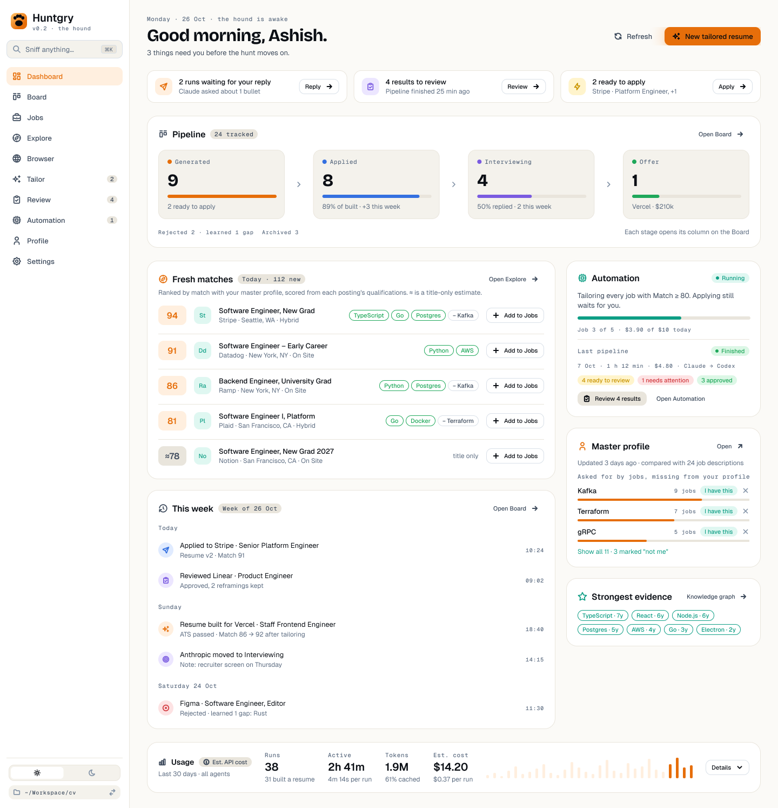
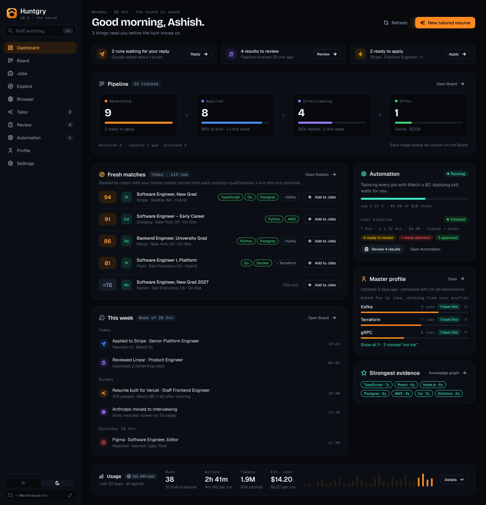
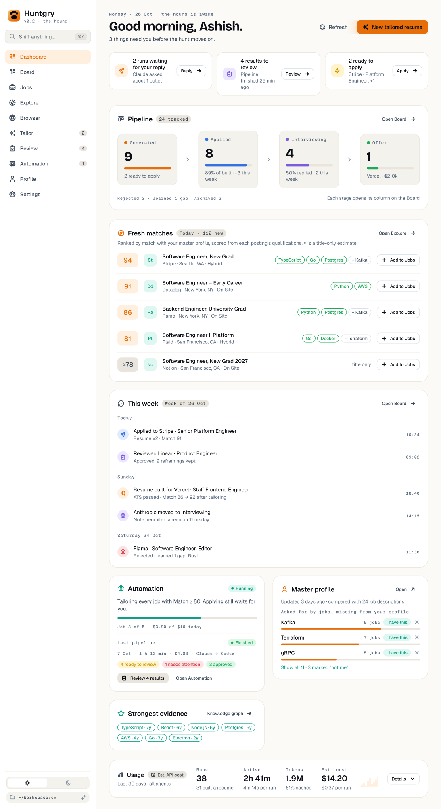
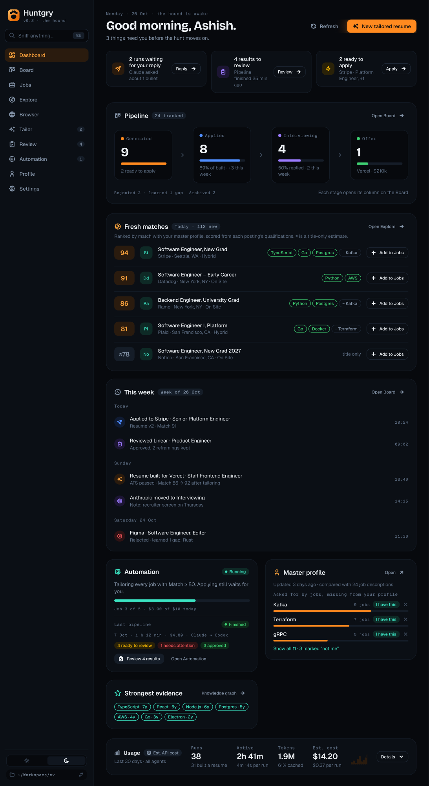
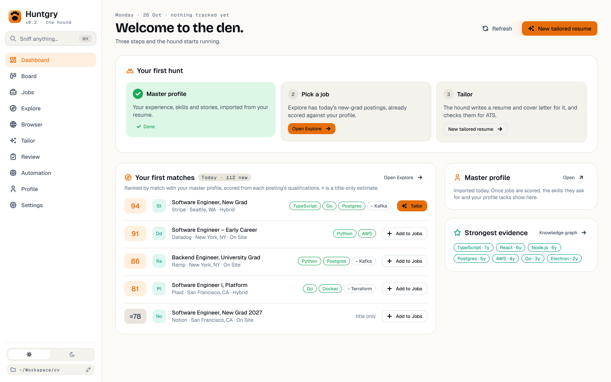
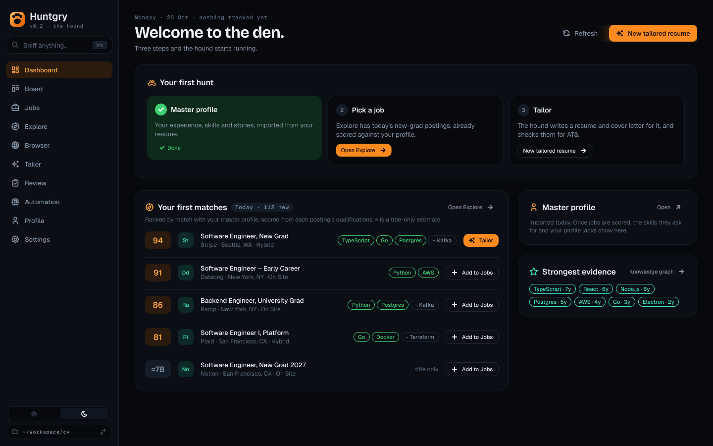

# Dashboard v2 — design proposal

Issue: [#181](https://github.com/silentashish/huntgry/issues/181) · Epic [#180](https://github.com/silentashish/huntgry/issues/180) · Review: [#182](https://github.com/silentashish/huntgry/issues/182) · Implementation: [#183](https://github.com/silentashish/huntgry/issues/183)

Figma: [Huntgry — Product & Website Design](https://www.figma.com/design/zhNccc831dRnOhj2tmqqkc), pages **🖥 App · Light** and **🖥 App · Dark**, frames named `Dashboard v2 …`, to the right of the current Dashboard frames.

| Frame | Light | Dark |
| --- | --- | --- |
| Wide (1440) | [62:2](https://www.figma.com/design/zhNccc831dRnOhj2tmqqkc/?node-id=62-2) | [63:789](https://www.figma.com/design/zhNccc831dRnOhj2tmqqkc/?node-id=63-789) |
| Narrow (1100) | [63:3](https://www.figma.com/design/zhNccc831dRnOhj2tmqqkc/?node-id=63-3) | [63:1306](https://www.figma.com/design/zhNccc831dRnOhj2tmqqkc/?node-id=63-1306) |
| Empty (first hunt) | [63:520](https://www.figma.com/design/zhNccc831dRnOhj2tmqqkc/?node-id=63-520) | [63:1823](https://www.figma.com/design/zhNccc831dRnOhj2tmqqkc/?node-id=63-1823) |

## Why

Since #161 moved the applications table to the Board, the Dashboard is a stack of leftovers
([today's page](../changes/assets/161-dashboard-after.png)):

- Under the six stat tiles sits one row of unequal cards: the tall Master profile card beside a
  short Strongest evidence card, with an empty third column and a large hole under it.
- Six identical tiles give every status the same weight and say nothing about progress between
  stages.
- Usage, a secondary card, is the widest block on the page and mostly empty when there were no runs.
- What was added since has no place on the home page: Explore's match scores (#150), Automation
  (#154), the Board's weeks (#160).

The new page answers three questions, top to bottom: **what needs me**, **how is the hunt going**,
**what should I do next**. Reference material (profile gaps, evidence, usage) moves to a rail and a
compact strip.

## Layout

| Light, 1440 | Dark, 1440 |
| --- | --- |
|  |  |

| Narrow 1100, light | Narrow 1100, dark |
| --- | --- |
|  |  |

| Empty (first hunt), light | Empty (first hunt), dark |
| --- | --- |
|  |  |

From top to bottom:

1. **Header** (unchanged): date eyebrow, greeting, "N things need you", Refresh, New tailored resume.
2. **Needs you** (unchanged behaviour, new layout): one equal-width card per thing that needs the
   user (runs waiting for a reply, results to review, ready to apply), each with its action.
   Cards with nothing to show are not drawn; with none, the strip is gone.
3. **Pipeline** (replaces the six tiles): the four forward stages, Generated → Applied →
   Interviewing → Offer, each with its count, a bar for how many of the stage before reached it,
   and one line of context. The total is the "24 tracked" badge; Rejected and Archived are in the
   footer. Every stage, the badge and the footer counts open the Board on their column, as the
   tiles do today (`kpiColumn`). The "scan stopped early" warning sits under it.
4. **Two columns** (wide): a main column and a 360 px rail.
   - **Fresh matches** (new, main column): the top five of today's Explore rows by match score,
     with matched skills (green) and missing ones (−), and **Add to Jobs**. `≈78` is a title-only
     estimate (README fallback rows, #150). **Open Explore** goes to the full list.
   - **This week** (new, main column): what changed in the last seven days, grouped by day:
     applied, reviewed, resume built (with the re-score from #151), status moves, rejections.
     A row opens the application's drawer on the Board. **Open Board** goes to the Board.
   - **Automation** (rail, new; absorbs Last pipeline): whether Automation runs, its rule (Match
     ≥ N), progress and today's spend; below a divider, the last unattended pipeline exactly as
     the Last pipeline card shows it today, with **Review N results**.
   - **Master profile** (rail): the top three gaps with **I have this** / dismiss, and
     **Show all N** for the rest.
   - **Strongest evidence** (rail, unchanged).
5. **Usage** (compact strip): runs, active time, tokens, estimated cost and a 30-day sparkline in
   one row. **Details** expands the full Usage card of today (range, agent filter, Export CSV,
   chart, runs).

**Narrow (below ~1280 px window):** the rail drops under the main column as a two-column grid; the
Pipeline stages and Needs-you cards stay in one row.

**Empty (no applications yet):** the three-step **Your first hunt** card (profile done → pick a job
in Explore → tailor), then **Your first matches** (the first row offers **Tailor**), Master profile
and Strongest evidence. Pipeline, This week, Automation and Usage are hidden until there is
something to show.

## Inventory: today's Dashboard → v2

| Today | v2 |
| --- | --- |
| Header, Refresh, New tailored resume | Kept |
| Error alert, loader | Kept |
| Needs you strip (reply / review / apply) | Kept, one card per item |
| Stat tiles: Total, Generated, Applied, Interviewing, Offer, Rejected → Board column | Pipeline card: four stages + total badge + Rejected in the footer, same Board links |
| "Scan stopped early" warning | Kept, under Pipeline |
| Last pipeline card | Lower half of the Automation card (its own card when Automation was never turned on) |
| Profile insights card (all gaps) | Master profile card: top three gaps, **Show all N** expands |
| Strongest evidence card | Kept, in the rail |
| Usage card | Compact strip; **Details** expands the full card |
| First hunt (empty state) | Kept as three step cards, plus Your first matches |
| — | **New:** Fresh matches, This week, Automation status, Archived count |

Nothing is dropped.

## Data each new block uses (no new storage)

- **Fresh matches:** the Explore list Huntgry already caches (`.huntgry/explore/`) and the #150
  scores. The Dashboard reads the cache only and never fetches: with no cache, the card says
  "Open Explore to load today's list".
- **This week:** each application's latest change (`statusChangedAt`, `appliedAt`, review state,
  `match.at`), so one row per application per week. A full event history would need an event log;
  that is out of scope.
- **Pipeline bars:** "reached" counts, for example Applied = applications that are applied,
  interviewing, offer or rejected after applying, as a share of the previous stage.
- **Automation:** `useAutomationState()` from #154.

## Questions for the reviewers

1. Does the Pipeline funnel read better than six equal tiles? Is a share of the previous stage the
   right bar, or would counts alone be clearer?
2. Fresh matches on the home page: useful, or a duplicate of Explore? Five rows, or three?
3. This week shows only the latest change per application. Is that honest enough without an event log?
4. Merging Last pipeline into Automation: clearer, or two ideas in one card?
5. Hierarchy and density: anything that should move up, down or out?
