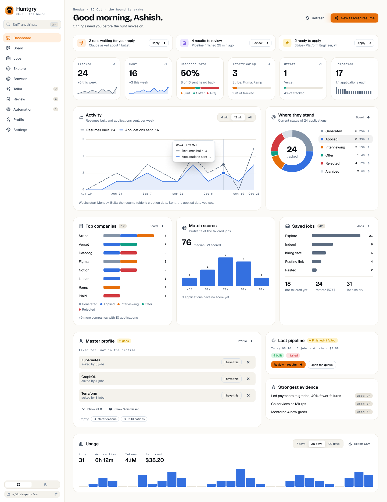
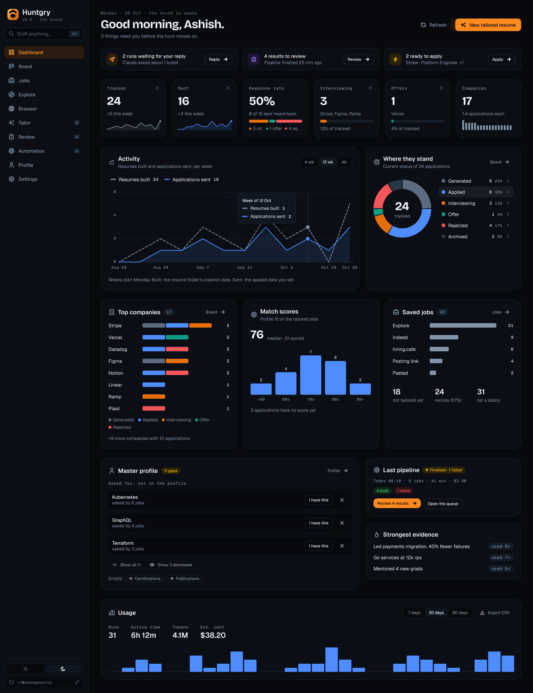
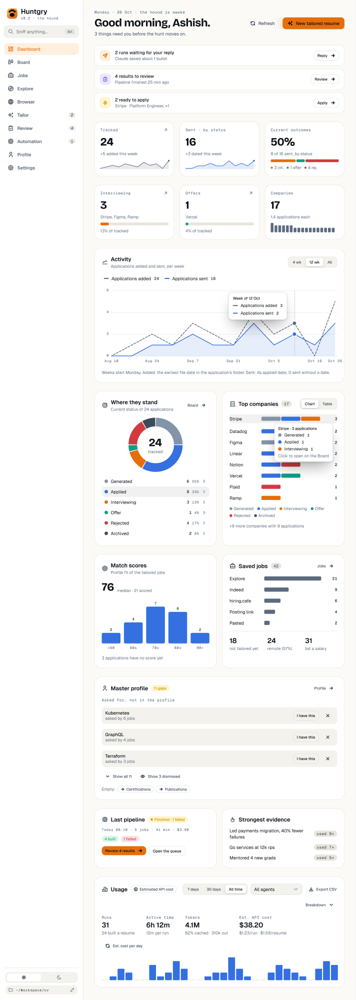
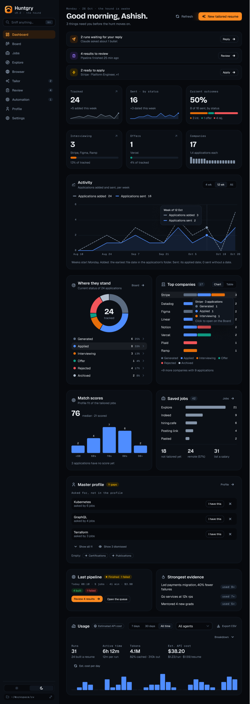
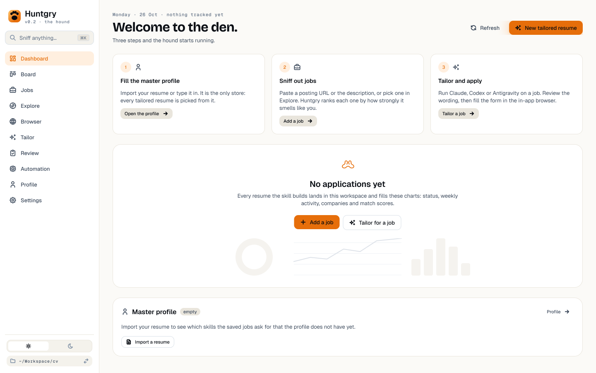
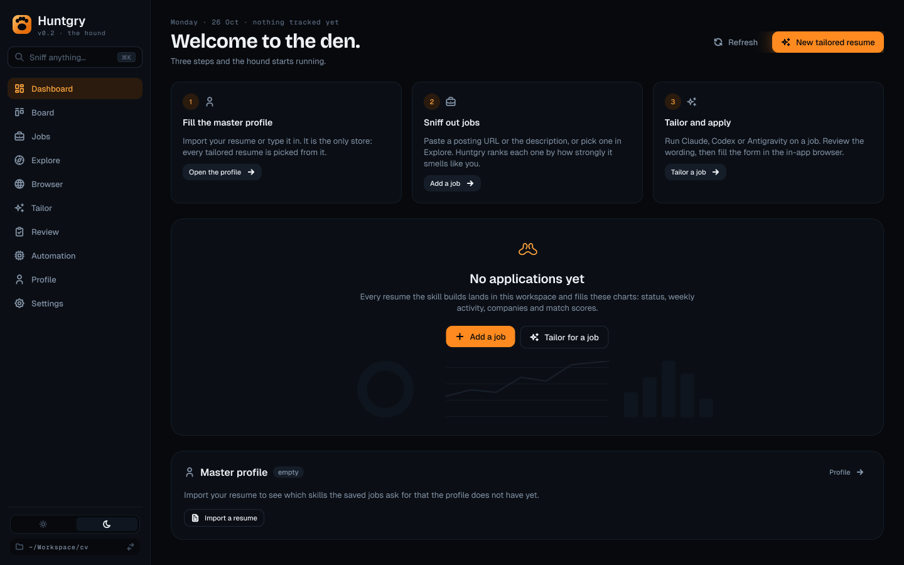

# Dashboard redesign: stats and charts (round 2)

Issue: [#181](https://github.com/silentashish/huntgry/issues/181) · Epic [#180](https://github.com/silentashish/huntgry/issues/180) · Review: [#182](https://github.com/silentashish/huntgry/issues/182) · Implementation: [#183](https://github.com/silentashish/huntgry/issues/183)

Figma: [Huntgry — Product & Website Design](https://www.figma.com/design/zhNccc831dRnOhj2tmqqkc), pages **🖥 App · Light** and **🖥 App · Dark**, frames named `Dashboard v3 …`, under the round-1 frames (`Dashboard v2 …`, kept for history).

| Frame | Light | Dark |
| --- | --- | --- |
| Wide (1440) | [68:2](https://www.figma.com/design/zhNccc831dRnOhj2tmqqkc/?node-id=68-2) | [68:712](https://www.figma.com/design/zhNccc831dRnOhj2tmqqkc/?node-id=68-712) |
| Narrow (1024) | [69:2](https://www.figma.com/design/zhNccc831dRnOhj2tmqqkc/?node-id=69-2) | [69:714](https://www.figma.com/design/zhNccc831dRnOhj2tmqqkc/?node-id=69-714) |
| Empty (cold start) | [66:2691](https://www.figma.com/design/zhNccc831dRnOhj2tmqqkc/?node-id=66-2691) | [66:2865](https://www.figma.com/design/zhNccc831dRnOhj2tmqqkc/?node-id=66-2865) |

## What changed since round 1

The owner asked for a Dashboard that **summarises the hunt with stats and charts** (totals, companies,
where things stand) rather than one that lists specific jobs. Round 1's job lists are gone, and with
them most of the review findings:

| Round-1 block | Round 2 | Review finding it settles |
| --- | --- | --- |
| Pipeline funnel with "share of previous stage" bars | **Where they stand** donut of *current* statuses, which sum to the total | Codex and Antigravity (high): current-status counts are partitions, not cohort milestones |
| Fresh matches (top Explore rows) | Removed. The Dashboard never reads Explore | Codex (medium), Antigravity (high): no cache-only Explore API; staleness |
| This week (latest change per application, with times) | **Activity** chart: applications added per week (`createdAt`) and applications sent per week (`appliedAt`, a date) | Codex and Antigravity (high): fabricated times and history |
| Automation card absorbing Last pipeline, "$3.90 of $10 today" | Removed. **Last pipeline** stays today's card, unchanged | Codex and Antigravity (medium): per-run cap; manual pipelines |
| Master profile "top 3 + Show all · 3 marked not me" | Today's **ProfileInsightsCard**, unchanged (show all, show dismissed and restore, empty-section links, "Already in your Gaps & notes") | Codex and Antigravity (medium): "nothing is dropped" was not true |
| Compact Usage strip | Today's **UsageCard**, unchanged | — |
| First-hunt frame with the profile done and Explore as step 2 | True cold start: empty profile, today's FirstHunt steps (Add a job / Open Jobs), every other card shown by its own data | Codex (medium) |

## Layout

| Light, 1440 | Dark, 1440 |
| --- | --- |
|  |  |

| Narrow 1024, light | Narrow 1024, dark |
| --- | --- |
|  |  |

| Empty (cold start), light | Empty (cold start), dark |
| --- | --- |
|  |  |

From top to bottom:

1. **Header** (unchanged).
2. **Needs you** (today's `NeedsYouStrip`): one card per item, equal heights. Below 1280 px they stack
   one per row, so a long line never wraps into a tall card.
3. **Stat cards**, six in a row (3 × 2 below 1280 px):
   - **Tracked**: every application. "+N added this week", and a 12-week sparkline of applications added.
   - **Sent · by status**: applications whose status is now applied, interviewing, offer or rejected.
     "+N dated this week", and a 12-week sparkline of the `appliedAt` dates. It is a current-status
     count, not an all-time total: archiving a sent application lowers it.
   - **Current outcomes**: (interviewing + offer + rejected) ÷ Sent, shown with its denominator ("8 of 16
     sent, by status") and a split bar of the three parts. It is not a response rate and makes no claim
     about responses in the past.
   - **Interviewing** and **Offers**: current counts, the companies (`listNames`), and a bar of their
     share of Tracked.
   - **Companies**: distinct companies, applications per company, and a strip of one bar per company.

   Tracked, Interviewing and Offers open the Board as the tiles do today (`kpiColumn`). Sent and Current
   outcomes are information only, because no Board destination shows four columns at once. Applied,
   Rejected and Archived each open their column from the donut's legend rows.
4. **Activity** (line chart, wide) and **Where they stand** (donut).
   - Activity has two series on one axis, applications added and applications sent per week, with a
     4 wk / 12 wk / All range. Hovering or focusing a week shows a crosshair and a tooltip with both
     counts.
   - Where they stand shows all six statuses. Its legend rows (count, share) are buttons that open the
     Board column.
5. **Top companies**, **Match scores**, **Saved jobs**, three equal cards (two per row below 1280 px):
   - Top companies: the eight companies with the most applications, each a bar stacked by status in the
     donut's colours and order, then "+N more companies with M applications".
     - **Chart / Table** toggle (visible, keyboard-operable) in the card header. The Table view lists each
       company with a count per status (six columns), so the breakdown never rests on colour alone. Its
       company names are buttons that open the same filtered Board as the chart rows.
     - In the Chart view each row is a button. Pointer hover and keyboard focus show the same tooltip
       ("Stripe · 3 applications: 1 Generated, 1 Applied, 1 Interviewing"), and the button opens the
       Board filtered by that company.
     - Segments have a 2 px surface gap, so every segment, Archived included, has a visible edge.
   - Match scores: a histogram of `tracking.match.profileFit` (< 60, 60s, 70s, 80s, 90+), the median, and
     "N applications have no score yet".
   - Saved jobs: saved jobs (dismissed ones left out) by source, then not tailored yet, remote, and with
     a salary.
6. Today's cards, unchanged: **Master profile** (ProfileInsightsCard), with **Last pipeline** and
   **Strongest evidence** in a 420 px column beside it (side by side below 1280 px), then **Usage**.
   The frames draw Usage with its real controls: 7 days / 30 days / All time, the agent select, Export
   CSV, Breakdown (on a second header row at narrow widths), each KPI's sub-line, and the cost/tokens toggle above the day chart. The unpriced and
   incomplete-turn notes and the Breakdown panel are unchanged too.

**Below ~1000 px window** (the app's minimum is 900): chart pairs stack to one column, and the donut's
legend goes under the ring (as in the narrow frame's donut card).

**Empty (no applications):** each block shows by its own data, as `index.tsx` does today.
- Needs you shows whenever it has items.
- FirstHunt (its three steps, Add a job / Open Jobs with the saved count) shows only with no applications.
- The stat cards and the Activity, Where they stand, Top companies and Match scores charts are hidden.
  In their place is the **No applications yet** card, with today's Add a job / Tailor for a job and a
  faint, decorative preview of the charts.
- Saved jobs shows as soon as one job is saved.
- Last pipeline shows whenever a pipeline has run, even if it built nothing.
- Master profile always shows.
- Usage shows when there is usage (`hideWhenEmpty`).

The frame draws the true cold start: empty profile, nothing saved, no runs.

## Data: every number, and where it comes from

The Dashboard keeps its two existing reads, `api.applications.list()` and `api.jobs.list()`; FirstHunt
already makes the second. It adds no store, no IPC and no network call. The calculations live in pure
functions in `summary.ts` (or a new `stats.ts`), unit-tested on fixtures.

| Number | Rule |
| --- | --- |
| Tracked | `applications.length`, archived included |
| This week | From Monday 00:00 local time, the same bucket as the chart's last week |
| Tracked +N | `createdAt` this week |
| Sent | status ∈ {applied, interviewing, offer, rejected} |
| Sent +N, Sent sparkline, Activity "sent" | `tracking.appliedAt` (`YYYY-MM-DD`) of every application that has one, archived included, per week. Sent (the card) is by status, so the two can differ; the chart's footnote names the difference ("N sent without a date"). Huntgry never invents a date. Main sets `appliedAt` the first time the status becomes applied. An application moved straight to Interviewing or Rejected has none, and its drawer's date field is how the user adds the real one. |
| `appliedAt` day | Main writes it with `toISOString().slice(0, 10)`, a UTC date, so on a Sunday evening in the Americas it can already read Monday. #183 changes the writer to the local date (with a test at that boundary); dates written before stay as they are, and the spec accepts that. |
| Activity "added", Tracked sparkline | `createdAt` per week. The scanner sets it to the earliest file time in the application's folder (`scan.ts`), so it says when the application was added, not when its resume was built. Series, tooltip, table and copy all say "added". |
| Current outcomes | (interviewing + offer + rejected) ÷ Sent, by current status, with the denominator shown; "—" while Sent is 0. No claim about past responses: archived applications are in neither count. |
| Interviewing, Offers | Current counts; share = count ÷ Tracked |
| Companies | Distinct `company`, trimmed and compared case-insensitively; "N applications each" = Tracked ÷ Companies, one decimal |
| Where they stand | Counts per status; they sum to Tracked |
| Top companies | Count per company, highest first, ties alphabetical; eight rows; segments by current status |
| Match scores | `tracking.match.profileFit` of applications that have `match`; median of those |
| Saved jobs | `jobs.filter(j => !j.dismissed)`; sources `jobright` → Explore, `indeed`, `hiring.cafe`, `url` → Posting link, `pasted` (the Board's `BOARD_SOURCE_LABEL` says Jobright and Link; #183 picks one wording for both); not tailored = no `tailoredAt`; remote = `remote` or `workplaceType === 'Remote'` (the type's casing; a fixture covers `remote: false, workplaceType: 'Remote'`); with a salary = non-empty `salary` |

When the scan was truncated (`list.truncated`), today's warning shows under the stat cards, and every
chart's footnote adds "may be incomplete".

Board links: the Board takes only `column` and `applicationId` today (`PageParams['board']`). A company
row opening the Board filtered by that company needs a `text` parameter (`PageParams['board'].text`,
applied as `BoardFilter.text`), which #183 adds. The Board hides archived cards a week after they were
archived (`ARCHIVE_TTL_DAYS`), so Archived on the Board can show fewer cards than the donut counts. The
donut's tooltip for Archived says so.

## Colour

The charts use one categorical palette for the statuses, in this order, in every chart. I checked it
with the dataviz palette validator (lightness band, chroma, CVD separation of adjacent pairs, normal
vision, contrast against the card surface):

| Status | Light (on #ffffff) | Dark (on #0b0f15) |
| --- | --- | --- |
| Generated | ink-300 `#8494a8` (neutral) | ink-400 `#5b6b80` (neutral) |
| Applied | blue-600 `#3470e0` | blue-500 `#4f8dff` |
| Interviewing | ember-600 `#e66e0a` | ember-600 `#e66e0a` |
| Offer | trail-600 `#0e9e85` | trail-600 `#0e9e85` |
| Rejected | red-600 `#d23a40` | red-500 `#f2555a` |
| Archived | ink-500 `#3d4a5c` (neutral) | ink-200 `#b3bfce` (neutral) |

- Applied, Interviewing, Offer and Rejected pass every check in both modes. The worst adjacent pair is
  Offer ↔ Rejected: ΔE 9.5 (deutan) in light, 9.9 (protan) in dark.
- The Board pills use violet for Interviewing and green for Offer. The validator fails violet next to
  blue (ΔE 0.6 under deuteranopia), so the charts use ember and trail. The pills keep their colours,
  since they always carry a text label.
- Single-series charts (sparklines, Saved jobs, Match scores, Usage) use the neutral ink or blue, so no
  colour means two things.
- Text never takes a series colour. Small text (axis ticks, footnotes, legend shares) uses
  `--hg-text-muted` in light (5.4:1 on white) and `--hg-text-secondary` in dark (`#8494a8`, 6.2:1). It
  never uses `--hg-text-muted` in dark (3.5:1).
- Every colour has a label beside it (legend rows with counts, direct labels on the histogram), so no
  meaning rests on colour alone.

## Interaction and accessibility

- Stat cards that link are today's `KpiTile` buttons, with labels like "Interviewing: 3, Stripe, Figma and Ramp. Open on
  the Board". Sent, Current outcomes and Companies are not buttons.
- Every chart is a `<figure>` with a heading and an `aria-label` summary, for example "Activity, 12
  weeks: 24 applications added, 16 applications sent". A visually hidden `<table>` of the same numbers
  follows it.
- Sparklines, the companies strip and the empty state's preview are `aria-hidden`.
- Activity: the plot is one focusable element, and ← / → move the highlighted week. The tooltip follows
  the pointer or the focus, and an `aria-live="polite"` region reads the week. The range control is a
  Mantine `SegmentedControl`.
- Donut legend rows are buttons, for example "Applied: 8, 33%. Open on the Board". Hovering a row lifts
  its segment, and hovering a segment highlights its row.
- Focus order follows the DOM, the same at every width: header, Needs you, stat cards, Activity, Where
  they stand, Top companies, Match scores, Saved jobs, Master profile, Last pipeline, Strongest
  evidence, Usage. Each card is a `<section>` named by its heading.

## Implementation notes for #183

- The charts are small SVG components in `components/charts/`: `Sparkline`, `LineChart`, `Donut`,
  `StackedBar`, `Histogram`. They are drawn with the tokens above. UsageCard already draws its own bars,
  so no chart library is added. Recharts through `@mantine/charts` is the alternative (settled in **Decisions from round 2**).
- Each chart's data comes from a pure function, for example `weeklySeries(apps, range, now)`,
  `statusCounts`, `topCompanies(apps, 8)`, `fitHistogram`, `savedJobStats(jobs)`. Unit tests cover week
  edges (Sunday 23:59 vs Monday 00:00), applications without `appliedAt`, and duplicate company names
  that differ only in case.
- e2e: the Dashboard spec checks Tracked and the donut counts against the fixture workspace, a legend
  row opening its Board column, and the cold start hiding the charts.

## Decisions from round 2

- Response rate: renamed **Current outcomes**, with the denominator visible and no historical claim
  (Codex). Antigravity's case for keeping the number is met the same way.
- Missing `appliedAt`: Antigravity suggested stamping today when a status skips Applied; Codex warned
  that would invent a send date. Huntgry never invents one: the footnote counts undated applications,
  the drawer takes the real date, and #183 fixes the UTC writer.
- Charts: small SVG components, with no chart library. Both reviewers agreed.
- Order: needs you → stats → activity and status → companies, scores and saved jobs → today's cards.
  Both reviewers agreed.

## Questions for the reviewers

1. Does a Table view on Top companies alone suffice, or should every chart card get the same Chart /
   Table toggle? Each one already has a hidden table.
